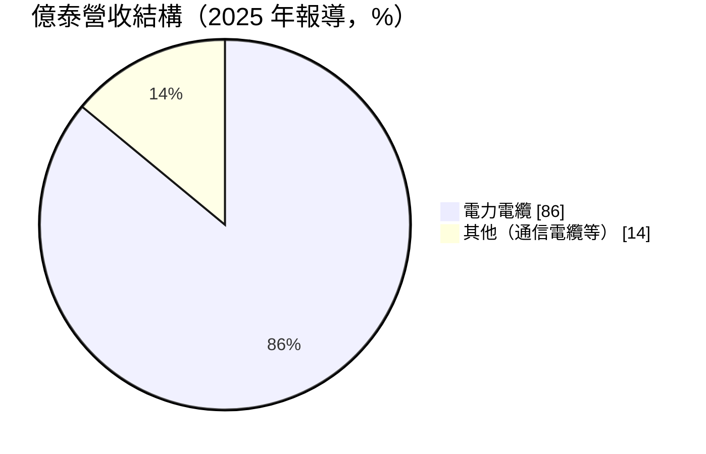
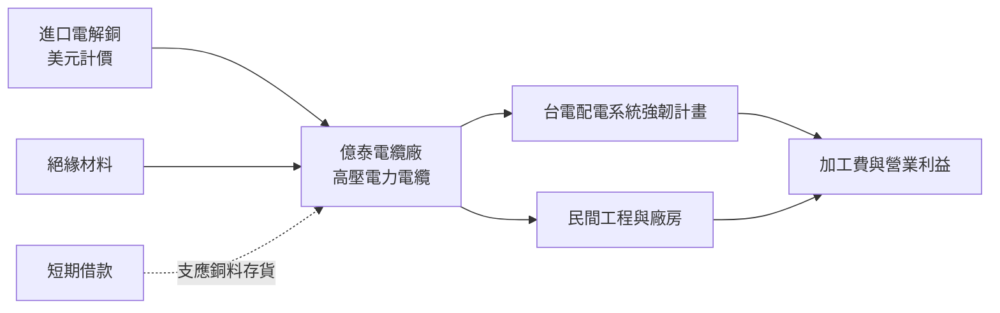
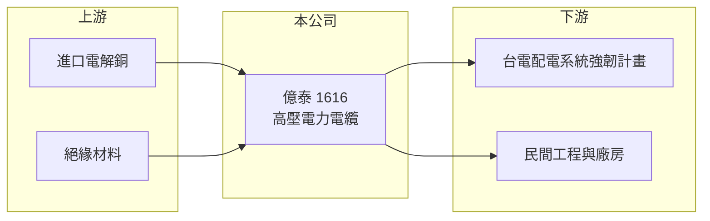

# 1616 億泰

> 上市｜[[產業索引-電器電纜|電器電纜]]｜上市（櫃）日期 2000/09/11

# 第一章：企業模式與商業藍圖

> [!info] 撰寫說明
> 本文由 Claude 依公開資料整理，架構比照 [[2330台積電]] 的四章研究，資料截至 2026-10-08。財務數字來源：Goodinfo 年度經營績效頁、自由時報 2025 年 6 月報導、證交所開放資料（基本資料、2026 年第二季資產負債與綜合損益、營益分析、股利、本益比）。公開資料有限，產業描述為整理性內容，尚未逐條比對原始文件。#待校對

在評估單一個股的長期投資價值時，首要步驟是拆解企業的底層獲利邏輯。本章說明億泰電線電纜（股票代號：1616，以下簡稱億泰）如何從長期微利的電纜廠，在台電電網強化計畫中轉為穩定獲利。

## 一、核心定位：以電力電纜為主的中型線纜廠

億泰成立於 1988 年，2000 年上市，實收資本額約 19.41 億元，董事長為王銀河。依 2025 年 6 月的報導，億泰約 86% 的營收來自電力電纜，主要受惠台電「配電系統強韌計畫」的高壓電力電纜訂單，當時在手訂單超過 20 億元。財經網站也將億泰描述為光纖電纜與電線電纜製造商，顯示公司另有通信相關產品（產品細項待校對）。

億泰是典型的「銅價加加工費」型電纜廠。報導指出，銅料占原物料成本約 60% 至 95%，台灣不產銅、仰賴進口並以美元計價，因此銅價與匯率是影響億泰成本最大的兩個變數。2019 至 2020 年公司接近虧損，2023 年後隨著台電[[強韌電網計畫]]的訂單放量，獲利才明顯改善。

## 二、產品板塊

依 2025 年 6 月報導的營收比重（其他為推算的剩餘比重）：

* **電力電纜：** 以高壓[[交連PE電纜]]為主，供應台電配電系統強化工程，也供應民間工程與廠房。
* **其他線材：** 包括通信電纜等產品（推估），比重較小。

## 三、資本轉化邏輯：高度依賴營運資金的加工模式

* **[[銅價轉嫁]]：** 電纜售價以銅價為基礎，億泰賺取的是加工費。銅料占成本比重極高，因此銅價上漲時營收膨脹，但毛利率不一定提高；轉嫁時間差反而可能產生庫存利益或損失。
* **營運資金需求大：** 2026 年第二季底流動負債約 24.1 億元，幾乎等於全部負債，權益約 20.6 億元（證交所開放資料），推估多數為支應銅料採購的短期借款。銅價越高，需要的周轉資金越多。

## 四、企業長期藍圖

億泰的長期成長主要繫於台電配電系統的更新需求。強韌電網計畫是十年期的電網投資，配電電纜屬於數量最大的品項之一，只要億泰維持供應資格與交期，訂單能見度相對穩定。報導也提到公司持續進行資產活化，但未提供細節。整體而言，億泰的策略偏向專注本業，沒有大規模轉型或跨足其他產業的公開計畫。

# 第二章：護城河深度與競爭優勢

本章分析億泰的競爭地位，以及它在台電標案競爭中的處境。

## 一、護城河的核心組成要素

* **台電供應資格：** 高壓電力電纜需通過台電的型式試驗與品質審核，取得資格後才能參與標案，這是新進廠商的門檻。
* **專注配電市場：** 億泰集中在配電等級的高壓電纜，規模雖小，但能在特定品項上維持產能與成本效率（推估）。

整體而言，億泰的護城河很淺。產品規格化、競爭者多、客戶集中，議價能力有限，2019 至 2022 年營業利益率只有 -2% 至 4%，說明在需求平淡時幾乎沒有超額利潤。

## 二、主要競爭對手格局

| 對手 | 定位 | 對億泰的影響 |
|---|---|---|
| [[1605華新]] | 台灣最大線纜廠 | 規模與原料採購優勢 |
| [[1609大亞]] | 電力電纜、漆包線、綠能 | 民間與台電訂單皆強 |
| [[1618合機]]、[[1612宏泰]] | 高壓與超高壓電纜 | 高壓標案競爭 |
| [[1603華電]]、[[1615大山]]、[[1608華榮]] | 中高壓與配電電纜 | 配電標案直接競爭 |

## 三、優勢轉化：守得住、守不住與觀察重點

* **守得住：** 強韌電網計畫期間的配電電纜訂單，需求量大且持續數年。
* **守不住：** 標案價格與毛利。計畫高峰過後，若需求回落，億泰可能再回到微利狀態。
* **觀察重點：** 第一，在手訂單能否持續補充；第二，毛利率能否維持在 10% 以上；第三，資產活化的內容與對獲利的影響。

# 第三章：財務體質與盈利規模

資料日期：2026-10-08。數字取自 Goodinfo 年度經營績效頁、自由時報報導與證交所開放資料，表格是撰寫當時的快照；最新月營收、毛利率、累計 EPS 由自動排程寫在本筆記的屬性欄位（月營收、毛利率、累計EPS 等）。#待校對

財務報表是檢驗護城河是否真實存在的最終標準。本章檢視億泰在電網投資循環中的獲利轉折。

## 一、多年度財務摘要

| 年度 | 營收（新台幣） | [[毛利率]] | [[營業利益率]] | EPS（元） | [[ROE]] |
|---|---|---|---|---|---|
| 2019 | 31.5 億 | 4.73% | -2.09% | -0.31 | -3.70% |
| 2020 | 26.8 億 | 4.78% | -1.13% | 0.01 | 0.11% |
| 2021 | 32.1 億 | 8.67% | 3.79% | 0.50 | 6.10% |
| 2022 | 37.2 億 | 7.94% | 3.06% | 0.10 | 1.14% |
| 2023 | 41.1 億 | 11.5% | 7.42% | 1.19 | 12.8% |
| 2024 | 45.9 億 | 10.8% | 3.50% | 2.04 | 19.0% |
| 2025 | 52.1 億 | 15.0% | 10.7% | 1.55 | 13.3% |
| 2026 上半年 | 27.9 億 | 9.44% | 5.81% | 0.54 | 未查得 |

* **獲利轉折：** 2019 至 2022 年營業利益率在 -2% 至 4% 之間，2023 年起隨台電訂單增加，2025 年提高到 10.7%。不過 2026 年上半年又回落到 5.81%，說明利潤率對銅價與標案價格非常敏感。
* **業外影響：** 2024 年營業利益率只有 3.5%，EPS 卻達 2.04 元，推估有資產處分或匯兌等業外收益（具體來源未查得）。2025 年 5 月的獲利也與匯兌利益有關（自由時報）。
* **營收成長：** 2020 至 2025 年營收年複合成長率約 14.2%（推算），一部分來自銅價上漲。

## 二、[[ROE]]：資本效率

2021 至 2025 年平均 ROE 約 10.5%（推算），但年度間從 1% 到 19% 大幅跳動。億泰的權益規模小（約 20.6 億元），保留盈餘只有約 1.8 億元（2026 年第二季底），代表過去長期微利，資本累積有限；近年的高 ROE 一部分來自短期借款帶來的財務槓桿，負債比約 54%。

## 三、股利與現金流

2025 年度配發現金股利約 1.36 元（證交所股利資料），以 EPS 1.55 元計算配發率約 88%（推算）。在保留盈餘偏低的情況下維持高配息，代表公司保留的資本不多，銅價大漲時需要更多借款支應營運資金。

## 四、[[ROIC]] 與 [[WACC]]：價值創造利差

**ROIC 推算：** 2025 年營收 52.1 億元乘以營業利益率 10.7%，營業利益約 5.57 億元，扣除 20% 稅率後約 4.46 億元。權益約 20.6 億元，假設總負債中約六成為有息負債（推估，約 14.5 億元），投入資本約 35.1 億元，ROIC 約 12.7%（推算）。若以 2026 年上半年 5.81% 的營業利益率估算，ROIC 約 6% 至 7%（推算）。

**WACC 推算：** 台灣 10 年期公債殖利率取 1.75%、市場風險溢酬 6%、β 取 1.0（推估），股東權益成本約 7.75%；負債成本 2.5%，稅後約 2.0%；權益約占 59%、負債約占 41%，WACC 約 5.4%（推算）。

**結論：** 2025 年億泰的 ROIC 明顯高於 WACC，是公司多年來少見的價值創造期，但這主要來自電網投資高峰與銅價上漲。拉長到 2019 至 2025 年，平均 ROIC 推估接近或低於資金成本。對長期投資人而言，億泰屬於週期性很強的電纜股，價值創造能否延續取決於強韌電網訂單的持續性。

# 第四章：總體風險與地緣政治

任何企業都無法脫離宏觀環境獨立存在。本章分析億泰長期面對的產業、原物料與財務風險。

## 一、產業週期與市場結構

* **客戶集中：** 營收高度依賴台電配電工程，台電預算、標案節奏與付款條件的變化，對億泰的影響大於規模較大的同業。
* **計畫週期：** 強韌電網計畫結束或放緩後，配電電纜需求可能回到過去的平淡水準，億泰歷史上曾在這種環境下接近虧損。

## 二、原物料與匯率風險

* **銅價：** 銅料占原物料成本 60% 至 95%，銅價的劇烈波動會直接影響毛利，標案價格固定而銅價上漲時，獲利可能被侵蝕。
* **匯率：** 進口銅以美元計價，新台幣貶值會提高成本，升值則可能產生匯兌損失或利益，增加獲利的不確定性。

## 三、財務結構風險

* **短期借款比重高：** 負債幾乎都是流動負債，利率上升或銀行緊縮信用時，營運資金成本與調度壓力會增加。
* **資本累積薄弱：** 保留盈餘偏低，若高配息政策持續，遇到景氣反轉時緩衝有限。

# 專有名詞解析

## 金融

- **[[毛利率]]**：營業毛利占營收的比例，反映產品定價能力與生產成本控制。
- **[[營業利益率]]**：扣除營業費用後的營業利益占營收的比例，衡量本業整體獲利能力。
- **[[ROE]]**：股東權益報酬率，稅後淨利除以股東權益，衡量公司運用股東資金的效率。
- **[[ROIC]]**：投入資本報酬率，稅後營業利益除以股東權益與有息負債的合計，衡量本業對所有資金提供者的報酬。
- **[[WACC]]**：加權平均資金成本，依股東權益與負債的比重加權計算的資金成本，ROIC 高於它才代表創造價值。

## 產業

- **[[交連PE電纜]]**：以交連聚乙烯（XLPE）作為絕緣層的電力電纜，耐熱與絕緣性能佳，是中高壓與超高壓輸配電的主流電纜。
- **[[強韌電網計畫]]**：台電在 2022 年大停電後提出的十年電網強化計畫，投入大量預算更新輸變電設備。
- **[[銅價轉嫁]]**：電線電纜廠把銅價變動反映到售價的機制，通常以報價時銅價加上加工費計價，轉嫁速度決定毛利穩定度。

# 核心供應鏈

## 1. 上游：原料
- 進口電解銅（美元計價）
- 絕緣材料，石化供應商如 [[1301台塑]]、[[1304台聚]]

## 2. 本公司與同業
- 同業：[[1605華新]]、[[1609大亞]]、[[1618合機]]、[[1612宏泰]]、[[1603華電]]、[[1615大山]]、[[1608華榮]]

## 3. 下游：客戶
- 台電：配電系統強韌計畫
- 民間工程、廠房與營建業者

## 最新新聞
<!-- news:start -->
<!-- news:end -->

## 相關連結
- [公開資訊觀測站](https://mopsov.twse.com.tw/mops/web/t05st03?step=1&firstin=1&co_id=1616)
- [Goodinfo](https://goodinfo.tw/tw/StockDetail.asp?STOCK_ID=1616)
- [Yahoo 股市](https://tw.stock.yahoo.com/quote/1616)
- [鉅亨網新聞](https://www.cnyes.com/twstock/1616/news)
