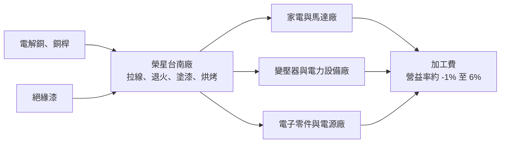
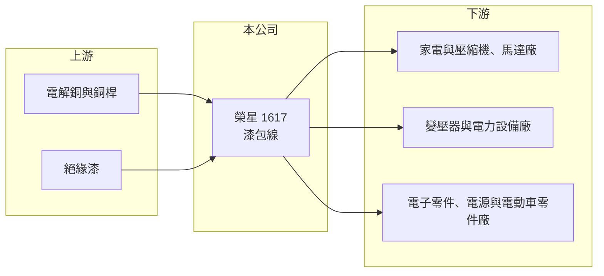

# 1617 榮星

> 上市｜[[產業索引-電器電纜|電器電纜]]｜上市（櫃）日期 2000/09/11

# 第一章：企業模式與商業藍圖

> [!info] 撰寫說明
> 本文由 Claude 依公開資料整理，架構比照 [[2330台積電]] 的四章研究，資料截至 2026-10-08。財務數字來源：Goodinfo 年度經營績效頁、nStock 公司頁、證交所開放資料（基本資料、2026 年第二季資產負債與綜合損益、營益分析、股利、本益比）。公開資料有限，查得的資料未揭露產品細項、客戶與產能，產業描述為整理性內容。#待校對

在評估單一個股的長期投資價值時，首要步驟是拆解企業的底層獲利邏輯。本章說明榮星電線工業（股票代號：1617，以下簡稱榮星）作為專業漆包線廠的商業模式，以及這個產業為何長期薄利。

## 一、核心定位：台南的專業漆包線廠

榮星成立於 1971 年，總部位於台南仁德，1979 年獲准引進外國人投資，2000 年上市，實收資本額約 16.95 億元，董事長為王東澤。公司的主要營業項目是[[漆包線]]的製造、加工與銷售。

漆包線是在銅線表面塗上多層絕緣漆的導線，用來繞製馬達、變壓器、電感、繼電器等元件的線圈。幾乎所有需要「電生磁」或「磁生電」的產品都會用到漆包線，從家電壓縮機、電風扇、工業馬達，到電動車驅動馬達與電源供應器。因此榮星的需求與家電、工業設備、電子與電動車產業的景氣密切相關，而不是像電力電纜廠那樣依賴台電的電網投資。

## 二、產品與收入結構

榮星的業務集中在漆包線單一產品線，查得的資料未揭露細部的規格或應用比重，因此本章不放圓餅圖。以產業分類整理，漆包線的應用大致可分為：

* **家電與馬達用：** 壓縮機、風扇、洗衣機馬達等，量大但價格競爭激烈。
* **工業與電力用：** 變壓器、工業馬達與發電設備，規格要求較高。
* **電子與新能源用：** 電源供應器、電感、電動車馬達等，對耐熱等級、絕緣厚度與尺寸精度要求高，附加價值較高。

漆包線的售價同樣以銅價加上加工費計算，因此營收會隨銅價大幅波動。2026 年 1 至 8 月營收約 28.15 億元、年增約 30.5%（nStock 整理），一部分反映銅價上漲。

## 三、資本轉化邏輯：薄利的銅加工

* **[[銅價轉嫁]]：** 銅占漆包線成本的大部分，榮星的利潤是每公斤的加工費。加工費受產能供需影響，同業產能過剩時很難調升。
* **營運資金：** 銅價上漲時，同樣的出貨量需要更多資金買銅，存貨與應收帳款增加，現金流會被占用。

## 四、企業長期藍圖

查得的資料未揭露榮星的具體長期策略。從產業趨勢看，漆包線的長期成長機會在於電動車驅動馬達、再生能源設備與高效率工業馬達，這些應用需要耐高溫、耐高壓的特殊規格產品，加工費較一般家電用線高。榮星能否提升高規格產品比重，是本業利潤率能否走出低檔的關鍵。

# 第二章：護城河深度與競爭優勢

本章分析榮星在漆包線市場的競爭地位。

## 一、護城河的核心組成要素

* **長期經營與客戶關係：** 榮星經營漆包線超過半世紀，與國內家電、馬達與電子零件廠建立長期供貨關係，交期與品質穩定是客戶選擇供應商的重要考量。
* **財務保守：** 2026 年第二季底總負債約 10.4 億元、權益約 23.3 億元，負債比約 31%（證交所開放資料），能承受銅價波動帶來的營運資金壓力。

不過漆包線產品高度標準化，中國與東南亞產能龐大，榮星缺乏明顯的成本或技術護城河。2022 至 2025 年營業利益率在 -1.2% 至 1.1% 之間，說明本業幾乎沒有超額利潤。

## 二、主要競爭對手格局

| 對手 | 定位 | 對榮星的影響 |
|---|---|---|
| [[1609大亞]] | 電力電纜為主，漆包線約占一成 | 國內漆包線市場的主要對手，切入新興應用 |
| [[1605華新]] | 台灣最大線纜與銅材廠 | 銅原料與規模優勢 |
| 中國漆包線廠 | 全球最大漆包線產能 | 以低價主導一般規格市場 |
| 日本與歐洲特殊漆包線廠 | 高耐熱與電動車用規格 | 主導高附加價值市場 |

## 三、優勢轉化：守得住、守不住與觀察重點

* **守得住：** 國內既有客戶的穩定訂單與在地交貨服務。
* **守不住：** 一般規格漆包線的加工費。在中國產能壓力下，加工費長期偏低。
* **觀察重點：** 第一，營業利益率能否穩定轉正並提高到 3% 以上；第二，電動車與工業馬達等高規格產品的比重；第三，業外收益在獲利中的角色。

# 第三章：財務體質與盈利規模

資料日期：2026-10-08。數字取自 Goodinfo 年度經營績效頁、nStock 公司頁與證交所開放資料，表格是撰寫當時的快照；最新月營收、毛利率、累計 EPS 由自動排程寫在本筆記的屬性欄位（月營收、毛利率、累計EPS 等）。#待校對

財務報表是檢驗護城河是否真實存在的最終標準。本章檢視榮星在漆包線景氣循環中的獲利表現。

## 一、多年度財務摘要

| 年度 | 營收（新台幣） | [[毛利率]] | [[營業利益率]] | EPS（元） | [[ROE]] |
|---|---|---|---|---|---|
| 2019 | 29.1 億 | 11.9% | 3.21% | 0.62 | 5.15% |
| 2020 | 29.8 億 | 14.4% | 6.48% | 1.02 | 8.41% |
| 2021 | 46.2 億 | 12.0% | 5.83% | 1.45 | 11.0% |
| 2022 | 35.8 億 | 7.03% | -1.19% | 0.33 | 2.00% |
| 2023 | 28.3 億 | 7.99% | -0.92% | 0.09 | 0.10% |
| 2024 | 34.0 億 | 9.12% | 1.11% | 0.55 | 3.60% |
| 2025 | 33.6 億 | 7.23% | -0.03% | 0.68 | 4.75% |
| 2026 上半年 | 20.2 億 | 8.24% | 2.12% | 0.21 | 未查得 |

註：Goodinfo 顯示 2023 年 ROE 為 0.1%，與 EPS 0.09 元、每股淨值約 13 元推算的約 0.7% 不一致，建議以年報核對。

* **景氣循環明顯：** 2020 至 2021 年疫情期間家電與電子需求暢旺，毛利率達 12% 至 14%；2022 年需求反轉後，毛利率降到 7% 左右，營業利益轉為虧損。
* **業外支撐 EPS：** 2022 至 2025 年營業利益接近零或為負，但每年 EPS 仍為正，代表有利息、股利或其他業外收入（來源未查得）。
* **營收成長：** 2020 至 2025 年營收年複合成長率約 2.4%（推算），長期大致持平。

## 二、[[ROE]]：資本效率

2021 至 2025 年平均 ROE 約 4.3%（推算），扣除 2021 年的高點後更低。榮星的財務結構保守，ROE 偏低主要是本業獲利不足，而不是資本過多。2026 年第二季底保留盈餘約 4.1 億元、其他權益約 -0.4 億元（證交所開放資料）。

## 三、股利與現金流

2025 年度配發現金股利 0.6 元，2024 年度 0.5 元，配發率約九成（nStock 整理）；近五年平均現金股利約 0.5 元。在本業微利的情況下維持穩定配息，代表公司把大部分盈餘都發還股東，保留的成長資本有限。

## 四、[[ROIC]] 與 [[WACC]]：價值創造利差

**ROIC 推算：** 2025 年營業利益率為 -0.03%，營業利益約 -0.01 億元，ROIC 約 0%（推算）。若以 2026 年上半年營業利益約 0.43 億元年化計算，稅後營業利益約 0.69 億元；權益約 23.3 億元，假設總負債中一半為有息負債（推估，約 5.2 億元），投入資本約 28.5 億元，ROIC 約 2.4%（推算）。

**WACC 推算：** 台灣 10 年期公債殖利率取 1.75%、市場風險溢酬 6%、β 取 1.0（推估），股東權益成本約 7.75%；負債成本 2.5%，稅後約 2.0%；權益約占 82%、負債約占 18%，WACC 約 6.7%（推算）。

**結論：** 2022 年以來榮星的 ROIC 接近零，明顯低於資金成本，本業處於「消耗價值」的狀態，只有在 2020 至 2021 年的景氣高峰期 ROIC 才接近或略高於 WACC（推估）。長期價值改善的前提，是加工費結構性提高或產品往高規格應用轉型。

# 第四章：總體風險與地緣政治

任何企業都無法脫離宏觀環境獨立存在。本章分析榮星長期面對的產業、原物料與競爭風險。

## 一、產業週期與市場結構

* **下游景氣循環：** 漆包線需求跟隨家電、馬達與電子產業的庫存週期起伏，疫情後的需求透支與庫存調整，曾讓榮星連續數年本業虧損。
* **中國產能過剩：** 中國是全球最大的漆包線生產國，產能擴張與低價出口會長期壓抑加工費。

## 二、原物料與營運風險

* **銅價波動：** 銅占成本大部分，價格急漲時營運資金占用增加，急跌時則可能提列存貨跌價損失。
* **匯率：** 銅以美元計價，新台幣升貶會影響進料成本與匯兌損益。
* **能源與環保：** 漆包線的塗漆與烘烤需要大量能源，並涉及揮發性有機物排放，環保法規趨嚴會提高營運成本。

## 三、科技演進風險

* **材料替代：** 部分應用可能以鋁漆包線替代銅，以降低成本與重量，廠商需要具備多種材料的生產能力。
* **規格升級：** 電動車與高效率馬達需要扁線、耐電暈等特殊漆包線，若無法跟上規格升級，將被排除在成長最快的市場之外。

# 專有名詞解析

## 金融

- **[[毛利率]]**：營業毛利占營收的比例，反映產品定價能力與生產成本控制。
- **[[營業利益率]]**：扣除營業費用後的營業利益占營收的比例，衡量本業整體獲利能力。
- **[[ROE]]**：股東權益報酬率，稅後淨利除以股東權益，衡量公司運用股東資金的效率。
- **[[ROIC]]**：投入資本報酬率，稅後營業利益除以股東權益與有息負債的合計，衡量本業對所有資金提供者的報酬。
- **[[WACC]]**：加權平均資金成本，依股東權益與負債的比重加權計算的資金成本，ROIC 高於它才代表創造價值。

## 產業

- **[[漆包線]]**：在銅線或鋁線表面塗上絕緣漆的導線，用來繞製馬達、變壓器與電感的線圈，需求與家電、工業與電動車相關。
- **[[銅價轉嫁]]**：電線電纜廠把銅價變動反映到售價的機制，通常以報價時銅價加上加工費計價，轉嫁速度決定毛利穩定度。

# 核心供應鏈

## 1. 上游：原料
- 電解銅與銅桿：[[1605華新]] 等銅材供應商與國際銅價
- 絕緣漆供應商

## 2. 本公司與同業
- 國內同業：[[1609大亞]]
- 中國、日本與歐洲漆包線廠

## 3. 下游：客戶
- 家電與壓縮機廠，如 [[4532瑞智]]（推估）
- 馬達、變壓器與電力設備廠，如 [[1504東元]]、[[1503士電]]（推估）
- 電子零件與電源供應器廠

## 最新新聞
<!-- news:start -->
<!-- news:end -->

## 相關連結
- [公開資訊觀測站](https://mopsov.twse.com.tw/mops/web/t05st03?step=1&firstin=1&co_id=1617)
- [Goodinfo](https://goodinfo.tw/tw/StockDetail.asp?STOCK_ID=1617)
- [Yahoo 股市](https://tw.stock.yahoo.com/quote/1617)
- [鉅亨網新聞](https://www.cnyes.com/twstock/1617/news)
