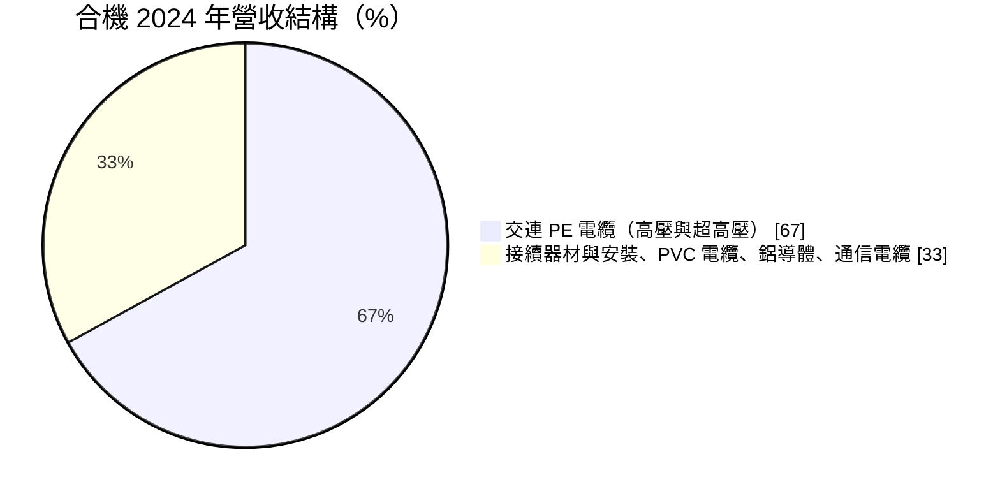
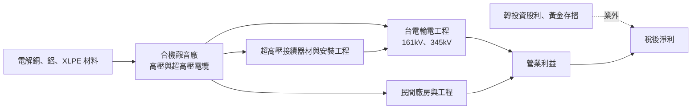
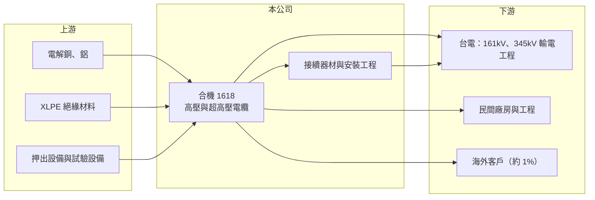

# 1618 合機

> 上市｜[[產業索引-電器電纜|電器電纜]]｜上市（櫃）日期 2000/09/11

# 第一章：企業模式與商業藍圖

> [!info] 撰寫說明
> 本文由 Claude 依公開資料整理，架構比照 [[2330台積電]] 的四章研究，資料截至 2026-10-08。財務數字來源：Goodinfo 年度經營績效頁、富果研究 2025 年 4 月法說會整理（內容為 2024 年營運）、證交所開放資料（基本資料、2026 年第二季資產負債與綜合損益、營益分析、股利、本益比）；產業描述為整理性內容，尚未逐條比對原始文件。#待校對

在評估單一個股的長期投資價值時，首要步驟是拆解企業的底層獲利邏輯。本章說明合機電線電纜（股票代號：1618，以下簡稱合機）如何以超高壓電纜切入台電輸電主幹，成為強韌電網計畫的主要受惠者之一。

## 一、核心定位：已具備 345kV 實績的超高壓電纜廠

合機的公司登記成立日為 1989 年（證交所基本資料），法說會資料則稱公司成立於 1968 年，推估是前身事業的起始年（待校對）。公司 2000 年上市，實收資本額約 19.27 億元，主要生產據點位於桃園觀音工業區。

合機最重要的產品是[[交連PE電纜]]，包括 6 至 35kV 的高壓電力電纜，以及 69kV 以上的[[超高壓電纜]]，2024 年占營收 67%，比 2023 年的 59% 明顯提高。2024 年超高壓電纜交貨量較前一年成長約 20%，其中 161kV 與 345kV 是成長重點。345kV 是台灣輸電網的主幹電壓，國內具備供應實績的廠商很少，這讓合機在台電[[強韌電網計畫]]中占有關鍵位置。公司 2024 年約 95% 的營業額來自國內，主要動能就是台電的電網投資。

## 二、產品板塊

依 2024 年資料，交連 PE 電纜占營收 67%，其餘產品合計約 33%（其他產品的個別比重未揭露）：

* **交連 PE 電纜：** 包含高壓與超高壓電力電纜，是公司的獲利核心。
* **超高壓接續器材與安裝工程：** 超高壓電纜在現場需要專業的接頭製作與安裝，這項服務毛利較高，也提高了客戶對單一供應商的依賴。
* **PVC 絕緣電纜、鋁導體電線：** 1kV 以下的 PVC 電纜、IV 線、控制線，以及裸鋁線、被覆鋁線等。
* **電信通信電纜：** 光纜與通信銅纜，比重較小。

## 三、資本轉化邏輯：超高壓電纜加上安裝服務

* **超高壓的高附加價值：** 超高壓電纜的絕緣層更厚、製程更精密，型式試驗時間長，加工費遠高於一般電纜。合機把產品組合往超高壓移動，是毛利率從 2019 年的 6% 提高到 2026 年上半年 32.8% 的主要原因。
* **[[銅價轉嫁]]：** 和同業一樣以銅價加上加工費報價，但超高壓電纜的加工費占售價比重較高，對銅價波動的敏感度相對較低（推估）。
* **廠房規劃：** 舊廠房已報廢拆除，改作倉儲，用於存放與包裝大型超高壓電纜，部分空間用於品保試驗。

## 四、企業長期藍圖

合機的策略相當集中：持續專注國內市場，特別是台電強韌電網計畫相關的超高壓電纜訂單，同時尋找新市場與客戶。公司在 2025 年法說會表示，期望當年營運與 2024 年「平穩相當」，實際上 2025 年營收約 48.2 億元、EPS 4.21 元，2026 年上半年營業利益率更提高到 28.47%。合機的長期價值，取決於台電輸電主幹投資能維持多久，以及公司能否把超高壓的技術能力延伸到海外或民間大型案場。

# 第二章：護城河深度與競爭優勢

本章分析合機的競爭優勢，以及超高壓電纜市場的進入門檻。

## 一、護城河的核心組成要素

* **345kV 供應實績：** 超高壓電纜需要專用的押出設備、長時間的型式試驗與多年的現場運轉實績，台電對供應商資格的審核非常嚴格。合機已有 161kV 與 345kV 的交貨實績，這是新進者需要數年才能追上的門檻。
* **安裝與接續能力：** 超高壓電纜的接頭與安裝品質直接影響電網可靠度，合機提供器材與安裝工程，形成「電纜加服務」的整合方案，提高轉換成本。
* **財務穩健：** 2026 年第二季底總負債約 22.4 億元、權益約 67.9 億元，負債比約 25%（證交所開放資料）。

這是線纜同業中相對較寬的護城河，但仍屬於「窄到中等」，因為競爭者正在積極擴充超高壓產能。

## 二、主要競爭對手格局

| 對手 | 定位 | 對合機的影響 |
|---|---|---|
| [[1605華新]] | 台灣最大線纜廠，具超高壓與海纜布局 | 345kV 市場的主要競爭者 |
| [[1612宏泰]] | XLPE 電纜，觀音新廠目標 345kV | 2027 年後可能成為新的超高壓競爭者 |
| [[1609大亞]] | 69kV、161kV 電力電纜 | 高壓與民間大型案場競爭 |
| 國際電纜廠（住友電工、LS 電纜等） | 全球超高壓與海纜 | 大型或特殊規格標案的潛在對手 |

## 三、優勢轉化：守得住、守不住與觀察重點

* **守得住：** 345kV 與 161kV 輸電電纜在台電的供應地位，以及安裝工程能力。
* **守不住：** 若宏泰等同業取得 345kV 資格，市場供給增加，目前偏高的利潤率可能回落。
* **觀察重點：** 第一，營業利益率能否在強韌電網計畫期間維持 15% 以上；第二，同業超高壓產能何時開出；第三，海外市場是否有突破。

# 第三章：財務體質與盈利規模

資料日期：2026-10-08。數字取自 Goodinfo 年度經營績效頁、富果研究法說會整理與證交所開放資料，表格是撰寫當時的快照；最新月營收、毛利率、累計 EPS 由自動排程寫在本筆記的屬性欄位（月營收、毛利率、累計EPS 等）。#待校對

財務報表是檢驗護城河是否真實存在的最終標準。本章檢視合機產品升級帶來的獲利變化。

## 一、多年度財務摘要

| 年度 | 營收（新台幣） | [[毛利率]] | [[營業利益率]] | EPS（元） | [[ROE]] |
|---|---|---|---|---|---|
| 2019 | 27.6 億 | 6.08% | 2.14% | 0.28 | 1.69% |
| 2020 | 28.2 億 | 12.1% | 8.52% | 1.00 | 5.55% |
| 2021 | 28.0 億 | 12.3% | 8.95% | 1.04 | 5.26% |
| 2022 | 28.6 億 | 11.3% | 7.81% | 1.29 | 5.81% |
| 2023 | 44.8 億 | 12.9% | 10.1% | 2.01 | 8.27% |
| 2024 | 46.7 億 | 19.4% | 16.1% | 3.71 | 12.9% |
| 2025 | 48.2 億 | 18.9% | 15.6% | 4.21 | 12.8% |
| 2026 上半年 | 22.9 億 | 32.79% | 28.47% | 2.90 | 未查得 |

* **產品升級的成果：** 毛利率從 2019 年的 6.08% 提升到 2024 年的 19.4%，2026 年上半年更達 32.79%，營業利益率同步從 2.14% 提高到 28.47%。營業費用一年約 1.5 億元（2024 年），規模穩定，毛利提高幾乎全數轉為營業利益。
* **業外收益：** 2024 年營業外淨收益約 1.38 億元，包括轉投資股利收入約 6,069 萬元與黃金存摺未實現評價利益約 6,921 萬元。黃金評價利益屬於非經常性收益，會隨金價波動。
* **營收成長：** 2020 至 2025 年營收年複合成長率約 11.3%（推算），2023 年是營收跳升的轉折年。

## 二、[[ROE]]：資本效率

2021 至 2025 年平均 ROE 約 9.0%（推算），2024 年起提高到 13% 左右。ROE 低於營業利益率所暗示的水準，原因是權益中包含約 10.9 億元的其他權益（2026 年第二季底，推估為金融資產評價），以及黃金等非營業資產，這些資產的報酬率低於本業。

## 三、股利與現金流

2025 年度配發盈餘現金股利 1.5 元，另以資本公積發放 0.2 元（證交所股利資料），合計 1.7 元，以 EPS 4.21 元計算配發率約 40%（推算）。配發率不高，公司保留較多盈餘，可能用於超高壓產能與營運資金。

## 四、[[ROIC]] 與 [[WACC]]：價值創造利差

**ROIC 推算：** 2025 年營收 48.2 億元乘以營業利益率 15.6%，營業利益約 7.52 億元，扣除 20% 稅率後約 6.02 億元。權益約 67.9 億元，假設總負債中約三成為有息負債（推估，約 6.7 億元），投入資本約 74.6 億元，ROIC 約 8.1%（推算）。以 2026 年上半年營業利益約 6.52 億元年化，ROIC 可達約 14%（推算）。

**WACC 推算：** 台灣 10 年期公債殖利率取 1.75%、市場風險溢酬 6%、β 取 0.9（推估），股東權益成本約 7.15%；負債成本 2.5%，稅後約 2.0%；權益約占 91%、負債約占 9%，WACC 約 6.7%（推算）。

**結論：** 合機的 ROIC 在 2023 年以前低於資金成本，2024 年起超過 WACC，2026 年上半年的利差更擴大到 7 個百分點左右（推算），代表超高壓轉型已經轉化為實際的價值創造。這個利差能否長期維持，取決於超高壓市場的競爭者數量與台電投資的延續性。

# 第四章：總體風險與地緣政治

任何企業都無法脫離宏觀環境獨立存在。本章分析合機長期面對的產業、競爭與營運風險。

## 一、產業週期與市場結構

* **高度依賴台電：** 國內市場占營業額約 95%，主要動能來自台電強韌電網計畫。台電的預算、財務狀況與標案節奏，是合機營收與獲利的最大變數。
* **計畫週期：** 強韌電網是十年期計畫，計畫後段或結束後需求可能回落，屆時目前偏高的利潤率難以維持。

## 二、競爭風險

* **同業擴產：** [[1612宏泰]] 規劃 345kV 新廠，其他同業也在擴充高壓產能，超高壓市場的供應商增加後，標案價格競爭將加劇。
* **國際廠商：** 大型或特殊規格的輸電與海纜標案，可能吸引國際電纜廠參與。

## 三、原物料與營運風險

* **銅價與鋁價：** 長期標案若未完全轉嫁金屬價格變動，銅價大漲時會壓縮利潤。
* **業外波動：** 黃金存摺與轉投資股票的評價會隨市場波動，影響 EPS 的穩定度。
* **產能與交期：** 超高壓電纜生產週期長，產能滿載時若延遲交貨，可能面臨罰款或影響後續標案資格。

## 四、技術演進

電網往更高電壓、更長距離與地下化發展，未來可能需要 500kV 等級電纜或直流輸電技術。合機若要維持技術領先，需要持續投資設備與型式試驗能力。

# 專有名詞解析

## 金融

- **[[毛利率]]**：營業毛利占營收的比例，反映產品定價能力與生產成本控制。
- **[[營業利益率]]**：扣除營業費用後的營業利益占營收的比例，衡量本業整體獲利能力。
- **[[ROE]]**：股東權益報酬率，稅後淨利除以股東權益，衡量公司運用股東資金的效率。
- **[[ROIC]]**：投入資本報酬率，稅後營業利益除以股東權益與有息負債的合計，衡量本業對所有資金提供者的報酬。
- **[[WACC]]**：加權平均資金成本，依股東權益與負債的比重加權計算的資金成本，ROIC 高於它才代表創造價值。

## 產業

- **[[交連PE電纜]]**：以交連聚乙烯（XLPE）作為絕緣層的電力電纜，耐熱與絕緣性能佳，是中高壓與超高壓輸配電的主流電纜。
- **[[超高壓電纜]]**：電壓等級在 69kV 以上、特別是 161kV 與 345kV 的輸電電纜，需要專用設備與長期型式試驗，國內供應商少。
- **[[強韌電網計畫]]**：台電在 2022 年大停電後提出的十年電網強化計畫，投入大量預算更新輸變電設備。
- **[[銅價轉嫁]]**：電線電纜廠把銅價變動反映到售價的機制，通常以報價時銅價加上加工費計價，轉嫁速度決定毛利穩定度。

# 核心供應鏈

## 1. 上游：原料與設備
- 電解銅、鋁（國際報價）
- 交連聚乙烯絕緣材料，石化供應商如 [[1304台聚]]、[[1301台塑]]
- 電纜押出與型式試驗設備

## 2. 本公司與同業
- 同業：[[1605華新]]、[[1612宏泰]]、[[1609大亞]]、[[1603華電]]、[[1615大山]]、[[1616億泰]]、[[1608華榮]]
- 國際電纜廠：住友電工、LS 電纜

## 3. 下游：客戶
- 台電：強韌電網計畫的輸電工程
- 民間廠房、科技廠與工程業者

## 最新新聞
<!-- news:start -->
<!-- news:end -->

## 相關連結
- [公開資訊觀測站](https://mopsov.twse.com.tw/mops/web/t05st03?step=1&firstin=1&co_id=1618)
- [Goodinfo](https://goodinfo.tw/tw/StockDetail.asp?STOCK_ID=1618)
- [Yahoo 股市](https://tw.stock.yahoo.com/quote/1618)
- [鉅亨網新聞](https://www.cnyes.com/twstock/1618/news)
