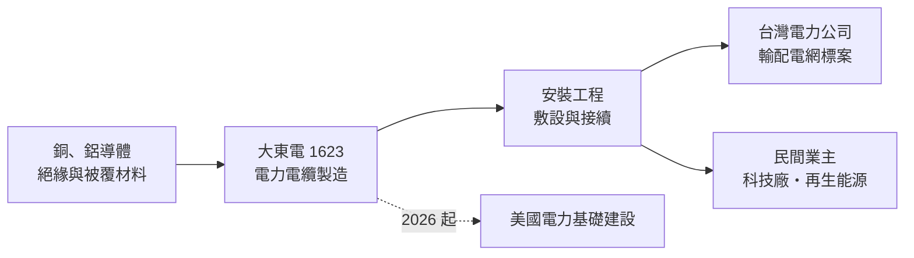
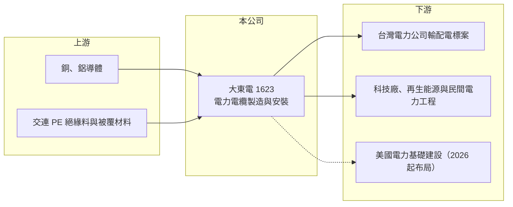

# 1623 大東電

> 上市｜[[產業索引-電器電纜|電器電纜]]｜上市（櫃）日期 2026/01/22

# 第一章：企業模式與商業藍圖

> [!info] 撰寫說明
> 本文由 Claude 依公開資料整理，架構比照 [[2330台積電]] 的四章研究，資料截至 2026-10-08。財務數字來源：Goodinfo 年度經營績效頁與基本資料頁、證交所開放資料（基本資料、資產負債、綜合損益、營益分析、股利、每月營收）；業務描述參考優分析、科技新報、工商時報等新聞標題，產品比重與主要客戶結構公開資料有限，產業描述為整理性內容，尚未逐條比對原始文件。#待校對

在評估單一個股的長期投資價值時，首要步驟是拆解企業的底層獲利邏輯。本章說明大東電業廠（股票代號：1623，以下簡稱大東電）如何以電力電纜的製造與安裝，參與台灣電網更新的長期需求。

## 一、核心定位：一甲子的電力電纜老廠、2026 年才上市

大東電成立於 1962 年 7 月，是一家有六十多年歷史的電線電纜製造商，主要業務是電線電纜的製造、加工、買賣與安裝工程。公司在 2024 年 5 月公開發行並登錄興櫃，2026 年 1 月 22 日在證交所上市，實收資本額 6.6 億元，董事長為林志明、總經理為楊博文。對投資人而言，這是一家「老公司、新股票」，過去的經營紀錄長，但公開市場的資訊揭露期間很短。

電纜廠的商業模式可以拆成兩段。第一段是製造：買進銅、鋁導體與絕緣材料，經過拉線、絞線、押出絕緣與包覆等工序，做成不同電壓等級的電纜。第二段是工程：替電力公司或民間業主把電纜敷設、接續到變電所或廠區。同時具備製造與安裝能力的廠商，能承接「產品加施工」的整包標案，附加價值高於單純賣線。

* **[[交連PE電纜]]為核心產品（推估）：** 中高壓電力電纜多採交連聚乙烯絕緣，是輸配電網的主幹材料。大東電的主力客戶與標案以電力系統為主，產品比重未查得，以上依產業慣例推估。#待校對
* **營收隨標案入帳：** 新聞標題多次提到大東電「受惠標案持續入帳」，代表營收的節奏取決於得標與交貨時程，而不是一般消費性需求。

## 二、需求來源：台灣電網的長期更新

台灣電力公司在 2022 年後推動強化電網韌性的長期投資計畫，十年期的總投資規模達數千億元（憑記憶，待校對）。電網投資有幾個長期驅動力：既有老舊線路汰換、離岸風電與太陽能併網、科技廠與資料中心新增的用電負載，以及地下化工程。這些需求不會因為一年的景氣好壞就消失，因此電力電纜屬於「長週期、政策驅動」的產業。#待校對

## 三、長期方向：上市募資、可轉債與美國市場

* **資本市場籌資：** 2026 年 1 月上市後，2026 年第二季資本公積增加到約 19.6 億元，同年 7 月又發行國內第一次無擔保[[可轉換公司債]]。兩次籌資讓公司有資金擴充產能與承接更大型的標案，但也代表股本與潛在稀釋增加。
* **跨足美國：** 依 2025 年 12 月科技新報報導，大東電計畫在 2026 年跟隨台灣科技業的腳步，進軍美國電力基礎建設市場。若能成功，營收來源可以從台電單一大客戶分散出去，但海外工程的執行與成本控管也是新的考驗。
* **管理層展望：** 公司上市前表示看好未來 3 年營收與獲利維持雙位數百分比成長（優分析，2025 年報導）。這是公司自身的展望，實際結果仍取決於標案取得與銅價。

# 第二章：護城河深度與競爭優勢

在長期價值投資中，「護城河」指企業抵禦競爭、維持超額利潤的保護機制。本章分析大東電在電力電纜市場的優勢與限制。

## 一、護城河的組成

* **資格與實績門檻：** 電力公司採購中高壓電纜，需要廠商通過型式試驗與長期供貨實績審核。新進者即使買得到設備，也很難在短時間累積足夠的驗證紀錄，這讓既有合格廠商維持相對穩定的市場地位。
* **製造加安裝的整包能力：** 同時提供電纜與施工，業主可以減少介面協調，廠商也能從工程端多賺一段利潤。2023 年後大東電營業利益率從 6.5% 拉升到 15% 左右，部分可能來自高附加價值標案比重提高（推估）。
* **低費用結構：** 2026 年上半年營業費用只占營收約 2.7%，營業利益率 15.3% 和毛利率 18.0% 相差不到 3 個百分點。精簡的營運讓毛利改善能幾乎全數轉成營業利益。

## 二、競爭對手格局

| 對手 | 定位 | 對大東電的影響 |
|---|---|---|
| [[1605華新]] | 台灣最大線纜廠，兼營不鏽鋼 | 規模與品項完整，在大型電力標案直接競爭 |
| [[1603華電]] | 電力電纜與通訊線纜 | 台電標案主要競爭者之一 |
| [[1618合機]] | 電力電纜與工程 | 同樣受惠台電大標，價格競爭對手 |
| [[1615大山]] | 電線電纜 | 中低壓產品重疊 |
| [[1609大亞]] | 電線電纜與綠能 | 台電與民間電力工程競爭 |

## 三、守得住與守不住的地方

* **守得住：** 有資格門檻的中高壓電力電纜與安裝工程。只要台灣電網投資持續，合格廠商的訂單能見度相對高。
* **守不住：** 標案價格。台電採公開招標，大型電纜標案通常由多家合格線纜廠分食，得標價格透明，難以長期維持超額毛利。
* **觀察重點：** 毛利率能否維持在 15% 以上、美國市場是否取得實際訂單，以及新募資金投入後的資本報酬率是否下滑。

# 第三章：財務體質與盈利規模

資料日期：2026-10-08。數字取自 Goodinfo 年度經營績效頁與證交所開放資料，表格是撰寫當時的快照；最新月營收、毛利率、累計 EPS 由自動排程寫在本筆記的屬性欄位（月營收、毛利率、累計EPS 等）。#待校對

財務報表是檢驗護城河是否真實存在的最終標準。本章用多年度三率、ROE 與資本報酬，檢視大東電的獲利品質。由於公司 2024 年才公開發行，Goodinfo 只有 2022 年以後的資料。

## 一、多年度獲利

| 年度 | 營收（新台幣） | [[毛利率]] | [[營業利益率]] | EPS（元） | [[ROE]] |
|---|---|---|---|---|---|
| 2021 | 未查得 | 未查得 | 未查得 | 未查得 | 未查得 |
| 2022 | 39.0 億 | 9.84% | 6.53% | 2.99 | 7.5% |
| 2023 | 42.2 億 | 15.3% | 11.6% | 12.17 | 30.2% |
| 2024 | 54.8 億 | 18.1% | 15.4% | 12.58 | 36.5% |
| 2025 | 66.1 億 | 18.7% | 15.1% | 13.61 | 29.9% |
| 2026 上半年 | 32.9 億 | 18.01% | 15.34% | 6.02 | 未查得 |

註：2022 年 EPS 以當時較小的股數計算，與上市後的股本基礎不同，跨年比較時以稅後淨利為準：2022 年 0.9 億元、2023 年 4.06 億元、2024 年 7.33 億元、2025 年 8.17 億元。2026 年 1 至 8 月累計營收 44.0 億元，年增約 2.3%。

* **獲利跳升：** 2022 至 2025 年營收成長約 1.7 倍，稅後淨利卻成長約 9 倍。毛利率從不到 10% 拉高到 18% 以上，是典型的[[營業槓桿]]效果：產能與人力固定，接到較多、較好的標案後，增加的毛利幾乎全部變成利潤。
* **營收年複合成長率：** 2022 至 2025 年約 19%（推算）。
* **2026 年成長放緩：** 上半年 EPS 6.02 元，若以上市後 6,600 萬股計算，全年水準與 2025 年接近；前 8 個月營收只微幅成長，顯示高成長期可能進入平台。

## 二、長期指標

* **平均 ROE：** 2023 至 2025 年平均約 32%（推算），屬於非常高的水準。不過上市募資後權益大增，未來 ROE 很可能會被稀釋下來。
* **股利：** 2025 年度配發現金股利 8 元，以 EPS 13.61 元計算，[[配發率]]約 59%（推算）。2026 年第一、二季董事會決議不分派季度股利。
* **資產結構：** 2026 年第二季總資產 79.3 億元，其中流動資產 63.0 億元，負債 38.3 億元、權益 41.0 億元，每股淨值 62.16 元。電纜廠需要大量資金備料與墊付工程款，流動資產占比高是行業特性。

## 三、[[ROIC]] 與 [[WACC]]：價值創造利差

**ROIC 推算：** 2025 年營業利益約 9.98 億元（66.1 億元 × 15.1%），稅後約 7.99 億元（稅率 20%）。以 2026 年第二季權益 41.0 億元計算約 19.5%；若把負債總額 38.3 億元全部計入投入資本，約 10.0%（推算）。有息負債金額未查得，實際 ROIC 應落在 10% 至 20% 之間，而且上市前權益更小，2024 至 2025 年的 ROIC 應更高。

**WACC 推算：** 權益成本以 [[CAPM]] 估算，台灣 10 年期公債 1.75%、市場風險溢酬 6%、β 取 1.0（電線電纜業常見值，非來源數字），約 7.75%；負債成本假設 2.5%，稅後 2%。假設權益占資本 80%，WACC 約 6.6%（推算）。

**結論：** 大東電近三年的 ROIC 明顯高於 WACC，代表電網投資高峰期確實為公司創造了超額報酬。長期要觀察的是：台電標案競爭與銅價波動是否讓毛利率回到 10% 左右，以及上市與可轉債募來的資金能否投入到同樣高報酬的用途。

# 第四章：總體風險與地緣政治

任何企業都無法脫離宏觀環境獨立存在。本章分析大東電必須面對的產業週期、營運與外部風險。

## 一、產業週期

* **政策與標案週期：** 營收高度依賴台電的電網投資。若政府預算調整、計畫延後或改變採購方式，訂單可能出現斷層。電網投資通常以十年計，但每一年的標案量可能有明顯起伏。
* **銅價：** 銅是電纜最大的原料成本。標案若以固定價格得標，交貨前銅價上漲會侵蝕毛利；反之則可能出現庫存利益。能否做到[[銅價轉嫁]]，決定獲利穩定度。

## 二、營運風險

* **客戶集中：** 電力公司是最主要的需求來源，客戶集中度高，議價能力有限。
* **工程執行：** 安裝工程涉及工期、工安與驗收，延誤或品質問題可能導致罰款或認列損失。
* **規模擴張：** 美國市場與新產能若進度不如預期，前期費用與折舊會先壓低獲利。

## 三、其他風險

* **股本稀釋：** 可轉換公司債轉換成股票後，流通股數增加，每股盈餘會被稀釋。
* **匯率與海外法規：** 進軍美國需要面對當地認證、工會與勞動成本，以及匯率變動。
* **新上市資訊有限：** 公開發行時間短，市場對公司長期經營紀錄與資本配置習慣的了解仍有限。

# 專有名詞解析

## 金融

- **[[可轉換公司債]]**：持有人可在約定期間依轉換價格把債券換成公司股票的公司債，發行公司可用較低利率籌資，但轉換後股本會增加。
- **[[營業槓桿]]**：固定成本占比高的企業，營收增加時利潤增幅大於營收增幅；反之營收下滑時利潤跌得更快。
- **[[配發率]]**：現金股利占當年度每股盈餘的比例，用來衡量公司把多少獲利分給股東。

## 產業

- **[[交連PE電纜]]**：以交連聚乙烯作為絕緣層的電力電纜，耐熱與絕緣性能佳，是中高壓輸配電網的主流產品。
- **[[銅價轉嫁]]**：廠商把銅等原料價格的變動反映到產品售價的能力，轉嫁越及時，毛利越不受原料價格波動影響。
- **[[強韌電網]]**：台電為提升供電穩定度而推動的長期電網投資計畫，涵蓋輸變電設備更新、分散式電網與地下化工程。

# 核心供應鏈

## 1. 上游：原料
- 銅、鋁導體：國際金屬市場（供應商名稱未查得）
- 絕緣與被覆材料：交連聚乙烯等塑化原料，可參考 [[1301台塑]]、[[6505台塑化]] 等石化上游（是否為供應商未查得）

## 2. 本公司與同業
- 電線電纜同業：[[1605華新]]、[[1603華電]]、[[1618合機]]、[[1615大山]]、[[1609大亞]]、[[1608華榮]]

## 3. 下游：客戶
- 台灣電力公司（輸配電網更新與強韌電網計畫）
- 重電設備與電力工程同業：[[1513中興電]]、[[1519華城]]、[[1503士電]]（是否為合作夥伴未查得）
- 科技廠與再生能源業主

## 最新新聞
<!-- news:start -->
<!-- news:end -->

## 相關連結
- [公開資訊觀測站](https://mopsov.twse.com.tw/mops/web/t05st03?step=1&firstin=1&co_id=1623)
- [Goodinfo](https://goodinfo.tw/tw/StockDetail.asp?STOCK_ID=1623)
- [Yahoo 股市](https://tw.stock.yahoo.com/quote/1623)
- [鉅亨網新聞](https://www.cnyes.com/twstock/1623/news)
