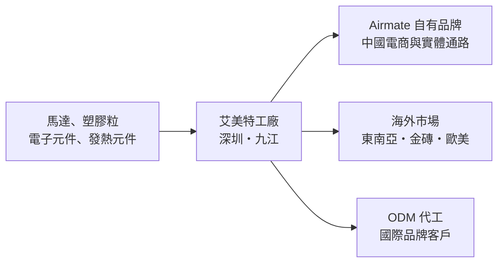
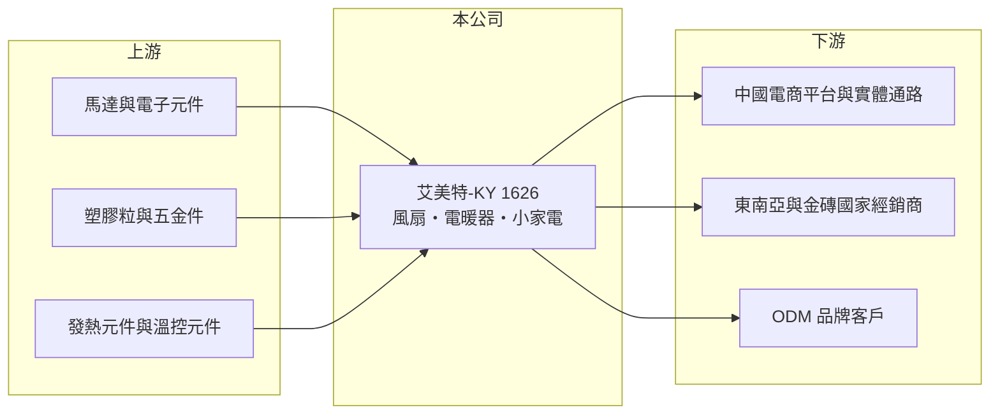

# 1626 艾美特-KY

> 上市｜[[產業索引-電器電纜|電器電纜]]｜上市（櫃）日期 2013/03/21

# 第一章：企業模式與商業藍圖

> [!info] 撰寫說明
> 本文由 Claude 依公開資料整理，架構比照 [[2330台積電]] 的四章研究，資料截至 2026-10-08。財務數字來源：Goodinfo 年度經營績效頁與基本資料頁、證交所開放資料（基本資料、資產負債、綜合損益、營益分析、股利、每月營收）；經營策略參考聯合報、優分析、自由時報等法說會新聞標題。產品別與地區別營收比重公開資料有限，產業描述為整理性內容，尚未逐條比對原始文件。#待校對

在評估單一個股的長期投資價值時，首要步驟是拆解企業的底層獲利邏輯。本章說明艾美特（開曼）國際（股票代號：1626，以下簡稱艾美特）如何以電風扇與電暖器起家，在中國小家電市場經營自有品牌，並嘗試把產品賣到海外。

## 一、核心定位：在中國生產與銷售的台資小家電品牌

艾美特是一家在開曼群島註冊、2013 年 3 月在台灣上市的第一上市公司，控股公司成立於 2004 年，2026 年實收資本額約 15.0 億元，董事長兼總經理為史瑞斌。公司的主要業務是電風扇、電暖器及各式[[小家電]]的研發、生產與銷售，生產基地包括艾美特電器（深圳）與艾美特電器（九江）兩家子公司。

艾美特的商業模式是「自己設計、自己生產、自己賣品牌」。「Airmate」品牌在中國的電風扇與電暖器市場有長期知名度（憑記憶，待校對），產品透過電商平台與實體通路銷售；工廠產能同時也替國際品牌做[[ODM]]代工（比重未查得，待校對）。這種模式的好處是同時賺製造與品牌的利潤，壞處是要同時負擔工廠的固定成本與品牌的行銷費用。#待校對

* **風扇與電暖器的季節互補：** 電風扇在春夏出貨，電暖器在秋冬出貨，兩種產品讓工廠全年都有生產重心，這是艾美特長期的產品組合邏輯。從月營收看，2026 年 8 月營收比 7 月少了約 44%，正是夏季風扇旺季結束的典型樣貌。
* **小家電的產品生命週期短：** 外型、功能與價格每年都要更新，研發與模具投入是持續性的支出。

## 二、長期方向：從中國內需轉向「自有產品出海」

中國小家電市場在 2020 年後競爭加劇，大型家電集團與網路品牌以低價和大量行銷搶占電商流量，艾美特營收從 2021 年的 102 億元降到 2025 年的 77.9 億元。面對內需疲軟，公司在 2025 年法說會中提出以自有品牌拓展東南亞與金磚國家市場，並以綠色製造作為訴求（聯合報，2025 年報導），也提到手持風扇等新品類的銷售優於預期。

* **策略意義：** 出海可以降低對中國單一市場的依賴，但新市場的品牌知名度低，前期通路與行銷費用高。轉型成效要看海外營收比重能否持續提升，以及毛利能否覆蓋新增的費用。

# 第二章：護城河深度與競爭優勢

在長期價值投資中，「護城河」指企業抵禦競爭、維持超額利潤的保護機制。本章分析艾美特在小家電市場的優勢與弱點。

## 一、護城河的組成

艾美特的護城河很窄，主要來自兩個要素：

* **品類專業與品牌認知：** 長期專注在風扇與電暖器，累積了馬達、送風與發熱控制的設計經驗，Airmate 在特定品類具有一定的消費者認知。品類專注讓研發與模具投入可以集中，但也代表成長空間受限於這兩類產品。
* **自有工廠的垂直整合：** 從設計到生產都在自家工廠完成，可以較快推出新品並控制品質。毛利率在 2023 至 2025 年維持在 19% 至 22%，高於純代工廠的水準，反映品牌與製造合一的價值。

## 二、競爭對手格局

| 對手 | 定位 | 對艾美特的影響 |
|---|---|---|
| 美的、格力 | 中國大型家電集團，品類齊全 | 以規模與通路優勢壓低價格 |
| [[1810小米]] 生態鏈品牌 | 網路行銷、高性價比 | 搶占電商流量與年輕族群 |
| 先鋒等中國電暖器與風扇品牌 | 同品類專業品牌 | 直接競爭風扇與電暖器市場 |
| 戴森（Dyson） | 高價無葉風扇與暖風機 | 壓縮高階市場空間 |

## 三、守得住與守不住的地方

* **守得住：** 毛利率。即使營收下滑，毛利率仍維持在 16% 至 22% 區間，代表產品本身仍有一定的定價能力。
* **守不住：** 費用率。營收縮小後，行銷、通路與管理費用沒有同比例下降，2024 年起營業利益連續為負，2026 年上半年營業利益率為負 2.94%。這是品牌型小家電公司在規模萎縮時最典型的問題。
* **觀察重點：** 海外營收比重、營業費用能否隨營收調整，以及電商渠道的獲利能力。

# 第三章：財務體質與盈利規模

資料日期：2026-10-08。數字取自 Goodinfo 年度經營績效頁與證交所開放資料，表格是撰寫當時的快照；最新月營收、毛利率、累計 EPS 由自動排程寫在本筆記的屬性欄位（月營收、毛利率、累計EPS 等）。#待校對

財務報表是檢驗護城河是否真實存在的最終標準。本章用多年度三率、ROE 與資本報酬，檢視艾美特的獲利品質。

## 一、多年度獲利

| 年度 | 營收（新台幣） | [[毛利率]] | [[營業利益率]] | EPS（元） | [[ROE]] |
|---|---|---|---|---|---|
| 2019 | 101 億 | 19.4% | 2.86% | 2.05 | 9.38% |
| 2020 | 92.1 億 | 17.1% | 2.40% | 1.12 | 5.08% |
| 2021 | 102 億 | 11.1% | -3.60% | -2.11 | -10.4% |
| 2022 | 92.2 億 | 15.7% | -2.64% | 3.25 | 15.8% |
| 2023 | 84.0 億 | 21.8% | -0.15% | 0.17 | 0.84% |
| 2024 | 81.3 億 | 20.0% | -2.63% | -1.05 | -5.28% |
| 2025 | 77.9 億 | 19.6% | -1.35% | -0.86 | -4.51% |
| 2026 上半年 | 48.9 億 | 16.74% | -2.94% | -1.62 | 未查得 |

註：2026 年 1 至 8 月累計營收 59.3 億元，年減約 1.1%。

* **本業長期虧損：** 2021 年以來營業利益率幾乎年年為負。2021 年毛利率掉到 11.1%，可能與原物料與運費大漲有關（推估）。
* **2022 年的獲利來自業外：** 2022 年營業利益為負，稅後淨利卻有 5.13 億元，代表當年有大額[[業外收益]]，可能與資產處分或廠區相關收益有關（推估，來源未查得）。評估本業時不應把這一年當成常態。#待校對
* **營收年複合成長率：** 2020 至 2025 年約負 3.3%（推算），規模持續縮小。

## 二、長期指標

* **平均 ROE：** 2021 至 2025 年平均約負 0.7%（推算），扣除 2022 年的業外收益後更低。
* **股利：** 2025 年度虧損，未配發股利。Goodinfo 統計的歷年平均現金股利約 0.6 元，但近年已無配息能力。
* **資產結構：** 2026 年第二季負債 72.7 億元、權益 27.1 億元，負債比約 73%；保留盈餘只剩約 1.1 億元，每股淨值 18.07 元。流動負債高達 69.2 億元，與旺季前備貨、應付帳款與短期借款有關，[[營運資金]]壓力是需要追蹤的重點。

## 三、[[ROIC]] 與 [[WACC]]：價值創造利差

**ROIC 推算：** 2025 年營業利益約負 1.05 億元（77.9 億元 × -1.35%）。虧損時不計稅盾，以 2026 年第二季權益 27.1 億元計算 ROIC 約負 3.9%；若把負債 72.7 億元全部計入投入資本，約負 1.1%（推算）。不論用哪一種口徑，本業的資本報酬都是負的。

**WACC 推算：** 權益成本以 [[CAPM]] 估算，台灣 10 年期公債 1.75%、市場風險溢酬 6%、β 取 1.0（考量中國市場風險，高於家電業常見的 0.8，非來源數字），約 7.75%；負債成本假設 3.5%（以人民幣借款為主的推估），稅後 2.8%。假設權益占資本 60%，WACC 約 5.8%（推算）。

**結論：** 艾美特的 ROIC 為負，遠低於 WACC，代表近五年本業持續在消耗股東價值。轉型能否成功的檢驗標準很明確：營業利益率要先轉正，ROIC 才有機會回到 WACC 之上。

# 第四章：總體風險與地緣政治

任何企業都無法脫離宏觀環境獨立存在。本章分析艾美特必須面對的需求、競爭與外部風險。

## 一、產業週期

* **天氣與季節：** 電風扇看夏季氣溫，電暖器看冬季冷度。涼夏或暖冬都會直接造成庫存積壓與降價促銷。
* **中國消費景氣：** 主要市場在中國，房地產與消費信心低迷會壓抑家電換購需求。

## 二、營運風險

* **價格競爭：** 電商平台的促銷檔期與低價品牌，使小家電的價格長期承壓。
* **費用僵固：** 品牌經營需要持續的廣告與通路費用，營收萎縮時費用難以同步下降。
* **海外拓展：** 新市場需要建立通路與售後服務，前期投入可能拖累獲利。

## 三、其他風險

* **地緣政治與關稅：** 生產集中在中國，出口歐美可能面臨關稅與供應鏈「中國以外」的要求。
* **匯率：** 營運以人民幣為主，財報以新台幣表達，人民幣兌新台幣的變動會影響換算後的營收與權益。
* **KY 公司治理：** 第一上市公司的營運主體在海外，資金貸與子公司等交易較頻繁（2026 年 9 月即有代深圳與九江子公司公告資金貸與），投資人需要留意集團內資金流向。

# 專有名詞解析

## 金融

- **[[業外收益]]**：本業以外的收入，例如投資收益、資產處分利益與匯兌利益，通常不具持續性。
- **[[營運資金]]**：流動資產減流動負債，代表企業日常營運需要投入的資金，存貨與應收帳款越多，所需資金越大。

## 產業

- **[[小家電]]**：電風扇、電暖器、吹風機、廚房電器等體積小、單價低的家電，產品週期短、品牌與通路競爭激烈。
- **[[ODM]]**：原廠委託設計製造，代工廠負責設計與生產，產品掛客戶的品牌銷售。
- **[[自有品牌]]**：公司以自己的商標銷售產品，需要負擔行銷與通路費用，但能保留品牌溢價。

# 核心供應鏈

## 1. 上游：零組件與原料
- 馬達、電子控制板、塑膠粒、五金件與發熱元件（供應商名稱未查得）
- 散熱風扇與馬達相關台廠可參考：[[2421建準]]（是否為供應商未查得）

## 2. 本公司與同業
- 台灣家電同業：[[1614三洋電]]、[[1604聲寶]]、[[5283禾聯碩]]
- 中國與國際品牌：美的、格力、[[1810小米]]、戴森

## 3. 下游：通路
- 中國電商平台（天貓、京東等）與實體家電通路（是否為主要通路，待校對）
- 海外經銷商與 ODM 品牌客戶

## 最新新聞
<!-- news:start（自動產生，請勿手動編輯此範圍） -->
- 2026-10-19 🏛️ 重訊 17:04｜依「公開發行公司資金貸與及背書保證處理準則」 第二十五條第一項第三款規定公告｜[觀測站](https://mops.twse.com.tw/mops/#/web/t05st01)
- 2026-10-19 🏛️ 重訊 17:01｜代子公司艾美特電器(九江)有限公司依「公開發行公司資金貸與 及背書保證處理準則」第二十五條第一項第三、四款規定公告｜[觀測站](https://mops.twse.com.tw/mops/#/web/t05st01)
- 2026-10-14 🏛️ 重訊 17:25｜更正公告本公司115年09月合併營業收入公告及 115年1-9月累計合併營收｜[觀測站](https://mops.twse.com.tw/mops/#/web/t05st01)
- 2026-10-13 📰 媒體 08:51｜營收速報 - 艾美特-KY(1626)9月營收4.77億元年增率高達37.47％｜[鉅亨網](https://news.cnyes.com/news/id/6629119)
- 2026-10-12 🏛️ 重訊 16:40｜代子公司艾美特電器(深圳)有限公司依「公開發行公司資金貸與 及背書保證處理準則」第二十五條第一項第三、四款規定公告｜[觀測站](https://mops.twse.com.tw/mops/#/web/t05st01)

完整紀錄：[[1626艾美特-KY 新聞]]
<!-- news:end -->

## 相關連結
- [公開資訊觀測站](https://mopsov.twse.com.tw/mops/web/t05st03?step=1&firstin=1&co_id=1626)
- [Goodinfo](https://goodinfo.tw/tw/StockDetail.asp?STOCK_ID=1626)
- [Yahoo 股市](https://tw.stock.yahoo.com/quote/1626)
- [鉅亨網新聞](https://www.cnyes.com/twstock/1626/news)
