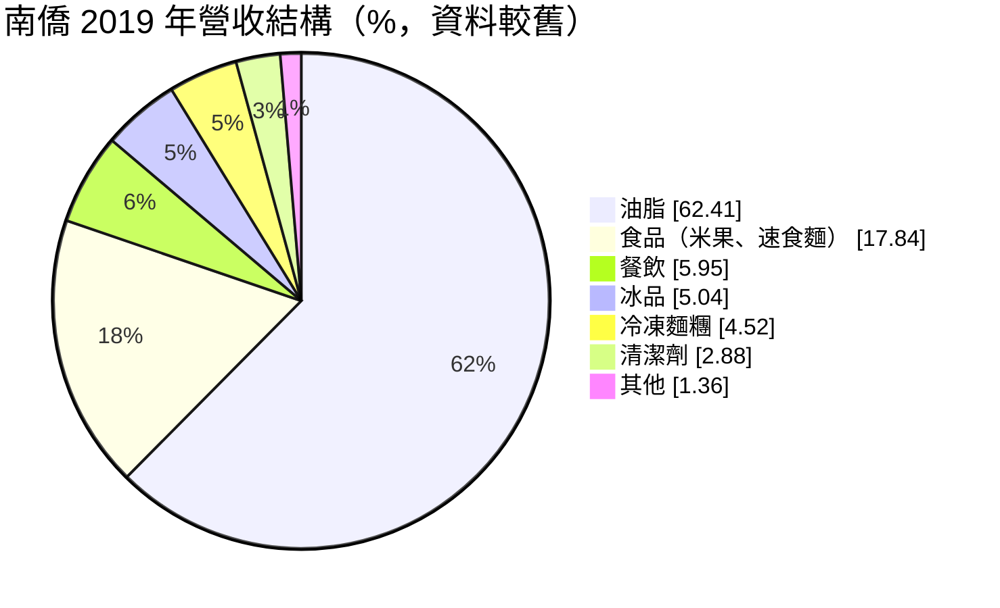
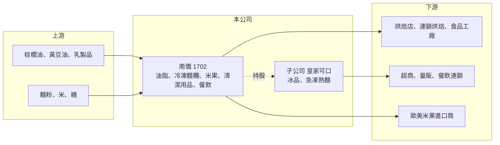

# 1702 南僑

> 上市｜[[產業索引-食品工業|食品工業]]｜上市（櫃）日期 1973/05/30

# 第一章：企業模式與商業藍圖

> [!info] 撰寫說明
> 精簡版，由 Claude 依公開資料整理，架構比照 [[2330台積電]]，資料截至 2026-10-08。來源：證交所開放資料快照（基本資料、2026 年上半年資產負債與綜合損益、股利）、Goodinfo 歷年經營績效、HiStock 2020 年整理文章（營收結構為 2019 年資料）、皇家可口相關新聞（聯合新聞網 2025 年 11 月）。業務比重年代較舊，品牌與據點部分憑整理資料撰寫。#待校對

南僑的本質是一家以油脂科學起家、再往下延伸到烘焙、冰品、速食麵與餐飲的民生食品集團，理解它要先抓住「工業用油脂是主體、消費品牌是延伸」這個結構。

- **核心業務：** 南僑成立於 1950 年，最早以水晶肥皂等清潔用品起家，之後把油脂加工技術轉向食品，發展出酥油、瑪琪琳、乳化油、精製油等[[烘焙油脂]]，賣給麵包店、連鎖烘焙與食品工廠。目前公司以「南僑投資控股」名義上市，旗下各事業由子公司經營，這讓集團可以把冰品、冷凍麵等事業獨立出來分別上市募資。
- **營收結構：** 依 2019 年資料，油脂約占營收六成二，食品（含米果、速食麵）約一成八，餐飲、冰品、冷凍麵糰各約 5% 上下，清潔用品約 3%。油脂比重高代表公司的獲利很大程度取決於原料油價與烘焙業景氣，而不是零售品牌的定價力。這份比重年代較舊，近年各事業消長未查得最新數字。#待校對
- **營運據點：** 台灣有桃園龜山（油脂、清潔劑）、中壢（冷凍麵糰與急凍熟麵）、台南（冰淇淋）等廠；中國天津有烘焙與工業用油脂廠；泰國廠生產米果、速食麵，主要外銷歐美。多地生產讓南僑能就近服務兩岸烘焙市場，但也讓中國烘焙需求的起伏直接影響集團獲利。
- **長期方向：** 集團持續把消費性事業分拆經營，旗下 [[7791皇家可口]]（杜老爺冰品、急凍熟麵）於 2025 年 10 月上市，是這個方向最具體的例子。長期看點在於油脂本業能否維持對連鎖烘焙客戶的技術服務優勢，以及冷凍麵、冰品等高附加價值事業能否提高集團整體毛利。

# 第二章：護城河深度與競爭優勢

南僑的護城河來自油脂配方技術與客戶黏著度，而不是單一品牌，這讓它在原料成本上升時有一定轉嫁能力，但轉嫁速度有限。

- **競爭優勢：** 烘焙油脂需要依客戶的麵包、蛋糕配方調整熔點、延展性與口感，供應商往往要派技術人員協助客戶試做，一旦配方定型，客戶不太會為了小幅價差換供應商。南僑在台灣與中國經營這類技術服務數十年，累積的配方資料庫與客戶關係是主要的競爭門檻。
- **品牌資產：** 水晶肥皂、杜老爺冰淇淋、點水樓等品牌在台灣知名度高，提供較穩定的零售需求。不過這些品牌占集團營收比重不高，品牌溢價對整體毛利的拉抬有限。
- **主要對手：** 油脂方面在台灣與 [[1225福懋油]]、[[1232大統益]] 等食用油廠部分重疊，在中國則面對益海嘉里、豐益等大型油脂集團與當地中小廠；冰品與冷凍麵則與 [[1216統一]]、[[1201味全]] 等食品集團競爭。中國油脂市場的規模經濟由大型集團主導，南僑只能靠專業烘焙油脂的利基區隔。
- **觀察重點：** 2025 年毛利率從前一年約 29% 降到約 25%、營業利益率降到約 2.5%，顯示成本轉嫁或中國市場出現壓力。長期要觀察的是毛利率能否回到過去 28% 至 33% 的區間，這代表護城河是否仍有效。

# 第三章：財務體質與盈利規模

資料日期：2026-10-08，表格是撰寫當時的快照；最新月營收、毛利率、累計 EPS 由自動排程寫在本筆記的屬性欄位（月營收、毛利率、累計EPS 等）。#待校對

南僑的財務特色是營收規模大、利潤率薄，獲利對原料油價與中國烘焙景氣高度敏感，近年資本報酬率明顯下滑。

| 年度 | 營收（億元） | [[毛利率]] | [[營業利益率]] | EPS（元） | [[ROE]] |
|---|---|---|---|---|---|
| 2020 | 176 | 33.7% | 9.52% | 3.84 | 14.9% |
| 2021 | 199 | 31.6% | 9.00% | 4.32 | 13.2% |
| 2022 | 205 | 26.1% | 4.36% | 2.26 | 5.71% |
| 2023 | 227 | 28.7% | 7.00% | 4.20 | 9.96% |
| 2024 | 237 | 29.1% | 6.47% | 4.07 | 8.78% |
| 2025 | 232 | 24.8% | 2.51% | 1.12 | 2.85% |
| 2026 上半年 | 115.3 | 24.3% | 1.29% | 0.24 | 未查得 |

資料來源：Goodinfo 歷年經營績效；2026 上半年取自證交所開放資料。2025 年 EPS 另有媒體報導為 1.09 元，數字待校對。

- **營收規模：** 2020 至 2025 年營收從 176 億元成長到 232 億元，年複合成長率約 5.7%（推算），成長主要來自規模擴大而非利潤率提升。2025 年營收首度小幅衰退，2026 年上半年約 115 億元，與前一年相近。
- **獲利：** 毛利率從 2020 年的 33.7% 一路降到 2026 年上半年的 24.3%，營業利益率從 9.5% 降到 1.3%，說明原料成本與費用增加的速度快過售價調整。近 5 年（2021 至 2025）平均 ROE 約 8.1%（推算），但趨勢向下。
- **配息：** 2025 年度現金股利 1.6 元，高於當年 EPS，代表公司動用以前年度盈餘維持配息。這種做法短期穩定股東報酬，但若獲利不回升，長期不可持續。
- **[[ROIC]] 與 [[WACC]]：** 證交所資料顯示 2026 年第二季底權益總計約 156.2 億元、負債總計約 179.6 億元，有息負債未單獨查得，以負債總計的一半約 90 億元推估。以 2025 年營業利益約 5.8 億元（232 億 × 2.51%）、稅率 20% 計，稅後營業利益約 4.7 億元，ROIC ≈ 4.7 ÷（156＋90）≈ 1.9%（推算）；2024 年同法約 5%。WACC 以 CAPM 推估：無風險利率 1.75%、市場風險溢酬 6%、β 取食品業常見值 0.6，股東權益成本約 5.4%；稅後負債成本約 2%，權益占比約 63%，WACC 約 4.1%（推算）。2025 年 ROIC 低於 WACC，代表這一年並未替股東創造超額價值，獲利率能否修復是長期評價的關鍵。

# 第四章：總體風險與地緣政治

南僑的風險集中在原料價格、中國市場與利潤率長期下滑三件事，品牌事業的穩定性不足以完全抵銷油脂本業的波動。

- **產業週期：** 烘焙油脂的原料是棕櫚油、黃豆油與乳製品，國際價格受氣候、生質燃料政策與匯率影響，波動很大。油脂廠通常只能落後數個月調整售價，原料急漲時毛利會先被壓縮。
- **營運風險：** 中國是油脂與冷凍麵的重要市場，但當地烘焙業競爭激烈、消費景氣起伏，大型油脂集團又有規模成本優勢。若中國需求持續疲弱，南僑的產能利用率與定價都會受壓。
- **財務風險：** 營業利益率已降到 1% 至 3%，配息高於獲利，負債規模也大於權益。若獲利長期無法回升，公司可能需要調整配息或處分資產。
- **其他風險：** 食品安全事件會直接傷害品牌與客戶信任；新台幣與人民幣、泰銖匯率變動影響海外子公司換算損益；台灣基本工資上升也推高餐飲與食品工廠的人力成本。

# 專有名詞解析

## 金融

- **[[ROIC]]**：投入資本報酬率，稅後營業利益除以股東權益加有息負債，用來衡量公司運用所有資本的獲利能力。
- **[[WACC]]**：加權平均資金成本，股東權益成本與稅後負債成本依資本結構加權，ROIC 高於它才代表創造價值。

## 產業

- **[[烘焙油脂]]**：供麵包、蛋糕與酥皮使用的酥油、瑪琪琳、奶油等油脂，需依配方調整熔點與口感，是技術服務型的食品原料。
- **[[冷凍麵糰]]**：預先揉好並急速冷凍的麵糰，烘焙店解凍後即可烘烤，可降低門市人力與技術需求。

# 核心供應鏈

- 上游：國際棕櫚油與黃豆油供應商、乳製品與麵粉供應商；原料價格是南僑毛利率的最大變數。
- 下游／客戶：兩岸麵包店與連鎖烘焙業者、食品加工廠，以及 [[2912統一超]]、[[5903全家]] 等零售通路與連鎖餐飲。
- 同業：[[1225福懋油]]、[[1232大統益]]、[[1264德麥]]（烘焙原料）、[[1216統一]]、[[1201味全]]；集團子公司 [[7791皇家可口]]。

## 最新新聞
<!-- news:start（自動產生，請勿手動編輯此範圍） -->
- 2026-10-13 🏛️ 重訊 17:01｜代子公司南僑油脂事業股份有限公司公告董事會代行股東臨時會 重要決議事項｜[觀測站](https://mops.twse.com.tw/mops/#/web/t05st01)
- 2026-10-09 📰 媒體 16:53｜南僑成T+T+A三掛牌集團 整合資源強攻東協食品、烘焙商機｜[鉅亨網](https://news.cnyes.com/news/id/6626694)
- 2026-10-07 🏛️ 重訊 11:34｜公告說明今日經濟日報報導｜[觀測站](https://mops.twse.com.tw/mops/#/web/t05st01)
- 2026-10-06 📰 媒體 19:42｜南僑持續擴張泰國子公司投資 規劃新增至少15億元規模｜[鉅亨網](https://news.cnyes.com/news/id/6622850)

完整紀錄：[[1702南僑 新聞]]
<!-- news:end -->

## 相關連結
- [公開資訊觀測站](https://mopsov.twse.com.tw/mops/web/t05st03?step=1&firstin=1&co_id=1702)
- [Goodinfo](https://goodinfo.tw/tw/StockDetail.asp?STOCK_ID=1702)
- [Yahoo 股市](https://tw.stock.yahoo.com/quote/1702)
- [鉅亨網新聞](https://www.cnyes.com/twstock/1702/news)
