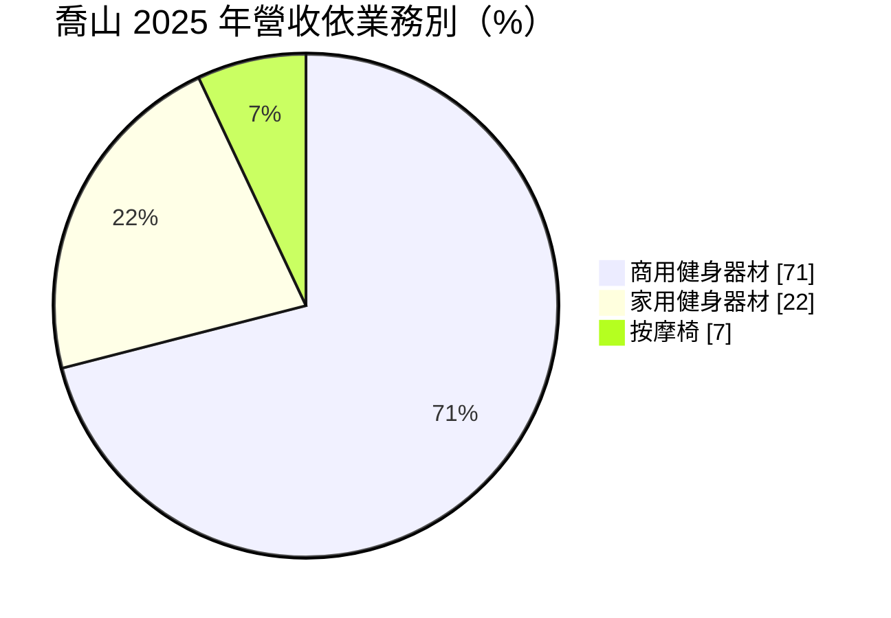
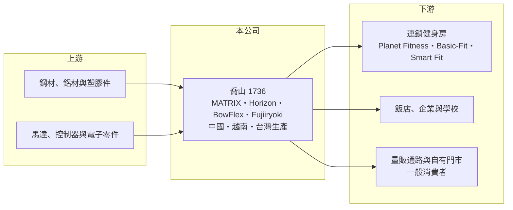

# 1736 喬山

> 上市｜[[產業索引-運動休閒|運動休閒]]｜上市（櫃）日期 2003/01/09

# 第一章：企業模式與商業藍圖

> [!info] 撰寫說明
> 精簡版，由 Claude 依公開資料整理，架構比照 [[2330台積電]]，資料截至 2026-10-08。來源：MoneyDJ 理財網財務比率年表（2021 至 2025 年）；富果研究 2026 年 5 月法說會備忘錄（營收結構、品牌、產地、客戶）；證交所開放資料快照（基本資料、2026 年上半年資產負債與損益、2025 年度股利）。營收金額由每股營業額乘以約 3.03 億股推算。#待校對

喬山健康科技成立於 1975 年 10 月、2003 年 1 月上市，總部在台中大雅，董事長羅崑泉、總經理羅光廷，實收資本額約 30.3 億元。喬山是台灣少數以自有品牌打進全球的健身器材公司，從工廠、品牌到門市一手包辦，理解它要抓住「商用健身房設備」這個核心引擎。

- **核心業務：** 喬山設計、製造並銷售跑步機、飛輪、重量訓練器材等健身設備，也經營按摩椅。商用器材賣給連鎖健身房、飯店、企業與學校，家用器材則透過量販通路與自有門市賣給一般消費者。和多數台灣同業只做 [[OEM]] 不同，喬山以[[自有品牌]]為主，因此能同時賺製造與品牌兩段利潤。
- **營收結構：** 依富果整理的 2026 年 5 月法說會，2025 年商用占 71%、家用 22%、按摩椅 7%；地區上北美 45% 最大，拉丁美洲約 7%。商用品牌分三層：高階 MATRIX、頂級 ONYX、中價位 VISION；家用有 Horizon 與 2024 年併購的 BowFlex；按摩椅則有日本品牌 Fujiiryoki（富士醫療器）與副牌 SYNCA。
- **營運據點：** 公司在全球 38 個國家設有 44 家行銷子公司，自有零售門市超過 300 家（法說會資料）。2025 年產能約 40% 在中國、30% 在越南、20% 在台灣、10% 委外；中國廠主要供應美國以外市場，台灣與越南廠主力供應美國，用產地配置降低關稅衝擊。越南二廠預計 2026 年第三季全面量產，完工後產能可支應約 1,000 億元年營收。
- **長期方向：** 喬山的策略是「商用拉市占、家用養品牌、併購補缺口」。商用端深耕全球大型連鎖健身房；家用端在 2024 年買下美國老牌 BowFlex 後，計畫投入廣告重建品牌，並在自有門市引進 Peloton、Tonal 等外部品牌產品，把門市變成健身器材通路平台。經營層長期傾向以併購取得品牌與通路，這讓公司規模成長快，但也使負債比率長期維持在七成以上。

# 第二章：護城河深度與競爭優勢

喬山的護城河來自「全球通路＋多品牌＋自有製造」三者同時具備，這在健身器材業並不常見。

- **競爭優勢：** 商用健身器材的買家是大型連鎖健身房，它們重視產品耐用度、全球維修服務與一次採購整套器材的能力。喬山在 44 家海外子公司建立的銷售與售後網絡，加上從有氧到重訓的完整產品線，讓它能同時服務 Planet Fitness（約占營收 10%）、歐洲的 Basic-Fit（約 5%）與拉美的 Smart Fit（3% 至 4%）等全球最大連鎖品牌，這種規模與服務網很難在短期內複製。
- **主要對手：** 商用市場主要對手是美國的 Life Fitness、Precor（已被 Peloton 收購）、義大利的 Technogym 與 Core Health & Fitness；家用市場則面對 Peloton、iFIT（NordicTrack）及大量中國低價品牌。台灣同業 [[1598岱宇]] 也同時經營家用與商用品牌，是最直接的本土比較對象。
- **觀察重點：** 喬山的毛利率接近五成，但營業利益率長期只有個位數，原因是品牌、門市與全球子公司的費用很重（公司預估費用率 43% 至 45%）。長期要看的是營收規模能否持續擴大、把固定費用攤薄，以及 BowFlex 家用品牌能否轉虧為盈；若營收停滯，高費用結構會讓獲利快速縮水，2021 至 2022 年就是例子。

# 第三章：財務體質與盈利規模

資料日期：2026-10-08，表格是撰寫當時的快照；最新月營收、毛利率、累計 EPS 由自動排程寫在本筆記的屬性欄位（月營收、毛利率、累計EPS 等）。#待校對

喬山營收在 2021 至 2025 年間由約 309 億元成長到約 543 億元，獲利則經歷疫後低谷後在 2024 年明顯回升。

| 年度 | 營收（億元） | [[毛利率]] | [[營業利益率]] | EPS（元） | [[ROE]] |
|---|---|---|---|---|---|
| 2021 | 約 309（推算） | 45.18% | 0.50% | 0.13 | 1.01% |
| 2022 | 約 337（推算） | 43.45% | -0.64% | 1.42 | 2.38% |
| 2023 | 約 381（推算） | 48.40% | 3.26% | 2.34 | 7.42% |
| 2024 | 約 478（推算） | 50.81% | 6.68% | 8.02 | 22.41% |
| 2025 | 約 543（推算） | 50.56% | 6.61% | 9.06 | 21.33% |

- **長期指標：** 2021 至 2025 年營收年複合成長率約 15%（推算），近 5 年平均 ROE 約 10.9%（推算），但前後兩段差距很大：2021 至 2022 年疫後需求退潮加上運費、庫存壓力，營業利益率一度轉負；2024 年起才回到二成以上的 ROE。2025 年度現金股利 4.5 元，約為 EPS 9.06 元的五成（證交所資料）。每股現金流量 2021 年為負，2022 至 2025 年轉正。
- **[[ROIC]] 與 [[WACC]]：** 2025 年營業利益約 35.9 億元（營收約 543 億元 × 6.61%），稅後約 28.7 億元（稅率 20%）。投入資本以 2026 年第二季權益總計 137.2 億元，加上有息負債（含租賃負債）推估約 100 億元計算（官方快照未拆分，負債總計為 333.5 億元），ROIC 約 12%（推算）。WACC 約 6.6%（推算：無風險利率 1.75%、市場風險溢酬 6%、β 取 1.0，股東權益成本 7.75%；稅前負債成本 3%、稅率 20%，以市值約 366 億元與負債 100 億元計算權重約 79：21）。ROIC 高於 WACC 約 5 個百分點，代表 2024 年後的營運是在創造價值，但 2021 至 2023 年 ROIC 明顯低於 WACC，說明這家公司的價值創造高度依賴景氣與規模。
- **財務特色：** 2026 年第二季總資產 470.7 億元、負債 333.5 億元，負債比率約 71%，主因是全球門市與通路需要大量存貨與營運資金。2026 年上半年營收 250.6 億元、[[毛利率]] 57.4%、EPS 3.27 元，其中包含美國關稅退稅的一次性影響（富果整理第二季調整後 EPS 約 1.29 元），解讀時需扣除。

# 第四章：總體風險與地緣政治

喬山的風險集中在三處：美國市場的關稅與消費景氣、高費用結構的營運槓桿，以及併購品牌的整合。

- **產業週期：** 家用健身器材在 2020 年疫情期間需求暴增，之後兩年急速退潮，造成整個產業庫存堆積，喬山 2021 至 2022 年獲利幾乎歸零就是這段週期的結果。商用器材的週期相對平穩，跟隨連鎖健身房的展店與汰換節奏，這也是喬山把重心放在商用的原因。
- **營運風險：** 費用率高達四成以上，營收只要下滑一成，營業利益就可能大幅縮水，這是品牌通路模式的代價。併購的 BowFlex 品牌需要持續投入廣告與通路費用，若重建品牌失敗會成為長期拖累。前三大客戶合計約占兩成營收，大型連鎖健身房的採購節奏變化也會影響單季表現。
- **其他風險：** 北美占營收近半，美國關稅政策反覆是最大外部變數，公司已用台灣與越南產能供應美國來因應。營收以美元、歐元等外幣為主，新台幣升值會壓縮換算後的獲利。負債比率偏高，利率上升時利息負擔加重。

# 專有名詞解析

## 金融

- **[[ROIC]]**：投入資本報酬率，稅後營業利益除以股東權益加有息負債，衡量本業運用資本的效率。
- **[[WACC]]**：加權平均資金成本，股東與債權人要求報酬率的加權平均，是 ROIC 要超越的門檻。

## 產業

- **[[OEM]]**：原廠委託製造，代工廠依品牌商的設計與規格生產，產品掛品牌商的名字出售。
- **[[自有品牌]]**：公司以自己的品牌名稱銷售產品，需自行負擔研發、行銷與通路費用，但可保留品牌溢價。

# 核心供應鏈

- 上游：鋼材、鋁材、塑膠件、馬達與電子控制零件供應商（名單未查得）。
- 下游／客戶：全球連鎖健身房 Planet Fitness、Basic-Fit、Smart Fit；飯店、企業與學校；量販通路與超過 300 家自有門市的終端消費者。台灣健身房業者 [[2762世界健身-KY]]、[[8462柏文]] 屬於商用器材的潛在客戶類型（實際採購關係未查得）。
- 同業：[[1598岱宇]]；國外 Life Fitness、Technogym、Peloton、Core Health & Fitness、iFIT。

## 最新新聞
<!-- news:start（自動產生，請勿手動編輯此範圍） -->
- 2026-10-07 📰 媒體 16:44｜喬山前三季營收站上400億元關卡 商用維持雙位數年增｜[鉅亨網](https://news.cnyes.com/news/id/6623700)

完整紀錄：[[1736喬山 新聞]]
<!-- news:end -->

## 相關連結
- [公開資訊觀測站](https://mopsov.twse.com.tw/mops/web/t05st03?step=1&firstin=1&co_id=1736)
- [Goodinfo](https://goodinfo.tw/tw/StockDetail.asp?STOCK_ID=1736)
- [Yahoo 股市](https://tw.stock.yahoo.com/quote/1736)
- [鉅亨網新聞](https://www.cnyes.com/twstock/1736/news)
