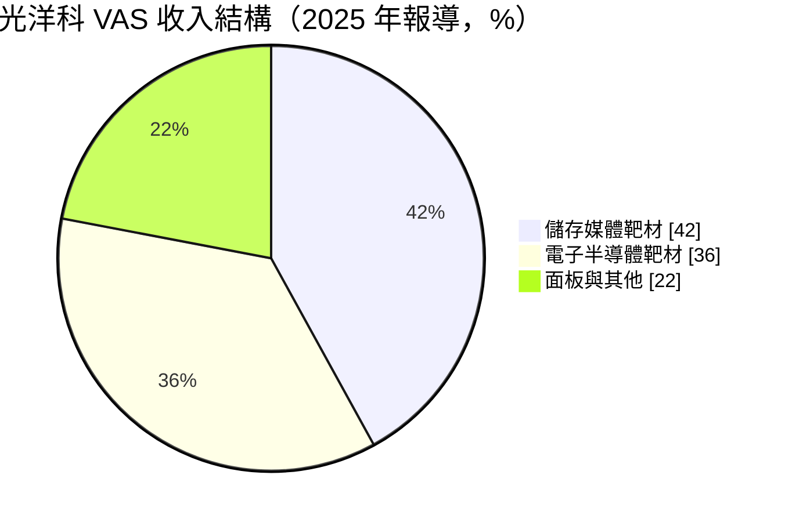
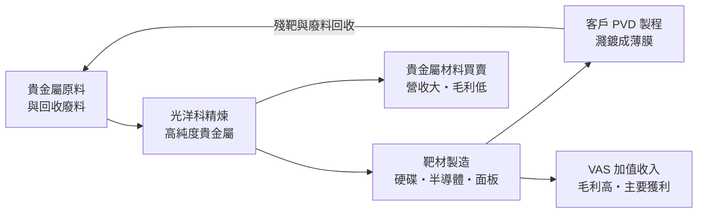
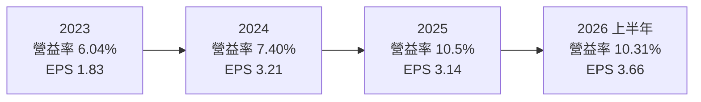
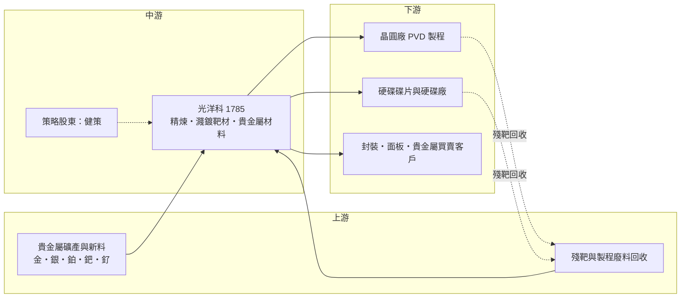

# 1785 光洋科

> 上櫃｜[[產業索引-其他電子業|其他電子業]]｜上市（櫃）日期 2005/01/31

# 第一章：企業模式與商業藍圖

> [!info] 撰寫說明
> 本文由 Claude 依公開資料整理，架構比照 [[2330台積電]] 的四章研究，資料截至 2026-10-08。財務數字來源：Goodinfo 經營績效、現金流量頁（年度合併報表）、櫃買中心開放資料（基本資料、2026 年第二季綜合損益與資產負債、本益比殖利率）、旺得富理財網（2025 年 8 月）、理財周刊（2025 年 12 月）、經濟日報（2026 年第一季財報報導）；產業描述為整理性內容，尚未逐條比對原始文件。#待校對

在評估單一個股的長期投資價值時，首要步驟是拆解企業的底層獲利邏輯。本章針對光洋應用材料科技（股票代號：1785，以下簡稱光洋科）的商業模式進行定性分析，說明一家營收大部分來自貴金屬買賣的公司，真正的獲利引擎為什麼是金額不大的靶材與加工業務，以及「回收、精煉、再製造」的循環模式如何成為它的核心競爭力。

## 一、核心定位：貴金屬循環與濺鍍靶材的整合廠

光洋科 1978 年成立，2005 年在櫃買中心掛牌，總部與主要廠區位於台南。公司的業務可以用一句話概括：把含有金、銀、鉑、鈀、釕等貴金屬的原料與廢料回收精煉，再加工成高純度的[[濺鍍靶材]]與貴金屬材料，賣給硬碟、半導體與面板等電子產業。

理解光洋科最重要的一點，是把營收拆成兩種性質完全不同的收入。依旺得富理財網 2025 年 8 月的報導，2025 年前 7 個月合併營收 213.6 億元，其中貴金屬材料約 177.2 億元、占八成以上，非貴金屬加值服務（公司稱為 [[VAS]]，含靶材、加工與工繳收入）約 36.4 億元、不到兩成。貴金屬買賣的營收隨國際金價、銀價漲跌而放大或縮小，毛利率很低；VAS 的金額雖小，毛利率卻高得多，是公司獲利的主要來源。因此，光洋科營收在貴金屬大漲的年份會快速成長，但營收成長並不等於本業變強，投資人應該看毛利金額與 VAS 的成長。

光洋科在產業鏈中的位置屬於上游材料。靶材是晶圓廠與硬碟廠 [[PVD]] 製程中直接消耗的耗材，用完之後剩下的殘靶又會回到光洋科精煉，因此它和客戶之間形成一種「材料租賃加回收」的長期關係，而不是一次性的買賣。

## 二、終端應用與產品板塊：硬碟與半導體雙引擎

依理財周刊 2025 年 12 月的報導，VAS 收入中儲存媒體（硬碟）靶材約占 42%，電子半導體靶材（含前段與後段製程）約占 36%，兩者合計約 78%，其餘為面板、光學與其他材料。以 VAS 為範圍的比重如下：

- **儲存媒體靶材：** 硬碟（[[HDD]]）磁碟片的記錄層需要鉑、釕、鈷等合金薄膜，光洋科在這個領域的市占率被報導為全球第一。AI 資料中心需要大量高容量硬碟存放冷資料，高容量硬碟的碟片層數與記錄層材料用量增加，使這塊業務從過去被視為夕陽產業，重新變成穩定成長的業務。
- **電子半導體靶材：** 2022 年光洋科切入晶圓前段製程，前段靶材占 VAS 的比重由當時約 4% 提升到 2025 年接近 20%。前段製程靶材的純度與認證要求高，一旦通過晶圓廠驗證，就會隨製程世代長期供貨，是光洋科長期評價的關鍵。後段封裝則以金、銀等貴金屬材料為主。
- **貴金屬材料與回收：** 包含貴金屬精煉、買賣與委託加工。這塊業務營收大、利潤薄，但它提供了靶材的原料來源與成本優勢，也是公司和客戶綁在一起的關鍵環節。

## 三、資本轉化邏輯：材料加密閉循環

- **[[密閉循環]]：** 客戶用過的殘靶通常只消耗一部分材料，剩下的貴金屬價值很高。光洋科把殘靶收回、精煉、再製成新靶材，客戶不必每次都用市價買進全新的貴金屬，光洋科則取得穩定的原料。經濟日報 2026 年的報導指出，公司每年回收的原料價值超過 400 億元。這種模式對客戶的意義是降低成本、確保供應，並符合減碳與資源循環的要求。
- **[[營運資金]]密集：** 貴金屬存貨的價值很高，公司需要大量營運資金與借款來支撐庫存，金價大幅波動時，存貨評價、避險與匯率都會影響業外損益。2025 年上半年營業利益成長，但業外的匯兌與金融資產損失使歸屬母公司淨利大幅縮水，就是這種結構的直接結果。
- **策略股東：** 2022 年散熱模組廠 [[3653健策]] 以約 5 億元入股光洋科，雙方在電鍍廢液的[[貴金屬回收]]與材料上合作，顯示光洋科的回收能力可以延伸到其他電子廠的製程廢料。

## 四、企業長期藍圖：提高半導體前段比重

光洋科的長期方向很清楚：降低對貴金屬價差的依賴，把資源集中在高毛利的 VAS，特別是半導體前段靶材與高容量硬碟靶材。2026 年市場曾出現靶材業務分割至子公司創鉅的傳聞，法人說明創鉅以半導體前段製程靶材的來料加工與特定先進材料供應為主，母公司仍保有硬碟與記憶體靶材，兩者業務有明確劃分（組織調整的最終形式以公司公告為準，待校對）。長期觀察重點是半導體靶材的市占率能否持續提升，以及前段製程的認證能否從成熟製程延伸到先進製程。

# 第二章：護城河深度與競爭優勢

在長期價值投資中，「護城河」指企業抵禦競爭、維持超額利潤的保護機制。本章分析光洋科的護城河構成、全球主要競爭對手，以及這些優勢在國際材料大廠的競爭下能守住多少。

## 一、護城河的核心組成要素

光洋科的護城河屬於「窄護城河」，但有逐步加寬的跡象，由三個要素組成：

- **回收精煉與靶材製造的垂直整合：** 單純做靶材的公司必須向市場購買貴金屬，單純做回收的公司又缺乏高純度加工能力。光洋科同時具備兩者，能提供客戶「殘靶回收抵價、再供應新靶」的整套服務。這種模式讓客戶的轉換成本變高，因為換供應商不只換一個產品，還要重新建立回收與帳務流程。
- **客戶認證與材料配方：** 硬碟記錄層與半導體前段製程的靶材，對純度、晶粒結構與雜質有嚴格規格，驗證期長。一旦通過認證，客戶在同一產品世代中很少更換供應商，這讓光洋科的 VAS 收入具有一定的黏著度。
- **在地供應與資源安全：** 台灣晶圓廠密集，在地供應可以縮短交期、降低庫存，也符合供應鏈在地化與資源循環的趨勢。在貴金屬價格高漲、地緣政治讓原料供應不穩時，擁有回收來源的材料商更受客戶重視。

## 二、全球主要競爭對手格局

| 對手 | 定位 | 對光洋科的威脅 |
|---|---|---|
| JX 金屬（日本） | 全球最大的半導體靶材廠之一，前段製程市占高 | 在先進製程靶材的技術與認證領先 |
| Honeywell、Materion（美國） | 半導體與特殊合金靶材 | 國際晶圓廠長期供應商，搶前段靶材 |
| 東曹、田中貴金屬（日本） | 靶材與貴金屬材料 | 在貴金屬與特殊靶材正面競爭 |
| Umicore、Heraeus（歐洲） | 貴金屬回收精煉與材料 | 在貴金屬循環與精煉業務競爭 |
| 中國靶材廠（江豐電子等） | 受政策扶植，主攻中國晶圓廠 | 在成熟製程靶材以價格競爭 |

（對手名單為整理性內容，市占數字未查得，待校對。）

## 三、優勢轉化：哪些守得住、哪些守不住

- **守得住：** 硬碟靶材與台灣晶圓廠的在地回收服務。硬碟產業只剩少數幾家碟片與硬碟廠，供應關係長期穩定，光洋科在這個利基市場的規模與經驗不易被取代；台灣晶圓廠的殘靶回收則受惠於距離與服務速度。
- **守不住：** 貴金屬買賣本身沒有護城河，價格由國際市場決定，光洋科只能賺取微薄的加工與價差。先進製程前段靶材目前仍由日美大廠主導，光洋科要取得更高份額，需要長時間的研發與認證。
- **觀察重點：** VAS 收入占比與毛利金額是否持續成長；半導體前段靶材能否在更多製程節點通過認證；以及在金價劇烈波動的年份，公司能否把業外的匯兌與評價損益控制在可接受範圍。

# 第三章：財務體質與盈利規模

資料日期：2026-10-08。年度數字取自 Goodinfo 經營績效與現金流量頁，2026 年上半年數字依櫃買中心開放資料計算；表格是撰寫當時的快照，最新月營收、毛利率、累計 EPS 由自動排程寫在本筆記的屬性欄位（月營收、毛利率、累計EPS 等）。#待校對

財務報表是檢驗護城河是否真實存在的最終標準。光洋科的財報有一個特別之處：營收與毛利率會被貴金屬價格扭曲，因此本章除了三率，也特別看營業利益金額、ROE 與現金流。

## 一、獲利能力的基石：三率

| 年度 | 營收（億元） | [[毛利率]] | [[營業利益率]] | EPS（元） | [[ROE]] |
|---|---|---|---|---|---|
| 2020 | 267 | 11.4% | 5.99% | 1.69 | 10.7% |
| 2021 | 314 | 11.5% | 5.16% | 2.15 | 12.5% |
| 2022 | 258 | 13.5% | 6.32% | 2.35 | 11.1% |
| 2023 | 226 | 12.0% | 6.04% | 1.83 | 8.15% |
| 2024 | 298 | 12.8% | 7.40% | 3.21 | 13.9% |
| 2025 | 394 | 14.6% | 10.5% | 3.14 | 12.7% |
| 2026 上半年 | 302.4 | 13.83% | 10.31% | 3.66 | 未查得 |

- **毛利率長期偏低是結構，不是弱點：** 2020 至 2025 年毛利率都在 11% 至 15% 之間，原因是八成以上營收來自貴金屬買賣，這部分幾乎只賺加工費。真正值得注意的是營業利益率由 2023 年約 6% 提升到 2025 年的 10.5%，代表高毛利的 VAS 占獲利比重提高，產品組合正在改善。
- **營收成長率被金價放大：** 2020 至 2025 年營收由 267 億元增至 394 億元，年複合成長率約 8.1%（推算），但 2022 至 2023 年營收下滑、2024 至 2025 年大增，主要反映貴金屬價格與交易量，而非靶材本業的劇烈變化。
- **業外波動大：** 2025 年上半年營業利益創新高，但新台幣升值造成的匯兌損失與金融資產評價損失使上半年 EPS 只有 0.10 元，全年 EPS 仍回到 3.14 元。這說明光洋科的單季 EPS 容易被業外項目扭曲，看長期趨勢時應以營業利益為主。

## 二、[[ROE]]：資本效率

2021 至 2025 年光洋科 ROE 介於 8% 至 14%，五年平均約 11.7%（推算），在台灣材料股中屬於中等水準。光洋科的權益規模不大（2026 年第二季權益總計約 169 億元，股本約 59.6 億元），但負債約 229 億元，負債占總資產接近六成，主要是支撐貴金屬存貨的營運資金負債。換句話說，光洋科的 ROE 有一部分來自財務槓桿，金價下跌或利率上升時，槓桿的好處就會縮小。

## 三、資本支出與自由現金流

- **自由現金流不穩定：** 依 Goodinfo（以營業現金流加投資現金流計算），2020 至 2025 年自由現金流分別為 24.3、-6.88、1.25、0.35、-14.4 與 4.19 億元，多數年度接近零，與帳上獲利差距很大。原因是金價上漲時，同樣數量的貴金屬存貨需要更多資金，營業現金流被存貨與應收款吃掉。2025 年營業現金流為 -4.52 億元，正是金價大漲的年份。
- **[[CapEx]]：** 靶材與精煉廠的設備投資金額相對營收不大，資本支出主要用於半導體前段靶材的產線與檢測設備，具體金額未查得。
- **股利：** 依櫃買中心本益比殖利率資料，最近一次年度現金股利為每股 2.0 元，以 2025 年 EPS 3.14 元計算，[[配息率]]約 64%（推算）。歷年股利明細本次未查得，但現金流不穩的特性代表配息能力會隨金價週期起伏。

## 四、[[ROIC]] 與 [[WACC]]：價值創造利差

- **ROIC：** 以 2025 年營收 394 億元、營業利益率 10.5% 計算，營業利益約 41.4 億元，扣除 20% 稅率後約 33.1 億元。投入資本以 2026 年第二季權益總計約 169 億元加上有息負債估算；有息負債金額未查得，假設占總負債 229 億元的 35% 至 65%（約 80 億至 150 億元），投入資本約 250 億至 320 億元，ROIC 約 10% 至 13%（推算）。
- **WACC：** 以 [[CAPM]] 推估，無風險利率取台灣 10 年期公債約 1.75%、市場風險溢酬 6%、β 假設 1.2（電子材料股常見值，未查得來源數字），權益成本約 9.0%。稅前負債成本假設 2.5%、稅後約 2.0%，以帳面資本結構權益六成、負債四成計算，WACC 約 6.2%；若以市值計算權益（股價淨值比約 4 倍），權益權重更高，WACC 約 8%（推算）。
- **解讀：** ROIC 約 10% 至 13%，高於 6% 至 8% 的 WACC，代表光洋科在 2024 至 2025 年的本業確實創造價值。但 2020 至 2023 年營業利益率只有 5% 至 6%，推算當時 ROIC 約 5% 至 7%，與 WACC 相當。因此，光洋科能否長期創造價值，取決於 VAS 的比重能否持續提高，而不是金價的漲跌。

# 第四章：總體風險與地緣政治

任何企業都無法脫離宏觀環境獨立存在。光洋科同時暴露在貴金屬市場、半導體與硬碟景氣，以及國際資源政策之下，本章分析這些長期風險。

## 一、地緣政治

- **貴金屬與稀有金屬供應：** 鉑、鈀、釕等金屬的礦產集中在南非與俄羅斯，戰爭、制裁或出口管制都可能造成價格暴漲或供應中斷。光洋科的回收來源可以緩衝部分風險，但新料仍需向國際市場採購。
- **中國的材料自主化：** 中國積極扶植本土靶材廠，中國晶圓廠會優先採用本土供應商。光洋科的主要市場在台灣與國際硬碟廠，直接衝擊有限，但中國廠商在成熟製程靶材的價格競爭會向外擴散。
- **台灣集中風險：** 主要生產與回收據點在台灣，與台灣半導體業同樣面臨兩岸風險與天然災害風險。

## 二、產業週期與市場結構

- **半導體與硬碟景氣：** 靶材是消耗品，用量與晶圓廠、硬碟廠的產能利用率直接相關。半導體庫存調整期，客戶減少投片，靶材需求同步下降；硬碟產業過去也經歷過因固態硬碟取代而萎縮的時期，目前的成長建立在 AI 資料中心對高容量硬碟的需求上。
- **貴金屬價格週期：** 金價、鉑價大漲時營收膨脹，大跌時營收萎縮並可能出現存貨跌價損失。這種週期與電子業景氣不同步，使光洋科的財報波動比一般材料股更難預測。

## 三、營運環境的隱性風險

- **營運資金與利率：** 貴金屬存貨需要大量借款支應，利率上升會增加利息費用，金價上漲則會壓縮營業現金流。
- **匯率與避險：** 貴金屬以美元計價，新台幣大幅升值時容易產生匯兌損失，2025 年上半年就是例子。
- **組織調整：** 若靶材業務透過子公司重組，母公司與子公司之間的業務劃分、少數股權與資本配置，都會影響股東實際分到的價值，需以公司正式公告為準。

## 四、科技或法規演進

- **硬碟技術路線：** 熱輔助磁記錄（[[HAMR]]）等新技術會改變記錄層材料配方，光洋科需要跟上客戶的材料世代，否則可能失去主力業務。
- **先進製程材料：** 晶圓製程往更小線寬與新金屬導線材料演進，靶材的材料與純度要求不斷提高。能否同步開發新材料，決定光洋科在半導體前段的長期份額。
- **環保與碳費：** 精煉製程涉及化學品與廢液處理，環保法規趨嚴會提高成本；但碳費與資源循環政策也可能讓擁有回收能力的業者更具優勢。

# 專有名詞解析

## 半導體

- **[[濺鍍靶材]]**：物理氣相沉積製程中被離子撞擊、把金屬原子鍍到晶圓或碟片上的高純度材料塊，是晶圓廠與硬碟廠的消耗性材料。
- **[[PVD]]**：物理氣相沉積，以濺鍍等物理方式把金屬薄膜鍍在基板上，常用於晶片金屬導線層與硬碟記錄層。

## 金融

- **[[營運資金]]**：流動資產減流動負債，代表日常營運需要的資金；貴金屬存貨價值高的公司，營運資金需求特別大。
- **[[毛利率]]**：毛利除以營收，反映產品售價扣除直接成本後的獲利空間；貴金屬買賣比重高的公司毛利率會被稀釋。
- **[[營業利益率]]**：營業利益除以營收，反映本業扣除營業費用後的獲利能力。
- **[[ROE]]**：股東權益報酬率，稅後淨利除以股東權益，衡量公司運用股東資本賺錢的效率。
- **[[ROIC]]**：投入資本報酬率，稅後營業利益除以股東權益加有息負債，衡量本業運用全部資本的效率。
- **[[WACC]]**：加權平均資金成本，股東與債權人要求報酬率的加權平均，ROIC 高於它才算創造價值。
- **[[CAPM]]**：資本資產定價模型，以無風險利率加上 β 乘以市場風險溢酬，推估股東要求的報酬率。
- **[[配息率]]**：現金股利除以每股盈餘，代表公司把多少比例的獲利發給股東。

## 產業

- **[[VAS]]**：光洋科對非貴金屬加值服務收入的稱呼，包含靶材、加工與工繳收入，營收占比低但毛利率高，是主要獲利來源。
- **[[貴金屬回收]]**：從殘靶、廢液或電子廢棄物中提煉金、銀、鉑、鈀、釕等貴金屬，再精煉成可重新使用的材料。
- **[[密閉循環]]**：材料商把客戶用過的殘靶與廢料收回精煉，再製成新材料供應同一客戶的模式，可降低客戶成本並確保原料來源。
- **[[HDD]]**：傳統硬碟，以磁性碟片儲存資料，單位容量成本低，是資料中心存放大量冷資料的主要媒介。
- **[[HAMR]]**：熱輔助磁記錄，以雷射瞬間加熱碟片後寫入資料，可提高硬碟記錄密度，會改變記錄層材料配方。

# 核心供應鏈

## 1. 上游：貴金屬原料與回收來源
- 貴金屬新料：國際貴金屬礦商與交易商（南非、俄羅斯等產地）
- 回收來源：晶圓廠、硬碟廠、封裝廠與電子廠的殘靶、廢料與電鍍廢液

## 2. 中游：光洋科本身與合作夥伴
- 光洋科：貴金屬精煉、濺鍍靶材、貴金屬材料
- 策略股東與回收合作：[[3653健策]]

## 3. 下游：主要客戶產業
- 晶圓廠：[[2330台積電]]（台積電供應鏈的關鍵耗材供應商）
- 硬碟碟片與硬碟廠：國際硬碟大廠（具體客戶未揭露，推估）
- 封裝與面板廠、貴金屬買賣客戶

## 4. 同業
- 國外：JX 金屬、Honeywell、Materion、東曹、田中貴金屬、Umicore、Heraeus
- 中國：江豐電子等本土靶材廠

延伸閱讀：[[台積電供應鏈]]

## 供應鏈關係
- 供應給 [[2330台積電]]：靶材製造與貴金屬回收（台積電供應鏈 › 上游：關鍵耗材、特用化學品與氣體）

## 最新新聞
<!-- news:start（自動產生，請勿手動編輯此範圍） -->
- 2026-10-20 📰 媒體 19:11｜彰銀統籌主辦光洋科及創鉅百億聯貸案 9家銀行相挺超額認參逾170%｜[鉅亨網](https://news.cnyes.com/news/id/6634305)
- 2026-10-20 📰 媒體 14:31｜《其他電》光洋科簽訂70億元聯合授信案｜[富聯網](https://news.google.com/rss/articles/CBMiiAFBVV95cUxPa2c1T2lHb1I5R256eDJieURLWllKQWN5NEdQbmFDR0lwQUtCQlVrcmI4djhHRlVXVHRsZkVUWHlvdDQ1ODcxbkdwcXpaV2Y5OXoxZWhBbVZ5ei13RXdfRld0ZFZ2eVFPZ09JYms2VE41MkhHS3ZBeVBiZjVRWVlxNkZLZmU5bFdX?oc=5)
- 2026-10-17 📰 媒體 14:57｜焦點股》光洋科：半導體話題降溫 開低走弱｜[自由時報](https://news.google.com/rss/articles/CBMiWEFVX3lxTE9mSVZvYVQ4QTdZSkUyU1NFUm5lWkFhX2N5c01KOV9ZTk9vQW84RFVfUERSVjVoOWF2eXAtU3ROMDY0SlBjUTV2cEdMSnJUQU1YX2RzYVE1TmM?oc=5)
- 2026-10-15 📰 媒體 12:17｜焦點股》光洋科：台積電走弱拖累 跌逾5％｜[自由財經](https://news.google.com/rss/articles/CBMiX0FVX3lxTE5IVDdoMy1NdFFSUklIVXZMQ1NpRXJ4V2ZsZWVnYVVNV1Z1UEh4MWk3NHdUVUJYY1ZfRzRhTnRtdG8zTXNmb3JqbXZEUVhkbWFYSXdYMTZ4V0FxLThLSXdJ0gFkQVVfeXFMTkg1ek95dXpLTVBWTzRxbmxsQmYwdUdxc1FHTmlyWEFpWVpHVEVGS0h3OVl2LVBBTFdibXdHaTNTQTFXQkd0T1paV05NenF5eEpUTTA2R2xHbzZJSXgxWHJYT1JOaw?oc=5)
- 2026-10-14 📰 媒體 07:30｜《櫃買市場券商賣超前30名 3-2》光洋科(-319)、茂迪(-318)｜[富聯網](https://news.google.com/rss/articles/CBMiiAFBVV95cUxNa0draGd0YjZSQ0ZwelZTVzR5WHo5NERxVVpBN1RMc2Y1RE1kODlKRlJra1pIZTZieDA4a0FnVGJoYzFZU1RTZFdxOWtCM3JSSzNYMVhybWpDVWhtMmFUVk5kVWR5Z09FQjl4bXlZeVZLdExnWXo5OUZDc0YySU43NWNVSHhZdHNG?oc=5)

完整紀錄：[[1785光洋科 新聞]]
<!-- news:end -->

## 相關連結
- [公開資訊觀測站](https://mopsov.twse.com.tw/mops/web/t05st03?step=1&firstin=1&co_id=1785)
- [Goodinfo](https://goodinfo.tw/tw/StockDetail.asp?STOCK_ID=1785)
- [Yahoo 股市](https://tw.stock.yahoo.com/quote/1785)
- [鉅亨網新聞](https://www.cnyes.com/twstock/1785/news)
