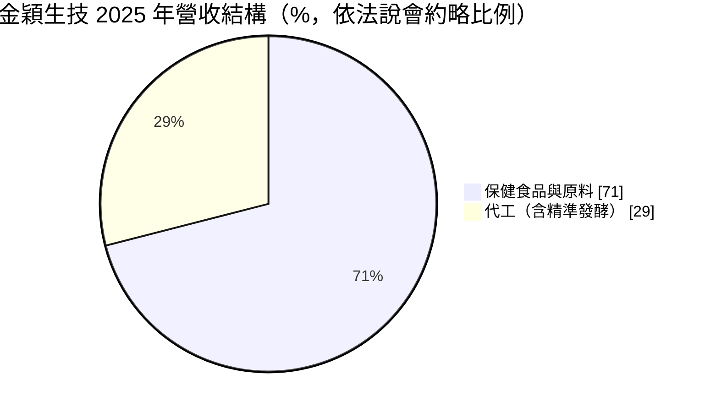
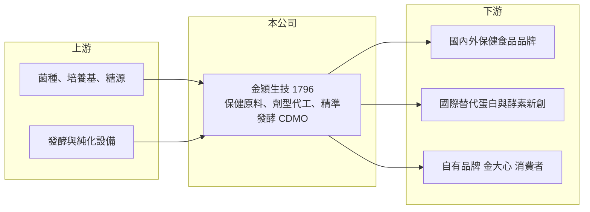

# 1796 金穎生技

> 上櫃｜[[產業索引-食品工業|食品工業]]｜上市（櫃）日期 2018/01/22

# 第一章：企業模式與商業藍圖

> [!info] 撰寫說明
> 精簡版，由 Claude 依公開資料整理，架構比照 [[2330台積電]]，資料截至 2026-10-08。來源：櫃買中心開放資料快照（基本資料、2026 年上半年資產負債與綜合損益）、Goodinfo 歷年經營績效、富果 2025 年 12 月法說會摘要（AI 整理，非公司原始文件）。#待校對

金穎生技是一家以微生物發酵為核心技術的公司，一邊賣保健食品原料與代工，一邊把發酵產能出租給國際新創做[[精準發酵]]，第二條路線是它長期轉型的重心。

- **核心業務：** 公司成立於 1999 年，2018 年 1 月上櫃，主要以發酵技術生產納豆激酶、紅麴、牛樟芝等保健原料，並提供粉劑、膠囊、錠劑、液劑、軟糖等劑型的保健食品 [[ODM]]／OEM 代工。另有自有品牌「金大心」，透過官網與電商銷售，但規模較小。
- **營收結構：** 依法說會說法，保健食品與代工的營收比約為七比三，2025 年代工約占 29%。管理層的長期目標是透過精準發酵把兩者拉到五比五，也就是讓高技術門檻的國際代工成為一半營收來源。
- **營運據點：** 南科一廠為生物質發酵，總槽體約 24 萬公升，供應保健原料與代工；南科二廠是精準發酵基地，有兩條 66 噸產線、約 15.9 萬公升，公司稱為台灣最大的精準發酵廠之一；新營廠負責成品劑型代工。管理層預期 2027 年起現有產能不足，正在評估新廠。
- **長期方向：** 國際 [[CDMO]] 客戶以替代蛋白、酵素、寡糖等新創公司為主，分布在美國、歐洲、日本與中東。若這些新創產品成功商業化，金穎作為少數能從菌種開發做到商業量產的亞洲代工廠，會有長期的放大量；反之，新創的資金與市場風險也會直接傳導過來。

# 第二章：護城河深度與競爭優勢

金穎的護城河建立在發酵放大量產的經驗與產能，這種能力需要長時間累積，但客戶集中在少數新創，優勢穩定度仍在驗證中。

- **競爭優勢：** 發酵從實驗室燒瓶放大到數十噸槽體，菌種表現、雜菌控制與產率都會改變，能穩定量產的工廠在全球並不多。金穎具備菌種開發到商業量產的一條龍服務、國際食品安全與猶太潔食認證，並把發酵週期從 10 天縮短到 6 天，這些都是新進者短期難以複製的能力。
- **客戶黏著：** 精準發酵客戶一旦在某家工廠完成製程轉移與法規文件，換廠要重新驗證，轉換成本高。法說會提到一家募資達 1.5 億美元的乳蛋白新創以金穎為獨家生產夥伴，這種綁定關係是護城河的來源，也是集中風險。
- **主要對手：** 保健原料與代工方面，國內有 [[1707葡萄王]]、[[4183福永生技]] 等發酵與保健廠；國際精準發酵代工則面對歐美與中國的大型生技代工廠與新設產能。台灣保健代工廠家數多、價格競爭激烈，金穎的差異化主要在大型發酵槽體。
- **觀察重點：** 2023 年營業利益率達 19%，2024 年轉為虧損，說明代工訂單起伏對獲利影響很大。長期要看精準發酵客戶數是否增加，以及新廠投資能否在客戶需求確定後才進行。

# 第三章：財務體質與盈利規模

資料日期：2026-10-08，表格是撰寫當時的快照；最新月營收、毛利率、累計 EPS 由自動排程寫在本筆記的屬性欄位（月營收、毛利率、累計EPS 等）。#待校對

金穎的財務特色是規模小、獲利隨代工訂單大起大落，毛利率在 18% 到 37% 之間擺動，尚未建立穩定的獲利基礎。

| 年度 | 營收（億元） | [[毛利率]] | [[營業利益率]] | EPS（元） | [[ROE]] |
|---|---|---|---|---|---|
| 2021 | 5.22 | 36.9% | 15.1% | 1.45 | 10.0% |
| 2022 | 6.34 | 35.0% | 16.1% | 2.26 | 11.8% |
| 2023 | 7.94 | 36.1% | 19.3% | 3.01 | 14.5% |
| 2024 | 5.21 | 18.6% | -6.6% | -0.54 | -2.68% |
| 2025 | 6.77 | 28.2% | 6.81% | 0.70 | 3.60% |
| 2026 上半年 | 3.22 | 21.8% | -1.7% | -0.11 | 未查得 |

資料來源：Goodinfo 歷年經營績效；2026 上半年取自櫃買中心開放資料。

- **營收規模：** 2020 年營收 3.68 億元，2025 年 6.77 億元，年複合成長率約 13%（推算），但中間 2024 年大幅衰退，成長並不平順。2026 年上半年營收約 3.2 億元並小幅虧損，與法說會對精準發酵倍增的展望有落差，需觀察下半年出貨。
- **獲利：** 近 5 年（2021 至 2025）平均 ROE 約 7.4%（推算）。毛利率在產能滿載時可到 35% 以上，產能閒置時跌到 20% 以下，屬於固定成本高、營運槓桿大的代工型態。
- **財務特色：** 2026 年第二季底權益約 7.8 億元、負債約 4.8 億元，其中非流動負債約 2.9 億元，多半與廠房投資有關。擴廠會提高折舊，若訂單未跟上，會再度壓縮獲利。
- **[[ROIC]] 與 [[WACC]]：** 以 2025 年營業利益約 0.46 億元（6.77 億 × 6.81%）、稅率 20% 計，稅後營業利益約 0.37 億元；有息負債未單獨查得，以約 3.5 億元推估，ROIC ≈ 0.37 ÷（7.8＋3.5）≈ 3.3%（推算）；2023 年高峰期同法推估約 11%。WACC 以無風險利率 1.75%、市場風險溢酬 6%、β 取小型生技食品常見值 0.8，股東權益成本約 6.6%，稅後負債成本約 2%，權益占比約七成，WACC 約 5%（推算）。目前 ROIC 低於 WACC，只有在產能滿載的年份才創造價值，精準發酵能否讓高利用率變成常態，是長期評價的核心。

# 第四章：總體風險與地緣政治

金穎的風險主要來自客戶集中、新創客戶本身的不確定性，以及擴產時機。

- **產業週期：** 保健食品代工受消費景氣與品牌商庫存影響，品牌客戶去化庫存時會減少下單。精準發酵仍是新興產業，終端產品如替代乳蛋白的價格與消費者接受度還在發展，需求成長曲線難以預測。
- **營運風險：** 法說會提到 2026 年兩家客戶預計占精準發酵產能約六成，客戶集中度高。若主要新創客戶募資不順、產品失敗或轉移生產地，產能利用率會快速下滑。
- **擴產風險：** 管理層評估新廠，若在需求尚未確定時投資，折舊與利息會先吃掉獲利；若太晚投資，又可能失去客戶。發酵廠建置期長，決策失誤的代價大。
- **其他風險：** 基因改造菌種產品在各國的法規審查不同，法規變動會影響客戶上市時程；保健食品原料面對食品安全與標示法規，也受新台幣兌美元匯率影響外銷報價。

# 專有名詞解析

## 金融

- **[[ROIC]]**：投入資本報酬率，稅後營業利益除以股東權益加有息負債，用來衡量公司運用所有資本的獲利能力。
- **[[WACC]]**：加權平均資金成本，股東權益成本與稅後負債成本依資本結構加權，ROIC 高於它才代表創造價值。

## 產業

- **[[精準發酵]]**：用經基因設計的微生物生產特定蛋白質、酵素或風味分子的發酵技術，可做出不需動物的乳蛋白等替代原料。
- **[[CDMO]]**：委託開發暨製造服務，代工廠不只生產，也協助客戶開發製程與放大量產。
- **[[ODM]]**：原廠委託設計製造，代工廠提供配方與設計，品牌商貼牌銷售。

# 核心供應鏈

- 上游：菌種與培養基、葡萄糖等碳源、發酵槽與純化設備供應商。
- 下游／客戶：國內外保健食品品牌商、美歐日與中東的精準發酵新創公司、電商通路消費者。
- 同業：[[1707葡萄王]]、[[4183福永生技]]、[[6846綠茵]]（保健原料與代工）。

## 最新新聞
<!-- news:start -->
<!-- news:end -->

## 相關連結
- [公開資訊觀測站](https://mopsov.twse.com.tw/mops/web/t05st03?step=1&firstin=1&co_id=1796)
- [Goodinfo](https://goodinfo.tw/tw/StockDetail.asp?STOCK_ID=1796)
- [Yahoo 股市](https://tw.stock.yahoo.com/quote/1796)
- [鉅亨網新聞](https://www.cnyes.com/twstock/1796/news)
