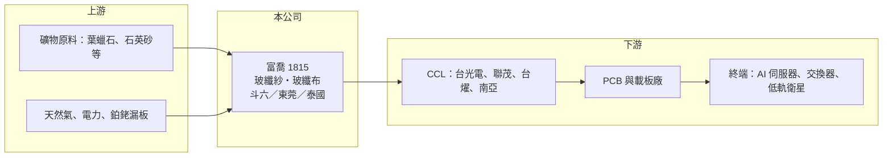

# 1815 富喬

> 上櫃｜[[產業索引-電子零組件業|電子零組件業]]｜上市（櫃）日期 2006/01/23

# 第一章：企業模式與商業藍圖

> [!info] 撰寫說明
> 精簡版，由 Claude 依公開資料整理，架構比照 [[2330台積電]]，資料截至 2026-10-08。來源：證交所／櫃買中心開放資料快照（基本資料、2026 上半年損益與資產負債、股利）、Goodinfo 經營績效頁（2019 至 2025 年度）、聯合新聞網 2026 年 6 月股東會報導、優分析與財經媒體標題。各產品營收比重未公開。#待校對

富喬工業（以下簡稱富喬）生產印刷電路板的骨架材料：玻璃纖維紗與玻纖布。它過去是景氣循環劇烈、時常虧損的大宗材料廠，近年則靠 AI 伺服器所需的低介電玻纖布轉型，是理解「傳統材料如何被 AI 重新定價」的好案例。

- **核心業務：** 富喬成立於 1999 年，2006 年在櫃買中心掛牌，工廠位於雲林斗六，另有中國東莞廠。它是台灣少數從熔爐拉製玻纖紗、再織成[[玻纖布]]的一貫化廠商。玻纖布浸上樹脂、與[[銅箔]]壓合後就成為[[銅箔基板]]，因此富喬的客戶是 CCL 廠，再往下才是 PCB 廠與電子品牌。
- **產品結構：** 傳統主力是 E 級玻纖布，用於一般消費電子與通訊板材，價格隨供需大幅波動。近年的成長來自高階品：[[Low Dk]] 一代與二代玻纖布用於 AI 伺服器與高速交換器，[[Low CTE]] 玻纖布用於 IC 載板，M9 等級[[石英布]]則已研製成功並進入客戶認證（2026 年）。公司表示 2026 年的目標是讓先進製程產品占產能比重提升到 70%。
- **營運據點：** 台灣斗六廠是高階產品的主要基地；東莞廠過去長期拖累獲利，2026 年第一季在產品組合調整與中國 E 級玻纖布漲價下轉虧為盈，並規劃導入 Low Dk 布。泰國新廠於 2026 年啟動投資、10 月動工，預計 2027 年下半年出貨，產品以低軌衛星與 AI 伺服器用布為主，回應客戶「中國以外」的供應需求。
- **長期方向：** 富喬的長期方向是從「賣噸數的大宗材料」轉為「賣規格的特用材料」。一般玻纖布同質性高，價格由產能多寡決定；低介電與低膨脹玻纖布則需要特殊玻璃配方與織布技術，供應商少、認證期長，能享有較穩定的價差。

# 第二章：護城河深度與競爭優勢

富喬在一般玻纖布市場缺乏規模優勢，它的競爭力取決於高階玻纖布能否站穩。本章說明護城河的來源與限制。

- **競爭優勢：** 低介電玻纖布的關鍵在玻璃成分配方與拉絲、織布的良率控制，日本日東紡長期是這個領域的領導者，全球能穩定量產的廠商不多。富喬具備從紗到布的一貫化能力，能自行調整玻璃配方，這是只做織布的同業做不到的。產品通過 CCL 廠與伺服器平台認證後，在該平台週期內具有一定的黏著度。
- **主要對手：** 高階領域的主要對手是日東紡（Nittobo）與其他日本廠；台灣同業有 [[1802台玻]]、[[1303南亞]]、[[5475德宏]] 與建榮；中國則有巨石、泰山玻纖、宏和科技等規模龐大的廠商。中國廠在 E 級玻纖布擁有成本優勢，一旦供過於求，報價會快速下跌，這也是富喬過去多次虧損的主因。
- **轉型的限制：** 富喬的高階化起步晚於日本廠，Low CTE 產品的生產學習曲線仍在優化中。高階產品的需求高度集中在 AI 伺服器，若 AI 投資放緩或客戶改用石英布等更新材料，富喬需要再一次跟上規格。
- **觀察重點：** 第一，先進產品占產能比重能否達到 70% 的目標。第二，石英布與 Low Dk 二代的認證與放量進度。第三，泰國新廠 2027 年下半年能否順利出貨。第四，東莞廠能否在 E 級玻纖布價格回落時仍維持獲利。

# 第三章：財務體質與盈利規模

資料日期：2026-10-08，表格是撰寫當時的快照；最新月營收、毛利率、累計 EPS 由自動排程寫在本筆記的屬性欄位（月營收、毛利率、累計EPS 等）。#待校對

富喬的財務紀錄是一部完整的景氣循環教材：七年中有三年虧損，最近兩年則因產品轉型創下新高。本章用多年度數據檢視轉型是否真的改變了獲利體質。

| 年度 | 營收（億元） | [[毛利率]] | [[營業利益率]] | EPS（元） | [[ROE]] |
|---|---|---|---|---|---|
| 2019 | 44.8 | 16.6% | 2.9% | -0.24 | -1.4% |
| 2020 | 34.3 | -2.9% | -18.0% | -1.17 | -7.0% |
| 2021 | 52.6 | 26.9% | 13.4% | 1.43 | 8.6% |
| 2022 | 46.5 | 18.0% | 4.8% | 0.07 | 0.4% |
| 2023 | 32.0 | -0.4% | -16.3% | -1.44 | -9.3% |
| 2024 | 42.5 | 14.5% | 2.1% | 0.13 | 0.9% |
| 2025 | 59.7 | 27.6% | 15.6% | 1.64 | 8.4% |
| 2026 上半年 | 40.1 | 38.1% | 23.7% | 2.24 | 未查得 |

資料來源：2019 至 2025 年為 Goodinfo 經營績效頁；2026 上半年依櫃買中心綜合損益開放資料計算。

- **營收規模：** 營收在 32 億元到 60 億元之間大幅擺盪，2019 至 2025 年年複合成長率約 4.9%（推算），但這個平均掩蓋了劇烈的循環。2025 年營收 59.7 億元、稅後淨利 8.57 億元，都創下歷史新高；2026 年上半年營收 40.1 億元，已是 2025 年全年的三分之二。
- **獲利：** 毛利率曾在 2020 年與 2023 年跌到負值，代表售價低於生產成本，這是大宗玻纖布在供過於求時的典型現象。2026 年上半年毛利率升到 38.1%，是高階產品比重提高與玻纖布漲價共同作用的結果。上半年營業外收入達 5.5 億元，占稅前淨利三分之一以上，評估本業時應以營業利益為準。
- **財務特色：** 2026 年第二季末股東權益 137.0 億元，負債 77.6 億元，負債比約 36%。2021 至 2025 年平均 ROE 僅約 1.8%（推算），說明過去整個循環幾乎沒有替股東賺到錢。2025 年度配發現金股利 0.5 元與股票股利 0.5 元，以 EPS 1.64 元計，配發率約 61%（推算）；虧損年度的股利紀錄未查得。玻纖熔爐需要定期冷修、泰國建廠也需要大量資本支出，自由現金流長期是否為正未查得。

**[[ROIC]] 與 [[WACC]]：** 開放資料未拆分有息負債，以下用區間推算。2026 年第二季末股東權益 137.0 億元，非流動負債 47.6 億元（假設大多為長期借款，作為有息負債的近似值），投入資本約 137 億至 185 億元。2025 年營業利益約 9.3 億元（59.7 億 × 15.6%），稅後約 7.5 億元，ROIC 約 4% 至 5%（推算，分母用 2026 年資本，因現金增資後資本變大而偏低）；以 2026 年上半年營業利益 9.5 億元年化，稅後約 15.2 億元，ROIC 約 8% 至 11%（推算）。WACC 以 CAPM 推估：無風險利率 1.75%、市場風險溢酬 6%、β 取玻纖與材料同業常見值 1.3（未查得公司實際數字），權益成本約 9.6%；負債成本假設 2.5%、稅率 20%，稅後 2.0%，負債占資本約 25%，WACC 約 7.7%（推算）。過去七年多數年份 ROIC 明顯低於 WACC，代表富喬長期在毀損價值；2026 年起首次出現 ROIC 高於 WACC 的情況。轉型是否成功，要看下一次玻纖布景氣下行時，ROIC 能否守在 WACC 之上。

# 第四章：總體風險與地緣政治

富喬的風險集中在玻纖布的供需循環、高階規格的技術更替，以及海外擴產的執行。

- **產業週期：** 玻纖布是產能驅動的產業，熔爐一旦點火就必須連續生產，供過於求時廠商寧可降價也不願停爐，因此價格跌幅往往很深。2020 年與 2023 年的負毛利就是例子。中國廠商大舉擴產時，E 級玻纖布價格首當其衝。
- **營運風險：** 高階玻纖布的需求集中在 AI 伺服器與高速網通，客戶與應用都相對集中。Low CTE 產品仍在學習曲線上，良率若無法提升會拖累毛利。泰國新廠的建廠、試產與認證若延誤，會先承擔折舊而沒有營收。
- **原物料與能源：** 玻纖熔爐需要大量天然氣與電力，能源價格上漲會直接墊高成本；礦物原料與鉑銠合金漏板等耗材價格也會影響成本。產品外銷與海外子公司比重高，匯率變動會影響以新台幣計的獲利。
- **其他風險：** 東莞廠暴露於中國的環保政策與市場競爭；美中科技管制可能改變客戶的採購地點，這既是泰國廠的機會，也可能使東莞廠產能利用率下降。

# 專有名詞解析

## 金融

- **[[現金增資]]**：公司發行新股向投資人募集現金，用於擴產或還債，會使股本增加、每股盈餘被稀釋。

## 產業

- **[[玻纖布]]**：以玻璃纖維紗織成的布，浸樹脂後與銅箔壓合成銅箔基板，是電路板的骨架與絕緣材料。
- **[[Low Dk]]**：低介電常數材料，用在高速板材可降低訊號延遲與損耗，是 AI 伺服器與高速交換器的關鍵規格。
- **[[Low CTE]]**：低熱膨脹係數材料，受熱時尺寸變化小，用於 IC 載板以避免晶片與基板因熱脹冷縮而翹曲。
- **[[石英布]]**：以石英纖維織成的布，介電特性優於一般玻纖布，用於下一代更高速的 AI 伺服器板材。
- **[[銅箔基板]]**：由銅箔、玻纖布與樹脂壓合而成的板材，是印刷電路板的基礎材料。

# 核心供應鏈

- 上游：玻璃原料礦物（葉蠟石、石英砂等，品項待校對）、天然氣與電力、拉絲用貴金屬漏板。
- 下游／客戶：CCL 廠，台灣主要為 [[2383台光電]]、[[6213聯茂]]、[[6274台燿]]、[[1303南亞]]（是否為富喬客戶未查得，公司未揭露客戶名稱）；再往下是 [[2368金像電]]、[[3037欣興]] 等 PCB 與載板廠。
- 同業：[[1802台玻]]、[[1303南亞]]、[[5475德宏]]、建榮、日東紡、巨石、泰山玻纖、宏和科技。

## 最新新聞
<!-- news:start（自動產生，請勿手動編輯此範圍） -->
- 2026-10-19 📰 媒體 10:54｜〈焦點股〉富喬泰國新廠動工 逆勢爆量攻漲停創天價｜[鉅亨網](https://news.cnyes.com/news/id/6633245)
- 2026-10-16 🏛️ 重訊 15:20｜本公司有價證券近期於櫃買市場達公布注意交易資訊 標準，故公布相關財務業務資訊，以利投資人區別瞭解。｜[觀測站](https://mops.twse.com.tw/mops/#/web/t05st01)
- 2026-10-15 🏛️ 重訊 11:26｜澄清媒體報導｜[觀測站](https://mops.twse.com.tw/mops/#/web/t05st01)
- 2026-10-08 📰 媒體 17:23｜營收速報 - 富喬(1815)9月營收9.39億元年增率高達82.14％｜[鉅亨網](https://news.cnyes.com/news/id/6624984)

完整紀錄：[[1815富喬 新聞]]
<!-- news:end -->

## 相關連結
- [公開資訊觀測站](https://mopsov.twse.com.tw/mops/web/t05st03?step=1&firstin=1&co_id=1815)
- [Goodinfo](https://goodinfo.tw/tw/StockDetail.asp?STOCK_ID=1815)
- [Yahoo 股市](https://tw.stock.yahoo.com/quote/1815)
- [鉅亨網新聞](https://www.cnyes.com/twstock/1815/news)
