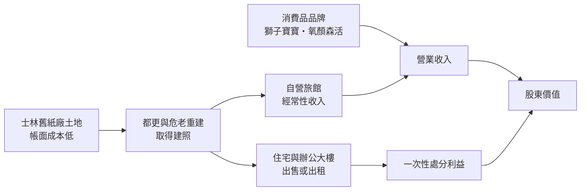
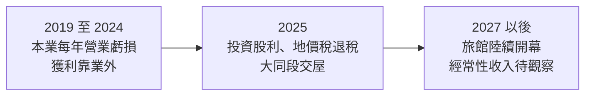
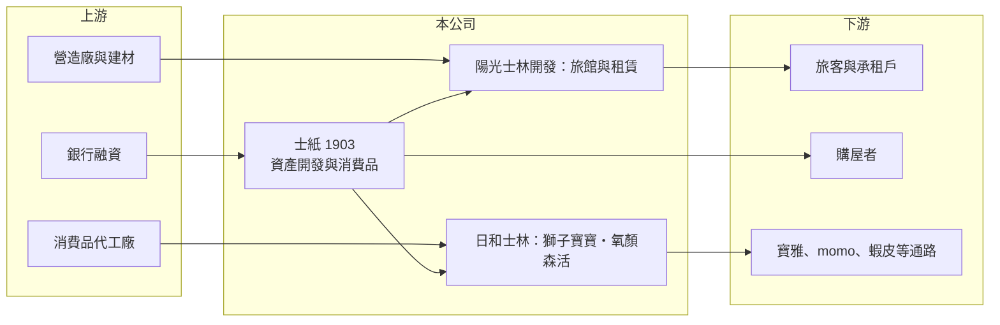

# 1903 士紙

> 上市｜[[產業索引-造紙工業|造紙工業]]｜上市（櫃）日期 1963/12/09

# 第一章：企業模式與商業藍圖

> [!info] 撰寫說明
> 本文由 Claude 依公開資料整理，架構比照 [[2330台積電]] 的四章研究，資料截至 2026-10-08。財務數字來源：Goodinfo 年度經營績效頁、富果研究 2025 年 12 月法說會整理（業務架構、開發案時程、2025 年前三季財務）、證交所開放資料（基本資料、2026 年第二季資產負債與營益分析、股利、本益比）；公開資料有限，各業務營收比重未查得。#待校對

在評估單一個股的長期投資價值時，首要步驟是拆解企業的底層獲利邏輯。本章針對士林紙業（股票代號：1903，以下簡稱士紙）的商業模式進行定性分析。士紙雖然仍被歸類在造紙業，但它的價值早已不在造紙，而在台北士林的土地，以及這些土地正在變成的旅館與住宅。

## 一、核心定位：從造紙廠轉型的資產開發控股公司

士紙成立於 1959 年，1963 年上市，實收資本額約 26.0 億元。依公司法說會說明，士紙已從傳統造紙業轉型為控股公司，業務聚焦在兩大塊：民生消費品與資產開發（富果整理）。

士紙最重要的資產，是位於台北市士林區、捷運士林站附近的舊紙廠土地。台北市中心的大面積完整土地極為稀少，加上鄰近的北投士林科技園區（北士科）陸續引進輝達、Google 等科技企業，這些土地的潛在價值遠高於帳面成本。這也是士紙本業營收只有一、兩億元，市值卻能遠高於淨值的原因。

## 二、業務板塊

* **民生消費品：** 透過子公司日和士林經營母嬰品牌「獅子寶寶」（濕紙巾、防蚊用品、嬰幼兒洗沐保養品）與保養品牌「氧顏森活」（面膜與保養品，2022 至 2024 年連續三年獲世界品質評鑑大賞金、銀牌）。通路包括寶雅、官網、momo 與蝦皮，並在日本設立銷售據點，新加坡、馬來西亞布局中。
* **租賃與旅館：** 由陽光士林開發負責住宅、大樓開發與不動產租賃，旗下有陽光士林珮柏旅館（56 間客房）。
* **建案與都更：** 由士林環境淨化、大地都更建設擔任開發案的[[都更]]實施者。2025 年 11 月大同段[[合建]]案完工交屋，士紙分回 8 戶，其中 7 戶已銷售交屋、1 戶保留自用出租。

## 三、資本轉化邏輯：把土地變成現金流

* **[[資產活化]]的兩種路徑：** 一是自己開發、自己經營旅館或出租，換取長期穩定的[[經常性收入]]；二是合建或出售，一次實現土地價值。士紙兩者都有，但從規劃來看，公司更傾向自持旅館，強調目標是永續經營而不是短期獲利了結。
* **時程很長：** 依公司說明，都更從送件到取得建照約需 2 至 3 年，興建期約 3 至 4 年，土地價值要轉化為穩定收入，往往需要五年以上。

## 四、企業長期藍圖：三個旅館開發案

依 2025 年 12 月法說會的說明（富果整理）：

* **5 號倉庫旅館都更案：** 位於捷運士林站 2 號出口旁，地上 12 層、地下 3 層，定位輕奢級（約 4.5 至 5 星）。結構體已完成，預計 2026 年第一季取得使用執照，室內裝修約 9 至 12 個月，目標 2027 年試營運。
* **福德路 18 號[[危老重建]]案：** 地上 10 層、地下 3 層的旅館大樓，定位流行風格（約 3.5 至 4 星），鎖定年輕族群與背包客，預計 2026 年第三季取得使用執照。
* **士林舊廠區：** 規劃住宅、旅館與辦公大樓，並與鄰近福德宮共同都更，共四張建照，其中包括約 250 間客房的五星級飯店。2024 年 12 月廠區部分歷史建築修復再利用計畫獲准，預計 2026 年第一季提出都更申請，資金來源可能包括自有資金、增資、銀行聯貸或引進第三方出資者。

如果這三案都順利完成，士紙將從一家營收不到兩億元的小公司，轉變為擁有多家旅館的觀光不動產公司。

# 第二章：護城河深度與競爭優勢

本章分析士紙的競爭優勢。士紙的護城河不是產品或技術，而是土地。

## 一、護城河的核心組成要素

* **不可複製的區位：** 捷運士林站周邊的大面積土地，在台北市幾乎不可能再取得。北士科的發展、捷運與觀光人潮，都讓這些土地的長期價值有支撐。
* **低帳面成本：** 土地取得年代久遠，帳面成本遠低於市價，這讓士紙開發時不需要負擔高昂的土地成本，旅館營運的損益兩平點較低。
* **完整的旅館產品線：** 三個開發案分別定位五星級、輕奢與流行風格，可以服務不同客群，也能分散單一定位的風險。

## 二、主要競爭對手格局

| 類別 | 競爭者 | 與士紙的比較 |
|---|---|---|
| 士林資產股 | [[1419新紡]] 等 | 同樣擁有士林土地，市場常將兩者並列比較 |
| 台北旅館業者 | [[2707晶華]]、[[2704國賓]] 等連鎖飯店 | 經營經驗與品牌遠勝士紙，是旅館營運的主要競爭者 |
| 母嬰與保養品 | 國際與本土品牌 | 士紙消費品規模小，品牌力有限 |

## 三、優勢轉化：守得住、守不住與觀察重點

* **守得住：** 土地價值。只要台北的土地稀缺性不變，士紙的資產價值就有底部支撐。
* **守不住：** 消費品本業的規模。獅子寶寶與氧顏森活面對眾多競爭品牌，營收規模小，難以獨立支撐公司的獲利。
* **觀察重點：** 5 號倉庫與福德路兩家旅館能否如期開幕並達到合理[[住房率]]；士林舊廠區都更審議進度；以及開發資金是否需要增資而稀釋股東權益。

# 第三章：財務體質與盈利規模

資料日期：2026-10-08。數字取自 Goodinfo 年度經營績效頁、富果法說會整理與證交所開放資料，表格是撰寫當時的快照；最新月營收、毛利率、累計 EPS 由自動排程寫在本筆記的屬性欄位（月營收、毛利率、累計EPS 等）。#待校對

財務報表是檢驗護城河是否真實存在的最終標準。對士紙而言，本業財報很難反映它的真正價值，本章重點在於區分本業與業外、一次性收益。

## 一、獲利能力的基石：三率

| 年度 | 營收（新台幣） | [[毛利率]] | [[營業利益率]] | EPS（元） | [[ROE]] |
|---|---|---|---|---|---|
| 2019 | 1.69 億 | 30.8% | -109% | -0.69 | -6.99% |
| 2020 | 1.59 億 | 33.6% | -95.6% | -0.52 | -4.57% |
| 2021 | 3.26 億 | 54.1% | -8.15% | 0.32 | 1.42% |
| 2022 | 1.65 億 | 46.1% | -62.5% | 0.81 | 3.11% |
| 2023 | 1.71 億 | 49.7% | -37.8% | 0.33 | 1.82% |
| 2024 | 1.56 億 | 60.0% | -31.0% | -0.08 | -0.44% |
| 2025 | 1.53 億 | 65.2% | -14.3% | 1.29 | 6.22% |
| 2026 上半年 | 0.77 億 | 64.19% | -23.78% | -0.15 | 未查得 |

* **[[毛利率]]：** 毛利率從 2019 年的約 31% 升到 2025 年的約 65%，反映營收結構從低毛利業務轉向租賃與品牌消費品。
* **[[營業利益率]]：** 七年都是營業虧損，因為營收規模太小，管理費用與開發案的前期費用無法被攤平。
* **獲利來源：** 有獲利的年度都來自[[業外收益]]。2025 年前三季營業淨損約 1,352 萬元，稅前淨利卻有約 1.39 億元，主要來自一筆長期投資的股利收入與 2021 至 2024 年的地價稅退稅（富果整理），屬於[[一次性收益]]。

## 二、[[ROE]]：資本效率

2021 至 2025 年平均 ROE 約 2.4%（推算），長期偏低。原因是士紙的大部分資本被土地與開發中資產占用，這些資產在開發完成前不產生收入。2026 年第二季底每股淨值約 21.18 元，股價淨值比約 2.24 倍（證交所開放資料），代表市場用土地的潛在市價而非帳面淨值評價士紙。

## 三、資本支出、自由現金流與股利

旅館與都更開發需要大量資金，2026 年第二季底總負債約 50.9 億元、權益約 55.1 億元，負債比約 48%（證交所開放資料），開發期間自由現金流預期為負（推估）。股利方面，2025 年度雖有獲利，但未配發現金股利（證交所股利資料），公司優先把現金留給開發案。

## 四、[[ROIC]] 與 [[WACC]]：價值創造利差

**ROIC 推算：** 2025 年營業利益約 -0.22 億元（1.53 億 × -14.3%），ROIC 為負。以 2026 年第二季底權益約 55.1 億元、總負債約 50.9 億元，假設其中約 60% 為有息負債（推估，約 30.5 億元），投入資本約 85.6 億元，ROIC 約 -0.3%（推算）。

**WACC 推算：** 假設台灣 10 年期公債殖利率 1.75%、市場風險溢酬 6%、β 取 0.8（資產股常見值），股東權益成本約 6.55%。負債成本假設 2.5%，稅後約 2.0%；以帳面價值計，權益約占 64%，WACC 約 4.9%（推算）。

**結論：** 以目前的財報來看，士紙的 ROIC 低於 WACC，本業並未創造價值。但士紙的情況特殊：土地以歷史成本入帳，大量資本處於開發中、尚未產生收益的階段。真正的檢驗點是 2027 年以後旅館陸續營運，屆時穩定的經常性收入能否讓 ROIC 超過資金成本。

# 第四章：總體風險與地緣政治

任何企業都無法脫離宏觀環境獨立存在。本章分析士紙長期必須面對的開發、觀光景氣、財務與法規風險。

## 一、開發與執行風險

* **都更審議時程：** 都更與危老案容易受政府審議、鄰地整合與歷史建築保存影響，時程延後是常態。士林舊廠區從送件到完工可能需要五到七年。
* **營建成本：** 營建原物料與工資上漲會推高開發成本，壓縮投資報酬。
* **旅館經營能力：** 士紙過去只有經營一家 56 間房旅館的經驗，同時開出多家不同定位的旅館，對管理能力是很大的挑戰。

## 二、觀光與景氣循環

* **觀光景氣：** 旅館收入取決於國際觀光客與國內旅遊需求，疫情、兩岸關係與匯率都可能大幅影響住房率。
* **不動產景氣：** 若選擇出售部分開發成果，價格與去化速度受房市與央行信用管制影響。

## 三、財務風險

* **開發資金：** 三個開發案需要大量資金，公司可能以增資、銀行聯貸或引進第三方出資，增資會稀釋現有股東，借款則會提高財務槓桿。
* **獲利不穩定：** 在旅館營運穩定前，獲利主要依賴業外與一次性收益，EPS 波動很大。

## 四、法規與治理

* **土地與文資法規：** 舊廠區有歷史建築，保存與再利用的要求會影響開發方式與容積。
* **治理：** 董事長由法人（臺實貿易）擔任，重大資本配置決策（增資、引進出資者）對小股東權益影響大，需要留意。

# 專有名詞解析

## 金融

- **[[經常性收入]]**：每年可重複發生的收入，例如租金、旅館營運收入，比一次性處分收益更穩定。
- **[[業外收益]]**：本業以外的收入，例如投資收益、處分資產利益或匯兌利益，通常不具持續性。
- **[[一次性收益]]**：處分資產、退稅等不會每年重複發生的收益，評估長期獲利時應排除。
- **[[ROIC]]**：投入資本報酬率，稅後營業利益除以股東權益與有息負債的合計，衡量本業對所有資金提供者的報酬。
- **[[WACC]]**：加權平均資金成本，依股東權益與負債的比重加權計算的資金成本，ROIC 高於它才代表創造價值。

## 產業

- **[[資產活化]]**：把閒置或低度利用的土地、廠房改作出租、開發或出售，以提高資產報酬。
- **[[都更]]**：都市更新，由地主與建商合作把老舊建物改建，地主依權利價值分回房地或收益。
- **[[危老重建]]**：依危老條例針對屋齡老舊或耐震不足的建物重建，整合門檻比都更低、規模通常較小。
- **[[合建]]**：地主提供土地、建商出資興建，完工後雙方依約定比例分配房屋或銷售收入。
- **[[住房率]]**：旅館已售出客房數占可售客房數的比例，是衡量旅館經營績效的核心指標。

# 核心供應鏈

## 1. 上游：開發與代工
- 營造廠、建材供應商、銀行融資
- 消費品代工廠

## 2. 中游：士紙本身與比較對象
- 士林資產股：[[1419新紡]]
- 台北旅館業者：[[2707晶華]]、[[2704國賓]]

## 3. 下游：客戶與通路
- 旅客、承租戶與購屋者
- 寶雅、momo、蝦皮等零售與電商通路

## 最新新聞
<!-- news:start -->
<!-- news:end -->

## 相關連結
- [公開資訊觀測站](https://mopsov.twse.com.tw/mops/web/t05st03?step=1&firstin=1&co_id=1903)
- [Goodinfo](https://goodinfo.tw/tw/StockDetail.asp?STOCK_ID=1903)
- [Yahoo 股市](https://tw.stock.yahoo.com/quote/1903)
- [鉅亨網新聞](https://www.cnyes.com/twstock/1903/news)
