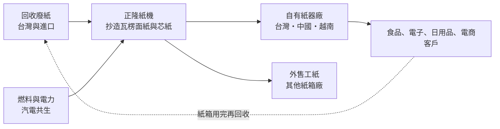
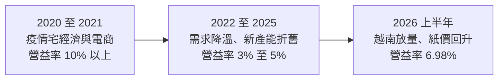
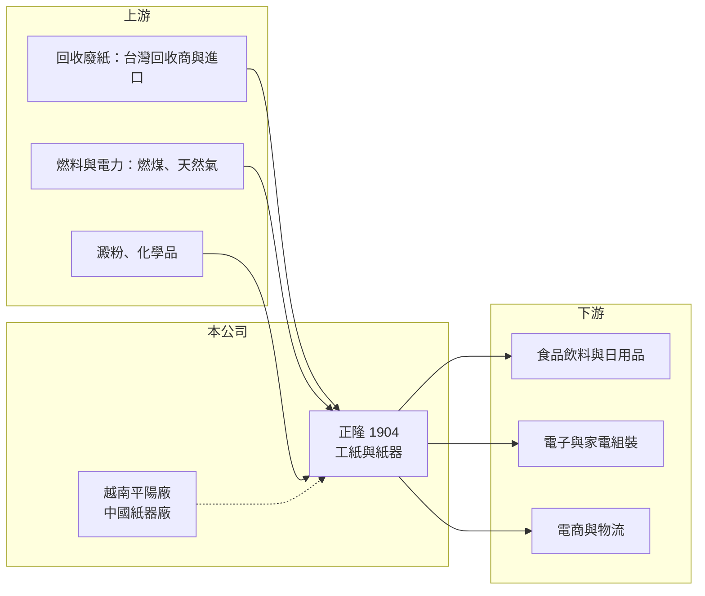

# 1904 正隆

> 上市｜[[產業索引-造紙工業|造紙工業]]｜上市（櫃）日期 1971/09/10

# 第一章：企業模式與商業藍圖

> [!info] 撰寫說明
> 本文由 Claude 依公開資料整理，架構比照 [[2330台積電]] 的四章研究，資料截至 2026-10-08。財務數字來源：Goodinfo 年度經營績效頁、證交所開放資料（基本資料、2026 年第二季資產負債、綜合損益與營益分析、股利、本益比）、nstock 公司小百科；越南擴產與產品結構參考經濟日報、優分析的法說會報導標題，廠區與品牌細節部分憑記憶整理，已標「待校對」。#待校對

在評估單一個股的長期投資價值時，首要步驟是拆解企業的底層獲利邏輯。本章針對正隆（股票代號：1904）的商業模式進行定性分析，說明這家台灣老牌工紙廠如何從廢紙回收一路做到紙箱，以及越南為何成為它近年最重要的成長引擎。

## 一、核心定位：從廢紙到紙箱的垂直整合工紙廠

正隆成立於 1959 年，1971 年上市，實收資本額約 110.8 億元，董事長為鄭人銘。公司主要業務依財報說明包括紙類製造買賣、造紙原料產銷、紙器與紙類加工品產銷，以及委託營造商興建住宅或商業大樓出售、出租。2004 年吸收合併天隆造紙，2015 年吸收合併山富紙業（nstock 公司沿革）。

正隆的核心是[[工業用紙]]，也就是做紙箱用的[[瓦楞紙]]（面紙與芯紙）。它的商業模式可以拆成三段：上游回收[[廢紙]]作為原料，中游用紙機把廢紙重新抄成工紙，下游再把工紙加工成紙板與紙箱賣給食品、電子、日用品等製造業。能同時掌握三段的業者，可以在紙價波動時調整內部銷售比例，這就是[[垂直整合]]的價值。

## 二、產品與地區板塊

本文未查得正隆最新的營收比重，以下依業務性質整理：

* **工紙：** 包含瓦楞面紙、芯紙與部分紙板，一部分自用於紙器廠，一部分外售給其他紙箱廠。工紙價格隨廢紙成本與供需變動，是獲利波動的主要來源。
* **紙器：** 把工紙壓製成瓦楞紙板與紙箱，客戶是需要包裝出貨的製造業與電商。紙器屬於「離客戶近」的生意，交期、印刷品質與服務比價格更重要，毛利相對穩定。
* **地區：** 台灣是本業基地；中國以紙器廠為主（待校對）；越南是近年擴產重心，公司在平陽省設有工紙廠，並與兆豐銀行完成 2.3 億美元聯貸擴充越南產能（優分析報導標題）。越南因為承接外資電子、鞋業與家具的產能轉移，包裝需求成長快於台灣與中國。
* **其他：** 家庭用紙品牌「春風」（待校對）與不動產開發，比重較小。

## 三、資本轉化邏輯：紙機、廢紙與能源

* **紙機是重資產、長壽命設備：** 一台大型工紙機投資動輒上百億元，可運轉二、三十年。產能一旦建好，[[產能利用率]]決定單位折舊成本，景氣差時工紙廠會選擇停機歲修或減產，而不是降價搶單。
* **廢紙是最大的變動成本：** 工紙的利潤基本上就是「紙價減廢紙價」的[[價差]]。中國 2021 年起全面禁止進口廢紙後，全球廢紙流向改變，亞洲紙廠的原料價格與供應變得更不穩定。
* **能源占比高：** 抄紙需要大量蒸汽與電力，紙廠多半自設[[汽電共生]]鍋爐。燃煤與天然氣價格、以及台灣的[[碳費]]，都會直接影響成本。

## 四、企業長期藍圖

正隆的長期方向可以歸納為三點。第一是「越南化」，把成長性最高的產能放在越南，跟著客戶的供應鏈移轉一起成長，公司在法說會表示越南新產能陸續投產、下半年營運優於上半年（經濟日報法說會報導標題）。第二是提高紙器比重，讓更多自產工紙在集團內部轉成附加價值較高的紙箱。第三是能源與減碳，紙業是用能大戶，汽電共生效率、生質燃料與綠電，會成為十年後紙廠之間的成本差距來源。

# 第二章：護城河深度與競爭優勢

本章分析正隆的競爭優勢，說明工紙業的護城河從何而來，以及在中國產能過剩與台灣需求成熟之下，哪些優勢守得住。

## 一、護城河的核心組成要素

* **規模與垂直整合：** 正隆是台灣最大的工紙與紙器業者之一（待校對），從回收、抄紙到紙箱一條龍，自用比例讓它在工紙報價下跌時仍能把價值留在紙器端。
* **紙器廠的地域性：** 紙箱體積大、價值低，運輸半徑通常在一、兩百公里內，客戶也重視準時交貨與小批量印刷。紙器廠一旦設在客戶聚落旁邊，就形成在地優勢，新進者不容易搶單。
* **越南先行者優勢：** 在越南設廠需要時間取得土地、環評與電力，正隆較早布局，能就近服務台商與外資在越南的工廠。
* **財務與土地資產：** 正隆持有的老廠區土地具備增值潛力，公司業務項目中也包含不動產開發，必要時可以透過[[資產活化]]支應資本支出（具體土地面積未查得）。

## 二、主要競爭對手格局

| 競爭對手 | 主要市場 | 與正隆的比較 |
|---|---|---|
| [[1909榮成]] | 台灣、中國 | 產能重心在中國，受中國工紙價格影響較大 |
| [[1907永豐餘]] | 台灣、中國 | 集團旗下有工紙、紙漿、家用紙與電子紙轉投資 |
| 玖龍紙業、理文造紙 | 中國、東南亞 | 規模遠大於台廠，近年也在越南、馬來西亞擴產 |
| 越南本地與泰國 SCG 等業者 | 東南亞 | 在越南工紙與紙器市場直接競爭 |

## 三、優勢轉化：守得住、守不住與觀察重點

* **守得住：** 紙器端的在地服務與客戶關係。紙箱是客戶出貨不可或缺的耗材，換供應商要重新打樣與驗證，客戶黏著度高。
* **守不住：** 工紙報價。工紙是同質性高的大宗商品，中國大廠擴產與東南亞新產能開出時，正隆只能跟隨市場價格，2022 至 2025 年毛利率從二成以上掉到 16% 至 18% 就是例子。
* **觀察重點：** 越南新產能的利用率與當地紙價、紙器自用比例的提升，以及廢紙價格與能源成本的走勢。這三者決定正隆能否回到 2020 至 2021 年 10% 以上的營業利益率。

# 第三章：財務體質與盈利規模

資料日期：2026-10-08。數字取自 Goodinfo 年度經營績效頁與證交所開放資料，表格是撰寫當時的快照；最新月營收、毛利率、累計 EPS 由自動排程寫在本筆記的屬性欄位（月營收、毛利率、累計EPS 等）。#待校對

財務報表是檢驗護城河是否真實存在的最終標準。本章用多年度的三率、ROE 與資本報酬，檢視正隆在工紙景氣循環中的獲利品質。

## 一、獲利能力的基石：三率

| 年度 | 營收（新台幣） | [[毛利率]] | [[營業利益率]] | EPS（元） | [[ROE]] |
|---|---|---|---|---|---|
| 2019 | 404 億 | 22.8% | 8.7% | 2.08 | 9.44% |
| 2020 | 401 億 | 26.5% | 12.5% | 3.36 | 14.3% |
| 2021 | 450 億 | 22.7% | 10.2% | 3.58 | 14.5% |
| 2022 | 439 億 | 16.7% | 3.77% | 2.27 | 9.39% |
| 2023 | 422 億 | 18.2% | 4.71% | 0.83 | 3.16% |
| 2024 | 452 億 | 16.3% | 3.42% | 0.55 | 2.18% |
| 2025 | 430 億 | 18.0% | 4.38% | 0.74 | 2.64% |
| 2026 上半年 | 221.1 億 | 20.57% | 6.98% | 1.45 | 未查得 |

* **[[毛利率]]：** 2020 年疫情帶動電商與宅經濟包裝需求，毛利率衝上 26.5%；2022 年起全球消費降溫、客戶去庫存，毛利率回落到 16% 至 18%。2026 年上半年回升到 20.57%（證交所營益分析），反映越南需求與紙價調漲。
* **[[營業利益率]]：** 工紙廠的營業費用相對固定，營收或價差一變動，營業利益率的波動比毛利率更大，這是典型的[[營運槓桿]]。
* **營收趨勢：** 2021 至 2025 年營收大致在 420 億至 450 億元之間，年複合成長率約 -1.1%（推算），成長主要靠價格而不是量。
* **2022 年的特殊性：** 2022 年營業利益率只有 3.77%，EPS 卻有 2.27 元，差額來自業外收益（推估為資產處分或投資收益，具體項目未查得），評估本業時應以營業利益為準。

## 二、[[ROE]]：資本效率

2021 至 2025 年平均 ROE 約 6.4%（推算），但走勢是從 14.5% 一路降到 2% 多。2026 年第二季底權益總計約 314.6 億元、總負債約 451.3 億元，負債比約 59%（證交所開放資料），高於同業水準，顯示越南擴產主要以借款支應。高負債在景氣好時放大 ROE，景氣差時則讓利息支出吃掉大部分營業利益。

## 三、資本支出、自由現金流與股利

越南新紙機與聯貸代表近年處於資本支出高峰，自由現金流在擴產期間偏弱（推估，具體金額未查得）。股利方面，2025 年度配發現金股利 0.45 元，以 EPS 0.74 元計算[[配發率]]約 61%（推算）；2026 年 10 月初殖利率約 1.84%、股價淨值比約 0.89 倍（證交所本益比資料）。股利金額隨景氣明顯起伏，不屬於穩定配息型的公司。

## 四、[[ROIC]] 與 [[WACC]]：價值創造利差

**ROIC 推算：** 2025 年營業利益約 18.8 億元（430 億 × 4.38%），扣除 20% 稅率後約 15.1 億元。2026 年第二季底權益總計約 314.6 億元，總負債約 451.3 億元，假設其中約 65% 為有息負債（推估，約 293 億元），投入資本約 608 億元，ROIC 約 2.5%（推算）。以同樣的資本基礎回推 2021 年高峰（營業利益約 45.9 億元），ROIC 約 6%（推算）。

**WACC 推算：** 假設台灣 10 年期公債殖利率 1.75%、市場風險溢酬 6%、β 取造紙業常見值 0.8，股東權益成本約 6.55%。負債成本假設 2.3%，稅後約 1.8%；以帳面價值計，權益約占 52%、有息負債約占 48%，WACC 約 4.3%（推算）。

**結論：** 正隆在景氣高峰時 ROIC 高於 WACC，2022 至 2025 年的低谷期則低於資金成本，代表這段期間的擴產尚未創造價值。2026 年上半年營業利益率回到約 7%，若能維持，ROIC 可回到 4% 至 5%（推算），大約與資金成本打平；越南新產能能否持續滿載，是正隆能否長期創造價值的關鍵。

# 第四章：總體風險與地緣政治

任何企業都無法脫離宏觀環境獨立存在。本章分析正隆長期必須面對的產業週期、原料能源、地緣政治與法規風險。

## 一、產業週期與市場結構

* **工紙的景氣循環：** 工紙需求跟著製造業出貨與消費走，價格則由產能決定。中國與東南亞大廠每隔幾年就有一波新產能開出，供過於求時紙價可能長期低迷，2022 至 2025 年就是一個完整的低谷。
* **[[長鞭效應]]：** 景氣轉弱時，品牌商、製造商與紙箱廠同時去庫存，工紙需求的下滑幅度會大於終端消費。
* **電商與減塑：** 電商包裝與「以紙代塑」是長期利多，但輕量化包裝與循環箱也可能減少單位紙用量。

## 二、原料與能源

* **廢紙價格：** 廢紙是最大的成本項目，價格受歐美回收量、中國政策與海運運費影響，波動大且難以轉嫁。
* **能源成本與碳費：** 紙廠自設汽電共生鍋爐，燃煤、天然氣與電價上漲會直接壓縮價差。台灣已開徵碳費，越南未來也可能導入碳定價，減碳投資將是長期支出。

## 三、地緣政治與營運風險

* **越南集中度提高：** 成長愈依賴越南，愈受越南的匯率、電力供應、勞動法規與美國對越南關稅政策影響。
* **財務槓桿：** 負債比約 59%，擴產期間若紙價下跌，利息負擔會放大虧損，也可能壓縮配息。
* **匯率：** 越南與中國子公司以當地貨幣營運，聯貸以美元計價，新台幣、越南盾與美元之間的變動會帶來匯兌損益。

## 四、法規與環保

* **環保法規：** 造紙業有廢水、污泥與空污排放，各國環保標準提高時需要追加投資。
* **循環經濟政策：** 各國推動包裝材料回收率與再生料比例，對以廢紙為原料的工紙廠是利多，但也可能帶來回收體系的成本分攤。

# 專有名詞解析

## 金融

- **[[產能利用率]]**：實際產量占總產能的比例，重資產產業的毛利率高度取決於此數字。
- **[[營運槓桿]]**：固定成本占比高的企業，營收小幅變動就會讓營業利益大幅變動的現象。
- **[[ROIC]]**：投入資本報酬率，稅後營業利益除以股東權益與有息負債的合計，衡量本業對所有資金提供者的報酬。
- **[[WACC]]**：加權平均資金成本，依股東權益與負債的比重加權計算的資金成本，ROIC 高於它才代表創造價值。

## 產業

- **[[工業用紙]]**：用於包裝與工業用途的紙種，主要是做紙箱的瓦楞面紙與芯紙，又簡稱工紙。
- **[[瓦楞紙]]**：由平面的面紙與波浪狀的芯紙黏合而成的紙板，是紙箱的主要材料。
- **[[廢紙]]**：回收的舊紙箱與紙類，是工紙廠最主要的原料，價格波動直接影響工紙獲利。
- **[[垂直整合]]**：同一家公司掌握上下游多個環節，例如從原料、製造到成品，可降低交易成本並穩定供應。
- **[[汽電共生]]**：同時產生電力與蒸汽的發電方式，蒸汽供工廠製程使用，整體能源效率比單純發電高。
- **[[價差]]**：產品售價與主要原料成本之間的差額，是加工型產業獲利的核心指標。

# 核心供應鏈

## 1. 上游：原料與能源
- 回收廢紙（台灣回收體系與歐美進口）
- 燃料與電力：燃煤、天然氣、台電

## 2. 中游：正隆本身與同業
- 台灣同業：[[1909榮成]]、[[1907永豐餘]]
- 國際同業：玖龍紙業、理文造紙、泰國 SCG

## 3. 下游：紙箱使用者
- 食品飲料、日用品、電子組裝與電商物流業者

## 最新新聞
<!-- news:start -->
<!-- news:end -->

## 相關連結
- [公開資訊觀測站](https://mopsov.twse.com.tw/mops/web/t05st03?step=1&firstin=1&co_id=1904)
- [Goodinfo](https://goodinfo.tw/tw/StockDetail.asp?STOCK_ID=1904)
- [Yahoo 股市](https://tw.stock.yahoo.com/quote/1904)
- [鉅亨網新聞](https://www.cnyes.com/twstock/1904/news)
