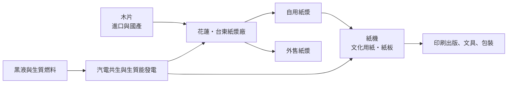
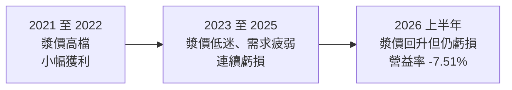
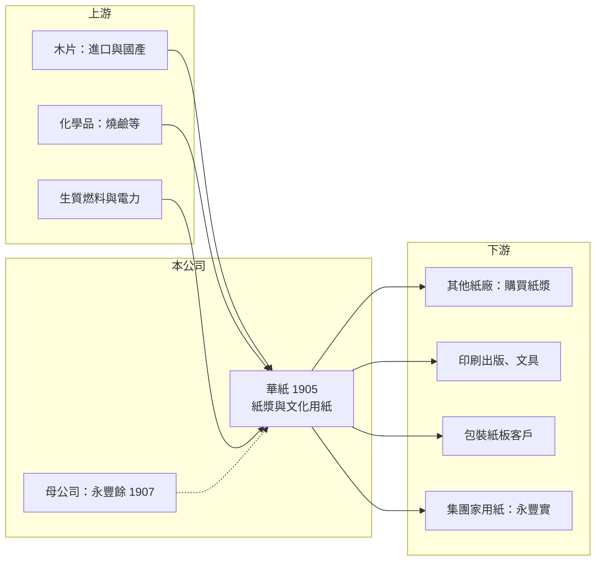

# 1905 華紙

> 上市｜[[產業索引-造紙工業|造紙工業]]｜上市（櫃）日期 1975/02/07

# 第一章：企業模式與商業藍圖

> [!info] 撰寫說明
> 本文由 Claude 依公開資料整理，架構比照 [[2330台積電]] 的四章研究，資料截至 2026-10-08。財務數字來源：Goodinfo 年度經營績效頁、證交所開放資料（基本資料、2026 年第二季資產負債與營益分析、股利、本益比）、優分析 2025 年度法說會整理（綠電計畫、漿價、虧損原因）；產品線與廠區分工部分憑記憶整理，已標「待校對」。#待校對

在評估單一個股的長期投資價值時，首要步驟是拆解企業的底層獲利邏輯。本章針對中華紙漿（股票代號：1905，以下簡稱華紙）的商業模式進行定性分析，說明這家台灣少數自產紙漿的紙廠，為何長期受國際漿價擺布，以及它正在進行的能源轉型。

## 一、核心定位：自產紙漿的一貫化紙廠

華紙成立於 1968 年，1975 年上市，實收資本額約 110.3 億元，是 [[1907永豐餘]] 具控制力的子公司。2012 年永豐餘把紙與紙板事業分割給華紙後，華紙成為集團的紙漿與印刷書寫用紙平台（nstock 永豐餘公司沿革）。

華紙的特色是「從木片到紙」的一貫化生產：花蓮廠與台東廠以進口與國產木片製造[[化學紙漿]]，一部分自用於抄造[[文化用紙]]與紙板，一部分外售給其他紙廠（廠區分工待校對）。高雄久堂廠是主要的紙機廠區（待校對）。這種模式的好處是漿價高漲時有成本優勢，壞處是漿價低迷時，紙漿廠本身的固定成本會變成負擔。

## 二、產品板塊

本文未查得華紙最新的營收比重，以下依產品性質整理（待校對）：

* **紙漿：** 以[[短纖漿]]為主，價格跟著國際漿價走。2025 年第四季起短纖漿價格累計上漲約 120 美元，漲到每公噸約 620 美元；長纖漿約 720 至 730 美元（優分析法說會整理）。
* **文化用紙：** 印刷紙、書寫紙、影印紙等，需求隨數位化長期下滑。
* **紙板與特殊紙：** 用於包裝與印刷的白紙板等，需求較穩定。
* **中國業務：** 集團在中國揚州有紙廠（待校對），面對中國龐大產能的價格競爭。

## 三、資本轉化邏輯：漿紙一貫與能源

* **漿價決定一切：** 華紙的紙漿與紙價都跟著國際行情走，國際漿價由南美、北歐的大型紙漿廠主導。華紙規模小，無法影響價格，只能透過減產、歲修與接單策略（以短單為主、長單有限）降低波動。
* **木片與運費：** 木片是紙漿的主要原料，木片與海運運費同步上漲時會推升成本，華紙曾因此宣布減產。
* **生質能是天然優勢：** 製漿過程產生的黑液與樹皮可以當作燃料，紙漿廠天生具備發展[[生質能]]發電的條件。

## 四、企業長期藍圖：從紙廠變成綠電廠

華紙的長期策略核心是能源轉型（優分析法說會整理）：

* **花蓮廠：** 2025 年啟動投資超過 30 億元的生質能發電新建案，年發電量由 1.5 億度倍增到 3.6 億度，綠電比重預估 9 成以上。
* **高雄久堂廠：** 把既有[[汽電共生]]鍋爐改為全木生質能綠電，搭配[[儲能]]設施打造智慧能源系統。
* **台東廠：** 委由三越企業建置沼氣發電設施，預計 2027 年底完成，綠電比重約 3 成。
* **整體：** 各項綠電預計 2027 年前陸續到位，整體綠電占比預估可達 8 成。

這個轉型有兩層意義：一是降低碳費與能源成本，二是讓紙漿廠的副產品變成可出售或自用的綠電，讓華紙不再只是一家看漿價吃飯的公司。

# 第二章：護城河深度與競爭優勢

本章分析華紙的競爭優勢與劣勢。坦白說，華紙的護城河很窄，它的價值更多來自資產與能源轉型的潛力。

## 一、護城河的核心組成要素

* **台灣唯一的紙漿產能（待校對）：** 新建紙漿廠需要大面積土地、水權與嚴格的環評，在台灣幾乎不可能再出現新的紙漿廠，華紙既有的產能具有稀缺性。
* **生質能條件：** 製漿副產品可作為燃料，讓華紙在發展綠電上比一般工廠更有條件，台灣企業對綠電的需求也持續增加。
* **集團支援：** 作為永豐餘的子公司，華紙可以與集團內的家用紙與紙器事業互相供應，在融資與管理上也有集團支撐。

## 二、主要競爭對手格局

| 競爭對手 | 主要市場 | 與華紙的比較 |
|---|---|---|
| Suzano、Arauco 等南美紙漿廠 | 全球紙漿 | 以人工林與規模取得極低成本，主導國際漿價 |
| 印尼 APP、APRIL | 亞洲漿紙 | 規模龐大的一貫化漿紙廠，文化用紙價格競爭者 |
| 中國晨鳴、太陽紙業 | 中國與亞洲 | 中國大型文化用紙與漿紙業者 |
| 進口文化用紙 | 台灣 | 價格低，壓抑台灣本地紙價 |

## 三、優勢轉化：守得住、守不住與觀察重點

* **守得住：** 綠電與能源自主。生質能發電投資完成後，華紙可以降低外購電力與燃料成本，也能因應碳費。
* **守不住：** 紙漿與文化用紙的價格。國際大廠成本遠低於華紙，文化用紙需求又長期萎縮，2023 至 2025 年華紙連續三年虧損。
* **觀察重點：** 生質能發電計畫能否在 2027 年前如期完成並降低成本；漿價回升能否延續；以及華紙是否會進一步縮減文化用紙產能、轉向紙板或其他產品。

# 第三章：財務體質與盈利規模

資料日期：2026-10-08。數字取自 Goodinfo 年度經營績效頁、證交所開放資料與優分析法說會整理，表格是撰寫當時的快照；最新月營收、毛利率、累計 EPS 由自動排程寫在本筆記的屬性欄位（月營收、毛利率、累計EPS 等）。#待校對

財務報表是檢驗護城河是否真實存在的最終標準。本章用多年度的三率、ROE 與資本報酬，檢視華紙在漿價循環中的獲利品質。

## 一、獲利能力的基石：三率

| 年度 | 營收（新台幣） | [[毛利率]] | [[營業利益率]] | EPS（元） | [[ROE]] |
|---|---|---|---|---|---|
| 2019 | 207 億 | 5.86% | -1.85% | -0.22 | -1.70% |
| 2020 | 186 億 | 6.67% | -2.10% | -0.18 | -1.82% |
| 2021 | 220 億 | 10.9% | 1.24% | 0.45 | 2.68% |
| 2022 | 237 億 | 10.8% | 1.02% | 0.41 | 3.02% |
| 2023 | 210 億 | 5.20% | -4.10% | -0.53 | -3.12% |
| 2024 | 208 億 | 7.44% | -2.65% | -0.23 | -1.25% |
| 2025 | 188 億 | 2.68% | -8.14% | -0.56 | -3.42% |
| 2026 上半年 | 90.8 億 | 2.99% | -7.51% | -0.52 | 未查得 |

註：優分析法說會整理中 2025 年營業利益率寫為 -15.29%，與 Goodinfo 的 -8.14% 不一致，本文採 Goodinfo 數字，以年報為準。

* **[[毛利率]]：** 華紙的毛利率長期在 3% 至 11% 之間，只有 2021 至 2022 年漿價高漲時超過 10%。毛利率這麼低，代表固定成本（折舊、人力、能源）占比很高。
* **[[營業利益率]]：** 七年中只有兩年為正，2025 年與 2026 年上半年虧損擴大到 -7% 至 -8%。
* **營收趨勢：** 2021 至 2025 年營收從 220 億元降到 188 億元，年複合成長率約 -3.9%（推算）。

## 二、[[ROE]]：資本效率

2021 至 2025 年平均 ROE 約 -0.4%（推算），近十年大致在 -3% 到 3% 之間。2026 年第二季底保留盈餘只剩約 16.6 億元，每股淨值約 15.50 元，股價淨值比約 0.82 倍（證交所開放資料）。帳上有大量紙漿廠、紙機與土地資產，但這些資產長期沒有產生足夠報酬。

## 三、資本支出、自由現金流與股利

生質能發電投資（花蓮廠超過 30 億元）將使 2025 至 2027 年資本支出偏高，在本業虧損下，自由現金流可能為負（推估）。股利方面，2025 年度因虧損未配發現金股利（證交所股利資料）。2026 年第二季底負債比約 53%，總負債約 224.8 億元，財務壓力隨虧損延續而升高。

## 四、[[ROIC]] 與 [[WACC]]：價值創造利差

**ROIC 推算：** 2025 年營業虧損約 15.3 億元（188 億 × -8.14%），ROIC 為負。以 2026 年第二季底權益總計約 196.4 億元、總負債約 224.8 億元，假設其中約 60% 為有息負債（推估，約 135 億元），投入資本約 331 億元，ROIC 約 -4.6%（推算）。即使在 2022 年較好的年度（營業利益約 2.4 億元），ROIC 也不到 1%（推算）。

**WACC 推算：** 假設台灣 10 年期公債殖利率 1.75%、市場風險溢酬 6%、β 取造紙業常見值 0.8，股東權益成本約 6.55%。負債成本假設 2.3%，稅後約 1.8%；以帳面價值計，權益約占 59%，WACC 約 4.6%（推算）。

**結論：** 華紙的 ROIC 長期低於 WACC，近三年更為負值，代表以目前的業務組合，它持續在消耗股東價值。能源轉型若能把發電成本與碳費降下來，有機會讓 ROIC 回到正值，但要追上資金成本，仍需要漿價長期維持高檔或產品結構明顯改善。

# 第四章：總體風險與地緣政治

任何企業都無法脫離宏觀環境獨立存在。本章分析華紙長期必須面對的產業結構、原料、能源與財務風險。

## 一、產業週期與市場結構

* **國際漿價循環：** 華紙營收與毛利跟著國際漿價走，南美大型新紙漿廠陸續投產時，漿價可能長期承壓。
* **文化用紙長期萎縮：** 數位閱讀與無紙化辦公是不可逆的趨勢，文化用紙需求每年下滑，產能過剩的壓力只會增加。
* **終端需求不確定：** 公司指出 2025 年受地緣政治與美國關稅政策影響消費信心，需求疲弱；這類外部衝擊對小型漿紙廠的影響特別大。

## 二、原料與能源

* **木片與運費：** 木片供應受產地天氣、林業政策與海運運費影響，成本上漲時華紙曾被迫減產。
* **能源轉型執行風險：** 生質能發電與沼氣計畫的工程時程、燃料來源穩定度與電價政策，都會影響投資回收。

## 三、財務與營運風險

* **連續虧損：** 若虧損延續，保留盈餘可能轉負，影響配息能力，也可能需要增資或處分資產。
* **歲修與減產：** 紙漿廠歲修集中時會影響產出，減產雖能降低虧損，但會拉高單位固定成本。
* **母公司依賴：** 華紙的資本配置與重大決策受永豐餘主導，小股東的利益未必優先。

## 四、法規與環保

* **環保與水資源：** 紙漿廠用水量與排放量大，花蓮、台東廠區面對嚴格的環保審查與地方關注。
* **碳費：** 碳費提高會增加化石燃料成本，但華紙若成功轉向生質能，反而可能成為受益者。

# 專有名詞解析

## 金融

- **[[ROIC]]**：投入資本報酬率，稅後營業利益除以股東權益與有息負債的合計，衡量本業對所有資金提供者的報酬。
- **[[WACC]]**：加權平均資金成本，依股東權益與負債的比重加權計算的資金成本，ROIC 高於它才代表創造價值。

## 產業

- **[[化學紙漿]]**：以化學藥劑蒸煮木片、分離出纖維製成的紙漿，品質較高，是印刷紙與家用紙的主要原料。
- **[[短纖漿]]**：以闊葉樹（如桉樹）製成的紙漿，纖維短、平滑度好，主要用於印刷紙與家用紙。
- **[[文化用紙]]**：用於印刷、書寫與影印的紙種，需求隨數位化長期下滑。
- **[[生質能]]**：以木材、農業廢棄物、黑液等生物質作為燃料的能源，可視為再生能源。
- **[[汽電共生]]**：同時產生電力與蒸汽的發電方式，蒸汽供工廠製程使用，整體能源效率比單純發電高。
- **[[儲能]]**：以電池等設備儲存電力，在用電尖峰或電網需要時釋放，可提高能源系統穩定度。

# 核心供應鏈

## 1. 上游：原料與能源
- 木片（進口與國產）、製漿化學品
- 生質燃料、台電

## 2. 中游：華紙本身與集團
- 母公司：[[1907永豐餘]]
- 集團關係企業：[[6790永豐實]]
- 台灣紙業同業：[[1904正隆]]、[[1909榮成]]

## 3. 下游：紙漿與紙品使用者
- 其他紙廠與家用紙廠（購買紙漿）
- 印刷出版業、文具業、包裝紙板客戶

## 最新新聞
<!-- news:start -->
<!-- news:end -->

## 相關連結
- [公開資訊觀測站](https://mopsov.twse.com.tw/mops/web/t05st03?step=1&firstin=1&co_id=1905)
- [Goodinfo](https://goodinfo.tw/tw/StockDetail.asp?STOCK_ID=1905)
- [Yahoo 股市](https://tw.stock.yahoo.com/quote/1905)
- [鉅亨網新聞](https://www.cnyes.com/twstock/1905/news)
