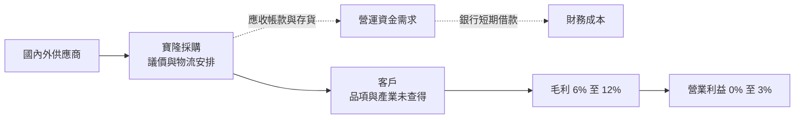
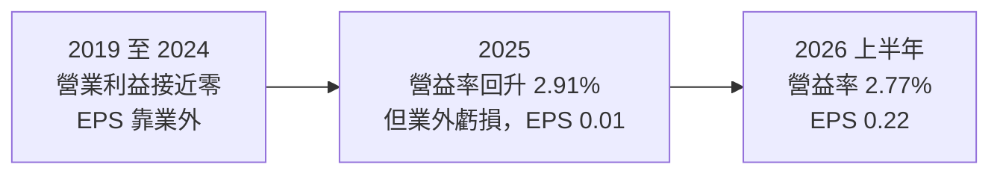
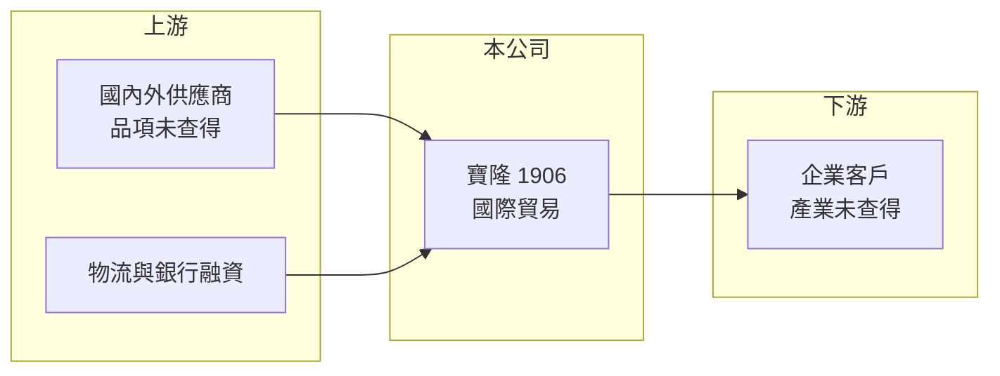

# 1906 寶隆

> 上市｜[[產業索引-造紙工業|造紙工業]]｜上市（櫃）日期 1976/04/26

# 第一章：企業模式與商業藍圖

> [!info] 撰寫說明
> 本文由 Claude 依公開資料整理，架構比照 [[2330台積電]] 的四章研究，資料截至 2026-10-08。財務數字來源：Goodinfo 年度經營績效頁、證交所開放資料（基本資料、2026 年第二季資產負債與營益分析、股利、每月營收、本益比）、nstock 公司小百科。公開資料有限，主要貿易品項、客戶與營收比重皆未查得，本文以財務結構分析為主。#待校對

在評估單一個股的長期投資價值時，首要步驟是拆解企業的底層獲利邏輯。本章針對寶隆國際（股票代號：1906，以下簡稱寶隆）的商業模式進行定性分析。寶隆是台灣最早上市的紙業公司之一，但目前的主要業務已是國際貿易，因此分析重點在於貿易商的獲利結構。

## 一、核心定位：掛在造紙類股的國際貿易商

寶隆成立於 1965 年，1976 年上市，實收資本額約 15.1 億元，董事長為李殷佳，登記地在雲林縣斗六市，總管理處在台北。依 nstock 公司小百科，寶隆的主要經營業務為國際貿易業，產業類別仍歸在造紙工業。

從財務數字可以看出它的業務性質：毛利率長期只有 6% 至 12%，營業利益率在 0% 至 3% 之間，這是典型的[[貿易商]]結構。貿易商不投入大量廠房設備，而是靠採購與銷售之間的價差、物流安排與客戶關係賺取微薄利潤，營收規模可以很大，但利潤率很低。

## 二、營收規模的變化

本文未查得寶隆的產品別營收比重，以下依營收規模的變化整理：

* **2019 至 2021 年：** 年營收約 12.5 億至 18.4 億元。
* **2022 年：** 營收跳升到約 46.0 億元，是近年高峰，可能與貿易品項的價格或量能大增有關（推估，原因未查得）。
* **2023 至 2025 年：** 營收回到約 31 億至 34 億元。
* **2026 年：** 1 至 8 月累計營收約 22.3 億元，比去年同期的 20.5 億元成長約 8.7%（證交所每月營收）。

營收大幅波動而毛利率維持低檔，代表寶隆的營收主要隨商品價格與成交量變動，而不是靠產品附加價值。

## 三、資本轉化邏輯：輕資產與營運資金

* **[[營運資金]]是主要投入：** 貿易商需要先付款採購、再向客戶收款，中間的應收帳款與存貨需要資金支應。2026 年第二季底流動負債約 24.2 億元，占總負債約 88%（證交所開放資料），顯示資金需求以短期為主。
* **利潤薄、波動小：** 營業利益率低，但只要控制好呆帳與存貨跌價，損益通常不會大起大落；真正影響 EPS 的往往是業外項目。

## 四、企業長期方向

由於本文未查得寶隆的法說會內容或策略說明，長期方向無法具體描述。可以確定的是，寶隆在 2025 年營業利益率回升到 2.91%、2026 年上半年為 2.77%，營業獲利能力較 2022 至 2024 年接近零的水準有所改善。後續可以觀察公司是否發展自有產品或高附加價值的貿易品項，以提高毛利率。

# 第二章：護城河深度與競爭優勢

本章分析寶隆的競爭優勢。對貿易商而言，護城河通常很淺，關鍵在於客戶關係與資金調度。

## 一、護城河的核心組成要素

* **長期的客戶與供應商關係：** 貿易商的價值在於掌握買賣雙方的需求與信用，寶隆經營超過 60 年，累積的交易關係是主要資產（具體客戶未查得）。
* **資金與信用：** 上市公司的身分有助於取得銀行額度，支應大量的應收帳款與存貨。
* **輕資產：** 不需要大型廠房，景氣差時可以快速縮減交易量，避免重資產產業的高額固定成本。

整體而言，寶隆的護城河屬於窄或無護城河：貿易業進入門檻低，客戶隨時可以改向其他貿易商或直接向原廠採購。

## 二、主要競爭對手與比較

| 比較對象 | 性質 | 與寶隆的比較 |
|---|---|---|
| [[1904正隆]]、[[1909榮成]]、[[1907永豐餘]] | 造紙類股的實業公司 | 擁有紙機產能，屬重資產，與寶隆的貿易模式不同 |
| 其他國際貿易商 | 貿易業 | 實際競爭對手取決於貿易品項，本文未查得 |

## 三、優勢轉化：守得住、守不住與觀察重點

* **守得住：** 既有客戶的穩定交易。只要供應穩定、交期準確，客戶通常不會輕易更換貿易夥伴。
* **守不住：** 價差。貿易商沒有定價權，商品價格下跌或客戶議價時，毛利只能被壓縮。
* **觀察重點：** 營業利益率能否維持在 2% 以上、營收成長是否來自新品項或新客戶，以及應收帳款與存貨的品質。

# 第三章：財務體質與盈利規模

資料日期：2026-10-08。數字取自 Goodinfo 年度經營績效頁與證交所開放資料，表格是撰寫當時的快照；最新月營收、毛利率、累計 EPS 由自動排程寫在本筆記的屬性欄位（月營收、毛利率、累計EPS 等）。#待校對

財務報表是檢驗護城河是否真實存在的最終標準。本章用多年度的三率、ROE 與資本報酬，檢視寶隆貿易模式的獲利品質。

## 一、獲利能力的基石：三率

| 年度 | 營收（新台幣） | [[毛利率]] | [[營業利益率]] | EPS（元） | [[ROE]] |
|---|---|---|---|---|---|
| 2019 | 12.7 億 | 6.22% | -1.20% | 0.80 | 3.20% |
| 2020 | 12.5 億 | 10.80% | 0.75% | 0.62 | 1.81% |
| 2021 | 18.4 億 | 12.10% | 0.10% | 1.22 | 2.79% |
| 2022 | 46.0 億 | 9.73% | 0.24% | 2.83 | 7.27% |
| 2023 | 33.9 億 | 7.53% | 0.12% | 0.20 | 0.65% |
| 2024 | 32.1 億 | 7.48% | 0.02% | 0.25 | 0.98% |
| 2025 | 31.1 億 | 9.31% | 2.91% | 0.01 | 0.04% |
| 2026 上半年 | 15.8 億 | 9.62% | 2.77% | 0.22 | 未查得 |

* **[[毛利率]]：** 長期在 6% 至 12% 之間，符合貿易商的特性。
* **[[營業利益率]]：** 2019 至 2024 年幾乎都在 0% 上下，本業只能打平。
* **本業與業外背離：** 2019 至 2022 年營業利益接近零，EPS 卻有 0.6 至 2.8 元，代表獲利主要來自[[業外收益]]（推估為投資、租金或處分利益，具體項目未查得）；2025 年則相反，營業利益率回升到 2.91%，EPS 卻只有 0.01 元，代表業外出現損失。分析寶隆時必須把本業與業外分開看。
* **營收趨勢：** 2021 至 2025 年營收從 18.4 億元增至 31.1 億元，年複合成長率約 14%（推算），但成長主要集中在 2022 年的跳升。

## 二、[[ROE]]：資本效率

2021 至 2025 年平均 ROE 約 2.3%（推算），2023 年以後都在 1% 以下。2026 年第二季底保留盈餘約 26.5 億元、權益總計約 27.4 億元，每股淨值約 18.13 元，股價淨值比約 0.59 倍（證交所開放資料）。保留盈餘占權益的比例很高，代表公司過去累積了不少獲利，但近年的資本報酬偏低。

## 三、資本支出、自由現金流與股利

貿易業資本支出很少，現金流主要受營運資金變動影響：營收擴大時需要墊付更多應收帳款與存貨，現金流可能轉負。股利方面，2025 年下半年與 2026 年上半年皆未配發現金股利（證交所股利資料），近五年平均現金股利約 0.27 元（nstock 統計），配息不穩定。

## 四、[[ROIC]] 與 [[WACC]]：價值創造利差

**ROIC 推算：** 2025 年營業利益約 0.91 億元（31.1 億 × 2.91%），扣除 20% 稅率後約 0.72 億元。2026 年第二季底權益總計約 27.4 億元，總負債約 27.5 億元，假設其中約 60% 為有息負債（推估，約 16.5 億元），投入資本約 43.9 億元，ROIC 約 1.7%（推算）。

**WACC 推算：** 假設台灣 10 年期公債殖利率 1.75%、市場風險溢酬 6%、β 取 0.8（造紙與貿易業常見值），股東權益成本約 6.55%。負債成本假設 2.5%，稅後約 2.0%；以帳面價值計，權益約占 62%，WACC 約 4.8%（推算）。

**結論：** 寶隆的 ROIC 長期低於 WACC，即使 2025 年本業改善，報酬仍不到資金成本的一半，代表目前的貿易業務並未為股東創造價值。股價長期低於淨值，也反映市場的看法。若要改善，寶隆需要提高毛利率（例如發展高附加價值品項），或縮減低報酬的資產。

# 第四章：總體風險與地緣政治

任何企業都無法脫離宏觀環境獨立存在。本章分析寶隆長期必須面對的市場、財務與資訊揭露風險。

## 一、市場與景氣

* **商品價格波動：** 貿易商的營收隨商品價格起伏，價格急跌時可能面臨存貨跌價損失。
* **客戶集中：** 貿易商常依賴少數大客戶，失去主要客戶會造成營收大幅下滑（本文未查得客戶集中度）。

## 二、財務風險

* **營運資金與短期借款：** 負債以流動負債為主，利率上升或銀行緊縮額度時，資金成本與周轉壓力會提高。
* **信用風險：** 應收帳款若出現呆帳，對薄利的貿易商影響很大，一筆呆帳可能吃掉整年的營業利益。
* **業外波動：** 近年 EPS 主要由業外決定，業外項目的不確定性讓獲利難以預測。

## 三、匯率與國際貿易

* **匯率：** 國際貿易以外幣計價，新台幣與美元等貨幣的匯率變動會產生匯兌損益。
* **關稅與貿易政策：** 各國關稅與貿易限制會影響貿易流向與利潤。

## 四、資訊揭露

* **公開資料有限：** 寶隆的業務細節、客戶與品項公開資訊很少，投資人難以評估其長期競爭力，這本身就是一種風險。

# 專有名詞解析

## 金融

- **[[營運資金]]**：流動資產減去流動負債，代表公司日常營運所需墊付的資金，貿易與製造業特別依賴。
- **[[業外收益]]**：本業以外的收入，例如投資收益、處分資產利益或匯兌利益，通常不具持續性。
- **[[ROIC]]**：投入資本報酬率，稅後營業利益除以股東權益與有息負債的合計，衡量本業對所有資金提供者的報酬。
- **[[WACC]]**：加權平均資金成本，依股東權益與負債的比重加權計算的資金成本，ROIC 高於它才代表創造價值。

## 產業

- **[[貿易商]]**：不自行生產、而是在買方與賣方之間採購轉售商品的公司，靠價差與服務賺取利潤，毛利率通常很低。

# 核心供應鏈

## 1. 上游：供應商與融資
- 國內外供應商（品項未查得）、物流業者、銀行

## 2. 中游：寶隆本身與造紙類股
- 同屬造紙類股：[[1904正隆]]、[[1907永豐餘]]、[[1909榮成]]、[[1905華紙]]

## 3. 下游：客戶
- 企業客戶（產業與集中度未查得）

## 最新新聞
<!-- news:start（自動產生，請勿手動編輯此範圍） -->
- 2026-10-05 📰 媒體 18:50｜營收速報 - 寶隆(1906)9月營收3.40億元年增率高達34.36％｜[鉅亨網](https://news.cnyes.com/news/id/6621902)

完整紀錄：[[1906寶隆 新聞]]
<!-- news:end -->

## 相關連結
- [公開資訊觀測站](https://mopsov.twse.com.tw/mops/web/t05st03?step=1&firstin=1&co_id=1906)
- [Goodinfo](https://goodinfo.tw/tw/StockDetail.asp?STOCK_ID=1906)
- [Yahoo 股市](https://tw.stock.yahoo.com/quote/1906)
- [鉅亨網新聞](https://www.cnyes.com/twstock/1906/news)
