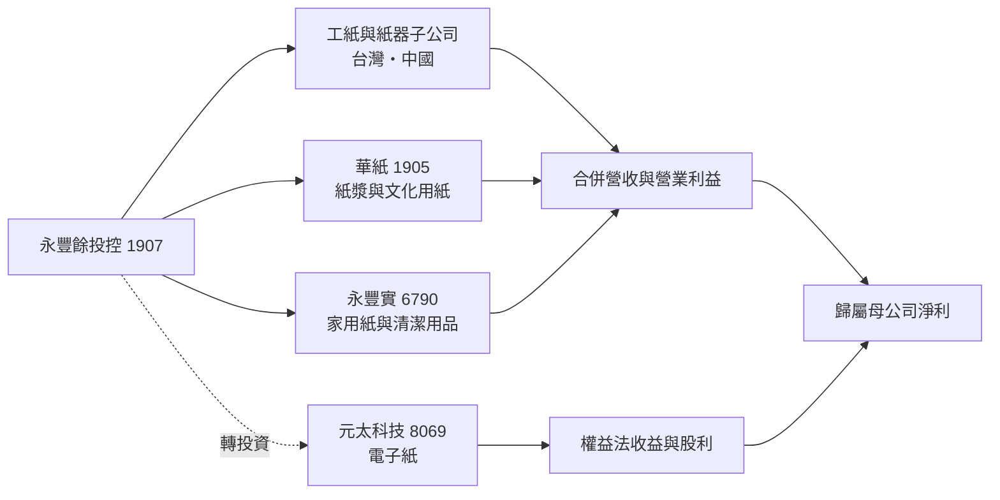
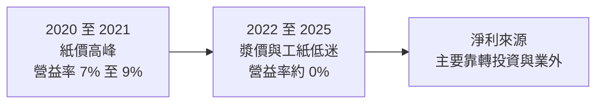
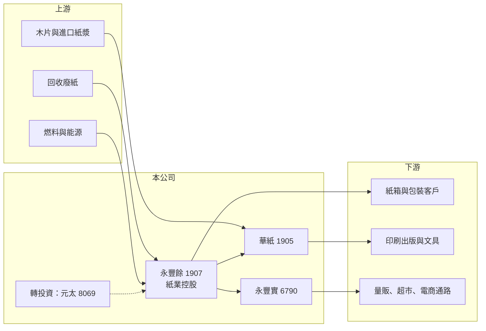

# 1907 永豐餘

> 上市｜[[產業索引-造紙工業|造紙工業]]｜上市（櫃）日期 1977/02/22

# 第一章：企業模式與商業藍圖

> [!info] 撰寫說明
> 本文由 Claude 依公開資料整理，架構比照 [[2330台積電]] 的四章研究，資料截至 2026-10-08。財務數字來源：Goodinfo 年度經營績效頁、證交所開放資料（基本資料、2026 年第二季資產負債與營益分析、股利、本益比）、nstock 公司小百科（組織沿革、股利統計）；子公司持股與轉投資細節部分憑記憶整理，已標「待校對」。#待校對

在評估單一個股的長期投資價值時，首要步驟是拆解企業的底層獲利邏輯。本章針對永豐餘投資控股（股票代號：1907，以下簡稱永豐餘）的商業模式進行定性分析，說明這家台灣歷史最悠久的造紙集團，為何在 2012 年轉型為控股公司，以及它的價值為何不能只看造紙本業。

## 一、核心定位：橫跨紙漿到家用紙的紙業控股公司

永豐餘成立於 1950 年，1977 年上市，實收資本額約 166 億元。它原本是一家什麼紙都做的綜合紙廠，2005 年起陸續把事業分割出去：2005 年把工業用紙與紙器事業分割給永豐餘工業用紙公司，2007 年把家庭用品事業分割給永豐餘消費品實業（即今天的 [[6790永豐實]]），2012 年把紙與紙板事業分割給中華紙漿（即 [[1905華紙]]），永豐餘本身因此成為[[控股公司]]（nstock 公司沿革）。

轉型後的永豐餘有三個層次：

* **紙業本業：** 透過子公司經營[[工業用紙]]與紙器（台灣與中國）、紙漿與文化用紙（華紙）、家用紙與清潔用品（永豐實），涵蓋紙業幾乎所有品項。
* **轉投資：** 集團早年孵化的電子紙公司 [[8069元太]] 是永豐餘最重要的轉投資之一（持股比例待校對），另持有金融與其他事業股權。
* **新事業：** 集團近年發展智慧包裝、生技與循環經濟等新事業（待校對，規模未查得）。

## 二、事業板塊與營收來源

本文未查得永豐餘最新的營收比重，以下依子公司性質整理：

* **工紙與紙器：** 營收規模最大，台灣與中國都有工紙廠與紙器廠（中國據點待校對），獲利隨工紙價差與廢紙成本波動。
* **紙漿與文化用紙（華紙）：** 華紙是台灣唯一同時產製紙漿的紙廠（待校對），近年因國際漿價低迷與需求疲弱連續虧損，是拖累集團獲利的主要來源。
* **家用紙與清潔用品（永豐實）：** 品牌包括五月花、柔情、得意與橘子工坊，2025 年營收 106.5 億元、EPS 3.03 元，是集團中獲利最穩定的一塊（富果法說會整理）。
* **業外：** 轉投資的權益法收益與股利。2026 年上半年營業利益只有約 0.56 億元，營業外收入卻有約 12.2 億元（證交所開放資料），淨利幾乎都來自業外。

## 三、資本轉化邏輯：多層子公司與少數股權

* **合併報表中的少數股權：** 華紙與永豐實都是上市公司，永豐餘只持有部分股權，2026 年第二季底權益總計約 1,088 億元，其中歸屬母公司約 911 億元，其餘約 177 億元屬於[[非控制權益]]（證交所開放資料）。子公司賺錢時，有一部分要分給其他股東；子公司虧損時，母公司也只承擔一部分。
* **重資產的紙業：** 紙機、紙漿廠與汽電共生設備都是長壽命資產，[[產能利用率]]與原料價格決定獲利。
* **控股折價：** 多層控股讓投資人難以估算各事業價值，2026 年 10 月初永豐餘股價淨值比約 0.51 倍（證交所本益比資料），顯示市場給予明顯的[[控股折價]]。

## 四、企業長期藍圖

永豐餘的長期方向可以從三個角度理解。第一是紙業內部的結構調整，讓工紙、紙漿與家用紙各自以上市子公司或獨立事業經營，提高經營透明度與責任歸屬。第二是減碳與能源轉型，華紙已宣布投資超過 30 億元在花蓮廠新建生質能發電設施，目標 2027 年前讓集團綠電比重大幅提高（優分析華紙法說會整理）。第三是轉投資價值的實現，元太在電子紙領域的成長，長期看是永豐餘淨值與股利的重要支撐。

# 第二章：護城河深度與競爭優勢

本章分析永豐餘的競爭優勢，說明多元紙業組合帶來什麼保護，以及哪些事業守不住。

## 一、護城河的核心組成要素

* **完整的紙業產品線：** 從紙漿、文化用紙、工紙、紙器到家用紙，永豐餘是台灣唯一涵蓋全部品項的紙業集團（待校對）。不同紙種的景氣不一定同步，組合可以分散單一產品的風險。
* **家用紙品牌：** 永豐實的五月花等品牌在台灣通路覆蓋超過 2 萬個零售點，品牌與通路是家用紙最主要的護城河，也是集團中毛利最高的業務。
* **紙漿自給能力：** 華紙自產紙漿，在國際漿價大漲時具成本優勢（漿價下跌時則反成負擔）。
* **轉投資資產：** 元太等轉投資的價值與股利，讓永豐餘的淨值與配息不完全依賴紙業景氣。

## 二、主要競爭對手格局

| 競爭對手 | 主要市場 | 與永豐餘的比較 |
|---|---|---|
| [[1904正隆]] | 台灣、越南 | 工紙與紙器的主要對手，越南布局較積極 |
| [[1909榮成]] | 台灣、中國 | 工紙產能重心在中國 |
| 金百利克拉克（舒潔） | 台灣家用紙 | 國際品牌，與永豐實在家用紙正面競爭 |
| 印尼 APP、中國晨鳴等 | 亞洲 | 文化用紙與紙漿的大型對手，成本與規模優勢明顯 |

## 三、優勢轉化：守得住、守不住與觀察重點

* **守得住：** 家用紙的品牌與通路。民生消費品需求穩定，永豐實 2025 年毛利率 26%、ROE 14%，是集團的現金來源。
* **守不住：** 文化用紙與紙漿。數位化讓印刷書寫紙需求長期萎縮，國際漿價又由南美大型紙漿廠主導，華紙 2022 年以後多數年度虧損。
* **觀察重點：** 華紙能否透過減產、綠電與產品轉型止血；工紙價差在中國與台灣的變化；以及元太等轉投資的價值能否反映在永豐餘的股價與股利上。

# 第三章：財務體質與盈利規模

資料日期：2026-10-08。數字取自 Goodinfo 年度經營績效頁與證交所開放資料，表格是撰寫當時的快照；最新月營收、毛利率、累計 EPS 由自動排程寫在本筆記的屬性欄位（月營收、毛利率、累計EPS 等）。#待校對

財務報表是檢驗護城河是否真實存在的最終標準。本章用多年度的三率、ROE 與資本報酬，檢視永豐餘本業與業外的獲利品質。

## 一、獲利能力的基石：三率

| 年度 | 營收（新台幣） | [[毛利率]] | [[營業利益率]] | EPS（元） | [[ROE]] |
|---|---|---|---|---|---|
| 2019 | 748 億 | 16.8% | 4.00% | 1.38 | 5.44% |
| 2020 | 732 億 | 20.5% | 7.65% | 3.14 | 12.1% |
| 2021 | 853 億 | 21.3% | 9.39% | 3.13 | 12.5% |
| 2022 | 796 億 | 14.0% | 1.44% | 1.31 | 4.20% |
| 2023 | 739 億 | 13.7% | 0.19% | 1.10 | 2.92% |
| 2024 | 784 億 | 13.3% | -0.20% | 0.98 | 2.88% |
| 2025 | 736 億 | 13.0% | -1.13% | 1.19 | 2.48% |
| 2026 上半年 | 378.6 億 | 14.07% | 0.15% | 0.47 | 未查得 |

* **[[毛利率]]：** 2020 至 2021 年疫情帶動包裝與家用紙需求，毛利率超過 20%；2022 年起回落到 13% 至 14%，並維持了四年。
* **[[營業利益率]]：** 2023 至 2025 年營業利益率在 0% 上下，2025 年甚至為 -1.13%，代表紙業本業整體只能打平；但同期 EPS 仍維持約 1 元，差額來自[[業外收益]]。
* **營收趨勢：** 2021 至 2025 年營收從 853 億元降到 736 億元，年複合成長率約 -3.6%（推算）。

## 二、[[ROE]]：資本效率

2021 至 2025 年平均 ROE 約 5.0%（推算），2022 年以後都在 3% 以下。永豐餘的淨值中有大量轉投資股權，這些資產主要帶來股利與權益法收益，加上紙業本業接近打平，ROE 很難提高。2026 年第二季底每股淨值約 54.88 元，股價淨值比約 0.51 倍（證交所開放資料），市場顯然對資產報酬率與控股結構打了折扣。

## 三、資本支出、自由現金流與股利

紙業的資本支出以紙機維護、環保與能源設備為主，華紙的生質能發電投資會在 2025 至 2027 年推高集團資本支出。股利方面，2025 年度配發現金股利 1 元，以 EPS 1.19 元計算[[配發率]]約 84%（推算）；2024 年度配發 0.8 元、配發率約 82%，近五年平均現金股利約 1.02 元（nstock 統計）。股利相對穩定，主要靠業外與轉投資股利支撐。

## 四、[[ROIC]] 與 [[WACC]]：價值創造利差

**ROIC 推算：** 2025 年營業利益約 -8.3 億元（736 億 × -1.13%），本業 ROIC 為負。以 2026 年第二季底權益總計約 1,088 億元、總負債約 848 億元，假設其中約 60% 為有息負債（推估，約 509 億元），投入資本約 1,597 億元，ROIC 約 -0.5%（推算）。以同樣資本基礎回推 2021 年高峰（營業利益約 80 億元），ROIC 約 4%（推算）。若把轉投資收益計入報酬，整體資本報酬大約與 ROE 相近，約 2% 至 3%（推估）。

**WACC 推算：** 假設台灣 10 年期公債殖利率 1.75%、市場風險溢酬 6%、β 取造紙業常見值 0.8，股東權益成本約 6.55%。負債成本假設 2.3%，稅後約 1.8%；以帳面價值計，權益約占 68%，WACC 約 5.0%（推算）。

**結論：** 即使在 2021 年的景氣高峰，永豐餘的本業 ROIC 也只略低於資金成本，2022 年以後更明顯低於 WACC。這代表以目前的資本規模，紙業本業長期沒有創造經濟價值，股東價值主要來自轉投資與家用紙子公司。長期投資人看永豐餘，比較適合用「資產與股利」的角度，而不是本業成長的角度。

# 第四章：總體風險與地緣政治

任何企業都無法脫離宏觀環境獨立存在。本章分析永豐餘長期必須面對的產業結構、原料能源、地緣政治與治理風險。

## 一、產業週期與市場結構

* **文化用紙的結構性萎縮：** 數位化讓印刷與書寫用紙需求逐年下滑，這不是景氣循環而是長期趨勢，華紙的產能需要轉型或縮減。
* **工紙與漿價循環：** 工紙價差受中國與東南亞產能影響，紙漿價格則由南美與北歐大廠主導，永豐餘只能被動接受。
* **家用紙競爭：** 家用紙需求穩定，但通路議價能力強，國際品牌與自有品牌（通路品牌）持續擠壓。

## 二、原料與能源

* **廢紙、木片與紙漿：** 三種原料各自有不同的價格循環，華紙曾因木片與運費上漲而減產。
* **能源與碳費：** 紙業是用能大戶，台灣碳費開徵後，汽電共生燃料由燃煤轉向生質能是必要投資，短期增加資本支出，長期才可能降低成本。

## 三、地緣政治與營運風險

* **中國業務：** 集團在中國有工紙與紙器據點（待校對），受中國內需、反內捲政策與兩岸關係影響。
* **子公司虧損：** 華紙連續虧損會持續拖累合併損益，若需要增資或提列資產減損，母公司也要承擔。

## 四、治理與資本配置風險

* **控股結構複雜：** 多層上市子公司與轉投資讓資訊揭露分散，投資人需要同時追蹤多家公司才能理解集團價值。
* **轉投資價值波動：** 元太股價與獲利的變化，會透過權益法與股利影響永豐餘的淨利與淨值，電子紙產業本身也有景氣與技術風險。

# 專有名詞解析

## 金融

- **[[非控制權益]]**：合併報表中子公司屬於其他股東的部分，母公司只能享有自己持股比例的損益。
- **[[控股折價]]**：市場對控股公司的市值常低於其持有資產價值加總，原因包括資訊不透明、多層結構與稅負。
- **[[業外收益]]**：本業以外的收入，例如轉投資收益、處分資產利益、利息與股利收入，通常較不穩定。
- **[[產能利用率]]**：實際產量占總產能的比例，重資產產業的毛利率高度取決於此數字。
- **[[配發率]]**：現金股利占每股盈餘的比例，代表公司把多少獲利以現金發給股東。
- **[[ROIC]]**：投入資本報酬率，稅後營業利益除以股東權益與有息負債的合計，衡量本業對所有資金提供者的報酬。
- **[[WACC]]**：加權平均資金成本，依股東權益與負債的比重加權計算的資金成本，ROIC 高於它才代表創造價值。

## 產業

- **[[控股公司]]**：本身不直接經營，而是持有子公司股權並收取其獲利的公司型態。
- **[[工業用紙]]**：用於包裝與工業用途的紙種，主要是做紙箱的瓦楞面紙與芯紙，又簡稱工紙。

# 核心供應鏈

## 1. 上游：原料與能源
- 回收廢紙（工紙原料）、木片與進口紙漿（華紙與家用紙原料）
- 燃料與電力：燃煤、生質燃料、台電

## 2. 中游：永豐餘集團與同業
- 集團上市子公司：[[1905華紙]]、[[6790永豐實]]
- 轉投資：[[8069元太]]
- 台灣同業：[[1904正隆]]、[[1909榮成]]

## 3. 下游：紙品使用者
- 食品、電子、電商等紙箱客戶
- 印刷出版業與文具業
- 全聯、家樂福等量販超市與電商通路（待校對）

## 最新新聞
<!-- news:start -->
<!-- news:end -->

## 相關連結
- [公開資訊觀測站](https://mopsov.twse.com.tw/mops/web/t05st03?step=1&firstin=1&co_id=1907)
- [Goodinfo](https://goodinfo.tw/tw/StockDetail.asp?STOCK_ID=1907)
- [Yahoo 股市](https://tw.stock.yahoo.com/quote/1907)
- [鉅亨網新聞](https://www.cnyes.com/twstock/1907/news)
