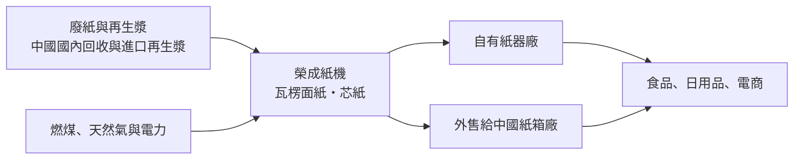
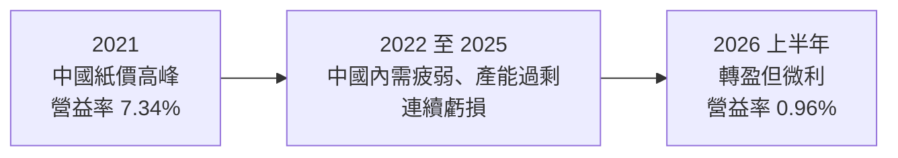
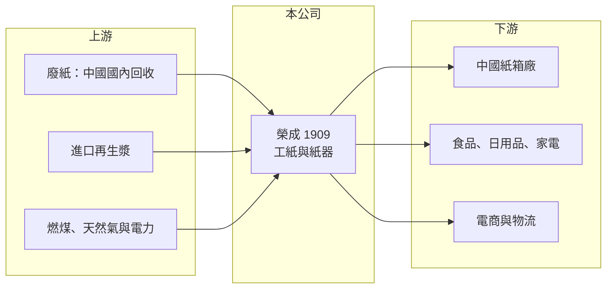

# 1909 榮成

> 上市｜[[產業索引-造紙工業|造紙工業]]｜上市（櫃）日期 1985/11/19

# 第一章：企業模式與商業藍圖

> [!info] 撰寫說明
> 本文由 Claude 依公開資料整理，架構比照 [[2330台積電]] 的四章研究，資料截至 2026-10-08。財務數字來源：Goodinfo 年度經營績效頁、證交所開放資料（基本資料、2026 年第二季資產負債與營益分析、股利、本益比）、優分析 2025 年 12 月法說會整理（中國市占率與市場規模）；廠區位置部分憑記憶整理，已標「待校對」。#待校對

在評估單一個股的長期投資價值時，首要步驟是拆解企業的底層獲利邏輯。本章針對榮成紙業（股票代號：1909，以下簡稱榮成）的商業模式進行定性分析，說明這家台灣工紙廠為何把產能重心放在中國，以及這個選擇如何決定它的景氣循環。

## 一、核心定位：台灣起家、中國為主的工紙廠

榮成成立於 1978 年，1985 年上市，實收資本額約 132.8 億元，董事長為鄭瑛彬。公司的本業是[[工業用紙]]與紙器，產品是做紙箱用的[[瓦楞紙]]（面紙與芯紙）以及紙箱。

榮成和 [[1904正隆]] 同樣是台灣的工紙大廠，但兩家的地理布局不同：正隆近年把成長押在越南，榮成則以中國為主要市場。依公司 2025 年 12 月法說會資料，榮成在中國工紙市場的瓦楞面紙市占率約 8%、瓦楞芯紙約 2%，自稱為中國前四大業者，僅次於玖龍、理文與山鷹（優分析整理）。

## 二、產品與地區板塊

本文未查得榮成最新的營收比重，以下依業務性質整理：

* **中國工紙：** 營收與獲利的主要來源，生產據點位於浙江與兩湖地區（待校對）。2024 年中國瓦楞面紙與芯紙消費量約 6,989 萬噸、年增 4.5%（優分析整理），是全球最大的工紙市場。
* **台灣工紙與紙器：** 台灣廠以內銷為主（廠區位置待校對），規模小於中國。
* **紙器：** 把自產工紙加工成紙箱，服務食品、日用品與電商客戶，提高附加價值並穩定工紙出貨。

## 三、資本轉化邏輯：中國工紙的價差生意

* **價差決定獲利：** 工紙利潤基本上是「紙價減[[廢紙]]價」的[[價差]]。中國自 2021 年起禁止進口廢紙（待校對），中國紙廠改用國內回收廢紙與進口再生漿，原料成本與品質都更不穩定。
* **產能與規模：** 中國工紙市場由玖龍、理文、山鷹等巨頭主導，它們持續擴產。榮成的市占率不高，價格只能跟隨龍頭。
* **地區需求差異：** 公司指出江浙等沿海城市受貿易戰影響處於低週期，兩湖內需市場的紙箱包裝需求則相對回溫，代表出口導向與內需導向的客戶景氣可能不同步。

## 四、企業長期藍圖

榮成的長期方向主要有兩點。第一是等待中國工紙產業的整合：中國推動「反內捲」政策、淘汰老舊產能，若能減少惡性價格競爭，榮成這類中型業者的價差可望改善，公司在 2025 年底法說會表示看到中國造紙產出改善的訊號，但離全面復甦仍有一段路。第二是強化紙器與內需市場，降低對出口導向客戶的依賴。由於本文未查得新產能或新事業的具體計畫，榮成的長期價值大致仍取決於中國工紙景氣。

# 第二章：護城河深度與競爭優勢

本章分析榮成的競爭優勢，說明它在中國工紙市場的定位，以及面對巨頭擴產時的處境。

## 一、護城河的核心組成要素

* **中國產能與在地經營：** 榮成在中國經營多年，擁有既有紙機產能、廢紙回收網路與客戶關係。中國對新紙廠的環評與能耗管制愈來愈嚴，既有產能具有一定價值。
* **紙器端的地域性：** 紙箱運輸半徑短，紙器廠設在客戶聚落附近就有在地優勢。
* **台灣上市公司的融資管道：** 可以透過台灣資本市場與銀行籌資，支應中國擴產與營運資金。

整體而言，榮成的護城河屬於窄護城河：工紙是同質性高的大宗商品，規模與成本才是決勝關鍵，而榮成在中國的規模明顯小於龍頭。

## 二、主要競爭對手格局

| 競爭對手 | 主要市場 | 與榮成的比較 |
|---|---|---|
| 玖龍紙業 | 中國、越南、馬來西亞 | 中國最大工紙廠，規模與成本優勢明顯 |
| 理文造紙 | 中國、越南 | 規模大、垂直整合程度高 |
| 山鷹國際 | 中國 | 中國第三大，與榮成在華東直接競爭 |
| [[1904正隆]] | 台灣、越南 | 台灣主要對手，布局重心在越南 |
| [[1907永豐餘]] | 台灣、中國 | 集團旗下也有工紙與紙器事業 |

## 三、優勢轉化：守得住、守不住與觀察重點

* **守得住：** 在中國既有的產能與客戶。中國工紙消費量仍在成長，榮成作為前四大業者之一，仍有穩定的銷售基礎。
* **守不住：** 價格。龍頭擴產與內需疲弱時，榮成只能被動接受低價，2022 至 2025 年連續四年虧損就是結果。
* **觀察重點：** 中國反內捲政策能否真正淘汰產能；中國內需消費與出口景氣；以及廢紙與能源成本的變化。這些都不是公司能控制的，因此榮成的獲利波動會比台灣本地的紙器廠更大。

# 第三章：財務體質與盈利規模

資料日期：2026-10-08。數字取自 Goodinfo 年度經營績效頁與證交所開放資料，表格是撰寫當時的快照；最新月營收、毛利率、累計 EPS 由自動排程寫在本筆記的屬性欄位（月營收、毛利率、累計EPS 等）。#待校對

財務報表是檢驗護城河是否真實存在的最終標準。本章用多年度的三率、ROE 與資本報酬，檢視榮成在中國工紙循環中的獲利品質。

## 一、獲利能力的基石：三率

| 年度 | 營收（新台幣） | [[毛利率]] | [[營業利益率]] | EPS（元） | [[ROE]] |
|---|---|---|---|---|---|
| 2019 | 477 億 | 13.70% | 3.74% | 0.45 | 2.28% |
| 2020 | 416 億 | 15.70% | 5.53% | 0.77 | 3.91% |
| 2021 | 566 億 | 16.40% | 7.34% | 1.84 | 8.91% |
| 2022 | 530 億 | 8.28% | -0.78% | -0.71 | -3.59% |
| 2023 | 467 億 | 9.74% | 0.07% | -0.77 | -4.46% |
| 2024 | 478 億 | 9.76% | 0.41% | -0.28 | -1.73% |
| 2025 | 447 億 | 9.85% | -0.03% | -0.39 | -2.50% |
| 2026 上半年 | 242.5 億 | 10.86% | 0.96% | 0.19 | 未查得 |

* **[[毛利率]]：** 只有 2021 年中國紙價高峰時毛利率超過 16%，2022 年起都在 10% 上下，營業費用一扣就接近打平。
* **[[營業利益率]]：** 2022 至 2025 年營業利益率在 -0.8% 至 0.4% 之間，加上利息支出，四年都是稅後虧損。
* **營收趨勢：** 2021 至 2025 年營收從 566 億元降到 447 億元，年複合成長率約 -5.7%（推算）。2026 年 1 至 8 月累計營收約 331.3 億元，比去年同期的 287.9 億元成長約 15%（證交所每月營收），顯示出貨量或紙價有所回升。

## 二、[[ROE]]：資本效率

2021 至 2025 年平均 ROE 約 -0.7%（推算），只有 2021 年接近 9%。2026 年第二季底總負債約 487.9 億元、權益總計約 208.2 億元，負債比約 70%（證交所開放資料），是台灣紙業中財務槓桿最高的公司之一。高槓桿在景氣好時放大 ROE，但在連續虧損期間讓利息成為沉重負擔。股價淨值比約 0.63 倍（2026 年 10 月初），反映市場對其資產報酬的保守看法。

## 三、資本支出、自由現金流與股利

工紙廠的資本支出以紙機維護、環保與能源設備為主，由於本文未查得現金流量資料，自由現金流是否長期為正無法確認。股利方面，2022 至 2025 年多數年度虧損，2025 年下半年與 2026 年上半年皆未配發現金股利（證交所股利資料），股利紀錄不穩定。

## 四、[[ROIC]] 與 [[WACC]]：價值創造利差

**ROIC 推算：** 2025 年營業利益約 -0.13 億元（447 億 × -0.03%），ROIC 約 0%（推算）。以 2026 年第二季底權益總計約 208.2 億元、總負債約 487.9 億元，假設其中約 70% 為有息負債（推估，約 342 億元），投入資本約 550 億元。以同樣資本基礎回推 2021 年高峰（營業利益約 41.5 億元，稅後約 33.2 億元），ROIC 約 6%（推算）。

**WACC 推算：** 假設台灣 10 年期公債殖利率 1.75%、市場風險溢酬 6%、β 取 0.9（高財務槓桿的造紙業，高於同業常見值 0.8），股東權益成本約 7.15%。負債成本假設 2.5%，稅後約 2.0%；以帳面價值計，權益約占 38%、有息負債約占 62%，WACC 約 4.0%（推算）。

**結論：** 榮成只有在 2021 年那樣的景氣高峰，ROIC 才明顯高於 WACC；2022 至 2025 年 ROIC 接近零，遠低於資金成本，代表這段期間持續消耗價值。高負債讓 WACC 看起來較低，但也提高了財務風險。榮成能否長期創造價值，關鍵在中國工紙產業能否真正整合。

# 第四章：總體風險與地緣政治

任何企業都無法脫離宏觀環境獨立存在。本章分析榮成長期必須面對的地緣政治、產業週期、原料能源與財務風險。

## 一、地緣政治

* **中國集中風險：** 榮成的產能與營收重心在中國，中國內需、房地產與消費景氣，以及中美貿易戰對沿海出口產業的影響，都直接決定紙箱需求。
* **兩岸關係：** 兩岸關係緊張時，台商在中國的資產與經營面臨不確定性，也會影響市場對榮成資產的評價。

## 二、產業週期與市場結構

* **中國工紙產能過剩：** 中國龍頭紙廠持續擴產，產能出清緩慢，價格競爭激烈。
* **電商與消費：** 電商旺季帶動紙箱需求，但中國消費力道疲弱時，旺季效果也有限。
* **[[長鞭效應]]：** 景氣轉弱時，客戶、紙箱廠同時去庫存，工紙需求的下滑會被放大。

## 三、原料與能源

* **廢紙與再生漿價格：** 中國禁止進口廢紙後，原料來源改變，國內廢紙價格波動加大。
* **能源與環保：** 燃煤與電價、中國的能耗雙控與碳排放管制，都會提高營運成本。

## 四、財務風險

* **高負債：** 負債比約 70%，若虧損延續，可能面臨借款條件惡化或需要增資的壓力。
* **匯率：** 中國子公司以人民幣營運，人民幣與新台幣匯率變動會影響合併報表的營收、淨值與匯兌損益。

# 專有名詞解析

## 金融

- **[[長鞭效應]]**：終端需求的小幅變動，沿供應鏈往上游傳遞時被逐級放大，造成上游庫存與訂單劇烈波動。
- **[[ROIC]]**：投入資本報酬率，稅後營業利益除以股東權益與有息負債的合計，衡量本業對所有資金提供者的報酬。
- **[[WACC]]**：加權平均資金成本，依股東權益與負債的比重加權計算的資金成本，ROIC 高於它才代表創造價值。

## 產業

- **[[工業用紙]]**：用於包裝與工業用途的紙種，主要是做紙箱的瓦楞面紙與芯紙，又簡稱工紙。
- **[[瓦楞紙]]**：由平面的面紙與波浪狀的芯紙黏合而成的紙板，是紙箱的主要材料。
- **[[廢紙]]**：回收的舊紙箱與紙類，是工紙廠最主要的原料，價格波動直接影響工紙獲利。
- **[[價差]]**：產品售價與主要原料成本之間的差額，是加工型產業獲利的核心指標。

# 核心供應鏈

## 1. 上游：原料與能源
- 中國國內回收廢紙、進口再生漿
- 燃煤、天然氣與電力

## 2. 中游：榮成本身與同業
- 台灣同業：[[1904正隆]]、[[1907永豐餘]]
- 中國同業：玖龍紙業、理文造紙、山鷹國際

## 3. 下游：紙箱使用者
- 中國紙箱廠、食品日用品與家電製造商、電商物流業者

## 最新新聞
<!-- news:start（自動產生，請勿手動編輯此範圍） -->
- 2026-10-12 🏛️ 重訊 16:03｜本公司股東臨時會通過分割案辦理向債權人通知及公告事宜｜[觀測站](https://mops.twse.com.tw/mops/#/web/t05st01)
- 2026-10-05 📰 媒體 19:06｜榮成前3季稅前盈餘5.99億元較去年轉盈 Q4旺季營運可望優於Q3｜[鉅亨網](https://news.cnyes.com/news/id/6621860)
- 2026-10-05 📰 媒體 18:50｜營收速報 - 榮成(1909)9月營收47.90億元年增率高達25.29％｜[鉅亨網](https://news.cnyes.com/news/id/6621903)

完整紀錄：[[1909榮成 新聞]]
<!-- news:end -->

## 相關連結
- [公開資訊觀測站](https://mopsov.twse.com.tw/mops/web/t05st03?step=1&firstin=1&co_id=1909)
- [Goodinfo](https://goodinfo.tw/tw/StockDetail.asp?STOCK_ID=1909)
- [Yahoo 股市](https://tw.stock.yahoo.com/quote/1909)
- [鉅亨網新聞](https://www.cnyes.com/twstock/1909/news)
