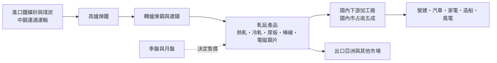
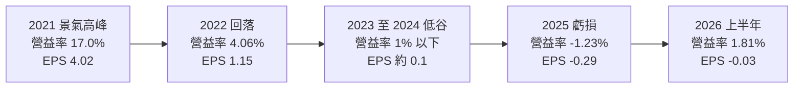
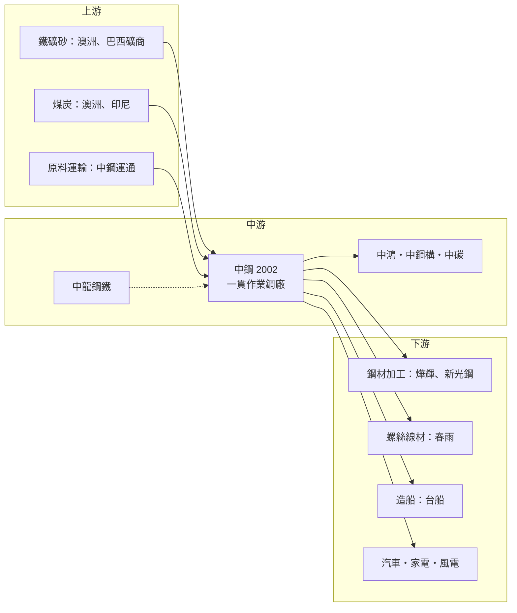

# 2002 中鋼

> 上市｜[[產業索引-鋼鐵工業|鋼鐵工業]]｜上市（櫃）日期 1974/12/26

# 第一章：企業模式與商業藍圖

> [!info] 撰寫說明
> 本文由 Claude 依公開資料整理，架構比照 [[2330台積電]] 的四章研究，資料截至 2026-10-08。財務數字來源：Goodinfo 經營績效、現金流量、股利政策頁（年度合併報表）、證交所開放資料（基本資料、2026 年第二季綜合損益與資產負債、股利）、永豐金證券 AI 投資網公司簡介、優分析與三立新聞財報報導；產業描述為整理性內容，尚未逐條比對原始文件。#待校對

在評估單一個股的長期投資價值時，首要步驟是拆解企業的底層獲利邏輯。本章針對中國鋼鐵（股票代號：2002，以下簡稱中鋼）的商業模式進行定性分析，說明它在台灣鋼鐵產業中扮演的上游角色、產品如何對應到各種終端產業，以及在中國鋼材大量出口的結構性壓力下，它試圖用什麼方式走出低利潤的困境。

## 一、核心定位：台灣唯一大型高爐一貫作業鋼廠集團

中鋼於 1971 年 12 月 3 日成立，是十大建設之一，1974 年上市，總部與主要廠區位在高雄小港臨海工業區。依永豐金證券 AI 投資網的公司簡介，經濟部持股約兩成，中鋼擁有[[高爐]]煉鋼與軋鋼的[[一貫作業]]體系，主要產品在國內市占率超過五成。2026 年實收資本額約 1,577 億元、普通股約 157 億股，股東人數眾多，被視為台灣的「國民股」之一。

「一貫作業」指從進口鐵礦砂與煤炭開始，經過煉焦、燒結、高爐煉鐵、轉爐煉鋼、連續鑄造，一路軋延成鋼板、[[熱軋]]鋼捲、[[冷軋]]鋼捲、鍍鋅鋼品、[[電磁鋼片]]與棒線等成品。台灣多數民營鋼廠採用[[電弧爐]]熔化廢鋼，或向中鋼購買鋼胚、熱軋捲再加工，這使中鋼具有兩個特殊地位。第一，它是產業源頭，下游數千家加工廠的原料成本，很大一部分取決於中鋼的出貨價格。第二，它是價格指標，中鋼定期公布的[[盤價]]，是國內鋼價的重要風向球，市場常以中鋼盤價的漲跌判斷鋼市景氣。

## 二、終端應用板塊：從營建到電動車馬達

本次未查得中鋼依產品別的營收比重，因此不繪製營收結構圖，改以產品對應的終端用途說明。

- **熱軋鋼捲與鋼板：** 用於建築、鋼構、機械與管材，是銷量最大的品項，也是價格最受國際行情牽動的產品。熱軋同時是冷軋與鍍鋅產品的原料，因此熱軋盤價往往帶動整條產品線的價格。
- **冷軋、鍍鋅與電磁鋼片：** 用於汽車、家電、馬達與變壓器。高階電磁鋼片可以降低馬達與變壓器的能量損耗，是 [[EV]] 馬達與電網設備的關鍵材料，技術門檻與附加價值都高於一般鋼材。
- **棒線：** 供應螺絲螺帽、鋼線鋼纜與汽車零件，是台灣螺絲產業的主要原料來源。
- **厚板：** 用於造船、橋梁、大型鋼構與離岸風電水下基礎，對強度、韌性與焊接性有嚴格認證要求。

集團轉投資企業超過 15 家，包括第二座一貫作業鋼廠中龍鋼鐵、冷軋與鋼管的 [[2014中鴻]]、鋼結構工程的 [[2013中鋼構]]、碳材料的 [[1723中碳]]、鋁軋延的中鋼鋁業、原料運輸的中鋼運通，以及離岸風電開發的中能風場。這些子公司讓中鋼從單純的鋼廠，延伸成涵蓋原料運輸、下游加工、工程與綠能的集團。

## 三、資本轉化邏輯：規模與開工率決定獲利

- **重資產、高固定成本：** 高爐一旦點火就必須連續運轉十幾年，停爐的成本極高。折舊、人力與維修費用大致固定，因此銷量與售價的小幅變化，就會讓獲利大幅波動。這也是中鋼在景氣好時 EPS 可以跳升數倍、景氣差時迅速轉為虧損的原因。
- **價差生意：** 中鋼的毛利取決於「鋼價減去鐵礦砂與煤炭成本」的價差。原料價格由澳洲、巴西礦商與國際煤市決定，鋼價則受中國出口量影響，兩者都不是中鋼能控制的。當原料上漲而鋼價因中國低價鋼材壓制無法同步上漲時，價差就會被壓縮。
- **國內定價與交期：** 中鋼以季盤與月盤公告售價，國內客戶可以小量、穩定地取得原料，比從日韓中進口的交期與規格彈性更好。這種在地供應關係是中鋼在國際價格競爭下仍能維持國內市占的基礎。

## 四、企業長期藍圖：高值化、綠能與減碳

- **高值化產品：** 擴大高階電磁鋼片、汽車用高強度鋼與離岸風電厚板的比重，降低對一般建築用鋼的依賴。這些產品需要長期認證，價格較不受國際大宗鋼價牽動，是中鋼擺脫純粹價差生意的主要方向。
- **綠能轉型：** 透過中能風場參與離岸風電開發，並以集團厚板與鋼構能力投入水下基礎製造，把鋼鐵本業轉成風電產業鏈的一環。風電售電收入與鋼價無關，可以提供較穩定的現金流。
- **減碳：** 鋼鐵業是台灣主要碳排來源之一，中鋼面對國內[[碳費]]與歐盟 [[CBAM]]，必須推動高爐製程減碳、提高廢鋼使用比例與開發低碳鋼品，具體投資金額本次未查得。減碳的速度將決定中鋼未來能否繼續供應重視碳足跡的國際汽車與家電客戶。

# 第二章：護城河深度與競爭優勢

在長期價值投資中，「護城河」指企業抵禦競爭、維持超額利潤的保護機制。鋼鐵是典型的大宗商品，護城河通常不深。本章分析中鋼的護城河構成、全球主要競爭對手，以及這些優勢在中國鋼材大量出口的環境中能守住多少。

## 一、護城河的核心組成要素

中鋼的護城河主要來自「規模、地理位置與認證」，屬於「窄護城河」：

- **國內唯一大型高爐體系：** 新建一貫作業鋼廠需要上千億元資本、深水港口、大量用地與環評許可，台灣幾乎不可能再出現新的高爐競爭者。中鋼與子公司中龍形成國內上游寡占，這是它在國內市場最穩固的基礎。
- **鄰近客戶的交期與服務：** 國內下游加工廠可以依需求向中鋼小量、快速取得鋼胚與鋼捲，並在品質問題發生時直接溝通。相較於進口鋼材需要提前數月下單、承擔匯率與運費，中鋼的在地服務降低了客戶的庫存與營運風險。
- **品質與長期認證：** 汽車用鋼、電磁鋼片、造船與風電厚板都需要經過客戶與驗船機構的長期認證。中鋼在部分高階品項具備國內唯一或少數供應者的地位，這些產品的價格彈性較小，是窄護城河中相對較深的部分。

## 二、全球主要競爭對手格局

| 對手 | 定位 | 對中鋼的威脅 |
|---|---|---|
| 中國寶武、鞍鋼、河鋼 | 全球最大的鋼鐵集團，產能遠大於中鋼 | 中國鋼品大量出口，是亞洲鋼價的主要壓力來源 |
| 日本製鐵、JFE、POSCO、現代製鐵 | 日韓大型一貫作業鋼廠 | 在汽車鋼板、電磁鋼片等高階產品正面競爭 |
| 越南與印度的新高爐產能 | 東南亞與南亞新興鋼廠 | 在東南亞出口市場搶單，並增加區域供給 |
| [[2006東和鋼鐵]]、[[2015豐興]]、[[2027大成鋼]] | 國內電爐與加工廠 | 在型鋼、鋼筋、不鏽鋼等特定產品重疊 |

## 三、優勢轉化：哪些守得住、哪些守不住

- **守得住：** 國內市場的交期、服務與高階認證產品，以及風電、軍工、造船等重視在地供應與國防自主的領域。在全球貿易壁壘升高的環境下，「本國產能」本身就是一種價值。
- **守不住：** 一般熱軋、冷軋產品的價格由國際行情決定。中國鋼品出口量大時，中鋼只能跟著降價。2023 至 2025 年中鋼營業利益率由約 1% 降到 -1.23%，就是中國低價鋼材長期壓制亞洲鋼價的結果，顯示護城河無法抵擋全球產能過剩。
- **觀察重點：** 中國[[粗鋼]]產量與出口量是否結構性下降；高值化產品在營收中的比重能否持續提升；風電業務能否成為穩定的第二支柱；以及減碳投資能否讓中鋼在 CBAM 時代保住出口競爭力。

# 第三章：財務體質與盈利規模

資料日期：2026-10-08。年度數字取自 Goodinfo 經營績效、現金流量與股利政策頁，2026 年上半年數字依證交所開放資料計算；表格是撰寫當時的快照，最新月營收、毛利率、累計 EPS 由自動排程寫在本筆記的屬性欄位（月營收、毛利率、累計EPS 等）。#待校對

財務報表是檢驗護城河是否真實存在的最終標準。中鋼是典型的景氣循環股，單看一兩年的數字容易誤判，因此本章以多年度資料觀察它在整個鋼鐵週期中的獲利能力。

## 一、獲利能力的基石：三率

| 年度 | 營收（億元） | [[毛利率]] | [[營業利益率]] | EPS（元） | [[ROE]] |
|---|---|---|---|---|---|
| 2020 | 3,148 | 4.8% | 0.73% | 0.05 | 0.69% |
| 2021 | 4,683 | 20.4% | 17.0% | 4.02 | 19.4% |
| 2022 | 4,496 | 7.1% | 4.06% | 1.15 | 4.84% |
| 2023 | 3,633 | 4.62% | 0.99% | 0.11 | 1.01% |
| 2024 | 3,605 | 4.18% | 0.50% | 0.13 | 1.13% |
| 2025 | 3,172 | 2.85% | -1.23% | -0.29 | -1.04% |
| 2026 上半年 | 1,680 | 5.78% | 1.81% | -0.03 | 未查得 |

- **極端的週期性：** 2021 年全球疫後需求暴增、鋼價大漲，中鋼毛利率衝上 20.4%、EPS 4.02 元；短短兩年後毛利率回到 4% 上下，2025 年轉為虧損。同一家公司在五年內 ROE 由 19.4% 變成 -1.04%，說明中鋼的獲利幾乎完全由鋼價與原料的價差決定。
- **營收長期停滯：** 2020 至 2025 年營收由 3,148 億元變為 3,172 億元，年複合成長率約 0.2%（推算），中間的起伏主要來自鋼價而非銷量成長。這是成熟的大宗商品產業，長期營收成長空間有限。
- **營運槓桿：** 2026 年上半年毛利率 5.78%，本業已回到小幅獲利，但子公司少數股權分走部分利潤，歸屬母公司 EPS 仍為 -0.03 元。由於固定成本高，鋼價每回升一點，獲利改善的幅度會比營收大得多，反之亦然。

## 二、[[ROE]]：資本效率

2021 至 2025 年中鋼的五年平均 ROE 約 5.1%（推算），但幾乎全部來自 2021 年的景氣高峰；扣除 2021 年，2022 至 2025 年平均 ROE 只有約 1.5%（推算）。2026 年第二季權益總計約 3,351 億元、歸屬母公司權益約 2,973 億元、每股淨值約 19.7 元，資產總額約 6,859 億元。龐大的資產基礎讓中鋼即使賺到上百億元，ROE 也很難超過個位數，屬於典型的重資產、低周轉、景氣循環型公司。

## 三、資本支出、自由現金流與股利

- **[[自由現金流]]：** 依 Goodinfo（以營業現金流加投資現金流計算），2020 至 2025 年自由現金流分別為 344、551、-2.45、-25.8、16.6 與 173 億元。中鋼的營業現金流因折舊龐大，即使帳上虧損也維持每年 240 億至 710 億元，但 2022 至 2024 年投資支出約 250 億至 410 億元，幾乎吃掉全部現金流。
- **[[CapEx]]：** 投資活動主要用於高爐大修、設備更新、高值化產線、減碳與風電投資。鋼鐵業屬於「不投資就落後」的產業，維持性資本支出很難大幅縮減。
- **股利：** 依 Goodinfo 股利政策頁，2019 至 2025 年度現金股利分別為 0.50、0.30、3.10、1.00、0.35、0.33 與 0.15 元。股利完全跟著景氣起伏，2025 年度雖然虧損仍配發 0.15 元，依證交所資料是動用期初未分配盈餘支應。中鋼的股利不適合以「穩定配息股」看待。

## 四、[[ROIC]] 與 [[WACC]]：價值創造利差

- **ROIC：** 以 2021 至 2025 年營業利益平均約 199 億元（各年營收乘營業利益率加總後平均）、稅率 20% 計算，五年平均稅後營業利益約 159 億元。投入資本以 2026 年第二季權益總計約 3,351 億元，加上有息負債估算；有息負債未查得，假設約 2,000 億至 2,500 億元（總負債約 3,508 億元），投入資本約 5,350 億至 5,850 億元，五年平均 ROIC 約 2.7% 至 3.0%（推算）。若扣除 2021 年的高峰，2022 至 2025 年平均 ROIC 不到 1%（推算），2025 年則為負值。
- **WACC：** 以 [[CAPM]] 推估，無風險利率 1.75%、市場風險溢酬 6%、β 假設 0.8（大型鋼鐵股常見值，未查得來源數字），權益成本約 6.55%。稅前負債成本假設 2%、稅後約 1.6%，資本結構假設權益六成、負債四成，WACC 約 4.6%（推算）。
- **解讀：** 中鋼長期 ROIC 約 3% 甚至更低，明顯低於約 4.6% 的 WACC，代表龐大的資產在一個完整的鋼鐵週期中並未賺回資金成本。只有在 2021 年這種罕見的景氣高峰，ROIC 才短暫超過 WACC。要讓利差長期轉正，需要高值化產品比重大幅提高、風電提供穩定收入，以及中國產能過剩的結構性改善，單靠成本控制不足以達成。

# 第四章：總體風險與地緣政治

任何企業都無法脫離宏觀環境獨立存在，鋼鐵業又特別容易受到貿易政策牽動。本章分析中鋼未來必須面對的地緣政治、產業週期、營運與減碳風險。

## 一、地緣政治

- **全球鋼鐵貿易壁壘：** 美國以 [[232 條款]]對進口鋼鐵課徵高額關稅，歐盟採取鋼品進口配額與防衛措施，日本、東南亞國家也陸續對進口鋼品啟動[[反傾銷]]調查。這些措施讓台灣鋼品出口受限，也讓原本銷往歐美的中國與東南亞鋼材轉向亞洲，壓低區域價格。
- **中國的產能政策：** 中國粗鋼產量占全球一半以上，中國內需疲弱時，大量鋼材以低價出口，是中鋼最大的外部壓力。中國是否真正落實減產，是亞洲鋼價長期走勢的最大變數。
- **兩岸與國防：** 台灣面臨兩岸風險，但國防、造船與能源設施需要本國鋼材，這也讓中鋼在國家安全上的戰略地位提高。

## 二、產業週期與市場結構

- **原料成本：** 鐵礦砂與煤炭價格由國際礦商主導，若原料上漲而鋼價無法轉嫁，毛利率就會被壓縮。
- **國內需求：** 營建、機械與製造業景氣決定國內鋼材需求，台灣製造業外移與營建週期都會影響中鋼的國內銷量。
- **[[長鞭效應]]：** 下游加工廠在鋼價上漲時搶進備貨、下跌時觀望，會放大中鋼接單的波動，使財報呈現急漲急跌的特性。

## 三、營運環境的隱性風險

- **高爐大修與設備老化：** 高爐定期大修需要停爐數月，會降低產量並增加支出，大修時程是影響單一年度獲利的重要因素。
- **工安、環保與用水：** 煉鋼高耗能、高排放，面臨空污、碳排、用水與工安規範，任何重大事故都可能造成停工與罰款。
- **轉投資與風電：** 中能風場等綠能投資金額大，若發電效率、電價或維運成本不如預期，會成為集團獲利的負擔。

## 四、科技或法規演進

全球鋼鐵業正朝[[氫能煉鋼]]、電爐化與低碳鋼發展。歐盟 CBAM 將依碳含量對進口鋼品收費，國內也已開徵碳費，高爐體系的碳排強度天生高於電爐，這是中鋼長期必須面對的結構性挑戰。若減碳進度落後，未來出口歐洲的成本會上升，國內汽車、家電與電子客戶也可能因國際品牌的供應鏈減碳要求，改採低碳鋼材。反過來說，若中鋼能率先量產低碳鋼品，就有機會把減碳壓力轉成新的產品溢價。

# 專有名詞解析

## 金融

- **[[自由現金流]]**：營業活動現金流減去資本支出，代表企業可自由用於配息、還債或併購的現金。
- **[[長鞭效應]]**：終端需求的小幅變動，沿供應鏈往上游傳遞時被逐級放大，造成上游庫存與訂單劇烈波動。
- **[[CAPM]]**：資本資產定價模型，以無風險利率加上 β 乘以市場風險溢酬，推估股東要求的報酬率。

## 產業

- **[[一貫作業]]**：從鐵礦砂、煤炭到煉鐵、煉鋼、軋延成品都在同一體系完成的鋼廠生產方式。
- **[[高爐]]**：以焦炭還原鐵礦砂、煉出鐵水的大型豎爐，產量大但碳排高，一旦點火需連續運轉多年。
- **[[電弧爐]]**：以電力產生電弧熔化廢鋼的煉鋼設備，投資較小、碳排較低，台灣多數民營鋼廠採用。
- **[[熱軋]]**：在高溫下把鋼胚軋成鋼捲或鋼板，產品用於建築、鋼構與管材，也是冷軋的原料。
- **[[冷軋]]**：把熱軋鋼捲在常溫下再軋薄，表面與尺寸精度較高，用於汽車、家電與鍍鋅產品。
- **[[電磁鋼片]]**：含矽的特殊鋼片，可降低馬達與變壓器的能量損耗，高階品是電動車馬達的關鍵材料。
- **[[盤價]]**：鋼廠定期公布的各產品出貨價格，中鋼盤價是國內鋼價的主要參考指標。
- **[[粗鋼]]**：煉鋼爐產出、尚未軋延的鋼，粗鋼產量是衡量一國鋼鐵產能的標準指標。
- **[[反傾銷]]**：進口國認定外國產品以低於正常價格銷售時，額外課徵關稅的貿易救濟措施。
- **[[232 條款]]**：美國貿易擴張法第 232 條，允許以國家安全為由對進口產品加徵關稅，美國曾據此對進口鋼鋁課稅。
- **[[CBAM]]**：歐盟碳邊境調整機制，對進口的高碳排產品依碳含量收費，鋼鐵是首批適用產業。
- **[[碳費]]**：政府依企業碳排放量收取的費用，台灣已開徵，高耗能產業成本將上升。
- **[[氫能煉鋼]]**：以氫氣取代焦炭還原鐵礦砂的煉鋼技術，排放物為水，是鋼鐵業長期減碳方向。

# 核心供應鏈

## 1. 上游：原料與運輸
- 鐵礦砂：澳洲、巴西等國際礦商
- 煤炭：澳洲、印尼等產地
- 原料運輸：中鋼運通

## 2. 中游：中鋼本身與集團企業
- 一貫作業鋼廠：中鋼、中龍鋼鐵
- 冷軋與鋼管：[[2014中鴻]]
- 鋼構工程：[[2013中鋼構]]
- 碳材料：[[1723中碳]]
- 離岸風電：中能風場

## 3. 同業競爭者
- 國內：[[2006東和鋼鐵]]、[[2015豐興]]、[[2027大成鋼]]
- 國外：中國寶武、日本製鐵、JFE、POSCO、現代製鐵

## 4. 下游：客戶產業
- 鋼材加工與鍍鋅：[[2023燁輝]]、[[2031新光鋼]]
- 螺絲與線材：[[2012春雨]]
- 造船：[[2208台船]]
- 汽車、家電與風電：國內車廠、家電廠與離岸風電開發商

## 最新新聞
<!-- news:start（自動產生，請勿手動編輯此範圍） -->
- 2026-10-12 📰 媒體 18:13｜中鋼9月營收310億元創28個月新高 Q4迎傳統旺季鋼市逐步向好｜[鉅亨網](https://news.cnyes.com/news/id/6628300)
- 2026-10-12 📰 媒體 17:52｜營收速報 - 中鋼(2002)9月營收310.01億元年增率高達27.13％｜[鉅亨網](https://news.cnyes.com/news/id/6628263)
- 2026-10-05 📰 媒體 08:11｜鉅亨速報 - Factset 最新調查：中鋼(2002-TW)EPS預估下修至0.15元，預估目標價為21.5元｜[鉅亨網](https://news.cnyes.com/news/id/6621407)

完整紀錄：[[2002中鋼 新聞]]
<!-- news:end -->

## 相關連結
- [公開資訊觀測站](https://mopsov.twse.com.tw/mops/web/t05st03?step=1&firstin=1&co_id=2002)
- [Goodinfo](https://goodinfo.tw/tw/StockDetail.asp?STOCK_ID=2002)
- [Yahoo 股市](https://tw.stock.yahoo.com/quote/2002)
- [鉅亨網新聞](https://www.cnyes.com/twstock/2002/news)
