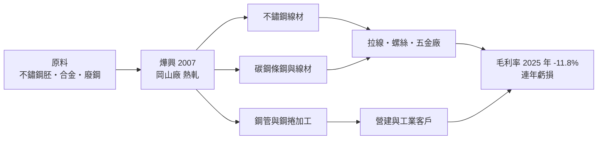
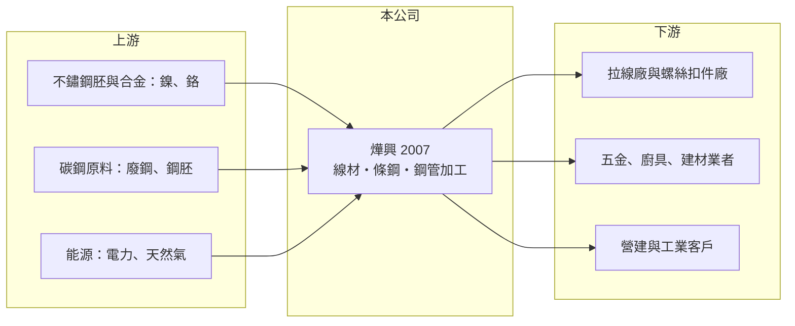

# 2007 燁興

> 上市｜[[產業索引-鋼鐵工業|鋼鐵工業]]｜上市（櫃）日期 1988/10/04

# 第一章：企業模式與商業藍圖

> [!info] 撰寫說明
> 本文由 Claude 依公開資料整理，架構比照 [[2330台積電]] 的四章研究，資料截至 2026-10-08。財務數字來源：Goodinfo 年度經營績效頁、nStock（公司業務登記內容）、CMoney 投資快訊標題（「不鏽鋼線材專業廠」定位）、證交所開放資料（基本資料、資產負債、綜合損益、營益分析、股利、每月營收）；公開資料有限，產品營收比重、產能與集團關係未查得或憑記憶撰寫並已標註，產業描述為整理性內容，尚未逐條比對原始文件。#待校對

在評估單一個股的長期投資價值時，首要步驟是拆解企業的底層獲利邏輯。本章說明燁興企業（股票代號：2007，以下簡稱燁興）的業務組成，以及它為何在過去七年中只有一年獲利。

## 一、核心定位：高雄岡山的線材與條鋼廠

燁興成立於 1978 年 7 月，1988 年 10 月上市，總部與工廠位於高雄市岡山區，2026 年實收資本額約 53.1 億元，董事長為吳林茂、總經理為黃傳祥。依公司業務登記，燁興從事各類鋼管、鋼捲加工品與[[線材]]的產銷，另登記有整廠機械與環保設備工程、營建等業務；財經媒體多把燁興定位為「不鏽鋼線材專業廠」。燁興一般被歸為燁隆集團（與 [[2023燁輝]]、燁聯同一體系）的成員（憑記憶，持股關係待校對）。#待校對

線材是把鋼胚熱軋成捲狀的細長條鋼，下游再拉成鋼線、做成螺絲、彈簧、焊材與各種五金。不鏽鋼線材則用於不鏽鋼螺絲、廚具、醫療器材與建築五金。這類產品的特性是：

* **價格跟著原料走：** 不鏽鋼的主要成本是鎳、鉻等合金與不鏽鋼胚，碳鋼條鋼的成本則是[[廢鋼]]或鋼胚。燁興賺的是售價與原料成本之間的[[價差]]，原料價格急跌時容易出現[[存貨跌價損失]]。
* **規格標準化：** 線材與條鋼屬於大宗鋼品，品牌差異小，價格主要由市場供需決定，中國與東南亞的大量產能是長期壓力來源。

## 二、營運現況：長期虧損與財務壓力

燁興在 2019 至 2025 年間只有 2021 年小幅獲利，其餘年度都是虧損，2025 年毛利率 -11.8%，代表產品售價連原料與製造成本都無法覆蓋。2026 年上半年營收 22.6 億元，毛利率 -6.48%、EPS -0.82 元，虧損仍在持續。

* **累積虧損：** 2026 年第二季保留盈餘為 -18.2 億元，已形成[[累積虧損]]，依法須先彌補才能配發股利，2025 年度未配息。
* **私募股權：** 證交所資料顯示燁興約 5.3 億股中有約 3.6 億股為私募股數，代表過去曾以大規模私募引進資金（私募對象與年份未查得）。這通常是虧損企業在公開市場籌資困難時的補血方式。#待校對

## 三、長期方向

燁興未查得明確的轉型或新產能計畫。對這類長期虧損的大宗鋼品廠，長期價值取決於三件事：能否透過產品組合調整（轉向較高附加價值的特殊線材）止住虧損、集團是否持續提供原料與資金支持，以及閒置資產（土地、廠房）能否活化。在這些條件改善之前，燁興更接近一家需要觀察存續能力的公司，而不是成長股。

# 第二章：護城河深度與競爭優勢

在長期價值投資中，「護城河」指企業抵禦競爭、維持超額利潤的保護機制。本章誠實檢視燁興的競爭位置：在連年虧損的情況下，護城河非常有限。

## 一、可能的優勢

* **集團上下游關係：** 若燁興確實屬於燁隆集團，不鏽鋼胚可由集團內的不鏽鋼廠供應，取得原料的穩定度高於獨立加工廠（推估）。
* **南部產業聚落：** 岡山是台灣螺絲扣件的主要聚落，燁興的線材可以就近供應下游螺絲廠，運輸成本與交期有地利之便。
* **既有設備與土地：** 長年經營的軋延產線與工業用地，在重置成本上具有一定價值，但這是資產價值，不是獲利能力。

## 二、競爭對手格局

| 對手 | 定位 | 對燁興的影響 |
|---|---|---|
| 華新集團（[[1605華新]]） | 不鏽鋼盤元與線材大廠，規劃在印尼建不鏽鋼盤元廠、2027 年量產（中央社 2024 年 11 月報導） | 規模與成本優勢明顯 |
| 中國與東南亞不鏽鋼廠 | 以鎳生鐵一貫化生產，成本低 | 壓低國際價格 |
| [[2015豐興]]、[[2006東和鋼鐵]]、[[2038海光]] | 國內電爐條鋼廠 | 在碳鋼條鋼與鋼筋市場競爭 |

## 三、守得住與守不住的地方

* **守得住：** 對在地螺絲、五金廠的就近供貨與既有客戶關係。
* **守不住：** 價格。2023 至 2025 年毛利率連續為負，說明在大宗線材市場燁興沒有定價能力，只能被動接受國際價格。
* **觀察重點：** 毛利率能否轉正、營運資金是否足以支應到期負債，以及集團或私募投資人的後續動作。

# 第三章：財務體質與盈利規模

資料日期：2026-10-08。數字取自 Goodinfo 年度經營績效頁與證交所開放資料，表格是撰寫當時的快照；最新月營收、毛利率、累計 EPS 由自動排程寫在本筆記的屬性欄位（月營收、毛利率、累計EPS 等）。#待校對

財務報表是檢驗護城河是否真實存在的最終標準。本章用多年度三率、ROE 與資本報酬，檢視燁興的獲利能力與財務體質。

## 一、多年度獲利

| 年度 | 營收（新台幣） | [[毛利率]] | [[營業利益率]] | EPS（元） | [[ROE]] |
|---|---|---|---|---|---|
| 2019 | 65.5 億 | -3.59% | -7.29% | -1.21 | -10.6% |
| 2020 | 55.9 億 | -2.92% | -6.33% | -0.89 | -7.03% |
| 2021 | 70.2 億 | 8.05% | 5.42% | 0.02 | 0.18% |
| 2022 | 68.3 億 | -0.97% | -4.07% | -1.31 | -9.75% |
| 2023 | 50.2 億 | -9.33% | -12.8% | -1.81 | -13.6% |
| 2024 | 69.0 億 | -7.64% | -10.6% | -2.04 | -17.2% |
| 2025 | 52.8 億 | -11.8% | -15.5% | -2.24 | -24.8% |
| 2026 上半年 | 22.6 億 | -6.48% | -10.79% | -0.82 | 未查得 |

註：2025 年稅後淨損 11.9 億元（證交所股利資料為 -11.86 億元）。2026 年 1 至 8 月累計營收 30.4 億元，年減約 22%。

* **營收規模萎縮：** 2020 至 2025 年營收在 50 億至 70 億元之間波動，沒有成長趨勢。
* **虧損擴大：** 2023 年以後毛利率持續為負，2025 年稅後淨損 11.9 億元，ROE -24.8%。連續虧損侵蝕淨值，2026 年第二季每股淨值只剩 7.40 元，低於面額 10 元。
* **流動性：** 2026 年第二季流動資產 17.3 億元，流動負債 45.7 億元，流動比率僅約 38%（推算）。短期償債高度依賴銀行續貸或集團支持，這是燁興最需要關注的財務風險。

## 二、長期指標

* **平均 ROE：** 2021 至 2025 年平均約 -13%（推算）。
* **股利：** 因累積虧損，近年未配息；章程規定可分配盈餘低於實收股本 20% 時得不分配。
* **自由現金流：** 長期虧損下推估為負（具體數字未查得）。

## 三、[[ROIC]] 與 [[WACC]]：價值創造利差

**ROIC 推算：** 2025 年營業利益約 -8.2 億元（52.8 億元 × -15.5%），因為虧損不計稅盾。投入資本以 2026 年第二季權益 39.2 億元加負債 81.1 億元計（有息負債明細未查得，以負債總額代替會高估投入資本），ROIC 約 -6.8%（推算）；只以權益計算則約 -21%（推算）。

**WACC 推算：** 以 [[CAPM]] 推估權益成本，台灣 10 年期公債 1.75%、市場風險溢酬 6%、β 取 0.9（鋼鐵業常見值，非來源數字），權益成本約 7.15%；負債成本假設 3%（虧損企業借款利率較高，推估），稅後約 2.4%。依權益約 33%、負債約 67% 的帳面結構，WACC 約 4% 至 7%（推算）。

**結論：** ROIC 長期為負，遠低於 WACC，燁興過去七年持續在毀損股東價值。這不是景氣循環的短期現象，而是產品在國際競爭下缺乏價差的結構性問題。

# 第四章：總體風險與地緣政治

任何企業都無法脫離宏觀環境獨立存在。本章分析燁興必須面對的產業、財務與外部風險。

## 一、產業週期

* **不鏽鋼與鎳價：** 不鏽鋼產品價格隨鎳價大幅波動，中國與印尼以鎳生鐵擴產，長期壓低全球不鏽鋼價格，台灣廠商的價差空間被擠壓。
* **碳鋼條鋼：** 碳鋼線材與鋼筋跟著營建景氣與廢鋼價格循環，旺季時價差擴大，淡季時容易虧損。

## 二、營運與財務風險

* **持續經營風險：** 流動負債遠高於流動資產，淨值低於面額，若銀行緊縮授信或虧損持續，可能需要再次增資或處分資產。
* **股權稀釋：** 過去的大規模私募已使股權結構改變，未來若再籌資，既有股東會被進一步稀釋。
* **營業外損失：** 2026 年上半年營業外損失 1.64 億元，業外項目（利息、匯兌、轉投資）持續拖累損益。

## 三、其他風險

* **貿易保護：** 美國關稅與各國對不鏽鋼產品的[[反傾銷]]措施，會改變出口市場的價格與訂單。
* **碳費與 [[CBAM]]：** 軋鋼與加熱爐屬於高耗能製程，台灣碳費與歐盟碳邊境調整機制會增加成本。
* **匯率：** 原料以美元計價，新台幣貶值會提高成本。

# 專有名詞解析

## 金融

- **[[存貨跌價損失]]**：存貨的市價低於帳上成本時必須提列的損失，常見於原物料價格急跌時。
- **[[累積虧損]]**：公司歷年虧損累積使保留盈餘為負數，依法須先彌補完才能分配股利。

## 產業

- **[[線材]]**：鋼胚熱軋成捲狀的細長條鋼，是拉線、螺絲、彈簧與焊材的原料。
- **[[廢鋼]]**：回收的鋼鐵料，是電弧爐的主要原料，價格隨國際供需每日變動，占電爐廠成本最大比重。
- **[[價差]]**：鋼品售價減去主要原料成本的差額，是鋼鐵業衡量獲利能力最直接的指標。
- **[[反傾銷]]**：進口國對低於正常價格銷售的進口商品加徵關稅，以保護本國產業的貿易救濟措施。
- **[[CBAM]]**：歐盟碳邊境調整機制，對進口鋼鐵等高碳產品依碳排量課徵費用，使低碳製程較具競爭力。

# 核心供應鏈

## 1. 上游：原料與能源
- 不鏽鋼胚與鎳、鉻合金（集團內供應關係待校對）
- 廢鋼與碳鋼鋼胚
- 電力：台灣電力公司

## 2. 本公司與同業
- 集團相關：[[2023燁輝]]（燁隆集團，持股關係待校對）
- 不鏽鋼線材同業：[[1605華新]]
- 條鋼同業：[[2015豐興]]、[[2006東和鋼鐵]]、[[2038海光]]

## 3. 下游：客戶
- 岡山與南部螺絲扣件聚落：[[2012春雨]]、[[2062橋椿]]、[[2069運錩]] 等（是否為燁興客戶未查得）
- 五金、廚具、建築與工業用戶

## 最新新聞
<!-- news:start -->
<!-- news:end -->

## 相關連結
- [公開資訊觀測站](https://mopsov.twse.com.tw/mops/web/t05st03?step=1&firstin=1&co_id=2007)
- [Goodinfo](https://goodinfo.tw/tw/StockDetail.asp?STOCK_ID=2007)
- [Yahoo 股市](https://tw.stock.yahoo.com/quote/2007)
- [鉅亨網新聞](https://www.cnyes.com/twstock/2007/news)
