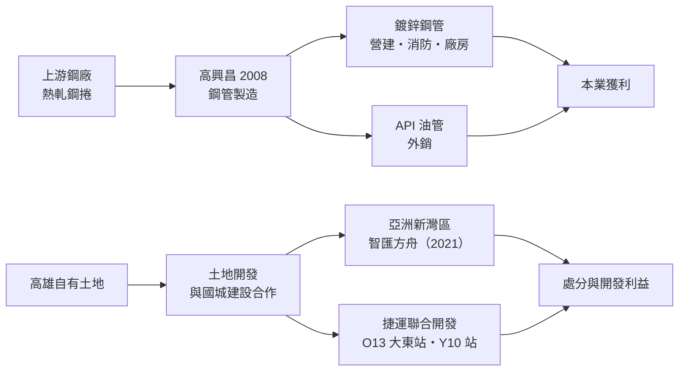
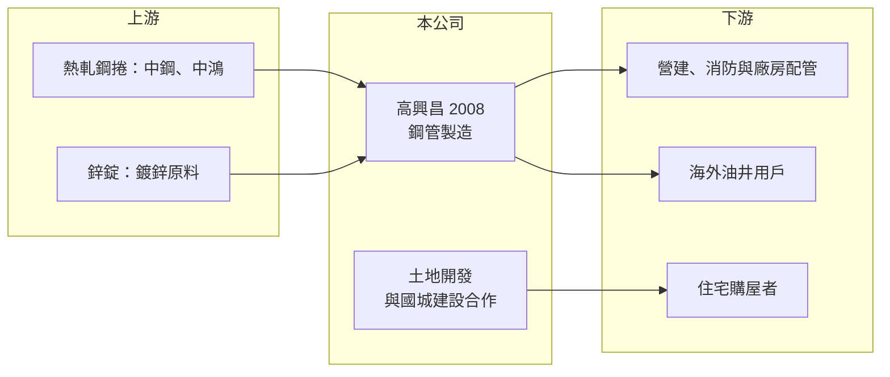

# 2008 高興昌

> 上市｜[[產業索引-鋼鐵工業|鋼鐵工業]]｜上市（櫃）日期 1988/12/28

# 第一章：企業模式與商業藍圖

> [!info] 撰寫說明
> 本文由 Claude 依公開資料整理，架構比照 [[2330台積電]] 的四章研究，資料截至 2026-10-08。財務數字來源：Goodinfo 年度經營績效頁、工商時報（2024 年 6 月高興昌股東會報導）、經濟日報（2026 年股東會報導標題）、證交所開放資料（基本資料、資產負債、綜合損益、營益分析、股利、每月營收）；公開資料有限，產品營收比重與產能未查得，產業描述為整理性內容，尚未逐條比對原始文件。#待校對

在評估單一個股的長期投資價值時，首要步驟是拆解企業的底層獲利邏輯。本章說明高興昌鋼鐵（股票代號：2008，以下簡稱高興昌）如何從一家高雄的鋼管廠，逐步把土地資產變成第二個事業。

## 一、核心定位：高雄老牌鋼管廠

高興昌成立於 1966 年 1 月，1988 年 12 月上市，總部位於高雄市，2026 年實收資本額約 19.1 億元，董事長為呂泰榮、總經理為勝呂榮峰。2024 年股東會改選時，第三代呂偉誠與勝呂安德首度當選董事，家族接班態勢明確。

高興昌的本業是[[鋼管]]，主力產品是[[鍍鋅鋼管]]，另有外銷的 API 油井用管：

* **鍍鋅鋼管（內銷為主）：** 用於建築消防、給水、電氣配管與廠房管線，需求跟著國內營建與廠房投資走。
* **API 油管（外銷）：** 依美國石油協會規格生產、用於油井的鋼管，需求取決於國際油價與油井開發數量，並面臨韓國同業的低價競爭。

鋼管廠向上游鋼廠購買熱軋鋼捲，經分條、成型、焊接與鍍鋅後出售，獲利來自鋼管售價與鋼捲成本之間的[[價差]]。

## 二、第二事業：與建商合作的土地開發

高興昌持有高雄市區的土地，近年積極把土地轉為開發收益：

* **亞洲新灣區：** 2021 年與國城建設成立「智匯方舟公司」，取得高雄亞洲新灣區特貿三南基地南側約 3,025 坪土地。
* **[[捷運聯合開發]]：** 2023 年與國城建設合作高雄捷運橘線 O13 大東站、黃線 Y10 站兩件聯合開發案，分別成立「大東智捷公司」與「大港捷匯公司」，規劃興建住宅大樓，總銷金額上看 200 億元（報導數字，高興昌的權益比例未查得）。
* **處分利益：** 2023 年處分不動產獲利 3.29 億元，是當年 EPS 達 2.24 元的主因。

## 三、長期方向

高興昌的長期價值由兩部分組成：本業鋼管提供穩定但不高的現金流，土地開發則在未來數年陸續認列一次性的大額收益。這種組合讓年度獲利非常不平均，投資人需要分開評估「鋼管本業能賺多少」與「土地還有多少價值」。

# 第二章：護城河深度與競爭優勢

在長期價值投資中，「護城河」指企業抵禦競爭、維持超額利潤的保護機制。本章分析高興昌在鋼管本業與土地資產兩方面的優勢與限制。

## 一、護城河的組成

* **土地資產：** 高興昌最具價值的資產是長年持有的高雄土地。高雄亞洲新灣區與捷運沿線的開發，使這些土地的價值顯著提升，而帳面成本多為早年取得的歷史成本（推估）。這是同業難以複製的優勢，但屬於一次性的資產價值。
* **國內鍍鋅鋼管的通路：** 長年經營的經銷與工程通路，讓高興昌在國內消防、配管市場有穩定客戶。
* **毛利率改善：** 2021 年以後毛利率由負轉正，2025 年達 16.8%，顯示產品組合與定價已改善，本業並非長期虧損。

## 二、競爭對手格局

| 對手 | 定位 | 對高興昌的影響 |
|---|---|---|
| [[2034允強]]、[[2032新鋼]] 等國內鋼管與鋼材廠 | 國內鋼管與鋼材 | 在內銷鋼管市場價格競爭 |
| 韓國鋼管廠 | 以無關稅優勢外銷美國 API 油管 | 壓縮高興昌外銷訂單 |
| 中國與東南亞鋼管廠 | 低價大宗鋼管 | 壓低國際價格 |

## 三、守得住與守不住的地方

* **守得住：** 國內鍍鋅鋼管的通路，以及土地開發的長期收益。
* **守不住：** 外銷 API 油管。2023 年外銷鋼管銷售量年減 82%，顯示在國際油管市場高興昌缺乏競爭力。
* **觀察重點：** 捷運聯合開發案的興建與銷售進度、處分利益的認列時點，以及鋼管本業毛利率能否維持在 15% 以上。

# 第三章：財務體質與盈利規模

資料日期：2026-10-08。數字取自 Goodinfo 年度經營績效頁與證交所開放資料，表格是撰寫當時的快照；最新月營收、毛利率、累計 EPS 由自動排程寫在本筆記的屬性欄位（月營收、毛利率、累計EPS 等）。#待校對

財務報表是檢驗護城河是否真實存在的最終標準。本章用多年度三率、ROE 與資本報酬，檢視高興昌本業與土地收益的貢獻。

## 一、多年度獲利

| 年度 | 營收（新台幣） | [[毛利率]] | [[營業利益率]] | EPS（元） | [[ROE]] |
|---|---|---|---|---|---|
| 2019 | 11.4 億 | -0.38% | -10.8% | -0.62 | -5.16% |
| 2020 | 9.63 億 | 2.29% | -7.13% | -0.16 | -1.26% |
| 2021 | 15.5 億 | 12.5% | 6.25% | 0.21 | 1.47% |
| 2022 | 22.2 億 | 14.8% | 6.25% | 0.56 | 3.88% |
| 2023 | 14.6 億 | 13.8% | 6.07% | 2.24 | 13.8% |
| 2024 | 14.6 億 | 15.1% | 6.9% | 0.26 | 1.39% |
| 2025 | 18.2 億 | 16.8% | 8.89% | 0.68 | 3.57% |
| 2026 上半年 | 8.22 億 | 16.86% | 10.10% | 0.34 | 未查得 |

註：2023 年業外損益 3.24 億元（主要為不動產處分利益）。2026 年 1 至 8 月累計營收 11.3 億元，年減約 13%。

* **營收規模小：** 年營收約 10 億至 20 億元，在上市鋼鐵股中屬於小型公司。2020 至 2025 年營收年複合成長率約 13.6%（推算），但起點是 2020 年的低谷。
* **本業獲利改善但不高：** 營業利益率由 2019 年的 -10.8% 改善到 2025 年的 8.89%，但 ROE 只有約 3% 至 4%，本業規模不足以支撐高報酬。
* **一次性收益：** 2023 年 ROE 13.8% 來自不動產處分，不能視為常態。

## 二、長期指標

* **平均 ROE：** 2021 至 2025 年平均約 4.8%（推算），若扣除 2023 年處分利益，平均約 2.6%（推算）。
* **股利：** 2025 年度配發現金股利 1 元，以 2025 年 EPS 0.68 元計算，[[配發率]]超過 100%（推算），代表部分股利來自過去的保留盈餘。2023 年度同樣配發 1 元。
* **資產結構：** 2026 年第二季總資產 87.4 億元，權益 41.2 億元，非流動負債 26.1 億元，推估與開發案的長期借款有關（明細未查得）。

## 三、[[ROIC]] 與 [[WACC]]：價值創造利差

**ROIC 推算：** 2025 年營業利益約 1.62 億元（18.2 億元 × 8.89%），稅後約 1.29 億元（稅率 20%）。以權益 41.2 億元計算，ROIC 約 3.1%；若把負債 46.2 億元全部視為投入資本，ROIC 約 1.5%（推算）。

**WACC 推算：** 權益成本以 [[CAPM]] 估算，台灣 10 年期公債 1.75%、市場風險溢酬 6%、β 取 0.9（鋼鐵業常見值，非來源數字），約 7.15%；負債成本假設 2.5%，稅後約 2%。依權益約 47%、負債約 53% 的帳面結構，WACC 約 4.4% 至 7.2%（推算）。

**結論：** 鋼管本業的 ROIC 低於 WACC，單靠本業並未創造價值；高興昌的價值主要藏在土地資產與開發案中。投資人評估時，應把它看成「本業打平、資產待實現」的公司，而不是以本業 EPS 為主的成長股。

# 第四章：總體風險與地緣政治

任何企業都無法脫離宏觀環境獨立存在。本章分析高興昌必須面對的產業、開發案與外部風險。

## 一、產業週期

* **鋼價循環：** 鋼管成本主要是熱軋鋼捲，鋼價急跌時產品售價跟著下調，庫存可能出現[[存貨跌價損失]]。
* **營建與廠房需求：** 鍍鋅鋼管需求取決於國內營建與廠房投資。報導指出電子廠訂單外流曾使國內鋼管需求轉弱。
* **油價：** API 油管外銷與國際油價、油井開發數量高度連動。

## 二、開發案風險

* **房市景氣：** 捷運聯合開發與亞洲新灣區開發案的收益，取決於高雄房市景氣與銷售價格，房市降溫可能延後認列或壓縮利潤。
* **財務槓桿：** 開發案需要資金投入，若以借款支應，會提高公司的財務風險。
* **合作夥伴：** 開發案依賴國城建設等合作夥伴的執行能力。

## 三、其他風險

* **貿易保護：** 美國關稅與其他國家的[[反傾銷]]措施影響外銷。
* **家族接班：** 第三代接班後的經營方向（本業或開發優先）仍待觀察。
* **匯率：** 外銷以美元計價，匯率變動影響外銷利潤。

# 專有名詞解析

## 金融

- **[[存貨跌價損失]]**：存貨的市價低於帳上成本時必須提列的損失，常見於原物料價格急跌時。
- **[[配發率]]**：現金股利占當年度每股盈餘的比例，用來衡量公司把多少獲利分給股東。

## 產業

- **[[鋼管]]**：以鋼板或鋼捲捲成管狀並焊接而成的鋼材，用於配管、結構與油井。
- **[[鍍鋅鋼管]]**：表面鍍上一層鋅以防鏽的鋼管，常用於消防、給水與建築配管。
- **[[價差]]**：鋼品售價減去主要原料成本的差額，是鋼鐵業衡量獲利能力最直接的指標。
- **[[捷運聯合開發]]**：政府以捷運站周邊或站體上方土地，與民間地主或建商合作開發住宅與商場，依權值分配成果。
- **[[反傾銷]]**：進口國對低於正常價格銷售的進口商品加徵關稅，以保護本國產業的貿易救濟措施。

# 核心供應鏈

## 1. 上游：原料
- 熱軋鋼捲：[[2002中鋼]]、[[2014中鴻]]（實際供應商未查得，為國內主要熱軋鋼捲來源）
- 鋅錠：國際金屬貿易商

## 2. 本公司與合作夥伴
- 開發夥伴：國城建設（智匯方舟、大東智捷、大港捷匯）
- 鋼管同業：[[2034允強]]、[[2032新鋼]]

## 3. 下游：客戶
- 國內營建、消防與工程配管業者
- 海外油井用戶（API 油管）
- 開發案的住宅購屋者

## 最新新聞
<!-- news:start（自動產生，請勿手動編輯此範圍） -->
- 2026-10-22 🏛️ 重訊 16:42｜公告本公司召開法說會增加若因颱風可能延期說明｜[觀測站](https://mops.twse.com.tw/mops/#/web/t05st01)
- 2026-10-22 🏛️ 重訊 14:56｜公告本公司召開法說會相關內容｜[觀測站](https://mops.twse.com.tw/mops/#/web/t05st01)
- 2026-10-15 🏛️ 重訊 16:42｜公告本公司取得有價證券｜[觀測站](https://mops.twse.com.tw/mops/#/web/t05st01)

完整紀錄：[[2008高興昌 新聞]]
<!-- news:end -->

## 相關連結
- [公開資訊觀測站](https://mopsov.twse.com.tw/mops/web/t05st03?step=1&firstin=1&co_id=2008)
- [Goodinfo](https://goodinfo.tw/tw/StockDetail.asp?STOCK_ID=2008)
- [Yahoo 股市](https://tw.stock.yahoo.com/quote/2008)
- [鉅亨網新聞](https://www.cnyes.com/twstock/2008/news)
