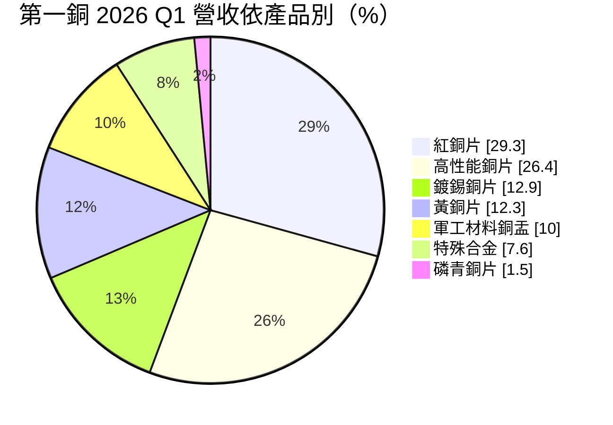
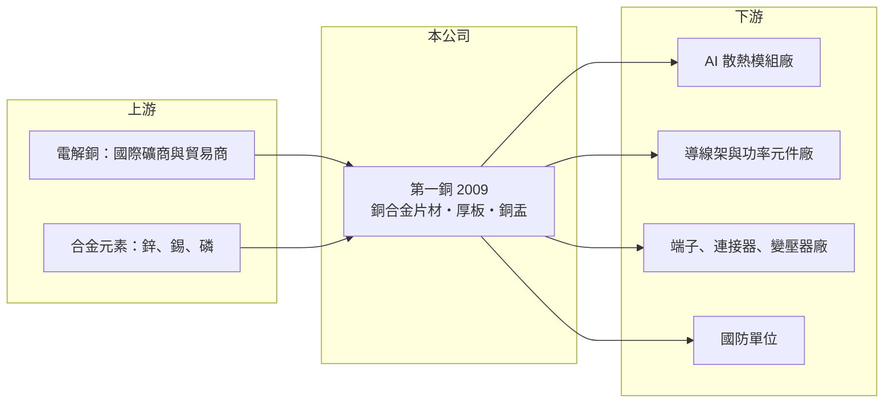

# 2009 第一銅

> 上市｜[[產業索引-鋼鐵工業|鋼鐵工業]]｜上市（櫃）日期 1989/10/20

# 第一章：企業模式與商業藍圖

> [!info] 撰寫說明
> 本文由 Claude 依公開資料整理，架構比照 [[2330台積電]] 的四章研究，資料截至 2026-10-08。財務數字來源：Goodinfo 年度經營績效頁、富果研究（第一銅 2026 年 5 月法說會整理）、證交所開放資料（基本資料、資產負債、綜合損益、營益分析、股利、每月營收）；產業描述為整理性內容，尚未逐條比對原始文件。#待校對

在評估單一個股的長期投資價值時，首要步驟是拆解企業的底層獲利邏輯。本章說明第一伸銅（股票代號：2009，以下簡稱第一銅）如何從傳統銅片加工，轉向 AI 散熱、半導體與國防材料。

## 一、核心定位：台灣老牌銅合金片材廠

第一銅成立於 1969 年 7 月，1989 年 10 月上市，2026 年實收資本額約 36 億元，董事長為王宏仁、總經理為洪茂陽。公司名稱雖歸在鋼鐵類股，實際產品是[[銅合金]]片材與熱壓板材，共有十大合金系列。依法說會整理，第一銅是台灣首家引進無鉛再熔鍍錫技術的廠商，約六年前跨入沖壓，供應軍用銅盂半成品。

銅片加工廠的商業模式是：向國際市場買進電解銅與合金原料，經熔鑄、熱軋、冷軋、退火、鍍錫等製程，做成不同厚度、強度與導電度的片材，賣給散熱、電子零件與電力設備廠。售價通常以銅價加上加工費計算，因此：

* **銅價影響營收大小：** 銅價上漲時營收跟著放大，但不一定代表加工利潤增加。
* **加工費才是真正的利潤：** 高性能合金、厚板與特殊規格的加工費較高，產品組合越往高階走，毛利率越好。

## 二、產品與應用

* **紅銅片（29.3%）：** 純銅導熱性最好，依法說會說明，紅銅片約 70% 至 80% 用於 AI 伺服器散熱片。AI 晶片功耗上升後，散熱模組使用的厚銅板需求從 3.0mm 延伸到 6.0mm。
* **高性能銅片（26.4%）：** 主力合金為 C194、C19210，供應半導體[[導線架]]與功率元件，需要高強度與高導電度兼具。
* **鍍錫與黃銅片：** 用於電器端子、連接器、汽車電機與變壓器。
* **軍工材料銅盂（10%）：** 國防彈藥用的銅盂半成品，是近年新增的業務。

銷售地區方面，國內約 66%、國外約 34%；國外銷售中，中國（含港澳）約 28.3%、東南亞合計約 32.7%、日本約 9.7%。

## 三、長期方向

第一銅的策略是把產品集中到四個成長領域：AI 散熱、電網基礎設施（變壓器）、半導體與國防。具體投資包括：可處理 6mm 銅板的厚板分條機（預計 2026 年第三季試產），用來切入原本由日本進口材料主導的高階散熱市場；軍工沖壓設備由一台擴增，計畫再引進三台；重新啟動變壓器用銅材產線。這些都是小規模、針對高附加價值產品的投資，而不是大規模擴產。

# 第二章：護城河深度與競爭優勢

在長期價值投資中，「護城河」指企業抵禦競爭、維持超額利潤的保護機制。本章分析第一銅在銅合金市場的利基與限制。

## 一、護城河的組成

* **合金配方與製程經驗：** 銅合金片材需要精準控制成分、軋延與熱處理，才能達到導線架或連接器要求的強度、導電度與彎折性能。第一銅經營超過五十年、有十大合金系列，客戶完成材料認證後，通常不會輕易更換供應商。
* **在地供應：** 台灣是 AI 伺服器散熱模組的主要生產地，第一銅就近供應厚銅板，交期與客製化能力優於日本進口材料。
* **國防供應資格：** 軍工銅盂需要通過國防採購的資格審查，進入門檻較高，競爭者少。

## 二、競爭對手格局

| 對手 | 定位 | 對第一銅的影響 |
|---|---|---|
| 日本銅材大廠（如三菱綜合材料、古河電工） | 高階導線架與散熱銅材 | 技術與品牌領先，是第一銅高階化要追趕的對象 |
| 中國銅加工廠 | 規模大、價格低 | 壓縮一般銅片的加工費 |
| 國內銅材廠 | 銅線、銅箔與銅材 | 部分產品重疊，[[1605華新]]、[[1608華榮]] 以電線電纜為主 |

## 三、守得住與守不住的地方

* **守得住：** AI 散熱用紅銅厚板與國防銅盂，這兩塊有技術或資格門檻，且需求在成長。
* **守不住：** 一般黃銅、鍍錫片的加工費。這類產品與中國同業直接競爭，2023 年與 2025 年毛利率都接近零或為負。
* **觀察重點：** 厚板分條機量產後，高階散熱銅板能否取代日本進口；軍工與變壓器業務的占比能否持續提高。

# 第三章：財務體質與盈利規模

資料日期：2026-10-08。數字取自 Goodinfo 年度經營績效頁、富果研究法說會整理與證交所開放資料，表格是撰寫當時的快照；最新月營收、毛利率、累計 EPS 由自動排程寫在本筆記的屬性欄位（月營收、毛利率、累計EPS 等）。#待校對

財務報表是檢驗護城河是否真實存在的最終標準。本章用多年度三率、ROE 與資本報酬，檢視第一銅的本業獲利能力。

## 一、多年度獲利

| 年度 | 營收（新台幣） | [[毛利率]] | [[營業利益率]] | EPS（元） | [[ROE]] |
|---|---|---|---|---|---|
| 2019 | 25.4 億 | -3.60% | -5.70% | -0.28 | -2.72% |
| 2020 | 22.6 億 | -0.94% | -3.36% | 0.22 | 1.93% |
| 2021 | 32.2 億 | 10.00% | 7.97% | 1.18 | 7.69% |
| 2022 | 29.0 億 | -1.67% | -3.84% | 0.55 | 3.59% |
| 2023 | 26.5 億 | -0.42% | -2.55% | -0.03 | -0.18% |
| 2024 | 31.3 億 | 3.78% | 1.79% | 0.74 | 4.04% |
| 2025 | 29.1 億 | -0.41% | -2.59% | 0.34 | 1.44% |
| 2026 上半年 | 16.9 億 | 12.31% | 10.40% | 0.49 | 未查得 |

註：2025 年本業虧損，稅後淨利 1.22 億元靠業外收益 2.04 億元支撐。2026 年第一季營收 7.99 億元、年增 30%，毛利率約 11%、EPS 0.21 元；1 至 8 月累計營收 23.8 億元，年增約 22%。

* **本業長期微利：** 2019 至 2025 年毛利率多在 -4% 至 10% 之間，七年中有五年營業利益為負。過去的第一銅更像是賺取微薄加工費的傳統加工廠。
* **2026 年的轉折：** 2026 年上半年毛利率升至 12.3%、營業利益率 10.4%，是近年最好的水準。原因包括銅價上漲帶來的庫存利益與 AI 散熱需求增加。其中有多少是可持續的產品組合改善、多少是銅價上漲的一次性效果，需要觀察銅價回落時的表現。
* **營收年複合成長率：** 2020 至 2025 年約 5.2%（推算）。

## 二、長期指標

* **平均 ROE：** 2021 至 2025 年平均約 3.3%（推算），長期偏低。
* **股利：** 2025 年度配發現金股利 0.4 元，以 EPS 0.34 元計算，[[配發率]]超過 100%（推算）。
* **資產負債：** 2026 年第二季總資產 111.8 億元、權益 87.6 億元、負債 24.2 億元，負債比約 22%，財務保守。每股淨值 24.37 元，權益中有相當比例來自金融資產等非營業資產（推估，明細未查得）。

## 三、[[ROIC]] 與 [[WACC]]：價值創造利差

**ROIC 推算：** 2025 年營業利益約 -0.75 億元（29.1 億元 × -2.59%），ROIC 約 -0.9%（以權益 87.6 億元計）至 -0.7%（加計負債 24.2 億元），為負值（推算）。若以 2026 年上半年營業利益 1.76 億元年化（約 3.5 億元，稅後約 2.8 億元），ROIC 約 2.5% 至 3.2%（推算）。

**WACC 推算：** 權益成本以 [[CAPM]] 估算，台灣 10 年期公債 1.75%、市場風險溢酬 6%、β 取 0.9（金屬加工業常見值，非來源數字），約 7.15%；負債成本假設 2.5%，稅後 2%。依權益約 78% 的帳面結構，WACC 約 6.0% 至 7.2%（推算）。

**結論：** 即使在 2026 年的好光景，第一銅的本業 ROIC 仍低於 WACC，長期並未創造價值。原因之一是帳上有大量非營業資產拉低資本效率。第一銅要真正創造價值，需要高階散熱與軍工產品的占比大幅提高，讓毛利率穩定在兩位數。

# 第四章：總體風險與地緣政治

任何企業都無法脫離宏觀環境獨立存在。本章分析第一銅必須面對的原料、產業與外部風險。

## 一、原料與價格風險

* **銅價波動：** LME 銅價自 2025 年下半年持續攀升，2026 年 5 月突破每噸 14,000 美元。銅價上漲時帶來[[庫存利益]]，回落時則可能出現[[存貨跌價損失]]，第一銅過去多年的低毛利，部分就是銅價下跌期間的損失。
* **加工費競爭：** 一般銅片的加工費受中國產能影響，長期有下降壓力。

## 二、產業週期

* **AI 散熱需求：** 紅銅片高度依賴 AI 伺服器散熱，若 AI 資本支出放緩，或散熱技術轉向液冷而改變材料規格，需求可能下降。
* **半導體與電子週期：** 導線架與連接器材料跟著半導體與消費電子景氣起伏。

## 三、其他風險

* **國防訂單：** 軍工業務取決於國防採購預算與標案時程，訂單可能不連續。
* **地緣政治：** 約三成外銷到中國與東南亞，美中貿易政策與關稅會影響下游客戶的生產布局。
* **匯率：** 銅以美元計價，新台幣升值時以台幣計算的營收與庫存價值會下降。

# 專有名詞解析

## 半導體

- **[[導線架]]**：承載晶片並把訊號導出到電路板的金屬框架，常用高強度銅合金製作。

## 金融

- **[[庫存利益]]**：原料或產品價格上漲時，先前以低價買進的庫存被以較高售價賣出所產生的額外利潤。
- **[[存貨跌價損失]]**：存貨的市價低於帳上成本時必須提列的損失，常見於原物料價格急跌時。
- **[[配發率]]**：現金股利占當年度每股盈餘的比例，用來衡量公司把多少獲利分給股東。

## 產業

- **[[銅合金]]**：在銅中加入鋅、錫、磷、鐵等元素調整強度與導電度的材料，黃銅、磷青銅都屬此類。
- **[[散熱模組]]**：由均熱板、熱管、散熱鰭片與風扇組成，把晶片熱量導出的零組件。

# 核心供應鏈

## 1. 上游：原料
- 電解銅：國際銅礦商與金屬貿易商（LME 定價）
- 合金元素：鋅、錫、磷等

## 2. 本公司與同業
- 日本銅材廠（三菱綜合材料、古河電工等）
- 國內銅相關業者：[[1605華新]]、[[1608華榮]]

## 3. 下游：客戶（第一銅未揭露具名客戶，以下為應用領域的代表廠商）
- AI 散熱模組：[[3017奇鋐]]、[[3324雙鴻]]
- 導線架與封裝：[[8070長華]] 等導線架業者
- 端子、連接器、變壓器與汽車電機廠
- 國防軍工單位

## 最新新聞
<!-- news:start（自動產生，請勿手動編輯此範圍） -->
- 2026-10-08 📰 媒體 17:23｜營收速報 - 第一銅(2009)9月營收3.40億元年增率高達36.02％｜[鉅亨網](https://news.cnyes.com/news/id/6624985)

完整紀錄：[[2009第一銅 新聞]]
<!-- news:end -->

## 相關連結
- [公開資訊觀測站](https://mopsov.twse.com.tw/mops/web/t05st03?step=1&firstin=1&co_id=2009)
- [Goodinfo](https://goodinfo.tw/tw/StockDetail.asp?STOCK_ID=2009)
- [Yahoo 股市](https://tw.stock.yahoo.com/quote/2009)
- [鉅亨網新聞](https://www.cnyes.com/twstock/2009/news)
