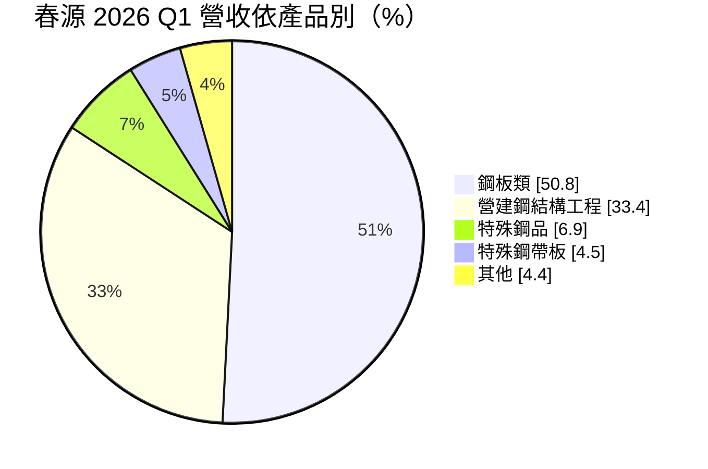
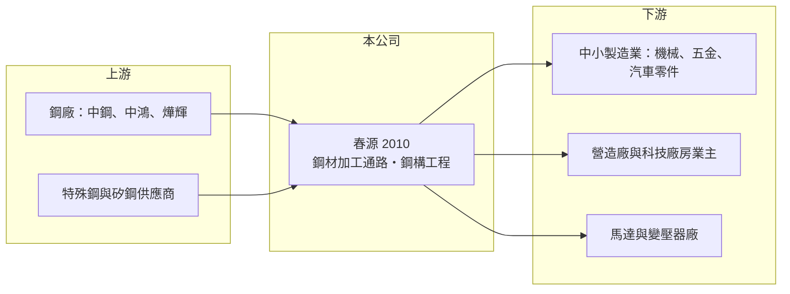

# 2010 春源

> 上市｜[[產業索引-鋼鐵工業|鋼鐵工業]]｜上市（櫃）日期 1989/12/22

# 第一章：企業模式與商業藍圖

> [!info] 撰寫說明
> 本文由 Claude 依公開資料整理，架構比照 [[2330台積電]] 的四章研究，資料截至 2026-10-08。財務數字來源：Goodinfo 年度經營績效頁、富果研究（春源 2026 年 5 月法說會整理）、證交所開放資料（基本資料、資產負債、綜合損益、營益分析、股利、每月營收）；產業描述為整理性內容，尚未逐條比對原始文件。#待校對

在評估單一個股的長期投資價值時，首要步驟是拆解企業的底層獲利邏輯。本章說明春源鋼鐵（股票代號：2010，以下簡稱春源）如何從鋼材買賣與加工，延伸到鋼結構工程，成為一家「金屬材料解決方案提供者」。

## 一、核心定位：台灣大型鋼材加工通路商

春源成立於 1966 年 1 月，1989 年 12 月上市，總部位於台北，2026 年實收資本額約 64.8 億元，董事長為蔡錫儀、總經理為洪士民。春源不煉鋼，而是向上游鋼廠大量採購鋼板、鋼捲與特殊鋼，再依客戶需求剪裁、加工與配送，這種角色在國外稱為[[金屬服務中心]]。

春源國內設有鋼板、直銷、特殊鋼、特鋼帶、矽鋼、自動倉儲、營建七大事業部，據點遍及汐止、龍潭、台中、台南、高雄，並在中國深圳、上海、青島有轉投資。2026 年第一季內銷占 98.9%，幾乎完全是台灣內需事業。

這個商業模式的獲利邏輯是：

* **加工與配送的服務費：** 中小型製造業者無法直接向鋼廠大量下單，春源以規模採購、庫存與加工能力，替客戶省下資金與時間。
* **庫存管理：** 鋼材價格波動大，春源採用加權平均法計算成本，以平滑盤價波動。鋼價上漲時有[[庫存利益]]，下跌時則有跌價壓力。

## 二、業務板塊

註：「其他」為 100% 減去已揭露項目的推算值。

* **鋼板類（50.8%）：** 熱軋、冷軋、鍍面鋼板的剪裁加工與銷售，客戶涵蓋機械、五金、汽車零件與家電。
* **營建鋼結構工程（33.4%）：** 承攬大樓、科技廠房與商辦的鋼結構製造與吊裝。龍潭鋼構加工廠增建後，產能與吊裝量提升。管理層預期鋼構業未來三至五年是黃金時期，[[在手訂單]]維持 20 萬噸以上，能見度到 2027 年下半年。
* **特殊鋼品與特殊鋼帶板：** 工具鋼、合金鋼與精密鋼帶，附加價值較高，供應模具、刀具與精密零件產業。
* **矽鋼：** 設有矽鋼事業部，供應馬達與變壓器用的[[電磁鋼片]]加工（營收占比未單獨揭露）。春源也是豐田汽車在台設立生產線回銷日本的供應商之一。

## 三、長期方向

春源的策略是「以舊產品舊市場，發展新產品新市場」，樂於以合資方式切入新領域，近年鎖定 AI 科技廠房、資料中心、都更與危老重建的鋼構需求，並關注中國華南的機器人與低空經濟。資本支出以提升設備效率為主，不做大規模建廠。新北市三重的集團總部大樓（地上 15 層、地下 3 層）預計 2027 年下半年啟用。公司在北部持有近 12 萬坪土地，帳面價值未重估，目前沒有遷廠或開發計畫。

# 第二章：護城河深度與競爭優勢

在長期價值投資中，「護城河」指企業抵禦競爭、維持超額利潤的保護機制。本章分析春源作為鋼材通路與鋼構廠的競爭優勢。

## 一、護城河的組成

* **規模與據點網路：** 春源在北中南都有加工與倉儲據點，能同時服務數千家中小客戶，這種「最後一哩」的配送與加工能力，是小型鋼材行難以複製的。
* **產品廣度：** 從一般鋼板到特殊鋼、矽鋼與鋼構工程，一站式供應讓客戶減少往來對象，也讓春源在單一產品景氣下滑時有其他業務緩衝。
* **鋼構與材料的綜效：** 春源自己就是大型鋼材通路，承接鋼構工程時在材料取得與成本上有優勢（推估）。
* **土地資產：** 北部近 12 萬坪土地以歷史成本入帳，是隱藏的資產價值。

## 二、競爭對手格局

| 對手 | 定位 | 對春源的影響 |
|---|---|---|
| [[2027大成鋼]] | 鋁材與不鏽鋼為主的金屬服務中心，美國事業大 | 同為金屬通路，產品與市場不同 |
| [[2031新光鋼]] | 鋼板加工與鋼構 | 鋼板與鋼構業務直接競爭 |
| [[2013中鋼構]]、[[9958世紀鋼]]、[[2006東和鋼鐵]]（東和鋼構） | 鋼結構製造與安裝 | 在大樓與廠房鋼構市場競爭 |

## 三、守得住與守不住的地方

* **守得住：** 中小製造業的鋼材加工與配送通路，以及鋼構工程的在手訂單。
* **守不住：** 鋼價方向。春源是通路商，無法決定鋼價，鋼價急跌時毛利率會受壓。
* **觀察重點：** 鋼構在手訂單是否維持 20 萬噸以上、毛利率能否守住 10%，以及總部大樓啟用後的資產運用。

# 第三章：財務體質與盈利規模

資料日期：2026-10-08。數字取自 Goodinfo 年度經營績效頁、富果研究法說會整理與證交所開放資料，表格是撰寫當時的快照；最新月營收、毛利率、累計 EPS 由自動排程寫在本筆記的屬性欄位（月營收、毛利率、累計EPS 等）。#待校對

財務報表是檢驗護城河是否真實存在的最終標準。本章用多年度三率、ROE 與資本報酬，檢視春源的獲利品質。

## 一、多年度獲利

| 年度 | 營收（新台幣） | [[毛利率]] | [[營業利益率]] | EPS（元） | [[ROE]] |
|---|---|---|---|---|---|
| 2019 | 167 億 | 5.69% | 0.98% | 0.37 | 2.16% |
| 2020 | 192 億 | 7.00% | 2.82% | 0.79 | 4.83% |
| 2021 | 263 億 | 8.99% | 5.18% | 1.88 | 10.9% |
| 2022 | 245 億 | 6.12% | 2.84% | 0.95 | 5.24% |
| 2023 | 212 億 | 8.32% | 4.38% | 1.35 | 7.54% |
| 2024 | 240 億 | 8.61% | 5.01% | 1.65 | 8.79% |
| 2025 | 242 億 | 11.00% | 7.16% | 2.32 | 11.7% |
| 2026 上半年 | 128.8 億 | 11.68% | 7.89% | 1.35 | 未查得 |

註：2026 年 1 至 8 月累計營收 169.5 億元，年增約 4%。

* **毛利率逐年墊高：** 毛利率從 2019 年的 5.7% 逐步提高到 2025 年的 11%，主要原因是高毛利的鋼構工程與特殊鋼占比提高。這是春源近年最重要的結構變化，代表公司正從單純的鋼材買賣轉向附加價值較高的工程與加工。
* **營收規模大、利潤率薄：** 年營收超過 200 億元，但營業利益率長期在 3% 至 7%，是通路與工程業的典型結構。
* **營收年複合成長率：** 2020 至 2025 年約 4.7%（推算）。

## 二、長期指標

* **平均 ROE：** 2021 至 2025 年平均約 8.8%（推算），並呈上升趨勢。
* **股利：** 2016 至 2025 年[[配發率]]皆在 50% 以上；2025 年度現金股利每股 2 元，配發率 86%（法說會數字）。以 2025 年稅後淨利 15.1 億元、股本 64.8 億元推算一致。
* **資產負債：** 2026 年第二季總資產 236.7 億元、權益 129.4 億元、負債 107.3 億元，負債以應付帳款、工程合約負債與短期借款為主（明細未查得）。

## 三、[[ROIC]] 與 [[WACC]]：價值創造利差

**ROIC 推算：** 2025 年營業利益約 17.3 億元（242 億元 × 7.16%），稅後約 13.9 億元（稅率 20%）。以權益 129.4 億元計算，ROIC 約 10.7%；若把負債 107.3 億元全部視為投入資本，ROIC 約 5.9%（推算）。實際有息負債低於負債總額，真實 ROIC 介於兩者之間。

**WACC 推算：** 權益成本以 [[CAPM]] 估算，台灣 10 年期公債 1.75%、市場風險溢酬 6%、β 取 0.9（鋼鐵通路業常見值，非來源數字），約 7.15%；負債成本假設 2.5%，稅後 2%。依權益約 55% 的帳面結構，WACC 約 4.8% 至 7.2%（推算）。

**結論：** 2025 年 ROIC 約 6% 至 11%，已高於 WACC，代表春源近年開始創造經濟價值；但 2019 至 2022 年 ROE 多低於 7%，當時 ROIC 推估低於 WACC。春源能否持續創造價值，取決於鋼構與特殊鋼的高毛利結構能否維持。

# 第四章：總體風險與地緣政治

任何企業都無法脫離宏觀環境獨立存在。本章分析春源必須面對的鋼價、營建與營運風險。

## 一、產業週期

* **鋼價循環：** 春源的成本跟著 [[2002中鋼]] 等鋼廠的[[盤價]]走，鋼價急跌時庫存跌價，急漲時下游接受度下降。
* **營建與廠房景氣：** 鋼構工程占營收三成以上，若科技廠房、資料中心或商辦投資放緩，在手訂單會減少。
* **製造業景氣：** 鋼板與特殊鋼的客戶多為中小製造業，景氣下滑時需求最先萎縮。

## 二、營運風險

* **工程風險：** 鋼構工程有工期、安全與成本超支風險，大型工程若延誤或發生工安意外，會影響獲利與商譽。
* **人力與吊裝能量：** 鋼構安裝需要專業技術工人，人力短缺會限制接單與施工。
* **中國轉投資：** 深圳、上海、青島的事業受中國景氣與政策影響。

## 三、其他風險

* **碳費與 [[CBAM]]：** 上游鋼廠的碳成本會轉嫁到鋼材價格，影響春源的進貨成本。
* **進口鋼材：** 中國與東南亞低價鋼材進口，會壓低國內鋼價與通路價差。

# 專有名詞解析

## 金融

- **[[庫存利益]]**：原料或產品價格上漲時，先前以低價買進的庫存被以較高售價賣出所產生的額外利潤。
- **[[配發率]]**：現金股利占當年度每股盈餘的比例，用來衡量公司把多少獲利分給股東。

## 產業

- **[[金屬服務中心]]**：向鋼廠或鋁廠大量採購金屬材料，再依客戶需求裁切、加工並少量配送的通路業者，美國代表為 Reliance、Ryerson。
- **[[在手訂單]]**：已簽約但尚未出貨的訂單，可用來判斷未來數月的營收能見度。
- **[[電磁鋼片]]**：含矽的特殊鋼片，可降低馬達與變壓器的能量損耗，高階品是電動車馬達的關鍵材料。
- **[[盤價]]**：鋼廠定期公布的各產品出貨價格，中鋼盤價是國內鋼價的主要參考指標。
- **[[CBAM]]**：歐盟碳邊境調整機制，對進口鋼鐵等高碳產品依碳排量課徵費用，使低碳製程較具競爭力。

# 核心供應鏈

## 1. 上游：鋼材供應
- 國內鋼廠：[[2002中鋼]]、[[2014中鴻]]、[[2023燁輝]]（實際採購比重未查得）
- 進口特殊鋼與矽鋼

## 2. 本公司與同業
- 金屬通路：[[2027大成鋼]]、[[2031新光鋼]]
- 鋼構工程：[[2013中鋼構]]、[[9958世紀鋼]]

## 3. 下游：客戶
- 機械、五金、汽車零件與家電製造業
- 營造廠、科技廠房與資料中心業主
- 汽車產業：豐田汽車在台生產線

## 最新新聞
<!-- news:start（自動產生，請勿手動編輯此範圍） -->
- 2026-10-07 🏛️ 重訊 16:01｜本公司於115年10月08日召開法人說明會｜[觀測站](https://mops.twse.com.tw/mops/#/web/t05st01)

完整紀錄：[[2010春源 新聞]]
<!-- news:end -->

## 相關連結
- [公開資訊觀測站](https://mopsov.twse.com.tw/mops/web/t05st03?step=1&firstin=1&co_id=2010)
- [Goodinfo](https://goodinfo.tw/tw/StockDetail.asp?STOCK_ID=2010)
- [Yahoo 股市](https://tw.stock.yahoo.com/quote/2010)
- [鉅亨網新聞](https://www.cnyes.com/twstock/2010/news)
