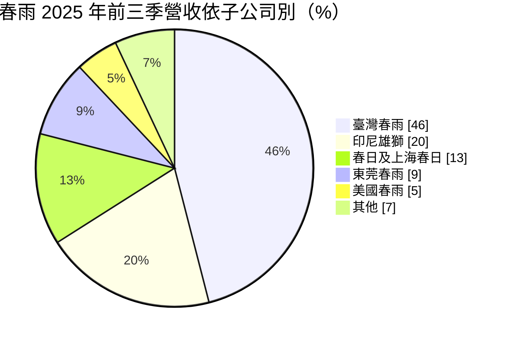
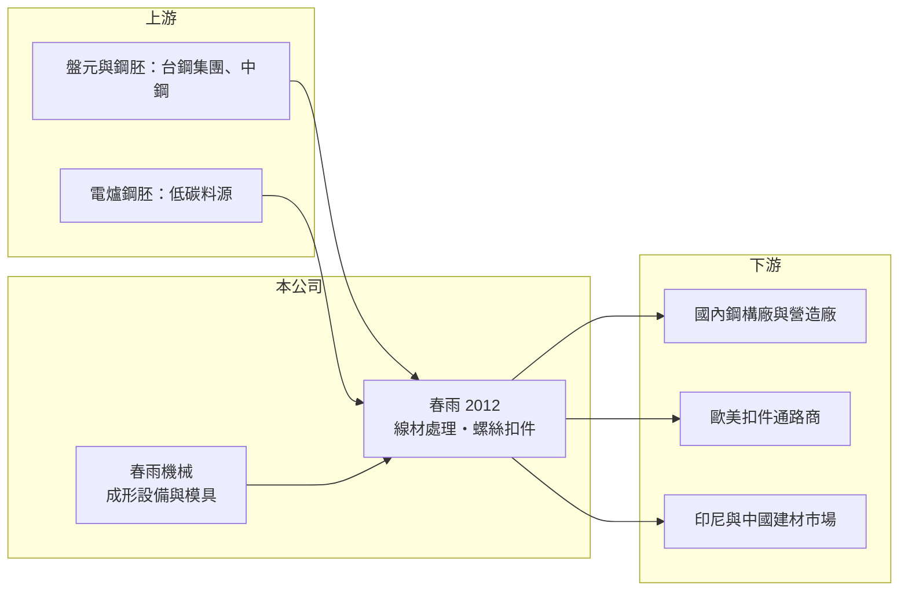

# 2012 春雨

> 上市｜[[產業索引-鋼鐵工業|鋼鐵工業]]｜上市（櫃）日期 1991/10/17

# 第一章：企業模式與商業藍圖

> [!info] 撰寫說明
> 本文由 Claude 依公開資料整理，架構比照 [[2330台積電]] 的四章研究，資料截至 2026-10-08。財務數字來源：Goodinfo 年度經營績效頁、富果研究（春雨 2025 年 12 月法說會整理）、經濟日報（2026 年股東會報導標題）、證交所開放資料（基本資料、資產負債、綜合損益、營益分析、股利、每月營收）；產業描述為整理性內容，尚未逐條比對原始文件。#待校對

在評估單一個股的長期投資價值時，首要步驟是拆解企業的底層獲利邏輯。本章說明春雨工廠（股票代號：2012，以下簡稱春雨）如何以垂直整合的方式，從盤元一路做到螺絲成品，並在台灣、中國與印尼建立在地市場。

## 一、核心定位：垂直整合的螺絲扣件集團

春雨的事業起源可追溯到 1949 年，自稱是台灣第一家螺絲扣件廠；證交所登記的公司成立日期為 1965 年 3 月，1991 年 10 月上市，總部位於高雄岡山，2026 年實收資本額約 30.2 億元，董事長為翁重鈞、總經理為吳居諺。集團年營收約 80 億至 90 億元。

春雨的核心是[[螺絲扣件]]，但它和多數只做成品的螺絲廠不同，採取一貫化的垂直整合：

* **從盤元到成品：** 向鋼廠購入[[盤元]]，自行做冷拉、球化等[[線材]]處理，再成形為螺絲、熱處理、包裝出口。上游線材自己做，品質與交期較能掌握，線材也可以對外銷售。
* **連設備都自己做：** 集團旗下有春雨機械、上海春日機械等，製造扣件成形設備與模具，另有粉末冶金事業群（春雨生醫）做金屬射出成形扣件。

依 2025 年法說會，春雨結合台鋼集團的材料供應，並計畫導入電爐鋼胚開發低碳產品。

## 二、業務板塊與市場

* **建築用緊固件：** 鋼結構與裝修用螺栓，春雨是台灣建築鋼構扣件市占第一，案例包括台北 101、台積電廠房、高鐵與捷運。下游鋼構廠訂單能見度約 1 至 1.5 年。
* **工業與機械用緊固件、金屬射出成形扣件：** 用於機械設備與精密零件。
* **線材與設備：** 冷拉捲線、球化線材，以及扣件成形設備與模具。

依市場別，台灣 35%、香港及中國 23%、東南亞 23%、歐洲 9%、美國 7%、其他 3%。三個生產基地分工明確：台灣廠供應國內與歐美外銷；東莞廠只做中國內銷；印尼廠在當地經營 40 多年，服務印尼與東南亞，建築裝修用鑽尾螺絲在印尼市占第一。

## 三、長期方向

春雨的長期方向是「低碳化與在地化」。導入電爐鋼胚讓產品碳足跡下降，以因應歐洲客戶與 [[CBAM]] 的要求；持續汰換節能設備降低成本；與台鋼科技大學產學合作培育人才。在地化方面，印尼與中國事業以內需為主，較不受美國關稅影響。

# 第二章：護城河深度與競爭優勢

在長期價值投資中，「護城河」指企業抵禦競爭、維持超額利潤的保護機制。本章分析春雨在螺絲產業的定位與優勢。

## 一、護城河的組成

* **垂直整合的成本與品質控制：** 從盤元處理到成品一貫生產，春雨可以掌握線材品質與交期，並把線材處理的利潤留在集團內。
* **建築鋼構扣件的品牌與工程實績：** 大型建築與科技廠房的鋼構螺栓需要通過嚴格規範，春雨的大型工程實績（台北 101、台積電廠房）形成信任門檻。
* **印尼的在地經營：** 在印尼經營 40 多年並取得鑽尾螺絲市占第一，當地通路與品牌是新進者難以快速建立的。

## 二、競爭對手格局

| 對手 | 定位 | 對春雨的影響 |
|---|---|---|
| [[2062橋椿]]、[[2069運錩]]、[[2065世豐]] | 台灣南部螺絲與線材業者 | 在外銷螺絲與線材市場競爭 |
| [[2064晉椿]]、[[2066世德]]、[[2063世鎧]] | 汽車、機械與建築扣件 | 部分產品重疊 |
| 中國與越南螺絲廠 | 低價大宗螺絲 | 壓低外銷價格，美國以反傾銷保護 |

## 三、守得住與守不住的地方

* **守得住：** 台灣建築鋼構扣件與印尼鑽尾螺絲市場，兩者都有在地優勢與工程實績。
* **守不住：** 一般外銷螺絲的價格。歐美客戶在關稅不確定性下多下急單，訂單穩定度低。
* **觀察重點：** 國內鋼構扣件在科技廠房與資料中心需求下的成長、印尼事業的獲利，以及低碳產品能否在歐洲取得溢價。

# 第三章：財務體質與盈利規模

資料日期：2026-10-08。數字取自 Goodinfo 年度經營績效頁、富果研究法說會整理與證交所開放資料，表格是撰寫當時的快照；最新月營收、毛利率、累計 EPS 由自動排程寫在本筆記的屬性欄位（月營收、毛利率、累計EPS 等）。#待校對

財務報表是檢驗護城河是否真實存在的最終標準。本章用多年度三率、ROE 與資本報酬，檢視春雨的獲利能力。

## 一、多年度獲利

| 年度 | 營收（新台幣） | [[毛利率]] | [[營業利益率]] | EPS（元） | [[ROE]] |
|---|---|---|---|---|---|
| 2019 | 93.3 億 | 16.1% | 6.38% | 1.60 | 12.4% |
| 2020 | 80.5 億 | 14.3% | 4.35% | 0.75 | 6.21% |
| 2021 | 118 億 | 17.5% | 9.33% | 2.81 | 19.9% |
| 2022 | 110 億 | 16.3% | 7.82% | 1.93 | 13.6% |
| 2023 | 84.6 億 | 15.6% | 5.39% | 0.91 | 7.11% |
| 2024 | 91.7 億 | 14.4% | 4.91% | 1.03 | 7.86% |
| 2025 | 83.1 億 | 13.8% | 3.6% | 0.20 | 2.5% |
| 2026 上半年 | 37.7 億 | 14.82% | 2.94% | -0.19 | 未查得 |

註：Goodinfo 2025 年歸屬母公司稅後淨利 0.55 億元，證交所股利資料的本期淨利為 0.55 億元；Goodinfo 的稅後淨利率口徑與此不一致，可能含[[非控制權益]]。2026 年 1 至 8 月累計營收 50.4 億元，年減約 11%。

* **毛利率穩定、營業利益率下滑：** 毛利率長年維持在 14% 至 17%，顯示垂直整合帶來穩定的加工價差；但營業利益率從 2021 年的 9.3% 降到 2025 年的 3.6%，代表營收下降時，固定的管銷費用侵蝕了利潤。
* **營業外拖累：** 2025 年前三季營業外損失約 5,500 萬元，主要是匯兌損失；2026 年上半年營業外損失 0.54 億元，使營業利益轉為稅後虧損。
* **營收長期持平：** 2020 至 2025 年營收年複合成長率約 0.6%（推算），景氣高峰 2021 年的 118 億元之後回落。

## 二、長期指標

* **平均 ROE：** 2021 至 2025 年平均約 10.2%（推算），但呈下降趨勢，2025 年僅 2.5%。
* **股利：** 2025 年度配發現金股利 0.3 元，以 EPS 0.20 元計算，[[配發率]]超過 100%（推算）。
* **資產負債：** 2026 年第二季總資產 114.8 億元、權益 44.3 億元（歸屬母公司 37.5 億元）、負債 70.5 億元，負債比約 61%，在螺絲業中槓桿偏高。

## 三、[[ROIC]] 與 [[WACC]]：價值創造利差

**ROIC 推算：** 2025 年營業利益約 3.0 億元（83.1 億元 × 3.6%），稅後約 2.4 億元（稅率 20%）。以權益 44.3 億元計算，ROIC 約 5.4%；若把負債 70.5 億元全部視為投入資本，ROIC 約 2.1%（推算）。

**WACC 推算：** 權益成本以 [[CAPM]] 估算，台灣 10 年期公債 1.75%、市場風險溢酬 6%、β 取 0.9（螺絲扣件業常見值，非來源數字），約 7.15%；負債成本假設 2.5%，稅後 2%。依權益約 39% 的帳面結構，WACC 約 4% 至 7.2%（推算）。

**結論：** 2021 至 2022 年景氣高峰時 ROIC 推估高於 WACC，但 2023 年以後已落到 WACC 附近或以下。春雨的毛利率結構健康，問題在於營收規模萎縮與財務槓桿偏高。營收回到 100 億元以上、並降低負債，是重新創造價值的前提。

# 第四章：總體風險與地緣政治

任何企業都無法脫離宏觀環境獨立存在。本章分析春雨必須面對的產業、貿易與財務風險。

## 一、產業週期

* **鋼價與盤元價格：** 原料成本隨鋼價波動，鋼價急跌時售價下修較快，可能出現[[存貨跌價損失]]。
* **營建景氣：** 國內鋼構扣件跟著大樓與科技廠房的興建週期走。
* **歐美庫存循環：** 外銷螺絲在歐美客戶去化庫存時訂單大幅減少，2023 年營收從 110 億元降到 84.6 億元就是例子。

## 二、貿易與地緣政治

* **美國關稅：** 美國對進口扣件的關稅政策不確定，客戶多以急單下單，訂單能見度低。
* **[[反傾銷]]：** 歐美對中國與部分亞洲國家的螺絲課徵反傾銷稅，會改變各國螺絲廠的競爭位置。
* **中國與印尼：** 東莞與印尼事業分別受中國內需與印尼政治經濟環境影響。

## 三、財務與其他風險

* **匯率：** 外銷比重高，匯兌損失是近年營業外虧損的主要來源。
* **槓桿：** 負債比約六成，利率上升會增加利息負擔。
* **碳費與 [[CBAM]]：** 歐洲客戶的碳足跡要求日益嚴格，低碳產品的開發進度會影響歐洲訂單。

# 專有名詞解析

## 金融

- **[[非控制權益]]**：合併子公司中不屬於母公司股東的權益部分，相關獲利不計入母公司 EPS。
- **[[存貨跌價損失]]**：存貨的市價低於帳上成本時必須提列的損失，常見於原物料價格急跌時。

## 產業

- **[[螺絲扣件]]**：用來鎖固與連接零件的螺絲、螺栓、螺帽等產品，台灣高雄岡山是全球重要的生產聚落。
- **[[盤元]]**：鋼胚熱軋成捲狀的圓形條鋼，是線材與螺絲的原料。
- **[[線材]]**：鋼胚熱軋成捲狀的細長條鋼，是拉線、螺絲、彈簧與焊材的原料。
- **[[反傾銷]]**：進口國對低於正常價格銷售的進口商品加徵關稅，以保護本國產業的貿易救濟措施。
- **[[CBAM]]**：歐盟碳邊境調整機制，對進口鋼鐵等高碳產品依碳排量課徵費用，使低碳製程較具競爭力。

# 核心供應鏈

## 1. 上游：原料
- 盤元與鋼胚：台鋼集團（非上市）、[[2002中鋼]]（實際採購比重未查得）
- 電爐鋼胚（低碳產品料源）

## 2. 本公司與同業
- 集團子公司：美國春雨、東莞春雨、上海友鉅、印尼雄獅、春雨機械、春邦精密、春雨生醫
- 螺絲同業：[[2062橋椿]]、[[2069運錩]]、[[2065世豐]]、[[2064晉椿]]

## 3. 下游：客戶
- 國內鋼構廠：[[2013中鋼構]]、[[9958世紀鋼]] 等（是否為春雨客戶未查得）
- 歐美扣件通路商與五金零售
- 印尼與中國的建材與裝修市場

## 最新新聞
<!-- news:start -->
<!-- news:end -->

## 相關連結
- [公開資訊觀測站](https://mopsov.twse.com.tw/mops/web/t05st03?step=1&firstin=1&co_id=2012)
- [Goodinfo](https://goodinfo.tw/tw/StockDetail.asp?STOCK_ID=2012)
- [Yahoo 股市](https://tw.stock.yahoo.com/quote/2012)
- [鉅亨網新聞](https://www.cnyes.com/twstock/2012/news)
