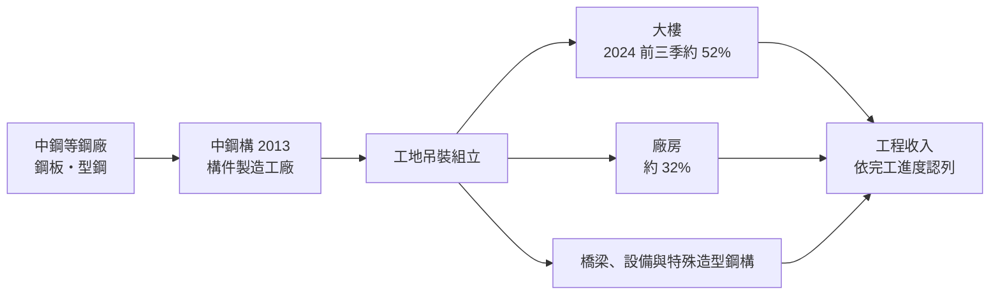
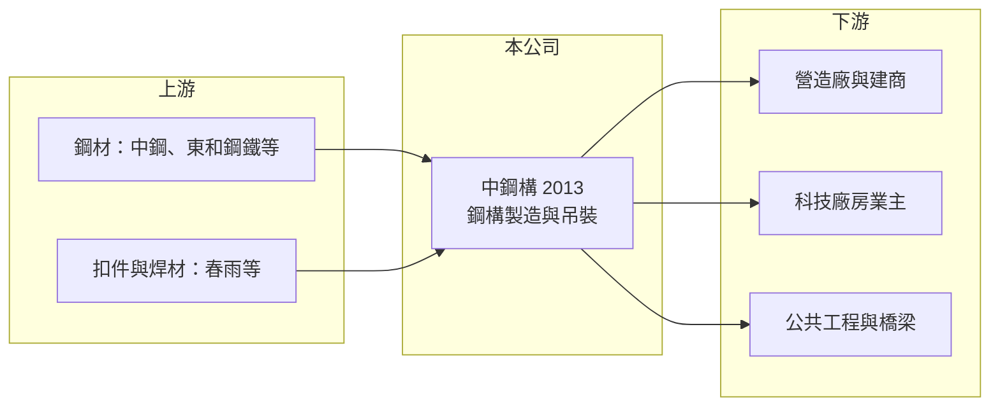

# 2013 中鋼構

> 上市｜[[產業索引-鋼鐵工業|鋼鐵工業]]｜上市（櫃）日期 1992/01/21

# 第一章：企業模式與商業藍圖

> [!info] 撰寫說明
> 本文由 Claude 依公開資料整理，架構比照 [[2330台積電]] 的四章研究，資料截至 2026-10-08。財務數字來源：Goodinfo 年度經營績效頁、工商時報（2024 年 11 月中鋼構營運報導）、證交所開放資料（基本資料、資產負債、綜合損益、營益分析、股利、每月營收）；中鋼持股比例與廠區憑記憶撰寫並已標註，產業描述為整理性內容，尚未逐條比對原始文件。#待校對

在評估單一個股的長期投資價值時，首要步驟是拆解企業的底層獲利邏輯。本章說明中鋼結構（股票代號：2013，以下簡稱中鋼構）作為台灣第一家鋼結構製造安裝公司，如何以工程承攬的模式賺取穩定但微薄的利潤。

## 一、核心定位：中鋼集團的鋼結構工程公司

中鋼構成立於 1978 年 2 月，1992 年 1 月上市，總部位於高雄燕巢，2026 年實收資本額 20 億元，董事長為陳瑞騰、總經理為黃源章。中鋼構是 [[2002中鋼]] 集團成員，中鋼為主要股東（持股約三成，憑記憶，待校對）。#待校對

[[鋼結構]]工程是把鋼板、H 型鋼等材料，在工廠裁切、焊接成柱、梁等構件，再運到工地吊裝組立。中鋼構承攬廠房、大樓、橋梁設備與特殊造型鋼構，過去也做鋼鐵貿易，但近年以鋼構為主力。

工程承攬的商業模式有幾個特點：

* **先接單、後施工：** 一個大案從簽約到完工常需兩到三年，因此[[在手訂單]]是判斷未來營收的最重要指標。2024 年 11 月報導指出，中鋼構在手訂單約 28 萬噸，交期在 2025 至 2026 年，當時新接訂單已排到 2026 至 2027 年。
* **薄利多量：** 工程業的毛利率通常只有 5% 左右，獲利來自規模與成本控制。
* **鋼價風險：** 合約簽訂時價格固定，若施工期間鋼價大漲，成本上升會吃掉利潤；反之則有利。

## 二、業務板塊

* **大樓（約 52%）：** 2024 年前三季的主要營收來自台北雙子星大樓與高雄富邦凹子底商場等大型商辦與商場。
* **廠房（約 32%）：** 科技廠房與竹科新三期等園區開發案，半導體與 AI 相關投資是主要動能。
* **橋梁與特殊鋼構：** 橋梁、設備鋼構與造型屋頂，案量不固定但技術門檻較高。

## 三、長期方向

中鋼構提出四個拓展方向：高科技廠房、冷鏈物流廠房、A 級商辦，以及[[都更]]與[[危老重建]]。這四個方向對應台灣未來十年的主要營建需求：半導體與資料中心投資、電商與食品物流、都會區辦公大樓汰舊，以及老舊建築改建。鋼構相對鋼筋混凝土施工快、耐震好，在高樓與大跨距廠房中滲透率持續提高。

# 第二章：護城河深度與競爭優勢

在長期價值投資中，「護城河」指企業抵禦競爭、維持超額利潤的保護機制。本章分析中鋼構在鋼構市場的競爭優勢。

## 一、護城河的組成

* **工程實績與技術：** 超高層大樓與大跨距廠房的鋼構，需要精密的焊接、測量與吊裝技術。台北雙子星等地標工程的實績，是爭取下一個大案的重要資格。業主與營造廠在選擇鋼構廠時，最重視的是過去完成同等規模工程的紀錄。
* **集團材料支援：** 作為中鋼集團成員，鋼材取得的穩定度與議價能力優於一般鋼構廠（推估）。
* **產能規模：** 在手訂單約 28 萬噸，代表中鋼構具有承接多個大案同時施工的產能與人力。

## 二、競爭對手格局

| 對手 | 定位 | 對中鋼構的影響 |
|---|---|---|
| [[9958世紀鋼]] | 鋼構與離岸風電水下基礎 | 大型鋼構與海事鋼構競爭 |
| [[2006東和鋼鐵]]（東和鋼構） | 型鋼廠延伸鋼構工程 | 材料自產，價格競爭力強 |
| [[2010春源]]、[[2031新光鋼]] | 鋼材通路延伸鋼構 | 在大樓與廠房鋼構接單 |
| 日本與韓國鋼構廠 | 大型國際工程 | 在特殊工程與外資業主案中競爭 |

## 三、守得住與守不住的地方

* **守得住：** 大型地標大樓與科技廠房的鋼構工程，這類案件重視實績與工期，價格不是唯一考量。
* **守不住：** 毛利率。工程業競標激烈，毛利率長期約 5%，沒有大幅提高的空間。
* **觀察重點：** 在手訂單噸數是否維持、科技廠房占比是否提高，以及鋼價變動對已簽約工程利潤的影響。

# 第三章：財務體質與盈利規模

資料日期：2026-10-08。數字取自 Goodinfo 年度經營績效頁、工商時報報導與證交所開放資料，表格是撰寫當時的快照；最新月營收、毛利率、累計 EPS 由自動排程寫在本筆記的屬性欄位（月營收、毛利率、累計EPS 等）。#待校對

財務報表是檢驗護城河是否真實存在的最終標準。本章用多年度三率、ROE 與資本報酬，檢視中鋼構的獲利品質。

## 一、多年度獲利

| 年度 | 營收（新台幣） | [[毛利率]] | [[營業利益率]] | EPS（元） | [[ROE]] |
|---|---|---|---|---|---|
| 2019 | 167 億 | 2.40% | 0.57% | 0.82 | 3.70% |
| 2020 | 132 億 | 4.86% | 2.10% | 3.26 | 13.9% |
| 2021 | 160 億 | 5.82% | 2.96% | 2.49 | 9.89% |
| 2022 | 194 億 | 4.97% | 3.25% | 2.39 | 9.18% |
| 2023 | 188 億 | 5.20% | 3.21% | 2.68 | 10.1% |
| 2024 | 197 億 | 5.38% | 3.56% | 2.70 | 9.97% |
| 2025 | 209 億 | 4.70% | 2.87% | 3.19 | 11.5% |
| 2026 上半年 | 96.4 億 | 5.06% | 3.18% | 1.44 | 未查得 |

註：2026 年 1 至 8 月累計營收 131.9 億元，年減約 6%。

* **穩定的薄利：** 2020 年以後毛利率維持在 4.7% 至 5.8%、營業利益率約 3%，EPS 穩定在 2.4 至 3.3 元之間。這是工程業成熟、穩定的樣貌，波動遠低於上游鋼廠。
* **營收成長：** 2020 至 2025 年營收從 132 億元增至 209 億元，年複合成長率約 9.6%（推算），主要來自大型大樓與科技廠房案。
* **業外貢獻：** 2025 年稅後淨利 6.38 億元高於營業利益約 6 億元（209 億元 × 2.87%），業外收益與轉投資有一定貢獻（明細未查得）。

## 二、長期指標

* **平均 ROE：** 2021 至 2025 年平均約 10.1%（推算），每年都在 9% 至 12% 之間，非常穩定。
* **股利：** 2025 年度配發現金股利 2.4 元，以 EPS 3.19 元計算，[[配發率]]約 75%（推算）。高配發率反映工程業不需要大量資本支出。
* **資產負債：** 2026 年第二季總資產 158.6 億元、權益 55.2 億元、負債 103.5 億元，其中流動負債 95.2 億元。工程業的負債多是預收工程款（[[合約負債]]）與應付款，不一定是借款（明細未查得）。

## 三、[[ROIC]] 與 [[WACC]]：價值創造利差

**ROIC 推算：** 2025 年營業利益約 6.0 億元（209 億元 × 2.87%），稅後約 4.8 億元（稅率 20%）。以權益 55.2 億元計算，ROIC 約 8.7%；若把負債 103.5 億元全部視為投入資本，ROIC 約 3.0%（推算）。由於大部分負債是預收款而非有息負債，真實 ROIC 應接近 8.7% 的上緣。

**WACC 推算：** 權益成本以 [[CAPM]] 估算，台灣 10 年期公債 1.75%、市場風險溢酬 6%、β 取 0.9（營建與鋼構業常見值，非來源數字），約 7.15%；負債成本假設 2.5%，稅後 2%。有息負債比重不明，WACC 約 4% 至 7.2%（推算）。

**結論：** 以接近 8.7% 的 ROIC 與約 6% 至 7% 的 WACC 比較，中鋼構長期小幅創造經濟價值。工程業的價值來源是「用客戶的預收款運轉」，資本需求低，所以即使利潤率只有 3%，ROE 仍能維持在 10% 左右。

# 第四章：總體風險與地緣政治

任何企業都無法脫離宏觀環境獨立存在。本章分析中鋼構必須面對的營建週期、工程與外部風險。

## 一、產業週期

* **營建與廠房投資：** 大樓與科技廠房合計超過八成營收，若半導體投資放緩或商辦市場降溫，新接訂單會減少，並在一兩年後反映到營收。
* **鋼價：** 已簽約工程的材料成本若在施工期間大漲，利潤會被壓縮。鋼價與 [[2002中鋼]] [[盤價]]高度相關。

## 二、工程風險

* **工期與成本超支：** 大型工程常因設計變更、天候或其他承包商延誤而延期，成本超支會直接吃掉微薄的利潤。
* **工安：** 高空吊裝作業有安全風險，重大工安事故會影響商譽與接單資格。
* **人力短缺：** 焊工與吊裝技術工人老化、缺工，限制產能擴張。

## 三、其他風險

* **客戶集中：** 單一大案占營收比重高，大案結束後若沒有接續案源，營收會出現斷層。
* **碳費與 [[CBAM]]：** 鋼材碳成本上升會反映在材料價格，業主對低碳鋼構的要求也在提高。
* **母公司策略：** 中鋼集團的資源配置會影響中鋼構的發展方向。

# 專有名詞解析

## 金融

- **[[合約負債]]**：客戶預先支付但公司尚未完成履約的款項，工程與預售業常見，完工交付後轉為營收。

## 產業

- **[[鋼結構]]**：以鋼板、型鋼在工廠製成柱、梁構件，再到工地組立的建築結構，施工快、耐震好，常用於高樓與廠房。
- **[[在手訂單]]**：已簽約但尚未出貨的訂單，可用來判斷未來數月的營收能見度。
- **[[盤價]]**：鋼廠定期公布的各產品出貨價格，中鋼盤價是國內鋼價的主要參考指標。
- **[[都更]]**：都市更新，由地主與建商合作改建老舊建物與街區，通常需要多數地主同意並經政府審議。
- **[[危老重建]]**：依《都市危險及老舊建築物加速重建條例》改建危險或屋齡 30 年以上的老舊建物，程序比都更簡化。
- **[[CBAM]]**：歐盟碳邊境調整機制，對進口鋼鐵等高碳產品依碳排量課徵費用，使低碳製程較具競爭力。

# 核心供應鏈

## 1. 上游：材料
- 鋼板與型鋼：[[2002中鋼]]（集團母公司）、[[2006東和鋼鐵]]
- 鋼構扣件：[[2012春雨]]（是否為供應商未查得）

## 2. 本公司與同業
- 鋼構同業：[[9958世紀鋼]]、[[2010春源]]、[[2031新光鋼]]

## 3. 下游：業主與營造廠
- 大樓與商場業主（台北雙子星、高雄富邦凹子底商場等案）
- 科技廠房業主與園區開發（竹科新三期等）
- 營造廠：[[2597潤弘]]、[[2546根基]] 等（是否為合作對象未查得）

## 最新新聞
<!-- news:start -->
<!-- news:end -->

## 相關連結
- [公開資訊觀測站](https://mopsov.twse.com.tw/mops/web/t05st03?step=1&firstin=1&co_id=2013)
- [Goodinfo](https://goodinfo.tw/tw/StockDetail.asp?STOCK_ID=2013)
- [Yahoo 股市](https://tw.stock.yahoo.com/quote/2013)
- [鉅亨網新聞](https://www.cnyes.com/twstock/2013/news)
