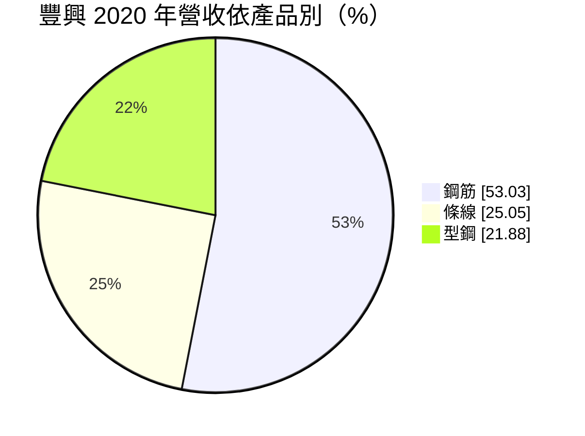
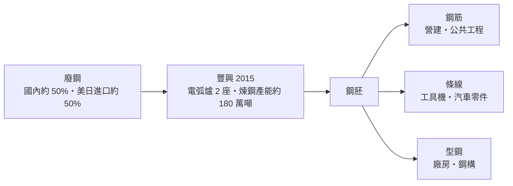
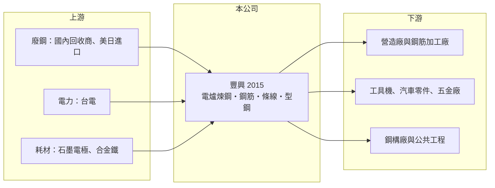

# 2015 豐興

> 上市｜[[產業索引-鋼鐵工業|鋼鐵工業]]｜上市（櫃）日期 1992/05/25

# 第一章：企業模式與商業藍圖

> [!info] 撰寫說明
> 本文由 Claude 依公開資料整理，架構比照 [[2330台積電]] 的四章研究，資料截至 2026-10-08。財務數字來源：Goodinfo 年度經營績效頁、CMoney 研究筆記（2021 年 6 月豐興研究報告，含產能與產品結構）、證交所開放資料（基本資料、資產負債、綜合損益、營益分析、股利、每月營收）；產品結構為 2020 年數字，近年比重未查得，產業描述為整理性內容，尚未逐條比對原始文件。#待校對

在評估單一個股的長期投資價值時，首要步驟是拆解企業的底層獲利邏輯。本章說明豐興鋼鐵（股票代號：2015，以下簡稱豐興）如何以電弧爐把廢鋼煉成鋼筋與型鋼，並在台灣條鋼市場扮演價格風向球的角色。

## 一、核心定位：台灣最大的民營電爐條鋼廠之一

豐興成立於 1969 年 1 月，1992 年 5 月上市，總部與工廠位於台中后里，2026 年實收資本額約 58.2 億元，董事長為林大鈞、總經理為林永源。依 2021 年研究報告整理，豐興擁有 2 座[[電弧爐]]與 3 座軋鋼廠，煉鋼總產能約 180 萬噸。

電爐鋼廠的商業模式是：買進[[廢鋼]]，用電弧爐熔化煉成鋼胚，再軋延成[[鋼筋]]、型鋼與條線等條鋼產品。原料約占產品成本 60% 至 70%，因此獲利的關鍵是產品售價與廢鋼成本之間的[[價差]]。

* **廢鋼來源：** 國內回收與進口各約一半，進口主要來自美國與日本。
* **定價方式：** 鋼筋多為長約，價格在簽約時議定；型鋼以現貨為主；條線以每月接單為主。豐興長期定期對外公布鋼筋售價與廢鋼收購價，市場常把豐興的報價當作國內條鋼行情的指標（憑記憶，待校對）。#待校對

## 二、產品結構

* **鋼筋（約 53%）：** 埋在混凝土中提供抗拉強度，用於住宅、商辦與公共工程。2020 年銷售量約 95.3 萬噸。
* **條線（約 25%）：** 圓鋼、扁鋼與線材等，供應工具機、汽車零件與五金加工。2020 年銷售量約 34 萬噸。
* **型鋼（約 22%）：** 槽鋼、角鋼與[[H型鋼]]等結構鋼材，用於廠房、鋼構與橋梁。2020 年銷售量約 34 萬噸。

2020 年內銷占 91.4%，外銷 8.6%，豐興基本上是一家台灣內需型鋼廠。

## 三、長期方向

豐興沒有大規模擴產或轉型計畫，長期策略是維持穩健的財務與穩定的配息。電爐煉鋼的碳排遠低於高爐，在台灣碳費與全球減碳趨勢下，電爐鋼的長期地位相對有利；但電爐耗電量大，台灣電價與供電穩定度是長期需要面對的課題。

# 第二章：護城河深度與競爭優勢

在長期價值投資中，「護城河」指企業抵禦競爭、維持超額利潤的保護機制。本章分析豐興在條鋼市場的優勢。

## 一、護城河的組成

* **成本與規模：** 豐興的電爐與軋鋼產線集中在中部，規模大、設備折舊多已攤提，單位成本具競爭力。中部營建與工具機聚落就在附近，運輸成本低。
* **財務實力：** 2026 年第二季負債只有 41.4 億元，權益 220.7 億元，負債比約 16%。低負債讓豐興在景氣低谷時不需降價求現，也能在廢鋼便宜時大量備料。
* **市場定價影響力：** 長期公開報價讓豐興成為國內條鋼市場的參考指標，客戶與同業都會參考它的價格，這是一種軟性的市場地位。

## 二、競爭對手格局

| 對手 | 定位 | 對豐興的影響 |
|---|---|---|
| [[2006東和鋼鐵]] | 電爐煉鋼、鋼筋與 H 型鋼，延伸鋼構 | 在鋼筋與型鋼市場直接競爭 |
| [[2038海光]] | 鋼筋為主的電爐廠 | 鋼筋市場競爭 |
| [[2007燁興]] | 線材與條鋼 | 條線市場部分重疊 |
| 中國與東南亞進口鋼材 | 低價鋼筋與型鋼 | 景氣低迷時壓低國內價格 |

## 三、守得住與守不住的地方

* **守得住：** 中部的鋼筋與條線市場，以及景氣低谷時的財務韌性。
* **守不住：** 鋼價與廢鋼價格的方向。豐興是價格接受者與價格參考者，但無法對抗國際鋼價的大循環。
* **觀察重點：** 價差變化、國內營建與公共工程的鋼筋需求，以及電價調整對成本的影響。

# 第三章：財務體質與盈利規模

資料日期：2026-10-08。數字取自 Goodinfo 年度經營績效頁與證交所開放資料，表格是撰寫當時的快照；最新月營收、毛利率、累計 EPS 由自動排程寫在本筆記的屬性欄位（月營收、毛利率、累計EPS 等）。#待校對

財務報表是檢驗護城河是否真實存在的最終標準。本章用多年度三率、ROE 與資本報酬，檢視豐興的獲利品質。

## 一、多年度獲利

| 年度 | 營收（新台幣） | [[毛利率]] | [[營業利益率]] | EPS（元） | [[ROE]] |
|---|---|---|---|---|---|
| 2019 | 277 億 | 10.3% | 7.53% | 3.37 | 10.6% |
| 2020 | 273 億 | 14.1% | 11.3% | 4.50 | 13.9% |
| 2021 | 384 億 | 14.7% | 12.3% | 6.94 | 19.4% |
| 2022 | 386 億 | 10.8% | 8.56% | 5.28 | 14.0% |
| 2023 | 349 億 | 10.2% | 7.77% | 4.08 | 10.9% |
| 2024 | 344 億 | 10.6% | 8.07% | 4.26 | 11.2% |
| 2025 | 290 億 | 11.5% | 8.62% | 3.88 | 10.0% |
| 2026 上半年 | 139.9 億 | 12.77% | 9.45% | 2.36 | 未查得 |

註：2025 年稅後淨利 22.5 億元（證交所股利資料為 22.54 億元）。2026 年 1 至 8 月累計營收 187.7 億元，年減約 7%。

* **穩定的價差：** 七年來毛利率維持在 10% 至 15%，沒有任何一年虧損，這在景氣循環劇烈的鋼鐵業中相當少見。原因是電爐廠的售價與廢鋼成本通常同向變動，價差相對穩定。
* **營收隨鋼價起伏：** 2021 至 2022 年鋼價高峰時營收達 384 億至 386 億元，2025 年回落至 290 億元。營收變化主要反映鋼價，而不是銷售量。
* **營收年複合成長率：** 2020 至 2025 年約 1.2%（推算），屬於成熟產業。

## 二、長期指標

* **平均 ROE：** 2021 至 2025 年平均約 13.1%（推算），在鋼鐵股中屬於前段。
* **股利：** 2025 年度配發現金股利 3.3 元，以 EPS 3.88 元計算，[[配發率]]約 85%（推算）。2021 年研究報告提到當年預計配發 3.5 元，豐興長期維持高配息。
* **資產結構：** 2026 年第二季保留盈餘高達 159.9 億元，每股淨值 37.92 元，財務非常保守。

## 三、[[ROIC]] 與 [[WACC]]：價值創造利差

**ROIC 推算：** 2025 年營業利益約 25 億元（290 億元 × 8.62%），稅後約 20 億元（稅率 20%）。以權益 220.7 億元計算，ROIC 約 9.1%；把負債 41.4 億元也計入，ROIC 約 7.6%（推算）。豐興帳上有不少現金與金融資產（2026 年上半年業外收益 3.14 億元），若只計算營運資本，本業 ROIC 會更高。

**WACC 推算：** 權益成本以 [[CAPM]] 估算，台灣 10 年期公債 1.75%、市場風險溢酬 6%、β 取 0.9（鋼鐵業常見值，非來源數字），約 7.15%；負債成本假設 2.5%，稅後 2%。依權益約 84% 的帳面結構，WACC 約 6.3% 至 7.2%（推算）。

**結論：** 豐興的 ROIC 約 7.6% 至 9.1%，略高於 WACC，在景氣高峰的 2021 年則遠高於 WACC。整體而言，豐興是一家在完整景氣循環中仍能創造價值的鋼鐵公司，但低負債與高現金的保守策略也讓報酬率難以大幅提升。

# 第四章：總體風險與地緣政治

任何企業都無法脫離宏觀環境獨立存在。本章分析豐興必須面對的原料、需求與外部風險。

## 一、產業週期

* **廢鋼價格：** 廢鋼是最大成本，價格由國際供需決定，美國與日本的廢鋼出口價格變動會直接影響成本。
* **營建景氣：** 鋼筋占營收過半，房市、公共工程與科技廠房的建設量決定需求。房市受信用管制降溫時，鋼筋需求會減少。
* **鋼價循環：** 國際鋼價下跌時，進口鋼材增加，國內價格跟著下修。

## 二、營運風險

* **電價：** 電弧爐是高耗電設備，台灣電價調漲會直接增加成本，供電不穩也可能影響生產。
* **石墨電極與耗材：** 電爐煉鋼需要石墨電極等耗材，價格波動會影響成本。
* **產能利用：** 需求下滑時開爐率降低，固定成本分攤變重。

## 三、其他風險

* **碳費：** 台灣已開徵碳費，電爐碳排雖低於高爐，仍屬於大型排放源。
* **進口鋼材與[[反傾銷]]：** 中國與東南亞低價鋼筋、型鋼進口會壓低國內價格，政府是否啟動反傾銷調查會影響國內市場。
* **[[CBAM]]：** 外銷比重低，對豐興的直接影響有限，但低碳鋼的市場地位可能提升。

# 專有名詞解析

## 金融

- **[[配發率]]**：現金股利占當年度每股盈餘的比例，用來衡量公司把多少獲利分給股東。

## 產業

- **[[電弧爐]]**：以電力產生的電弧熔化廢鋼來煉鋼的設備，開停爐彈性大、碳排較低，是台灣條鋼廠的主要製程。
- **[[廢鋼]]**：回收的鋼鐵料，是電弧爐的主要原料，價格隨國際供需每日變動，占電爐廠成本最大比重。
- **[[鋼筋]]**：埋在混凝土中提供抗拉強度的條狀鋼材，規格標準化，是住宅與公共工程的主要用鋼。
- **[[H型鋼]]**：斷面呈 H 字形的結構鋼材，用於鋼骨大樓、廠房與橋梁，需要大型軋延設備生產。
- **[[價差]]**：鋼品售價減去主要原料成本的差額，是鋼鐵業衡量獲利能力最直接的指標。
- **[[反傾銷]]**：進口國對低於正常價格銷售的進口商品加徵關稅，以保護本國產業的貿易救濟措施。
- **[[CBAM]]**：歐盟碳邊境調整機制，對進口鋼鐵等高碳產品依碳排量課徵費用，使低碳製程較具競爭力。

# 核心供應鏈

## 1. 上游：原料與能源
- 廢鋼：國內回收體系與美國、日本進口（供應商名稱未查得）
- 電力：台灣電力公司
- 耗材：石墨電極、合金鐵

## 2. 本公司與同業
- 電爐條鋼同業：[[2006東和鋼鐵]]、[[2038海光]]、[[2007燁興]]
- 一貫作業鋼廠參考：[[2002中鋼]]

## 3. 下游：客戶
- 營造廠、建商與鋼筋加工廠
- 工具機、汽車零件與五金加工業者
- 鋼構廠：[[2013中鋼構]]、[[9958世紀鋼]]（是否為客戶未查得）

## 最新新聞
<!-- news:start（自動產生，請勿手動編輯此範圍） -->
- 2026-10-21 🏛️ 重訊 15:09｜公告本公司115年9月份合併自結損益｜[觀測站](https://mops.twse.com.tw/mops/#/web/t05st01)
- 2026-10-21 🏛️ 重訊 14:26｜受國票綜合證券邀請召開法人說明會｜[觀測站](https://mops.twse.com.tw/mops/#/web/t05st01)

完整紀錄：[[2015豐興 新聞]]
<!-- news:end -->

## 相關連結
- [公開資訊觀測站](https://mopsov.twse.com.tw/mops/web/t05st03?step=1&firstin=1&co_id=2015)
- [Goodinfo](https://goodinfo.tw/tw/StockDetail.asp?STOCK_ID=2015)
- [Yahoo 股市](https://tw.stock.yahoo.com/quote/2015)
- [鉅亨網新聞](https://www.cnyes.com/twstock/2015/news)
