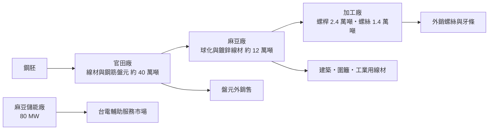
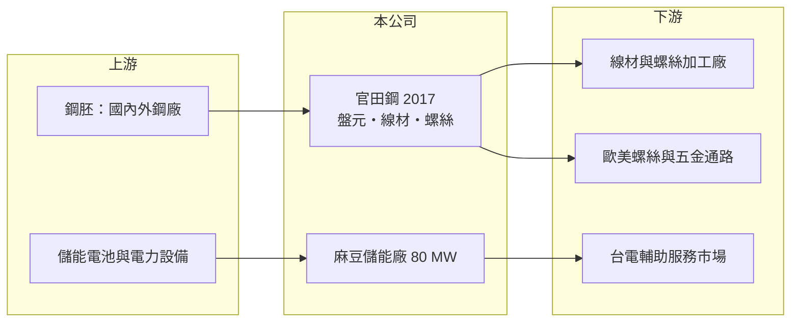

# 2017 官田鋼

> 上市｜[[產業索引-鋼鐵工業|鋼鐵工業]]｜上市（櫃）日期 1992/11/02

# 第一章：企業模式與商業藍圖

> [!info] 撰寫說明
> 本文由 Claude 依公開資料整理，架構比照 [[2330台積電]] 的四章研究，資料截至 2026-10-08。財務數字來源：Goodinfo 年度經營績效頁、富果研究（官田鋼 2026 年 6 月法說會整理）、證交所開放資料（基本資料、資產負債、綜合損益、營益分析、股利、每月營收）；休閒旅遊事業的具體內容未查得，產業描述為整理性內容，尚未逐條比對原始文件。#待校對

在評估單一個股的長期投資價值時，首要步驟是拆解企業的底層獲利邏輯。本章說明官田鋼鐵（股票代號：2017，以下簡稱官田鋼）如何在鋼鐵本業長期低迷下，嘗試以「鋼鐵加能源」雙引擎轉型。

## 一、核心定位：台南的線材與螺絲加工廠

官田鋼成立於 1973 年 7 月，1992 年 11 月上市，總管理處位於台南，2026 年實收資本額約 44.7 億元，董事長為汪振澤、總經理為謝政成。公司採「三廠一處」架構：

* **官田廠（軋鋼）：** 生產線材[[盤元]]與鋼筋盤元，年產能約 40 萬噸，部分對外銷售、部分供應自家加工。官田軋鋼廠過去租給易昇鋼鐵經營，2026 年 4 月起終止租約、收回自營，以強化垂直整合。
* **麻豆廠：** 生產球化[[線材]]與鍍鋅線材，年產能約 12 萬噸，也接受客戶委託代工。
* **加工廠：** 螺桿（牙條）年產能 2.4 萬噸，螺絲及熱處理年產能 1.4 萬噸。

依 2026 年第一季業務來源，鋼鐵原料工業約占 80%、休閒旅遊業約占 20%（休閒旅遊事業的具體內容未查得）。內銷約 86%、外銷約 14%，但螺絲產品 99% 以上外銷。

## 二、業務板塊與轉型

* **鋼鐵本業：** 從盤元、線材到螺桿與螺絲的垂直鏈。尖牙牙條多外銷，用於管路吊掛固定；珠牙牙條用於台灣建築模板鎖固；木螺絲與自攻螺絲用於木製家具、木屋與廠房屋頂鋼板；鍍鋅線材用於建築、圍籬與一般工業。
* **[[儲能]]：** 在麻豆工業區建置 80 MW 的儲能廠，預計 2026 年下半年商轉，參與台電的[[輔助服務]]市場。儲能廠的收入來自協助電網調頻與備轉，與鋼價無關，目標是建立穩定現金流。
* **金融資產：** 2026 年第一季綜合損益總額 5.8 億元，主要來自透過其他綜合損益按公允價值衡量的股票投資上漲，遠高於本業的虧損。

## 三、長期方向

官田鋼提出「鋼鐵」與「能源」雙引擎策略。鋼鐵方面短期維持保守，專注服務既有客戶、不追求銷量；能源方面以儲能廠開創新的收入來源。這是典型的「本業成熟、尋找第二曲線」的轉型，成敗取決於儲能廠的實際收益與鋼鐵本業能否止血。

# 第二章：護城河深度與競爭優勢

在長期價值投資中，「護城河」指企業抵禦競爭、維持超額利潤的保護機制。本章分析官田鋼的競爭位置，以及轉型能否建立新的優勢。

## 一、可能的優勢

* **垂直整合：** 從軋鋼到螺絲成品一貫生產，可以把各段加工利潤留在公司內，並掌握品質與交期。收回官田軋鋼廠自營，正是為了強化這一點。
* **土地與廠房：** 台南官田、麻豆的工業用地與廠房，為儲能廠等新事業提供了現成的場地，這是新進業者需要額外取得的資源。
* **金融資產：** 帳上持有的股票投資提供了財務緩衝，2026 年第一季評價利益就遠大於本業虧損。

## 二、競爭對手格局

| 對手 | 定位 | 對官田鋼的影響 |
|---|---|---|
| [[2012春雨]]、[[2062橋椿]]、[[2069運錩]] | 螺絲與線材廠 | 在線材與外銷螺絲市場競爭 |
| [[2007燁興]]、[[2015豐興]] | 線材與條鋼廠 | 盤元與線材市場重疊 |
| 中國與越南螺絲廠 | 低價外銷螺絲 | 壓低國際價格 |
| 儲能業者（如 [[1519華城]] 等電力設備與能源業者） | 電網級儲能 | 輔助服務市場競價 |

## 三、守得住與守不住的地方

* **守得住：** 既有客戶的線材與螺絲訂單、台南的廠房與土地資源。
* **守不住：** 鋼鐵本業的價差。2023 年與 2025 年毛利率接近零或為負，代表在大宗線材與螺絲市場缺乏定價能力。
* **觀察重點：** 儲能廠 2026 年下半年商轉後的實際收益、收回軋鋼廠自營後的毛利率變化，以及休閒旅遊事業的獲利貢獻。

# 第三章：財務體質與盈利規模

資料日期：2026-10-08。數字取自 Goodinfo 年度經營績效頁、富果研究法說會整理與證交所開放資料，表格是撰寫當時的快照；最新月營收、毛利率、累計 EPS 由自動排程寫在本筆記的屬性欄位（月營收、毛利率、累計EPS 等）。#待校對

財務報表是檢驗護城河是否真實存在的最終標準。本章用多年度三率、ROE 與資本報酬，檢視官田鋼本業與轉型的財務基礎。

## 一、多年度獲利

| 年度 | 營收（新台幣） | [[毛利率]] | [[營業利益率]] | EPS（元） | [[ROE]] |
|---|---|---|---|---|---|
| 2019 | 39.5 億 | 6.55% | -4.63% | -0.50 | -2.98% |
| 2020 | 34.9 億 | 11.0% | -0.39% | 0.04 | 1.28% |
| 2021 | 40.4 億 | 22.7% | 13.5% | 1.98 | 11.0% |
| 2022 | 35.6 億 | 18.5% | 7.64% | 0.69 | 4.97% |
| 2023 | 30.3 億 | -1.63% | -14.6% | -0.68 | -3.32% |
| 2024 | 32.8 億 | 5.36% | -7.20% | 0.28 | 2.41% |
| 2025 | 27.3 億 | 0.44% | -14.7% | -0.56 | -4.47% |
| 2026 上半年 | 14.1 億 | 3.27% | -11.05% | -0.30 | 未查得 |

註：2025 年稅後淨損 2.39 億元（證交所股利資料為 -2.39 億元）。2026 年 1 至 8 月累計營收 18.1 億元，年減約 5%。

* **營收逐年萎縮：** 2020 至 2025 年營收從 34.9 億元降至 27.3 億元，年複合成長率約 -4.8%（推算）。
* **只有景氣高峰時賺錢：** 2021 至 2022 年鋼價高峰時毛利率達 18% 至 23%，其餘年份營業利益多為負數。這代表官田鋼的費用結構偏重，只有在價差特別大的年份才能獲利。
* **綜合損益與 EPS 背離：** 本業虧損，但股票投資的評價利益透過其他綜合損益反映在淨值，投資人需同時看損益表與淨值變化。

## 二、長期指標

* **平均 ROE：** 2021 至 2025 年平均約 2.1%（推算）。
* **股利：** 2025 年度因虧損未配息；2026 年第二季保留盈餘為 -2.25 億元，形成[[累積虧損]]，須先彌補才能配發股利。
* **資產結構：** 2026 年第二季總資產 171.2 億元、權益 84.5 億元，其中歸屬母公司 64.7 億元，約 19.9 億元為[[非控制權益]]；負債 86.6 億元。每股淨值 15.18 元，證交所資料的股價淨值比約 0.58 倍，市場對其資產打了明顯折扣。

## 三、[[ROIC]] 與 [[WACC]]：價值創造利差

**ROIC 推算：** 2025 年營業利益約 -4.0 億元（27.3 億元 × -14.7%），因虧損不計稅盾。以權益 84.5 億元計算，ROIC 約 -4.7%；把負債 86.6 億元也計入，ROIC 約 -2.3%（推算）。

**WACC 推算：** 權益成本以 [[CAPM]] 估算，台灣 10 年期公債 1.75%、市場風險溢酬 6%、β 取 0.9（鋼鐵業常見值，非來源數字），約 7.15%；負債成本假設 2.5%，稅後 2%。依權益約 49% 的帳面結構，WACC 約 4.5% 至 7.2%（推算）。

**結論：** 官田鋼的 ROIC 為負，遠低於 WACC，鋼鐵本業長期未創造價值。儲能廠若能帶來穩定的輔助服務收入，可能是改變這個局面的關鍵；但在儲能收益實際入帳之前，官田鋼的價值主要來自土地、廠房與金融資產，而非本業獲利。

# 第四章：總體風險與地緣政治

任何企業都無法脫離宏觀環境獨立存在。本章分析官田鋼必須面對的鋼鐵週期、轉型與外部風險。

## 一、產業週期

* **鋼價與價差：** 盤元與線材價格隨國際鋼價波動，鋼價下跌時售價下修快於成本，容易出現[[存貨跌價損失]]。
* **外銷螺絲需求：** 螺絲 99% 外銷，歐美建築與 DIY 市場景氣、客戶庫存循環直接影響訂單。

## 二、轉型與營運風險

* **儲能收益不確定：** 輔助服務市場的價格由台電競價決定，隨著更多儲能業者加入，收益率可能下降。儲能電池也有衰退、安全與汰換成本的風險。
* **自營軋鋼廠：** 收回官田軋鋼廠後需自行承擔產能利用率與營運成本，若鋼鐵需求疲弱，虧損可能擴大。
* **休閒旅遊事業：** 占營收約兩成，受觀光景氣影響（具體事業內容未查得）。

## 三、其他風險

* **貿易保護：** 美國關稅與各國對螺絲的[[反傾銷]]措施影響外銷。
* **金融資產波動：** 淨值有相當部分來自股票投資，股市修正時淨值會跟著下降。
* **碳費與 [[CBAM]]：** 軋鋼加熱爐耗能高，碳成本上升；外銷歐洲的螺絲須面對碳邊境調整。

# 專有名詞解析

## 金融

- **[[累積虧損]]**：公司歷年虧損累積使保留盈餘為負數，依法須先彌補完才能分配股利。
- **[[非控制權益]]**：合併子公司中不屬於母公司股東的權益部分，相關獲利不計入母公司 EPS。

## 產業

- **[[盤元]]**：鋼胚熱軋成捲狀的圓形條鋼，是線材與螺絲的原料。
- **[[線材]]**：鋼胚熱軋成捲狀的細長條鋼，是拉線、螺絲、彈簧與焊材的原料。
- **[[儲能]]**：以電池等設備儲存電力，在需要時釋放，可協助電網調頻、削峰填谷與穩定再生能源供電。
- **[[輔助服務]]**：電力公司向業者採購調頻、備轉等服務以維持電網穩定，儲能業者可藉此取得收入。
- **[[反傾銷]]**：進口國對低於正常價格銷售的進口商品加徵關稅，以保護本國產業的貿易救濟措施。

# 核心供應鏈

## 1. 上游：原料與設備
- 鋼胚：國內外鋼廠（供應商未查得）
- 儲能系統：電池與電力轉換設備（供應商未查得）

## 2. 本公司與同業
- 線材與螺絲同業：[[2012春雨]]、[[2062橋椿]]、[[2069運錩]]
- 條鋼同業：[[2007燁興]]、[[2015豐興]]

## 3. 下游：客戶
- 國內線材與螺絲加工廠、建築模板業者
- 歐美螺絲、牙條與五金通路
- 台灣電力公司（輔助服務市場）

## 最新新聞
<!-- news:start -->
<!-- news:end -->

## 相關連結
- [公開資訊觀測站](https://mopsov.twse.com.tw/mops/web/t05st03?step=1&firstin=1&co_id=2017)
- [Goodinfo](https://goodinfo.tw/tw/StockDetail.asp?STOCK_ID=2017)
- [Yahoo 股市](https://tw.stock.yahoo.com/quote/2017)
- [鉅亨網新聞](https://www.cnyes.com/twstock/2017/news)
