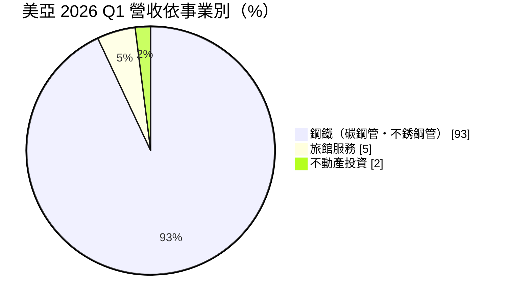
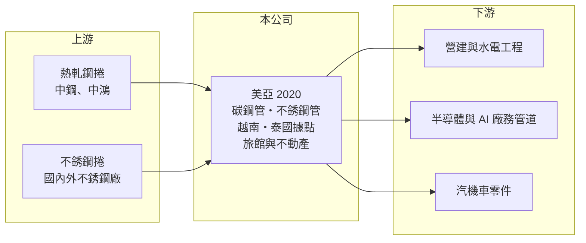

# 2020 美亞

> 上市｜[[產業索引-鋼鐵工業|鋼鐵工業]]｜上市（櫃）日期 1993/04/27

# 第一章：企業模式與商業藍圖

> [!info] 撰寫說明
> 精簡版，由 Claude 依公開資料整理，架構比照 [[2330台積電]]，資料截至 2026-10-08。來源：MoneyDJ 理財網財務比率年表（2021 至 2025 年）；富果研究 2026 年 6 月法說會備忘錄（產品、地區、海外據點）；證交所開放資料快照（基本資料、2026 年上半年資產負債與損益、2025 年度股利、本益比淨值比）。營收金額由每股營業額乘以約 2.67 億股推算。#待校對

美亞鋼管廠成立於 1959 年 9 月、1993 年 4 月上市，總部在台北市中山區，董事長黃春發、總經理蕭敏志，實收資本額約 26.7 億元。美亞是台灣歷史悠久的鋼管廠，本業是把鋼帶加工成碳鋼管與不銹鋼管，另外經營旅館與不動產，理解它要從「內需鋼管＋資產活化」兩條線來看。

- **核心業務：** 美亞的主力是[[焊接鋼管]]，包括碳鋼管與[[不銹鋼]]管，用於建築結構、消防與水電管線、廠房工程以及汽機車零件。鋼管廠的原料是[[熱軋鋼捲]]或不銹鋼捲，加工後以噸計價出售，獲利主要來自加工價差與原料進貨時點的掌握。
- **營收結構：** 依富果整理的 2026 年第一季法說會，鋼鐵事業約占營收 93%，銷量約 2.1 萬噸；100% 持股的美亞商旅貢獻約 5,145 萬元，不動產投資則從 2026 年第一季開始認列營收。地區上台灣市場約占 92%，出口（含越南子公司）約 8%，屬於典型的內需型鋼管廠。
- **營運據點：** 除台灣本業外，海外據點包括越南美亞、泰國廣太與越南鑽石，2026 年第一季海外總銷量約 7,686 噸，年增 17.9%。海外據點讓美亞能就近供應東南亞市場，也分散了台灣營建景氣的風險。
- **長期方向：** 公司策略是鞏固利基市場，特別是 AI 與半導體建廠帶動的廠務管道工程需求，並以提高產品附加價值與成本控制維持競爭力。另一方面，旅館與不動產開發屬於土地資產的活化，這類收入不受鋼價循環影響，長期能讓獲利來源更穩定，但規模仍小。

# 第二章：護城河深度與競爭優勢

美亞的競爭力來自老字號品牌在內需鋼管市場的通路與規格齊全度，而非技術壁壘。

- **競爭優勢：** 建築與工程用鋼管講求規格齊全、交期穩定與認證完整，營造廠與水電包商習慣向熟悉的品牌下單。美亞經營超過六十年，在國內工程通路有長期關係，加上碳鋼與不銹鋼兩條產品線，可以滿足同一工程的多種需求。不過鋼管本身是標準品，價格仍由原料成本與市場供需決定，品牌溢價有限。
- **主要對手：** 國內鋼管同業包括不銹鋼管的 [[2030彰源]]、[[2034允強]]，以及碳鋼管與結構鋼管業者；進口方面則面對中國與東南亞的低價鋼管。美亞以內銷為主，與以外銷為主的允強市場重疊較少，但在國內工程市場仍需面對價格競爭。
- **觀察重點：** 2026 年第一季毛利率升到 22.31%、營業利益率 14.77%，明顯高於過去五年的區間，代表 AI 與半導體廠務需求確實拉高了產品組合。長期要看的是這類高規格管材能否成為穩定比重，以及不動產開發能否持續貢獻，而不是一次性的建案收入。

# 第三章：財務體質與盈利規模

資料日期：2026-10-08，表格是撰寫當時的快照；最新月營收、毛利率、累計 EPS 由自動排程寫在本筆記的屬性欄位（月營收、毛利率、累計EPS 等）。#待校對

美亞過去五年獲利始終為正，ROE 多數年度在一成以上，但每股營業額在 2024 年明顯下降，營收規模較 2021 至 2023 年縮小。

| 年度 | 營收（億元） | [[毛利率]] | [[營業利益率]] | EPS（元） | [[ROE]] |
|---|---|---|---|---|---|
| 2021 | 未查得 | 13.08% | 7.97% | 3.52 | 23.00% |
| 2022 | 未查得 | 6.41% | 3.48% | 1.20 | 7.81% |
| 2023 | 未查得 | 11.99% | 7.40% | 4.80 | 29.39% |
| 2024 | 約 52（推算） | 15.19% | 9.31% | 3.09 | 19.09% |
| 2025 | 約 47（推算） | 18.65% | 7.99% | 2.13 | 12.53% |

- **長期指標：** 每股營業額由 2023 年的 31.5 元降到 2024 年的 19.63 元，2021 至 2023 年的營收金額因股本是否變動無法確認，故寫未查得。2021 至 2025 年平均 ROE 約 18.4%（推算），但稅後淨利率在 2023、2024 年達 15% 以上，高於營業利益率，代表有相當比重來自業外收益（明細未查得）。2025 年度現金股利 1.8 元，約為 EPS 2.13 元的 85%（證交所資料），配息意願高。每股現金流量 2024、2025 年為負，需留意。
- **[[ROIC]] 與 [[WACC]]：** 2025 年營業利益約 3.8 億元（營收約 47.4 億元 × 7.99%），稅後約 3.0 億元。投入資本以 2026 年第二季權益總計 42.7 億元，加上有息負債推估約 30.7 億元（以負債總計 51.2 億元的六成估算，官方快照未拆分）計算，ROIC 約 4.1%（推算）；以 2026 年上半年營業利益 3.27 億元年化，ROIC 約 7%（推算）。WACC 約 5.5%（推算：無風險利率 1.75%、市場風險溢酬 6%、β 取鋼鐵同業常見值 0.9，股東權益成本 7.15%；稅前負債成本 2.5%、稅率 20%，以市值約 66 億元與負債 30.7 億元計算權重約 68：32）。2025 年 ROIC 略低於 WACC，2026 年高規格管材帶動下回到 WACC 之上，說明本業的價值創造仍高度依賴產品組合與景氣。
- **財務特色：** 2026 年第二季總資產 93.9 億元、負債 51.2 億元，負債比率約 55%，每股淨值 15.94 元。2026 年上半年營收 20.5 億元、[[毛利率]] 23.5%、營業利益率 16.0%、EPS 1.02 元（證交所資料），毛利率是近年高點。

# 第四章：總體風險與地緣政治

美亞的風險集中在國內營建景氣、鋼價循環，以及非本業收入的可持續性。

- **產業週期：** 鋼管價格跟隨熱軋鋼捲與鎳價波動，原料上漲時有庫存利益，下跌時則可能提列[[存貨跌價損失]]，2022 年毛利率跌到 6.41% 就是鋼價回落的結果。內需鋼管又連動房市與公共工程，富果整理的法說會提到國內房市處於冷靜期，汽機車需求成長也趨緩。
- **營運風險：** 2026 年的高毛利部分來自 AI 與半導體建廠的管道工程，這類需求隨大型廠房投資的節奏起伏，一旦建廠潮放緩，產品組合可能回到一般建材為主。不動產與旅館事業的收入受個別建案與觀光景氣影響，認列時點不規律，解讀獲利時應區分本業與業外。
- **其他風險：** 中國與東南亞的低價鋼管進口、印尼鎳礦政策造成的不銹鋼原料成本變動，以及越南、泰國子公司的匯率與當地競爭，都是外部變數。公司現金股利發放率偏高，若獲利轉弱，配息可能隨之下降。

# 專有名詞解析

## 金融

- **[[存貨跌價損失]]**：存貨的市價低於帳面成本時，依會計規定須認列的損失，會直接壓低毛利率。
- **[[ROIC]]**：投入資本報酬率，稅後營業利益除以股東權益加有息負債，衡量本業運用資本的效率。
- **[[WACC]]**：加權平均資金成本，股東與債權人要求報酬率的加權平均，是 ROIC 要超越的門檻。

## 產業

- **[[焊接鋼管]]**：把鋼帶捲成圓形後沿接縫焊合製成的鋼管，用於建築結構、管線輸送與機械零件。
- **[[不銹鋼]]**：含鉻、鎳等合金元素的耐腐蝕鋼材，鎳價是主要成本，價格隨鎳價波動。
- **[[熱軋鋼捲]]**：鋼胚加熱後在高溫下軋成的鋼板卷，是冷軋、鋼管、五金等下游加工的基礎原料，屬全球定價的大宗商品。

# 核心供應鏈

- 上游：熱軋鋼捲與不銹鋼捲供應商，國內主要為 [[2002中鋼]]、[[2014中鴻]] 等（實際採購比重未查得）。
- 下游／客戶：營造廠、水電與消防工程包商、半導體與 AI 相關廠務工程、汽機車零件廠；旅館事業面對一般旅客。
- 同業：[[2030彰源]]、[[2034允強]]、[[2027大成鋼]]；進口中國與東南亞鋼管。

## 最新新聞
<!-- news:start -->
<!-- news:end -->

## 相關連結
- [公開資訊觀測站](https://mopsov.twse.com.tw/mops/web/t05st03?step=1&firstin=1&co_id=2020)
- [Goodinfo](https://goodinfo.tw/tw/StockDetail.asp?STOCK_ID=2020)
- [Yahoo 股市](https://tw.stock.yahoo.com/quote/2020)
- [鉅亨網新聞](https://www.cnyes.com/twstock/2020/news)
