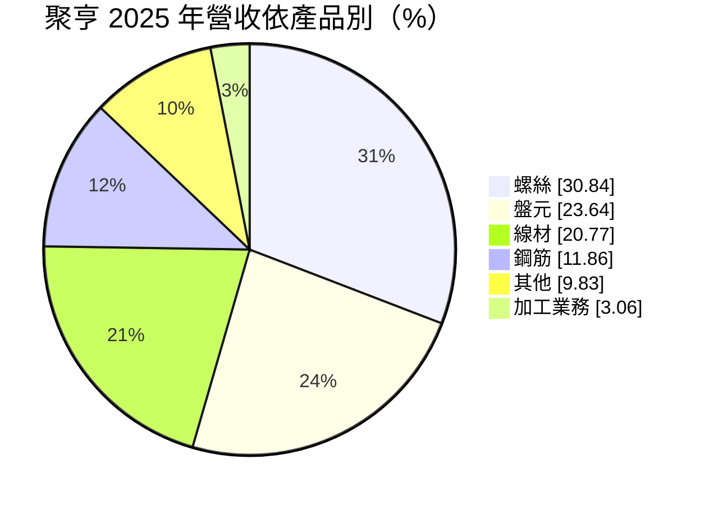
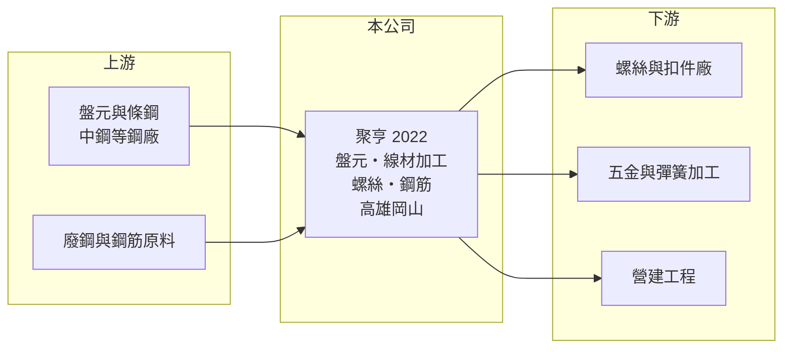

# 2022 聚亨

> 上市｜[[產業索引-鋼鐵工業|鋼鐵工業]]｜上市（櫃）日期 1995/03/27

# 第一章：企業模式與商業藍圖

> [!info] 撰寫說明
> 精簡版，由 Claude 依公開資料整理，架構比照 [[2330台積電]]，資料截至 2026-10-08。來源：MoneyDJ 理財網財務比率年表（2021 至 2025 年）與個股基本資料（2025 年營收比重）；證交所開放資料快照（基本資料、2026 年上半年資產負債與損益、2025 年度股利、本益比淨值比）。營收金額由每股營業額乘以約 3.37 億股推算。公開資料有限，產能與客戶資訊未查得。#待校對

聚亨企業成立於 1980 年 12 月、1995 年 3 月上市，總部在高雄岡山，董事長黃文松、總經理呂艷娟，實收資本額約 33.7 億元。岡山是台灣螺絲產業的聚落，聚亨的業務從[[盤元]]、線材加工一路延伸到螺絲成品，理解它要從「條鋼原料到扣件」這條產業鏈來看。

- **核心業務：** 聚亨經營盤元與線材的買賣與加工，並生產螺絲。盤元是熱軋後捲成盤狀的圓形條鋼，經抽線、退火等加工成線材，再由螺絲廠打頭、輾牙製成螺絲。聚亨同時站在原料與成品兩端，可以把上游條鋼加工的價差和下游螺絲的附加價值都留在集團內。
- **營收結構：** 依 MoneyDJ 整理的 2025 年營收比重，螺絲約 30.8%、盤元約 23.6%、線材約 20.8%、[[鋼筋]]約 11.9%、其他約 9.8%、加工業務約 3.1%。換句話說，接近四成五的營收是盤元與線材這類半成品，價格直接跟著鋼價走；螺絲雖是最大單項，但同樣以鋼材成本為定價基礎。
- **營運據點：** 公司總部與營運重心在高雄岡山，鄰近大量螺絲與扣件加工廠，運輸與接單都有地利之便。合併報表中非控制權益約占權益總計的一半（2026 年第二季權益總計 67.9 億元、歸屬母公司 33.4 億元，證交所資料），代表聚亨合併了外部股東持股比重高的子公司，分析母公司股東的報酬時要以歸屬母公司數字為準。
- **長期方向：** 公開資料未查得具體的擴產或轉型計畫。從營收結構看，聚亨的長期價值取決於能否提高螺絲等成品的比重，降低對單純盤元、鋼筋買賣的依賴，因為後者的毛利薄、受鋼價影響最大。

# 第二章：護城河深度與競爭優勢

聚亨的競爭位置建立在岡山扣件聚落的地緣與上下游一體的產品線，但產品多屬標準品，護城河偏窄。

- **競爭優勢：** 同時供應盤元、線材與螺絲，讓聚亨能提供螺絲廠一站式的原料，並以自身螺絲產能消化部分線材，降低單一產品景氣變化的衝擊。地處岡山聚落，交期與服務反應速度是它相對外地供應商的優勢。不過盤元、線材與鋼筋都是規格化商品，價格由市場決定，議價空間有限。
- **主要對手：** 線材與螺絲同業包括 [[5007三星]]、[[2065世豐]]、[[2069運錩]]、[[2012春雨]] 等；盤元主要由 [[2002中鋼]] 等鋼廠供應，鋼筋則與 [[2006東和鋼鐵]]、[[2015豐興]] 等電爐廠的產品同類。聚亨規模較這些專業廠小，競爭多靠地緣與產品組合。
- **觀察重點：** 2021 年營業利益率 8.59%，之後四年多在 2% 上下甚至轉負，顯示鋼價高峰過後利差快速收斂。長期要看螺絲比重能否提升、毛利率能否穩定在一成以上，以及子公司的獲利對母公司股東的實際貢獻。

# 第三章：財務體質與盈利規模

資料日期：2026-10-08，表格是撰寫當時的快照；最新月營收、毛利率、累計 EPS 由自動排程寫在本筆記的屬性欄位（月營收、毛利率、累計EPS 等）。#待校對

聚亨營收在 2021 至 2025 年間大致維持在 67 億至 93 億元，但獲利波動大，五年中有三年 EPS 為負或接近零。

| 年度 | 營收（億元） | [[毛利率]] | [[營業利益率]] | EPS（元） | [[ROE]] |
|---|---|---|---|---|---|
| 2021 | 約 75（推算） | 13.14% | 8.59% | 0.89 | 8.06% |
| 2022 | 約 67（推算） | 6.45% | 1.25% | -0.25 | -0.92% |
| 2023 | 約 84（推算） | 14.10% | 4.80% | 0.24 | 5.12% |
| 2024 | 約 80（推算） | 8.28% | -2.13% | -0.49 | -7.28% |
| 2025 | 約 93（推算） | 10.01% | 約 1.0% | -0.02 | 1.76% |

- **長期指標：** 2021 至 2025 年營收年複合成長率約 5.6%（推算），近 5 年平均 ROE 約 1.3%（推算），長期幾乎沒有替股東賺到資金成本。2024 與 2025 年度均未配發股利（證交所資料），每股現金流量在 2024、2025 年也轉為負值。負債比率由 2023 年的 22.5% 升到 2025 年的 33.3%，仍屬偏低水準。
- **[[ROIC]] 與 [[WACC]]：** 2025 年營業利益約 0.9 億元（營收約 93.4 億元 × 約 1.0%），稅後約 0.75 億元。投入資本以 2026 年第二季權益總計 67.9 億元，加上有息負債推估約 27 億元（以負債總計 45.0 億元的六成估算，官方快照未拆分）計算，ROIC 約 0.8%（推算）；2026 年上半年營業利益為小幅虧損，年化 ROIC 接近零。WACC 約 4.4%（推算：無風險利率 1.75%、市場風險溢酬 6%、β 取鋼鐵同業常見值 0.9，股東權益成本 7.15%；稅前負債成本 2.5%、稅率 20%，以市值約 24 億元與負債 27 億元計算權重約 47：53）。ROIC 長期低於 WACC，代表以目前的業務組合，公司在多數年度並未創造經濟價值，只有 2021 年鋼價高峰時接近打平。
- **財務特色：** 2026 年第二季總資產 112.9 億元、負債 45.0 億元，負債比率約 40%，每股淨值 9.90 元。2026 年上半年營收 62.2 億元、[[毛利率]] 6.8%、營業利益率 -0.3%、EPS -0.18 元（證交所資料）。

# 第四章：總體風險與地緣政治

聚亨的風險主要在鋼價循環造成的利差波動，以及扣件產業的外銷景氣。

- **產業週期：** 盤元、線材與鋼筋的售價跟隨國際條鋼價格與[[廢鋼]]成本，鋼價下跌時存貨必須提列[[存貨跌價損失]]，同時下游客戶延後採購，形成量價齊跌。2022 年與 2024 年的虧損都發生在鋼價回落期，說明這是結構性的週期風險。
- **營運風險：** 螺絲下游以外銷歐美的扣件廠為主，扣件需求受汽車、營建與 DIY 市場影響，歐美庫存調整會傳導到岡山聚落的訂單。公司毛利率長期在一成上下，費用稍有增加就會轉為營業虧損，營運槓桿不利。
- **其他風險：** 美國與歐盟對扣件的[[反傾銷]]與關稅措施、中國低價線材與螺絲的競爭、新台幣匯率變動，都會影響下游客戶的出口競爭力，進而影響聚亨的原料銷售。

# 專有名詞解析

## 金融

- **[[存貨跌價損失]]**：存貨的市價低於帳面成本時，依會計規定須認列的損失，會直接壓低毛利率。
- **[[ROIC]]**：投入資本報酬率，稅後營業利益除以股東權益加有息負債，衡量本業運用資本的效率。
- **[[WACC]]**：加權平均資金成本，股東與債權人要求報酬率的加權平均，是 ROIC 要超越的門檻。

## 產業

- **[[盤元]]**：熱軋後捲成盤狀的圓形條鋼，是抽製鋼線、螺絲與彈簧的原料。
- **[[鋼筋]]**：埋在混凝土中提供抗拉強度的條狀鋼材，規格標準化，是住宅與公共工程的主要用鋼。
- **[[廢鋼]]**：回收的鋼鐵料，是電弧爐的主要原料，價格隨國際供需每日變動，占電爐廠成本最大比重。
- **[[反傾銷]]**：進口國對低於正常價格銷售的進口商品加徵關稅的貿易救濟措施。

# 核心供應鏈

- 上游：盤元與條鋼供應商，國內主要為 [[2002中鋼]]（實際採購對象與比重未查得）。
- 下游／客戶：岡山與台南一帶的螺絲、扣件與五金加工廠，以及營建工程（具名客戶未查得）。
- 同業：[[5007三星]]、[[2065世豐]]、[[2069運錩]]、[[2012春雨]]；鋼筋同類產品有 [[2006東和鋼鐵]]、[[2015豐興]]。

## 最新新聞
<!-- news:start -->
<!-- news:end -->

## 相關連結
- [公開資訊觀測站](https://mopsov.twse.com.tw/mops/web/t05st03?step=1&firstin=1&co_id=2022)
- [Goodinfo](https://goodinfo.tw/tw/StockDetail.asp?STOCK_ID=2022)
- [Yahoo 股市](https://tw.stock.yahoo.com/quote/2022)
- [鉅亨網新聞](https://www.cnyes.com/twstock/2022/news)
