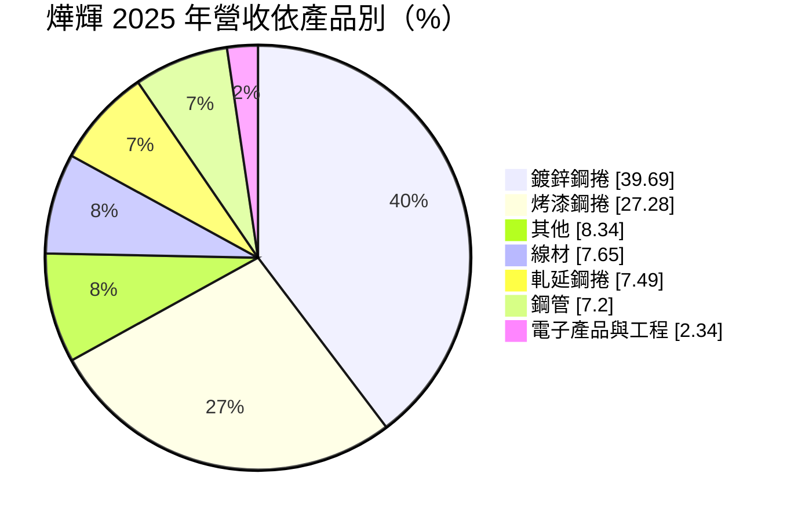
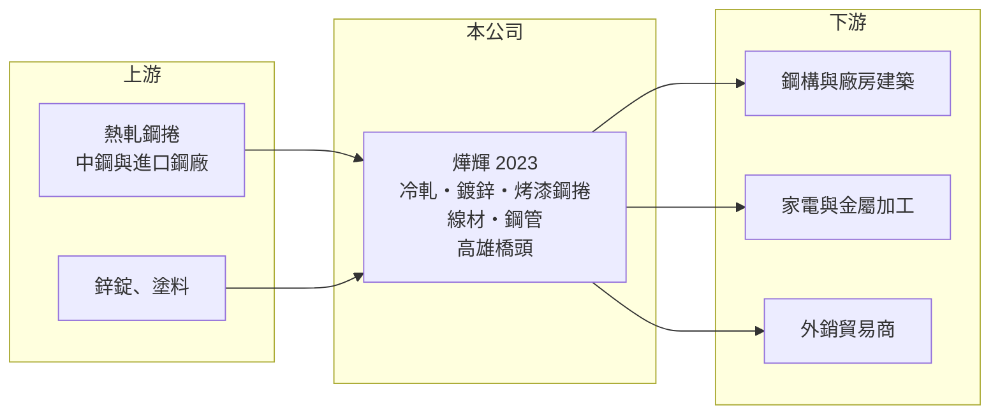

# 2023 燁輝

> 上市｜[[產業索引-鋼鐵工業|鋼鐵工業]]｜上市（櫃）日期 1995/07/28

# 第一章：企業模式與商業藍圖

> [!info] 撰寫說明
> 精簡版，由 Claude 依公開資料整理，架構比照 [[2330台積電]]，資料截至 2026-10-08。來源：MoneyDJ 理財網財務比率年表（2021 至 2025 年）與個股基本資料（2025 年營收比重）；證交所開放資料快照（基本資料、2026 年上半年資產負債與損益、2025 年度股利、本益比淨值比）。營收金額由每股營業額乘以約 18.2 億股推算；集團關係等描述憑整理性知識撰寫，標示待校對。#待校對

燁輝企業成立於 1978 年 4 月、1995 年 7 月上市，總部在高雄橋頭，董事長林義守、總經理張振武，實收資本額約 182 億元，是本批鋼鐵股中規模最大的一家。燁輝屬於林義守創辦的義聯集團（待校對），本業是把熱軋鋼捲加工成[[鍍鋅鋼捲]]與[[烤漆鋼板]]，理解它要抓住「表面處理鋼品＋集團轉投資」兩個重點。

- **核心業務：** 燁輝以[[熱軋鋼捲]]為原料，經酸洗、[[冷軋]]、熱浸鍍鋅或鍍鋁鋅，再塗佈烤漆，製成表面處理鋼品。鍍鋅鋼捲與烤漆鋼捲主要用於廠房屋頂與牆板、鋼構建築、家電外殼與各類金屬加工，屬於鋼鐵業中加工層次較高的板材。
- **營收結構：** 依 MoneyDJ 整理的 2025 年營收比重，鍍鋅鋼捲約 39.7%、烤漆鋼捲約 27.3%，兩者合計約三分之二；其餘為線材 7.7%、軋延鋼捲 7.5%、鋼管 7.2%、其他 8.3%，另有少量電子產品與工程收入。產品線從板材延伸到線材與鋼管，反映集團內部多元的鋼品業務。
- **營運據點：** 公司總部與主要廠區位於高雄橋頭（證交所基本資料）。燁輝的合併報表涵蓋集團內的鋼鐵子公司與轉投資，2026 年第二季總資產達 1,017 億元，遠大於單純的鍍鋅廠規模，代表轉投資在資產負債表中占有相當比重（明細未查得）。
- **長期方向：** 表面處理鋼品的長期成長來自建築鋼構化、家電與綠能（太陽能支架、廠房屋頂）的用鋼需求。燁輝的挑戰在於，中國與東南亞的鍍鋅產能大幅擴充，外銷市場價格長期承壓，提高烤漆等高附加價值產品比重與集團資源整合，是比擴產更重要的方向。

# 第二章：護城河深度與競爭優勢

燁輝的優勢在於規模與產品線完整，但鍍鋅、烤漆鋼品的技術門檻不高，護城河主要來自集團的上下游配置。

- **競爭優勢：** 燁輝具備從冷軋、鍍鋅到烤漆的連續產線，產品規格齊全，能同時供應建築、家電與金屬加工客戶。身為義聯集團成員（待校對），在原料採購與通路上可與集團內其他鋼鐵公司互相支援。這種規模優勢讓它在國內表面處理鋼品市場維持重要地位，但無法擺脫國際鋼價的牽動。
- **主要對手：** 國內同業包括以烤漆鋼板著稱的 [[2029盛餘]]、中鋼集團的 [[2014中鴻]]，以及上游一貫作業的 [[2002中鋼]]；外銷市場則面對中國、韓國、越南的大型鍍鋅廠。2025 年毛利率只有 8% 左右，顯示同質化競爭下的利差有限。
- **觀察重點：** 燁輝 2023 至 2025 年連續三年虧損，2025 年 EPS -1.85 元，且 2026 年上半年營業利益為正、稅後卻因業外虧損 14.3 億元而虧損（證交所資料）。長期要看的是轉投資的拖累何時改善，以及本業毛利率能否回到一成以上。

# 第三章：財務體質與盈利規模

資料日期：2026-10-08，表格是撰寫當時的快照；最新月營收、毛利率、累計 EPS 由自動排程寫在本筆記的屬性欄位（月營收、毛利率、累計EPS 等）。#待校對

燁輝營收由 2021 年約 867 億元一路下滑到 2025 年約 655 億元，獲利則從 2021 年的鋼價高峰轉為連續虧損。

| 年度 | 營收（億元） | [[毛利率]] | [[營業利益率]] | EPS（元） | [[ROE]] |
|---|---|---|---|---|---|
| 2021 | 約 867（推算） | 12.11% | 5.59% | 2.75 | 17.19% |
| 2022 | 約 771（推算） | 10.93% | 2.75% | 0.41 | 1.59% |
| 2023 | 約 686（推算） | 9.16% | 2.18% | -0.31 | -2.63% |
| 2024 | 約 688（推算） | 7.98% | 0.46% | -0.81 | -5.09% |
| 2025 | 約 655（推算） | 8.27% | 0.08% | -1.85 | -11.11% |

- **長期指標：** 2021 至 2025 年營收年複合成長率約 -6.8%（推算），近 5 年平均 ROE 約 0%（推算）。毛利率與營業利益率連續四年下滑，代表不是單一年度的跌價，而是產業結構性的利差壓縮。2025 年度未配發股利（證交所資料），負債比率在 60% 至 67% 之間，2025 年為 66.7%。每股現金流量五年皆為正，本業仍能產生現金。
- **[[ROIC]] 與 [[WACC]]：** 2025 年營業利益約 0.5 億元（營收約 655 億元 × 0.08%），稅後約 0.4 億元。投入資本以 2026 年第二季權益總計 316.1 億元，加上有息負債推估約 491 億元（以負債總計 701 億元的七成估算，官方快照未拆分）計算，ROIC 約 0.1%（推算）；2021 年鋼價高峰時約 5%（推算）。WACC 約 3.7%（推算：無風險利率 1.75%、市場風險溢酬 6%、β 取鋼鐵同業常見值 0.9，股東權益成本 7.15%；稅前負債成本 2.5%、稅率 20%，以市值約 251 億元與負債 491 億元計算權重約 34：66）。即使在 2021 年的高峰，ROIC 也只略高於 WACC，近年則明顯低於，代表這個資產規模龐大的事業體長期並未創造經濟價值。
- **財務特色：** 2026 年第二季總資產 1,017 億元、負債 701 億元，負債比率約 69%，每股淨值 17.31 元。2026 年上半年營收 336.9 億元、[[毛利率]] 9.5%、營業利益率 1.3%，業外虧損 14.3 億元，EPS -0.52 元（證交所資料）。

# 第四章：總體風險與地緣政治

燁輝的風險來自三層：國際鋼價循環、亞洲鍍鋅產能過剩，以及高負債下的轉投資損益。

- **產業週期：** 鍍鋅與烤漆鋼品的售價隨熱軋鋼捲與鋅價波動，原料急跌時燁輝必須提列[[存貨跌價損失]]，而且產品從進料到出貨有一段時間差，價格轉折時毛利率波動放大。中國房地產低迷後，大量鋼材轉往出口，壓低亞洲鋼價，是 2023 年後利差持續收斂的主因。
- **營運風險：** 2026 年上半年本業轉為小幅獲利，但業外虧損仍大，代表轉投資（推估為集團內其他鋼鐵事業）的表現才是決定股東報酬的關鍵。資產規模大、負債比率接近七成，利率上升或景氣延長低迷時，財務壓力會比同業明顯。
- **其他風險：** 外銷市場面對各國對鍍鋅鋼品的[[反傾銷]]與關稅措施；國內則有碳費與減碳要求帶來的成本上升；新台幣升值會壓縮外銷報價的競爭力。

# 專有名詞解析

## 金融

- **[[存貨跌價損失]]**：存貨的市價低於帳面成本時，依會計規定須認列的損失，會直接壓低毛利率。
- **[[ROIC]]**：投入資本報酬率，稅後營業利益除以股東權益加有息負債，衡量本業運用資本的效率。
- **[[WACC]]**：加權平均資金成本，股東與債權人要求報酬率的加權平均，是 ROIC 要超越的門檻。

## 產業

- **[[鍍鋅鋼捲]]**：在冷軋鋼捲表面鍍上一層鋅以防鏽的鋼材，用於建築屋頂、牆板、家電外殼與鋼構。
- **[[烤漆鋼板]]**：在鍍鋅或鍍鋁鋅鋼板上塗佈並烘烤塗料的彩色鋼板，又稱彩鋼，用於廠房屋頂、牆面與家電。
- **[[冷軋]]**：在常溫下把熱軋鋼捲再壓薄的製程，可得到較薄、表面較平滑、尺寸較精確的鋼材。
- **[[熱軋鋼捲]]**：鋼胚加熱後在高溫下軋成的鋼板卷，是冷軋、鋼管、五金等下游加工的基礎原料，屬全球定價的大宗商品。
- **[[反傾銷]]**：進口國對低於正常價格銷售的進口商品加徵關稅的貿易救濟措施。

# 核心供應鏈

- 上游：熱軋鋼捲供應商，國內為 [[2002中鋼]]，另有進口鋼捲；鋅錠與塗料供應商（實際採購比重未查得）。
- 下游／客戶：鋼構與浪板加工廠、家電與金屬加工業者、外銷貿易商（具名客戶未查得）。
- 同業：[[2029盛餘]]、[[2014中鴻]]、[[2002中鋼]]；集團相關公司 [[2007燁興]]（集團關係待校對）。

## 最新新聞
<!-- news:start（自動產生，請勿手動編輯此範圍） -->
- 2026-10-16 📰 媒體 09:24｜〈智慧能源週〉燁輝MAXITRA鋅鋁鎂鋼品跳脫單一市場 雙軌布局綠能及AI基建應用｜[鉅亨網](https://news.cnyes.com/news/id/6631817)

完整紀錄：[[2023燁輝 新聞]]
<!-- news:end -->

## 相關連結
- [公開資訊觀測站](https://mopsov.twse.com.tw/mops/web/t05st03?step=1&firstin=1&co_id=2023)
- [Goodinfo](https://goodinfo.tw/tw/StockDetail.asp?STOCK_ID=2023)
- [Yahoo 股市](https://tw.stock.yahoo.com/quote/2023)
- [鉅亨網新聞](https://www.cnyes.com/twstock/2023/news)
