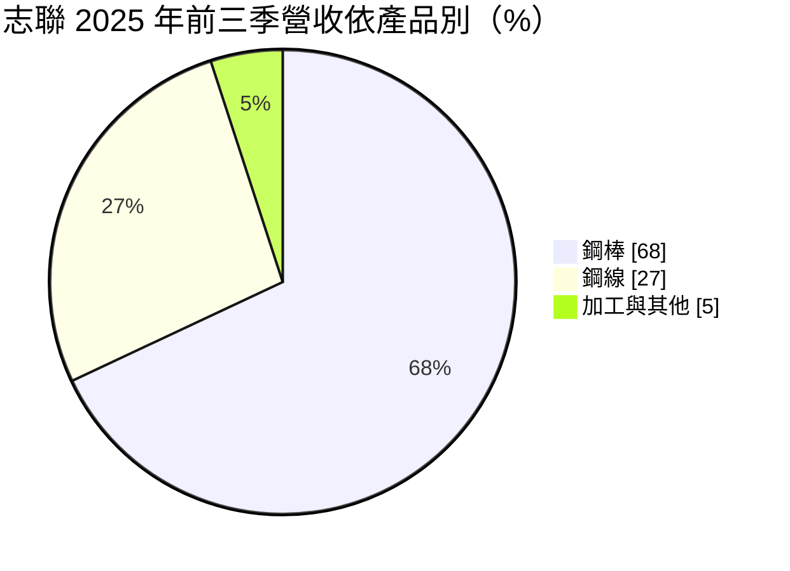
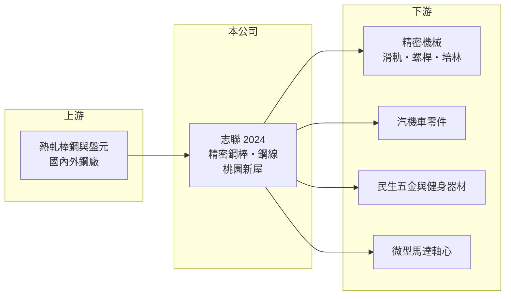

# 2024 志聯

> 上市｜[[產業索引-鋼鐵工業|鋼鐵工業]]｜上市（櫃）日期 1995/12/30

# 第一章：企業模式與商業藍圖

> [!info] 撰寫說明
> 精簡版，由 Claude 依公開資料整理，架構比照 [[2330台積電]]，資料截至 2026-10-08。來源：MoneyDJ 理財網財務比率年表（2021 至 2025 年）；富果研究 2025 年 12 月法說會備忘錄（產品、營收比重、市場、產能）；證交所開放資料快照（基本資料、2026 年上半年資產負債與損益、2025 年度股利、本益比淨值比）。營收金額由每股營業額乘以約 0.975 億股推算。#待校對

志聯工業成立於 1973 年 9 月、1995 年 12 月上市，總部與工廠在桃園新屋，董事長潘仲良，總經理由林信安代理，實收資本額 9.75 億元，是規模很小的鋼鐵加工廠。志聯把棒鋼與盤元再加工成[[精密鋼棒]]與鋼線，理解它要從「精度與表面品質換取加工價差」的角度來看。

- **核心業務：** 志聯以熱軋棒鋼與[[盤元]]為原料，經酸洗、引拔（冷抽）、研磨、矯直與探傷，製成尺寸精確、表面光滑的精密鋼棒，以及伸線製成的鋼線。產品用於傘骨、彈簧床墊、健身器材，線性滑軌、軸心、螺桿、培林滾珠等精密機械零件，汽機車的輻線、避震器軸心與鏈條，以及無人機與散熱風扇的微型馬達軸心。
- **營收結構：** 依富果整理的 2025 年 12 月法說會，2025 年前三季鋼棒約占 68%、鋼線約 27%、加工與其他約 5%。市場上台灣內銷約 72%、中國約 13%（過去約 18% 至 19%）、印尼約 6%、馬來西亞約 4%，以國內機械與五金加工廠為主要客群。
- **營運據點：** 生產基地集中在桃園新屋，廠區約兩萬坪。鋼棒廠有 9 台引拔機，月產能約 2,100 噸；鋼線廠有 23 台伸線機，月產能約 1,000 噸；另有兩條自動酸洗線（富果整理法說會）。新增離線渦電流探傷與心部探傷設備，目的是提高精密零件客戶要求的內部品質。
- **長期方向：** 公司提出四大方針：以內部小組拆分做成本控管、透過客戶座談提高黏著度、開發北亞與南亞新客戶、保持現金流充沛。2026 年初預計試行表面硬化處理設備，等於往更高附加價值的後段加工延伸。這些方向顯示經營層以守成和提高附加價值為主，而非擴產。

# 第二章：護城河深度與競爭優勢

志聯的護城河來自精密加工的品質與多元應用，但規模小、議價力有限。

- **競爭優勢：** 精密鋼棒用於線性滑軌、螺桿與馬達軸心時，客戶對真直度、尺寸公差與內部缺陷要求很高，探傷設備與製程經驗是基本門檻。志聯的產品同時打進民生、機械、汽機車與科技零件，應用分散，單一產業衰退的衝擊較小。不過這類加工以噸計價，加工價差在景氣差時很容易被壓縮。
- **主要對手：** 國內同業包括冷抽鋼棒與線材加工廠，以及上游提供特殊鋼棒的 [[2012春雨]]、[[5009榮剛]] 等；進口方面面對中國的冷抽鋼棒。依法說會說法，下游客戶要求「交期短、品質高、成本導向」且不願備庫存，代表志聯必須自己承擔庫存與交期壓力。
- **觀察重點：** 毛利率由 2021 年的 17.25% 降到 2023 年的 2%，2024、2025 年回到 7% 左右，2026 年上半年約 9.7%（證交所資料）。長期要看表面硬化等新製程能否把毛利率拉回一成以上，以及中國產能過剩何時緩解。

# 第三章：財務體質與盈利規模

資料日期：2026-10-08，表格是撰寫當時的快照；最新月營收、毛利率、累計 EPS 由自動排程寫在本筆記的屬性欄位（月營收、毛利率、累計EPS 等）。#待校對

志聯營收由 2021 年約 15 億元縮小到 2025 年約 10 億元，獲利在 2021 年高峰後長期徘徊在損益兩平附近。

| 年度 | 營收（億元） | [[毛利率]] | [[營業利益率]] | EPS（元） | [[ROE]] |
|---|---|---|---|---|---|
| 2021 | 約 15.3（推算） | 17.25% | 11.95% | 1.47 | 12.01% |
| 2022 | 約 11.7（推算） | 11.64% | 5.37% | 0.48 | 3.87% |
| 2023 | 約 9.2（推算） | 2.00% | -4.94% | -0.56 | -4.78% |
| 2024 | 約 11.0（推算） | 7.74% | 1.50% | 0.16 | 1.43% |
| 2025 | 約 9.9（推算） | 6.83% | 0.64% | -0.06 | -0.53% |

- **長期指標：** 2021 至 2025 年營收年複合成長率約 -10%（推算），近 5 年平均 ROE 約 2.4%（推算）。2025 年度未配發股利（證交所資料），法說會也提到 2024 年獲利不佳未配息。負債比率由 2022 年的 46% 降到 2025 年的 33%，財務保守；每股現金流量五年中有四年為正。
- **[[ROIC]] 與 [[WACC]]：** 2025 年營業利益約 0.06 億元（營收約 9.9 億元 × 0.64%），稅後約 0.05 億元。投入資本以 2026 年第二季權益總計 11.4 億元，加上有息負債推估約 2 億元（以負債總計 5.1 億元的四成估算；法說會提到 2025 年第三季短期借款約 1.3 億元）計算，ROIC 約 0.4%（推算）；2026 年上半年年化約 2%（推算），2021 年高峰約 11%（推算）。WACC 約 6.4%（推算：無風險利率 1.75%、市場風險溢酬 6%、β 取鋼鐵同業常見值 0.9，股東權益成本 7.15%；稅前負債成本 2.5%、稅率 20%，以市值約 12.7 億元與負債 2 億元計算權重約 86：14）。除 2021 年外 ROIC 都低於 WACC，代表精密加工的利差在多數年度不足以覆蓋資金成本。
- **財務特色：** 2026 年第二季總資產 16.5 億元、負債 5.1 億元，負債比率約 31%，每股淨值 11.70 元。2026 年上半年營收 5.1 億元、[[毛利率]] 9.7%、營業利益率 3.4%、EPS 0.27 元（證交所資料），較 2025 年改善。

# 第四章：總體風險與地緣政治

志聯的風險在於規模小、產品以噸計價，對鋼價與下游景氣高度敏感。

- **產業週期：** 原料棒鋼與盤元價格跟隨國際鋼價，鋼價下跌時存貨可能提列[[存貨跌價損失]]，同時客戶延後下單；2023 年毛利率只剩 2% 就是這種量價同時轉弱的結果。依法說會說法，中國產能過剩可能延續到 2026 年中後期。
- **營運風險：** 下游客戶不願備庫存、要求短交期，使志聯必須自己持有較多存貨，2025 年第三季存貨約 4.17 億元，相對於約 10 億元的年營收不算低。公司規模小，費用與折舊相對固定，營收一下滑就容易轉為虧損。
- **其他風險：** 中國市場占比由約兩成降到 13%，反映中國本地供應鏈替代與價格競爭；東南亞新市場則有匯率與當地競爭風險。經營層有總經理代理的情況，管理穩定度也值得留意。

# 專有名詞解析

## 金融

- **[[存貨跌價損失]]**：存貨的市價低於帳面成本時，依會計規定須認列的損失，會直接壓低毛利率。
- **[[ROIC]]**：投入資本報酬率，稅後營業利益除以股東權益加有息負債，衡量本業運用資本的效率。
- **[[WACC]]**：加權平均資金成本，股東與債權人要求報酬率的加權平均，是 ROIC 要超越的門檻。

## 產業

- **[[精密鋼棒]]**：把熱軋棒鋼在常溫下抽拉、研磨與矯直，使尺寸與表面精度提高的鋼棒，用於軸心、滑軌等精密零件。
- **[[盤元]]**：熱軋後捲成盤狀的圓形條鋼，是抽製鋼線、螺絲與彈簧的原料。

# 核心供應鏈

- 上游：熱軋棒鋼與盤元供應商，國內如 [[2002中鋼]]（實際採購對象未查得）。
- 下游／客戶：線性滑軌與傳動元件廠（如 [[2049上銀]] 這類產品的零件鏈，實際交易關係未查得）、汽機車零件廠、傘骨與彈簧床墊廠、健身器材與微型馬達廠。
- 同業：冷抽鋼棒與鋼線加工廠；特殊鋼棒供應商 [[2012春雨]]、[[5009榮剛]]；中國冷抽鋼棒廠。

## 最新新聞
<!-- news:start -->
<!-- news:end -->

## 相關連結
- [公開資訊觀測站](https://mopsov.twse.com.tw/mops/web/t05st03?step=1&firstin=1&co_id=2024)
- [Goodinfo](https://goodinfo.tw/tw/StockDetail.asp?STOCK_ID=2024)
- [Yahoo 股市](https://tw.stock.yahoo.com/quote/2024)
- [鉅亨網新聞](https://www.cnyes.com/twstock/2024/news)
