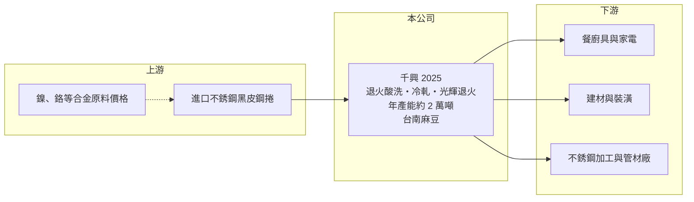

# 2025 千興

> 上市｜[[產業索引-鋼鐵工業|鋼鐵工業]]｜上市（櫃）日期 1996/02/08

# 第一章：企業模式與商業藍圖

> [!info] 撰寫說明
> 精簡版，由 Claude 依公開資料整理，架構比照 [[2330台積電]]，資料截至 2026-10-08。來源：MoneyDJ 理財網財務比率年表（2021 至 2025 年，個別報表）；富果研究 2026 年 7 月法說會備忘錄（製程、產能、減資與私募）；證交所開放資料快照（基本資料、2026 年上半年資產負債與損益、2026 年 8 月營收備註、2025 年度股利、本益比淨值比）。富果備忘錄的資產負債數字與證交所資料不一致，本文財務數字一律採證交所資料。公開資料有限。#待校對

千興不銹鋼成立於 1972 年 5 月、1996 年 2 月上市，總部與工廠在台南麻豆，董事長魏福全、總經理邱麗雲，實收資本額約 17.3 億元。千興的本業是把進口的不銹鋼黑皮鋼捲加工成[[冷軋]]不銹鋼捲，近年歷經減資、私募與經營調整，理解它要同時看「小型冷軋廠的價差生意」與「公司重整的進度」。

- **核心業務：** 千興進口熱軋的[[不銹鋼]]黑皮鋼捲，經連續退火酸洗線處理成白皮鋼捲，再依客戶需求壓延到指定厚度，並經退火、噴砂、電解等程序；客戶有特殊要求時，可再做光輝退火（BA）的高階表面處理（富果整理法說會）。冷軋不銹鋼捲是餐廚具、家電、建材與工業設備的基礎材料。
- **營收結構：** 產品別與客戶別營收比重未查得。公司年產能約 2 萬噸，實際產量依市場需求調整（富果整理法說會）。以 2025 年約 8 億元的營收規模推算，千興在國內不銹鋼冷軋市場屬於小型業者。
- **營運據點：** 總部與工廠位於台南麻豆工業區（證交所基本資料）。原料仰賴進口，因此國際不銹鋼熱軋價格、鎳價與海運時程都直接影響成本。
- **長期方向：** 公司在 2024 年 11 月辦理減資、同年 12 月完成變更登記，2025 年 6 月辦理一次私募；2025 年第二季起因經營層面改變，營收一度縮減（富果整理法說會）。公司表示策略為調整財務結構、強化成本轉嫁能力與優化產品組合。2026 年 8 月營收年增 102%，公司在證交所備註說明是鎳價上漲帶動售價提高，加上去年基期偏低。

# 第二章：護城河深度與競爭優勢

千興的規模小、產品標準化，護城河很窄，長期能否站穩取決於重整後的經營穩定度。

- **競爭優勢：** 千興具備從退火酸洗、壓延到光輝退火的完整冷軋製程，能接小量、特殊厚度與表面要求的訂單，這是大型鋼廠不一定願意承接的利基。不過年產能只有約 2 萬噸，採購議價力與成本攤提都不如大型業者。
- **主要對手：** 國內不銹鋼冷軋業者包括 [[2035唐榮]]、燁聯鋼鐵、[[1605華新]] 旗下不銹鋼事業等大型廠，以及中國、印尼的低價不銹鋼捲。大型廠擁有從煉鋼到冷軋的一貫產線，千興則必須向外購買黑皮鋼捲，在成本上居於劣勢。
- **觀察重點：** MoneyDJ 資料顯示 2022 至 2025 年毛利率皆為負值，2026 年上半年毛利率回到 16.6%、營業利益率 13.6%（證交所資料），轉折幅度很大。長期要看這樣的獲利能否在鎳價回落後維持，以及私募引進的新股東對經營方向的影響（新股東身分未查得）。

# 第三章：財務體質與盈利規模

資料日期：2026-10-08，表格是撰寫當時的快照；最新月營收、毛利率、累計 EPS 由自動排程寫在本筆記的屬性欄位（月營收、毛利率、累計EPS 等）。#待校對

千興過去五年的財務呈現「本業長期虧損、業外大額收益」的特殊型態，2024 年又有減資，因此早年營收金額無法用現有股數推算。

| 年度 | 營收（億元） | [[毛利率]] | [[營業利益率]] | EPS（元） | [[ROE]] |
|---|---|---|---|---|---|
| 2021 | 未查得 | 12.32% | 10.75% | 0.98 | 48.77% |
| 2022 | 未查得 | -8.89% | -11.85% | 2.78 | 72.09% |
| 2023 | 未查得 | -21.10% | -25.35% | 0.81 | 14.39% |
| 2024 | 未查得 | -19.37% | -24.00% | -1.42 | -15.52% |
| 2025 | 約 8.2（推算） | -28.92% | -23.12% | -0.18 | -2.17% |

- **長期指標：** 2022 年稅後淨利率高達 63%，同年負債比率由 2021 年的 64% 降到 3%，顯示公司透過處分資產或債務清理等業外交易大幅降低負債（具體交易未查得）；2022、2023 年的高 ROE 主要來自這類一次性收益，而非本業。2021 年 ROE 48.77% 則是在權益偏低時計算，同樣不具代表性。2025 年度未配發股利（證交所資料），2023 至 2025 年每股現金流量皆為負。
- **[[ROIC]] 與 [[WACC]]：** 2025 年營業利益約 -1.9 億元（營收約 8.2 億元 × -23.12%），稅後約 -1.5 億元。投入資本以 2026 年第二季權益總計 20.9 億元，加上有息負債推估約 1.8 億元（以負債總計 6.1 億元的三成估算，官方快照未拆分）計算，2025 年 ROIC 約 -6.7%（推算），本業在消耗資本；2026 年上半年營業利益 1.23 億元，年化 ROIC 約 8.7%（推算）。WACC 約 6.8%（推算：無風險利率 1.75%、市場風險溢酬 6%、β 取鋼鐵同業常見值 0.9，股東權益成本 7.15%；稅前負債成本 2.5%、稅率 20%，以市值約 24 億元與負債 1.8 億元計算權重約 93：7）。過去四年 ROIC 遠低於 WACC，2026 年上半年首度高於，但只有半年資料，還不能視為長期創造價值。
- **財務特色：** 2026 年第二季總資產 26.9 億元、負債 6.1 億元，負債比率約 23%，每股淨值 12.08 元。2026 年上半年營收 9.0 億元、[[毛利率]] 16.6%、營業利益率 13.6%、EPS 0.76 元（證交所資料）。

# 第四章：總體風險與地緣政治

千興的風險集中在鎳價循環、小規模冷軋廠的成本劣勢，以及公司重整後的治理與經營連續性。

- **產業週期：** 不銹鋼價格由鎳價主導，而鎳價又受印尼[[鎳生鐵]]產能擴張影響，長期呈現供給過剩、價格易跌難漲的格局。千興進口黑皮鋼捲、加工後出售，進貨到出貨有時間差，鎳價上漲時有庫存利益，下跌時則要提列[[存貨跌價損失]]；2026 年的獲利改善很大一部分來自鎳價上漲，這種利益會隨價格反轉而消失。
- **營運風險：** 2025 年第二季起因經營層面改變導致營收縮減，顯示公司營運對經營團隊與資金調度的依賴很高。年產能僅約 2 萬噸，接單規模有限，費用與折舊分攤不易，營收稍有下滑就容易轉為虧損。
- **其他風險：** 原料全靠進口，匯率與國際運費直接影響成本；中國、印尼的低價不銹鋼捲大量出口，加上各國的[[反傾銷]]措施，使亞洲不銹鋼價格長期承壓。減資、私募等資本動作頻繁，股權結構變化對小股東權益的影響也需留意。

# 專有名詞解析

## 金融

- **[[存貨跌價損失]]**：存貨的市價低於帳面成本時，依會計規定須認列的損失，會直接壓低毛利率。
- **[[ROIC]]**：投入資本報酬率，稅後營業利益除以股東權益加有息負債，衡量本業運用資本的效率。
- **[[WACC]]**：加權平均資金成本，股東與債權人要求報酬率的加權平均，是 ROIC 要超越的門檻。

## 產業

- **[[冷軋]]**：在常溫下把熱軋鋼捲再壓薄的製程，可得到較薄、表面較平滑、尺寸較精確的鋼材。
- **[[不銹鋼]]**：含鉻、鎳等合金元素的耐腐蝕鋼材，鎳價是主要成本，價格隨鎳價波動。
- **[[鎳生鐵]]**：以紅土鎳礦冶煉出的含鎳生鐵，是生產不銹鋼的低成本鎳原料，印尼為主要產地。
- **[[反傾銷]]**：進口國對低於正常價格銷售的進口商品加徵關稅的貿易救濟措施。

# 核心供應鏈

- 上游：進口不銹鋼熱軋黑皮鋼捲（供應國與供應商未查得）；鎳價與鎳生鐵供給決定原料成本。
- 下游／客戶：餐廚具、家電、建材與不銹鋼二次加工業者（具名客戶未查得），二次加工同業如 [[2032新鋼]]。
- 同業：[[2035唐榮]]、[[1605華新]]、燁聯鋼鐵；中國與印尼不銹鋼廠。

## 最新新聞
<!-- news:start（自動產生，請勿手動編輯此範圍） -->
- 2026-10-20 🏛️ 重訊 15:31｜公告本公司現金增資認股基準日及相關事宜(補充公告 每股發行價格、代收股款及存儲款項機構)｜[觀測站](https://mops.twse.com.tw/mops/#/web/t05st01)
- 2026-10-12 🏛️ 重訊 17:24｜公告本公司現金增資認股基準日及相關事宜｜[觀測站](https://mops.twse.com.tw/mops/#/web/t05st01)
- 2026-10-05 📰 媒體 18:50｜營收速報 - 千興(2025)9月營收1.59億元年增率高達163.03％｜[鉅亨網](https://news.cnyes.com/news/id/6621904)

完整紀錄：[[2025千興 新聞]]
<!-- news:end -->

## 相關連結
- [公開資訊觀測站](https://mopsov.twse.com.tw/mops/web/t05st03?step=1&firstin=1&co_id=2025)
- [Goodinfo](https://goodinfo.tw/tw/StockDetail.asp?STOCK_ID=2025)
- [Yahoo 股市](https://tw.stock.yahoo.com/quote/2025)
- [鉅亨網新聞](https://www.cnyes.com/twstock/2025/news)
