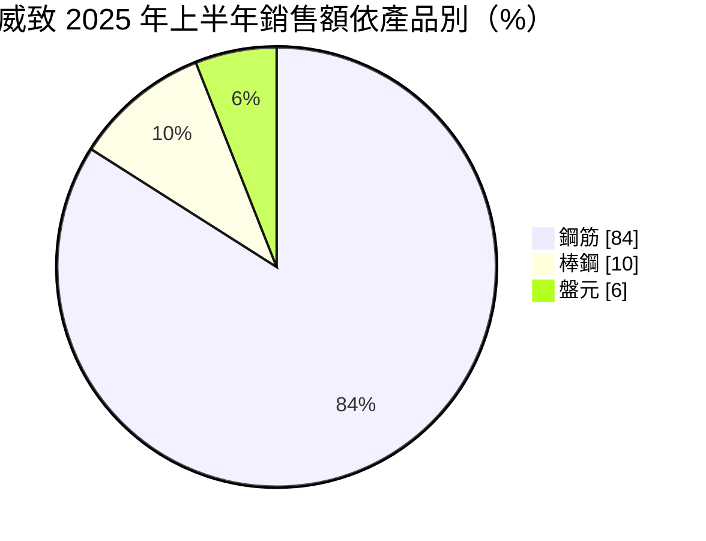
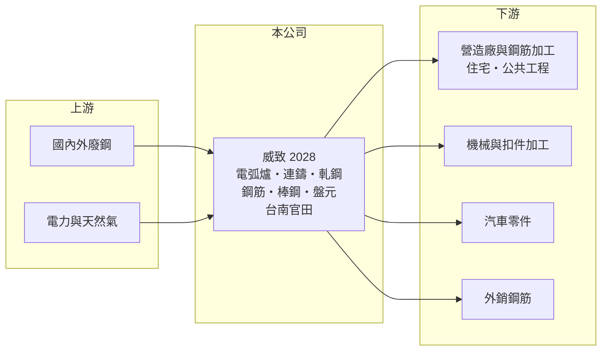

# 2028 威致

> 上市｜[[產業索引-鋼鐵工業|鋼鐵工業]]｜上市（櫃）日期 1996/12/13

# 第一章：企業模式與商業藍圖

> [!info] 撰寫說明
> 精簡版，由 Claude 依公開資料整理，架構比照 [[2330台積電]]，資料截至 2026-10-08。來源：MoneyDJ 理財網財務比率年表（2021 至 2025 年）；富果研究 2025 年 8 月法說會備忘錄（產品銷售額、製程、資本支出、認證與減碳）；證交所開放資料快照（基本資料、2026 年上半年資產負債與損益、股利、本益比淨值比）。營收金額由每股營業額乘以約 3.26 億股推算。#待校對

威致鋼鐵工業成立於 1982 年 10 月、1996 年 12 月上市，總部與工廠在台南官田，董事長兼總經理為郭素惠，實收資本額約 32.6 億元。威致是以[[電弧爐]]煉鋼、再軋成條鋼的煉軋一貫鋼廠，主力是營建用的[[鋼筋]]，理解它要抓住「廢鋼與鋼筋的價差」以及「往棒鋼、盤元等高附加價值產品移動」兩件事。

- **核心業務：** 威致以[[廢鋼]]為主要原料，經電弧爐熔煉、精煉爐調整成分、連續澆鑄成鋼胚，再軋成鋼筋、棒鋼與[[盤元]]。鋼筋用於住宅與公共工程，棒鋼（Φ13～60 mm）與盤元（Φ13～45 mm）則供應機械、扣件與汽車零件加工。這種「小鋼廠」模式投資較小、開停爐彈性大，獲利主要來自鋼筋售價與廢鋼成本之間的價差。
- **營收結構：** 依富果整理的 2025 年 8 月法說會，2025 年上半年銷售額 45.8 億元，其中鋼筋 38.6 億元、棒鋼 4.7 億元、盤元 2.5 億元，銷量合計 24.1 萬噸；鋼胚因市價低廉，外售量幾乎歸零。外銷占比由前一年同期的 2% 升到 12%，主要是鋼筋。
- **營運據點：** 生產基地在台南官田（證交所基本資料），採煉、軋一貫作業。2024 年資本支出 9.8 億元，其中 5.64 億元用於購置新的鋼筋加工廠土地；軋鋼加熱爐與連鑄盛鋼桶預熱設備已改用天然氣，太陽光電系統預計 2025 年完工供電（富果整理法說會）。
- **長期方向：** 公司策略是提高國內鋼筋直接客戶的市占率、提高棒鋼與盤元在高附加價值市場的比重，並申請國際綠色鋼品認證。2024 年 9 月取得汽車業品質系統 IATF 16949 驗證，作為切入汽車零件供應鏈的基礎；同年取得產品環境宣告（EPD）與碳足跡驗證。從鋼筋加工廠與低碳認證的布局看，經營層想把威致從單純賣鋼筋，轉向提供加工後鋼筋與低碳鋼品的服務。

# 第二章：護城河深度與競爭優勢

威致的競爭力來自電爐小鋼廠的成本彈性與南部營建市場的地緣，但鋼筋是高度同質的商品，護城河有限。

- **競爭優勢：** 電弧爐鋼廠可以依訂單與電價彈性調整產量，不必像高爐廠一樣長期滿載，在景氣低迷時較能控制損失。威致位於台南，鄰近南部科學園區與大型公共工程，鋼筋運輸成本相對低。往加工鋼筋（裁切、彎曲後直送工地）延伸，可以提高對營造廠的服務黏著度。
- **主要對手：** 鋼筋市場的主要競爭者包括 [[2015豐興]]、[[2006東和鋼鐵]]、[[2038海光]] 等電爐廠；棒鋼與盤元則與 [[2002中鋼]]、[[2012春雨]] 等業者重疊。國內鋼筋價格大致跟隨大廠的盤價，威致較屬於價格跟隨者。
- **觀察重點：** 2021 年營業利益率 14.46%、ROE 43.29%，之後逐年下滑到 2025 年的 1.63% 與 1.9%，說明鋼筋利差高度依賴營建景氣。長期要看棒鋼與盤元比重能否提升、汽車零件客戶能否放量，以及低碳鋼品能否在公共工程採購中取得溢價。

# 第三章：財務體質與盈利規模

資料日期：2026-10-08，表格是撰寫當時的快照；最新月營收、毛利率、累計 EPS 由自動排程寫在本筆記的屬性欄位（月營收、毛利率、累計EPS 等）。#待校對

威致營收由 2021 年約 136 億元下滑到 2025 年約 86 億元，獲利也隨鋼筋利差收斂而逐年下降，但五年都維持獲利。

| 年度 | 營收（億元） | [[毛利率]] | [[營業利益率]] | EPS（元） | [[ROE]] |
|---|---|---|---|---|---|
| 2021 | 約 136（推算） | 16.74% | 14.46% | 5.11 | 43.29% |
| 2022 | 約 132（推算） | 8.57% | 7.04% | 2.30 | 16.63% |
| 2023 | 約 105（推算） | 6.53% | 4.84% | 1.28 | 9.43% |
| 2024 | 約 103（推算） | 5.46% | 3.70% | 0.98 | 6.93% |
| 2025 | 約 86（推算） | 3.93% | 1.63% | 0.28 | 1.90% |

- **長期指標：** 2021 至 2025 年營收年複合成長率約 -11%（推算），近 5 年平均 ROE 約 15.6%（推算），但主要由 2021 至 2022 年拉高，近三年 ROE 都在一成以下。公司採季度或半年度分派盈餘，2025 年第四季與 2026 年上半年各配發現金股利 0.2 元，2026 年第一季未配發（證交所資料）。2025 年每股現金流量 5.09 元，明顯高於 EPS，負債比率由 2024 年的 52.9% 降到 43.2%。
- **[[ROIC]] 與 [[WACC]]：** 2025 年營業利益約 1.4 億元（營收約 85.6 億元 × 1.63%），稅後約 1.1 億元。投入資本以 2026 年第二季權益總計 47.9 億元，加上有息負債推估約 22.7 億元（以負債總計 37.9 億元的六成估算，官方快照未拆分）計算，ROIC 約 1.6%（推算）；2021 年高峰約 22%（推算），2026 年上半年年化約 3%（推算）。WACC 約 5.6%（推算：無風險利率 1.75%、市場風險溢酬 6%、β 取鋼鐵同業常見值 0.9，股東權益成本 7.15%；稅前負債成本 2.5%、稅率 20%，以市值約 55 億元與負債 22.7 億元計算權重約 71：29）。高峰期 ROIC 遠高於 WACC，低谷期則明顯低於，這是電爐鋼廠的典型型態，長期價值取決於整個週期的平均。
- **財務特色：** 2026 年第二季總資產 85.8 億元、負債 37.9 億元，負債比率約 44%，每股淨值 14.77 元。2026 年上半年營收 47.4 億元、[[毛利率]] 5.3%、營業利益率 3.0%、EPS 0.37 元（證交所資料）。

# 第四章：總體風險與地緣政治

威致的風險集中在營建景氣、廢鋼與電價成本，以及減碳法規帶來的成本與機會。

- **產業週期：** 鋼筋需求跟隨房市與公共工程，售價跟隨國際廢鋼價格；當營建景氣轉弱、廢鋼價格又居高不下時，利差會被兩頭擠壓。2022 年後利差持續縮小，就是房市降溫與進口鋼筋競爭共同造成的。鋼價下跌期間，廢鋼與成品庫存也可能提列[[存貨跌價損失]]。
- **營運風險：** 電弧爐是用電大戶，台灣工業電價調漲會直接墊高成本；鋼筋占銷售額八成以上，產品集中度高。新鋼筋加工廠與汽車零件市場若推進不如預期，資本支出的報酬會被拉長。
- **其他風險：** 碳費與歐盟碳邊境調整機制（CBAM）會提高高碳排產品的成本，電爐鋼廠的碳排低於高爐，若能取得綠色鋼品認證，反而可能成為優勢。進口鋼筋、廢鋼出口政策與匯率，也會影響成本與售價。

# 專有名詞解析

## 金融

- **[[存貨跌價損失]]**：存貨的市價低於帳面成本時，依會計規定須認列的損失，會直接壓低毛利率。
- **[[ROIC]]**：投入資本報酬率，稅後營業利益除以股東權益加有息負債，衡量本業運用資本的效率。
- **[[WACC]]**：加權平均資金成本，股東與債權人要求報酬率的加權平均，是 ROIC 要超越的門檻。

## 產業

- **[[電弧爐]]**：以電力產生電弧熔化廢鋼的煉鋼設備，投資較小、碳排較低，台灣多數民營鋼廠採用。
- **[[鋼筋]]**：埋在混凝土中提供抗拉強度的條狀鋼材，規格標準化，是住宅與公共工程的主要用鋼。
- **[[廢鋼]]**：回收的鋼鐵料，是電弧爐的主要原料，價格隨國際供需每日變動，占電爐廠成本最大比重。
- **[[盤元]]**：熱軋後捲成盤狀的圓形條鋼，是抽製鋼線、螺絲與彈簧的原料。

# 核心供應鏈

- 上游：國內外廢鋼貿易商與回收業者、台電與天然氣供應（具名供應商未查得）。
- 下游／客戶：營造廠與鋼筋加工業者、機械與扣件加工廠、汽車零件廠（IATF 16949 認證後開發中）、外銷客戶（具名客戶未查得）。
- 同業：[[2015豐興]]、[[2006東和鋼鐵]]、[[2038海光]]、[[2002中鋼]]（棒線）、[[2012春雨]]。

## 最新新聞
<!-- news:start（自動產生，請勿手動編輯此範圍） -->
- 2026-10-06 🏛️ 重訊 15:48｜公告本公司115年上半年度股利之除息基準日｜[觀測站](https://mops.twse.com.tw/mops/#/web/t05st01)

完整紀錄：[[2028威致 新聞]]
<!-- news:end -->

## 相關連結
- [公開資訊觀測站](https://mopsov.twse.com.tw/mops/web/t05st03?step=1&firstin=1&co_id=2028)
- [Goodinfo](https://goodinfo.tw/tw/StockDetail.asp?STOCK_ID=2028)
- [Yahoo 股市](https://tw.stock.yahoo.com/quote/2028)
- [鉅亨網新聞](https://www.cnyes.com/twstock/2028/news)
