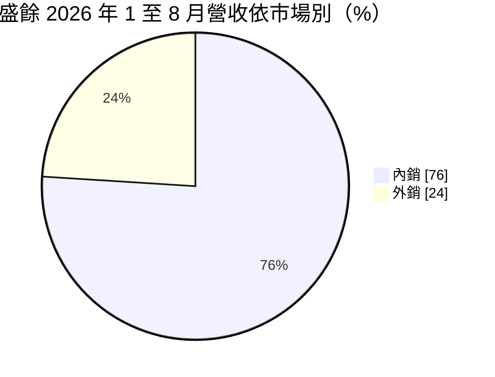
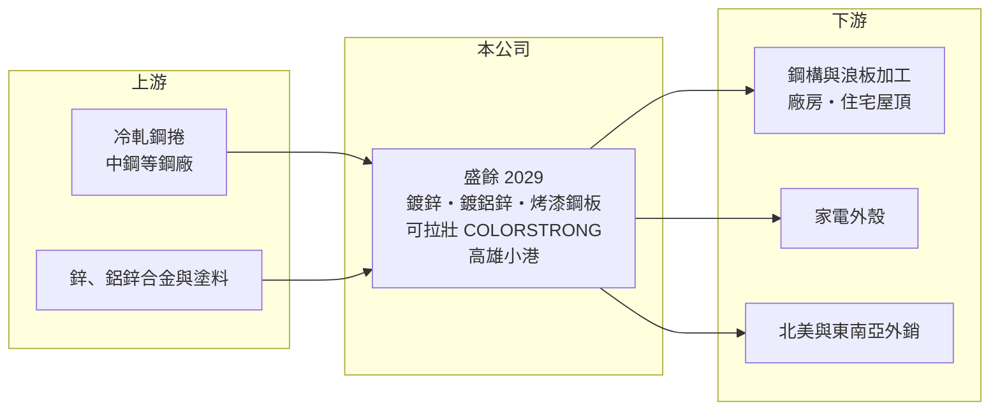

# 2029 盛餘

> 上市｜[[產業索引-鋼鐵工業|鋼鐵工業]]｜上市（櫃）日期 1997/01/11

# 第一章：企業模式與商業藍圖

> [!info] 撰寫說明
> 精簡版，由 Claude 依公開資料整理，架構比照 [[2330台積電]]，資料截至 2026-10-08。來源：MoneyDJ 理財網財務比率年表（2021 至 2025 年）；富果研究 2026 年 9 月法說會備忘錄（產品、品牌、內外銷、產能利用率、研發與 2026 年上半年財務）；證交所開放資料快照（基本資料、2026 年上半年資產負債與損益、2025 年度股利、本益比淨值比）。營收金額由每股營業額乘以約 3.21 億股推算；日系股東關係憑整理性知識撰寫，標示待校對。#待校對

盛餘成立於 1973 年 5 月、1997 年 1 月上市，總部與工廠在高雄小港，董事長樽宮浩一、總經理洪世強，實收資本額約 32.1 億元。盛餘以「可拉壯（COLORSTRONG）」品牌的[[烤漆鋼板]]聞名，董事長由日籍人士擔任，反映其日系鋼廠股東背景（日本製鐵體系，待校對），理解它要抓住「品牌彩鋼＋日系技術＋低負債」三個特點。

- **核心業務：** 盛餘以冷軋鋼捲為基材，生產[[鍍鋅鋼捲]]、鍍鋁鋅鋼板與烤漆鋼板，主力品牌為可拉壯系列，法說會稱其為國內烤漆鋼品市占第一的品牌（富果整理）。產品用於廠房與住宅屋頂、牆板、鋼構建築，以及家電外殼。烤漆鋼板的價值在於塗料配方、耐候年限與顏色穩定度，比單純鍍鋅鋼捲更能建立品牌。
- **營收結構：** 產品別營收比重未查得。依富果整理的 2026 年 9 月法說會，2026 年前八個月內銷約 76%、外銷約 24%，公司表示近年比例穩定；外銷以北美為主，需求來自 AI 資料中心、電力基礎建設與製造業投資帶動的廠房興建。
- **營運據點：** 生產集中在高雄小港廠區，產能利用率約 70% 至 80%，目前沒有擴產計畫（富果整理法說會）。廠區鄰近 [[2002中鋼]] 小港廠，原料取得與運輸具地利之便（實際採購比重未查得）。2026 年第三季完成「聯莊盛餘」股權轉讓的交割（轉投資內容未查得）。
- **長期方向：** 盛餘的策略是提高低碳與環保鋼品等高附加價值產品比重。2024 年 10 月起導入低 VOC 背漆，2025 年開發水性烤漆鋼板、印刷烤漆鋼板與超耐候低光澤鋼板，2026 年 7 月改良配方量產，溶劑用量降低約 33%；2026 年計畫開發家電用消光鋼板、氟改質高耐候鋼板與抗菌烤漆鋼板（富果整理法說會）。經營層以研發與產品組合取代擴產，資本支出相對保守。

# 第二章：護城河深度與競爭優勢

盛餘的護城河來自品牌與塗裝技術，在同質化的鍍鋅鋼品市場中屬於少數有品牌溢價的業者。

- **競爭優勢：** 建築師、鋼構廠與業主選用烤漆鋼板時，重視耐候年限、褪色保證與色彩一致性，長期使用經驗累積出的品牌信任很難在短期內取代。盛餘的塗料配方與塗裝技術有日系背景支援（待校對），加上專利設計的印刷烤漆產品，使它能在國內維持較高的市占與定價。
- **主要對手：** 國內主要對手是規模更大的 [[2023燁輝]]，以及中鋼集團的表面處理鋼品業者；外銷市場則面對中國、韓國、越南的大型彩鋼廠。東南亞市場受中國鋼材競爭與馬來西亞[[反傾銷]]調查影響，盛餘因此把外銷重心放在北美。
- **觀察重點：** 2021 至 2025 年毛利率約 9.4% 至 15%，2026 年上半年回升到 15.5%，其中包含跌價損失回沖約 4,400 萬元（富果整理法說會）。長期要看環保與高耐候產品能否讓毛利率穩定在一成以上，以及北美外銷能否在關稅政策下持續。

# 第三章：財務體質與盈利規模

資料日期：2026-10-08，表格是撰寫當時的快照；最新月營收、毛利率、累計 EPS 由自動排程寫在本筆記的屬性欄位（月營收、毛利率、累計EPS 等）。#待校對

盛餘營收在 2021 至 2025 年間維持在 124 億至 144 億元之間，五年都有獲利，但 ROE 在 2021 年後多數年度落在 2% 至 6%。

| 年度 | 營收（億元） | [[毛利率]] | [[營業利益率]] | EPS（元） | [[ROE]] |
|---|---|---|---|---|---|
| 2021 | 約 144（推算） | 14.96% | 10.86% | 3.94 | 13.58% |
| 2022 | 約 128（推算） | 9.44% | 4.14% | 1.57 | 5.02% |
| 2023 | 約 124（推算） | 10.96% | 6.04% | 1.95 | 6.37% |
| 2024 | 約 137（推算） | 9.60% | 4.57% | 1.81 | 5.81% |
| 2025 | 約 133（推算） | 10.30% | 2.22% | 0.74 | 2.47% |

- **長期指標：** 2021 至 2025 年營收年複合成長率約 -2%（推算），近 5 年平均 ROE 約 6.7%（推算）。負債比率長年只有 8% 至 15%，2026 年第二季流動金融資產約 12 億元（富果整理法說會），財務結構非常保守。2025 年度現金股利 0.6 元，約為 EPS 0.74 元的八成（證交所資料）；每股現金流量五年皆為正。
- **[[ROIC]] 與 [[WACC]]：** 2025 年營業利益約 3.0 億元（營收約 132.7 億元 × 2.22%），稅後約 2.4 億元。投入資本以 2026 年第二季權益總計 102.9 億元，加上有息負債推估約 1.4 億元（以負債總計 14.4 億元的一成估算，官方快照未拆分）計算，ROIC 約 2.3%（推算）；2026 年上半年年化約 5%（推算），2021 年約 12%（推算）。WACC 約 7.0%（推算：無風險利率 1.75%、市場風險溢酬 6%、β 取鋼鐵同業常見值 0.9，股東權益成本 7.15%；稅前負債成本 2.5%、稅率 20%，幾乎全由股東權益支應，以市值約 69 億元計算權重約 98：2）。除 2021 年外 ROIC 都低於 WACC；低負債讓公司很安全，但也代表大量權益資本停在低報酬的狀態。
- **財務特色：** 2026 年第二季總資產 117.4 億元、負債 14.4 億元，負債比率約 12%，每股淨值 31.76 元。2026 年上半年營收 67.1 億元、[[毛利率]] 15.5%、營業利益率 5.2%、EPS 0.98 元（證交所資料）。

# 第四章：總體風險與地緣政治

盛餘的風險在於鋼價與鋅價的循環、亞洲彩鋼的價格競爭，以及北美外銷的貿易政策。

- **產業週期：** 原料冷軋鋼捲與鋅錠價格波動時，盛餘約 40 天的原料庫存（富果整理法說會）會產生庫存利益或[[存貨跌價損失]]，2026 年上半年的跌價回沖就是一例。下游需求跟隨廠房興建與營建景氣，國內客戶在價格下跌期會延後補庫存。
- **營運風險：** 產能利用率約七至八成，固定成本分攤仍有改善空間；不擴產的策略雖然降低風險，也限制了成長。環保塗料與新產品的研發成果需要時間轉換成營收，短期貢獻有限。
- **其他風險：** 外銷以北美為主，美國對進口鋼品的關稅政策是最大外部變數；東南亞市場有反傾銷調查。日系股東的策略調整（例如轉投資處分）可能影響公司方向，新台幣升值也會壓縮外銷報價。

# 專有名詞解析

## 金融

- **[[存貨跌價損失]]**：存貨的市價低於帳面成本時，依會計規定須認列的損失，會直接壓低毛利率。
- **[[ROIC]]**：投入資本報酬率，稅後營業利益除以股東權益加有息負債，衡量本業運用資本的效率。
- **[[WACC]]**：加權平均資金成本，股東與債權人要求報酬率的加權平均，是 ROIC 要超越的門檻。

## 產業

- **[[烤漆鋼板]]**：在鍍鋅或鍍鋁鋅鋼板上塗佈並烘烤塗料的彩色鋼板，又稱彩鋼，用於廠房屋頂、牆面與家電。
- **[[鍍鋅鋼捲]]**：在冷軋鋼捲表面鍍上一層鋅以防鏽的鋼材，用於建築屋頂、牆板、家電外殼與鋼構。
- **[[反傾銷]]**：進口國對低於正常價格銷售的進口商品加徵關稅的貿易救濟措施。

# 核心供應鏈

- 上游：冷軋鋼捲供應商，國內主要為 [[2002中鋼]]（實際採購比重未查得）；鋅錠、鋁鋅合金與塗料供應商，部分樹脂由日本引進。
- 下游／客戶：鋼構廠與浪板加工業者、建築業主、家電廠，以及北美為主的外銷客戶（具名客戶未查得）。
- 同業：[[2023燁輝]]、[[2014中鴻]]；中國、韓國、越南彩鋼廠。

## 最新新聞
<!-- news:start -->
<!-- news:end -->

## 相關連結
- [公開資訊觀測站](https://mopsov.twse.com.tw/mops/web/t05st03?step=1&firstin=1&co_id=2029)
- [Goodinfo](https://goodinfo.tw/tw/StockDetail.asp?STOCK_ID=2029)
- [Yahoo 股市](https://tw.stock.yahoo.com/quote/2029)
- [鉅亨網新聞](https://www.cnyes.com/twstock/2029/news)
