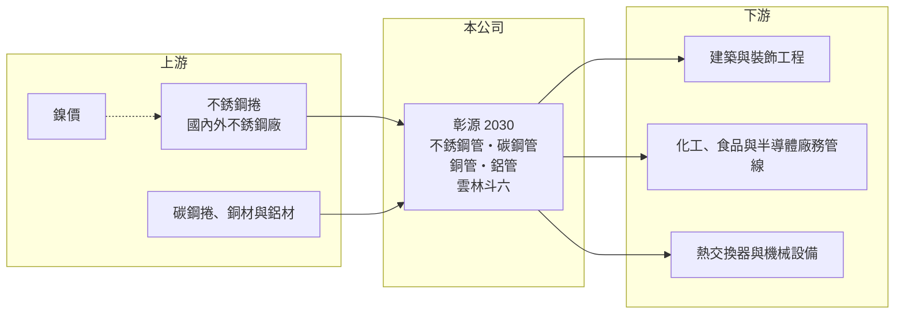

# 2030 彰源

> 上市｜[[產業索引-鋼鐵工業|鋼鐵工業]]｜上市（櫃）日期 1998/12/24

# 第一章：企業模式與商業藍圖

> [!info] 撰寫說明
> 精簡版，由 Claude 依公開資料整理，架構比照 [[2330台積電]]，資料截至 2026-10-08。來源：MoneyDJ 理財網財務比率年表（2021 至 2025 年）；nStock 個股頁（業務範圍、2025 年營收、股利統計）；證交所開放資料快照（基本資料、2026 年上半年資產負債與損益、2026 年 8 月營收備註、2025 年度股利、本益比淨值比）。2021 至 2024 年營收由每股營業額乘以約 2.81 億股推算。公開資料有限，產品比重與外銷市場未查得。#待校對

彰源企業成立於 1984 年 10 月、1998 年 12 月上市，總部與工廠在雲林斗六工業區，董事長兼總經理為張炳耀，實收資本額約 28.1 億元。彰源以[[不銹鋼]]管為主，也生產碳鋼管、銅管與鋁管，理解它要抓住「鎳價決定售價、加工價差決定獲利」這個不銹鋼加工業的基本邏輯。

- **核心業務：** 彰源從事各種不銹鋼管、鋼管、銅管、鋁管及相關產品的製造與買賣（nStock 整理的營業項目）。不銹鋼[[焊接鋼管]]是把不銹鋼捲分條後捲圓、焊接、熱處理與研磨製成，用於建築裝飾與結構、化工與食品設備管線、半導體廠務、熱交換器與汽機車零件。
- **營收結構：** 產品別與地區別營收比重未查得。2025 年全年營收約 101.5 億元（nStock），規模與 [[2034允強]] 相近，屬國內主要的不銹鋼管廠之一。2026 年 8 月營收年增 57.7%，公司在證交所備註說明是鎳價走揚、需求上升與去年低基期所致，說明營收高度連動鎳價。
- **營運據點：** 總部與工廠位於雲林斗六工業區（證交所基本資料）。海外據點與產能數字未查得。
- **長期方向：** 公開資料未查得具體的擴產或轉型計畫。從產品線看，彰源同時經營不銹鋼、碳鋼、銅與鋁管材，長期策略推估是以多材質、多規格的管材組合服務工業與建築客戶，降低單一金屬價格循環的影響（推估）。

# 第二章：護城河深度與競爭優勢

彰源的競爭力在於管材規格齊全與加工經驗，但不銹鋼管屬於全球競爭的標準品，護城河偏窄。

- **競爭優勢：** 不銹鋼管的客戶重視焊道品質、尺寸精度與各國規範認證，長期經營累積的認證與客戶名單是基本門檻。彰源同時具備多種金屬管材的生產能力，可以一次滿足工程與設備廠的多樣需求。不過管材的定價方式是原料成本加上加工費，加工費高低取決於市場供需，議價力有限。
- **主要對手：** 國內同業包括 [[2034允強]]、[[2020美亞]]、[[2027大成鋼]]（不銹鋼管與通路）；國際上面對中國、印度、越南的大量不銹鋼管產能。不銹鋼管是各國[[反傾銷]]的常見標的，外銷市場的進入條件常因貿易政策而改變。
- **觀察重點：** 營業利益率由 2021 年的 11.33% 降到 2023 年的 1.95%，2026 年上半年回升到 10.3%（證交所資料），擺動幅度很大。長期要看鎳價上升期的獲利能否累積成實質的股東權益成長，以及在鎳價回落期能否避免大額跌價損失。

# 第三章：財務體質與盈利規模

資料日期：2026-10-08，表格是撰寫當時的快照；最新月營收、毛利率、累計 EPS 由自動排程寫在本筆記的屬性欄位（月營收、毛利率、累計EPS 等）。#待校對

彰源營收由 2022 年約 163 億元的高點降到 2025 年約 101 億元，獲利則呈現明顯的鎳價週期，2023 年接近損益兩平。

| 年度 | 營收（億元） | [[毛利率]] | [[營業利益率]] | EPS（元） | [[ROE]] |
|---|---|---|---|---|---|
| 2021 | 約 152（推算） | 18.48% | 11.33% | 4.29 | 27.18% |
| 2022 | 約 163（推算） | 13.42% | 7.11% | 2.64 | 14.56% |
| 2023 | 約 129（推算） | 7.29% | 1.95% | 0.18 | 1.01% |
| 2024 | 約 125（推算） | 9.74% | 3.27% | 0.84 | 4.77% |
| 2025 | 101.5 | 9.35% | 2.18% | 0.35 | 1.95% |

- **長期指標：** 2021 至 2025 年營收年複合成長率約 -9%（推算），近 5 年平均 ROE 約 9.9%（推算）。nStock 統計近五年平均現金股利約 1.04 元，2024 年現金配發率約 85%；2025 年度現金股利 0.5 元，高於當年 EPS 0.35 元（證交所資料），代表公司願意動用保留盈餘維持配息。每股現金流量除 2021 年外皆為正，負債比率長年在 57% 至 66% 之間，相對偏高。
- **[[ROIC]] 與 [[WACC]]：** 2025 年營業利益約 2.2 億元（營收約 101.5 億元 × 2.18%），稅後約 1.8 億元。投入資本以 2026 年第二季權益總計 53.3 億元，加上有息負債推估約 59 億元（以負債總計 78.8 億元的七成五估算，官方快照未拆分）計算，ROIC 約 1.6%（推算）；2021 年約 12%（推算），2026 年上半年年化約 8.6%（推算）。WACC 約 5.3%（推算：無風險利率 1.75%、市場風險溢酬 6%、β 取鋼鐵同業常見值 0.9，股東權益成本 7.15%；稅前負債成本 2.5%、稅率 20%，以市值約 103 億元與負債 59 億元計算權重約 64：36）。ROIC 在鎳價上升期高於 WACC、下跌期低於 WACC，整個週期平均大致與資金成本相當，價值創造取決於能否在高峰期累積足夠的利潤。
- **財務特色：** 2026 年第二季總資產 132.0 億元、負債 78.8 億元，負債比率約 60%，每股淨值 19.30 元。2026 年上半年營收 58.2 億元、[[毛利率]] 17.1%、營業利益率 10.3%、EPS 1.66 元（證交所資料），已超過 2023 至 2025 年任一整年。

# 第四章：總體風險與地緣政治

彰源的風險集中在鎳價循環、偏高的財務槓桿，以及不銹鋼管的國際貿易壁壘。

- **產業週期：** 不銹鋼管售價隨鎳價與不銹鋼捲價格調整，鎳價上漲時，低價庫存帶來額外利潤；鎳價下跌時則須提列[[存貨跌價損失]]，且客戶延後下單。印尼[[鎳生鐵]]產能持續擴張，使鎳價長期呈現易跌難漲的結構，2026 年的鎳價上漲能否延續，直接決定獲利高度。
- **營運風險：** 負債比率約六成，原料庫存與應收帳款需要大量營運資金，鎳價上漲時借款需求同步增加。營收與獲利波動大，景氣低迷時 ROE 可能接近零，配息若高於獲利，長期會侵蝕保留盈餘。
- **其他風險：** 美國、歐盟等市場對不銹鋼管的[[反傾銷]]與關稅措施，中國與印度的低價出口，以及新台幣匯率變動，都會影響外銷報價與接單（彰源的外銷比重未查得）。

# 專有名詞解析

## 金融

- **[[存貨跌價損失]]**：存貨的市價低於帳面成本時，依會計規定須認列的損失，會直接壓低毛利率。
- **[[ROIC]]**：投入資本報酬率，稅後營業利益除以股東權益加有息負債，衡量本業運用資本的效率。
- **[[WACC]]**：加權平均資金成本，股東與債權人要求報酬率的加權平均，是 ROIC 要超越的門檻。

## 產業

- **[[不銹鋼]]**：含鉻、鎳等合金元素的耐腐蝕鋼材，鎳價是主要成本，價格隨鎳價波動。
- **[[焊接鋼管]]**：把鋼帶捲成圓形後沿接縫焊合製成的鋼管，用於建築結構、管線輸送與機械零件。
- **[[鎳生鐵]]**：以紅土鎳礦冶煉出的含鎳生鐵，是生產不銹鋼的低成本鎳原料，印尼為主要產地。
- **[[反傾銷]]**：進口國對低於正常價格銷售的進口商品加徵關稅的貿易救濟措施。

# 核心供應鏈

- 上游：不銹鋼捲供應商，國內如 [[2035唐榮]]、[[1605華新]]、燁聯鋼鐵（實際採購對象與比重未查得）；碳鋼捲供應商如 [[2002中鋼]]。
- 下游／客戶：建築與工程業者、化工與食品設備廠、半導體廠務工程、熱交換器與機械設備廠（具名客戶未查得）。
- 同業：[[2034允強]]、[[2020美亞]]、[[2027大成鋼]]；中國、印度、越南不銹鋼管廠。

## 最新新聞
<!-- news:start -->
<!-- news:end -->

## 相關連結
- [公開資訊觀測站](https://mopsov.twse.com.tw/mops/web/t05st03?step=1&firstin=1&co_id=2030)
- [Goodinfo](https://goodinfo.tw/tw/StockDetail.asp?STOCK_ID=2030)
- [Yahoo 股市](https://tw.stock.yahoo.com/quote/2030)
- [鉅亨網新聞](https://www.cnyes.com/twstock/2030/news)
