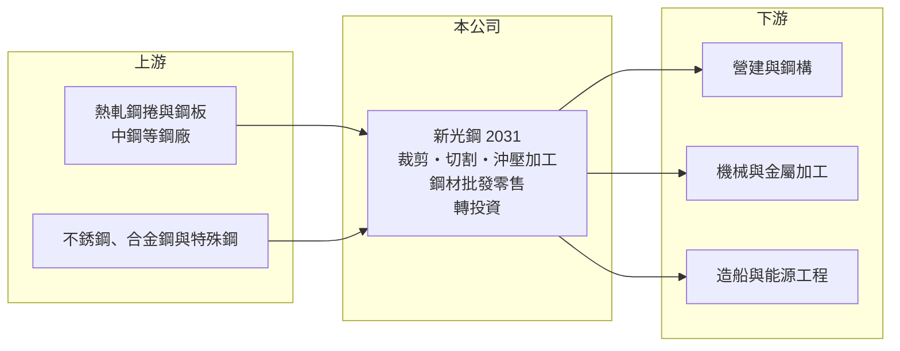

# 2031 新光鋼

> 上市｜[[產業索引-鋼鐵工業|鋼鐵工業]]｜上市（櫃）日期 2000/09/11

# 第一章：企業模式與商業藍圖

> [!info] 撰寫說明
> 精簡版，由 Claude 依公開資料整理，架構比照 [[2330台積電]]，資料截至 2026-10-08。來源：MoneyDJ 理財網財務比率年表（2021 至 2025 年）；nStock 個股頁（營業項目、公司沿革、2025 年營收、股利統計）；證交所開放資料快照（基本資料、2026 年上半年資產負債與損益、2025 年度股利、本益比淨值比）。2021 至 2024 年營收由每股營業額乘以約 3.21 億股推算。營收比重、加工據點與轉投資明細未查得；與中鋼的往來關係憑整理性知識撰寫，標示待校對。#待校對

新光鋼鐵創立於 1967 年 1 月，1997 年 4 月上櫃、2000 年 9 月轉上市，總部在新北三重，董事長粟明德、總經理曾明山，實收資本額約 32.1 億元。新光鋼是台灣規模最大的[[鋼材加工中心]]之一（待校對），本身不煉鋼，而是向鋼廠買進鋼捲、鋼板，依客戶需求裁切加工後出貨，理解它要抓住「加工服務＋庫存管理＋轉投資」三條獲利線。

- **核心業務：** 新光鋼的營業項目包括鋼捲、鋼板、圓鋼棒、[[不銹鋼]]、合金鋼、特殊鋼與耐候抗鹽化腐蝕建築材料的裁剪、切割、沖壓等加工，以及批發與零售（nStock 整理）。客戶不必自行購買整卷鋼材與加工設備，而是向新光鋼買切好尺寸的料件，新光鋼賺的是加工費與鋼材的進銷價差。
- **營收結構：** 產品與客戶別營收比重未查得。2025 年全年營收約 168.0 億元（nStock），是本批鋼鐵股中營收規模僅次於燁輝的公司。主要原料為 [[2002中鋼]] 等鋼廠的[[熱軋鋼捲]]與鋼板（往來比重待校對），下游涵蓋營建鋼構、機械、造船與能源工程。
- **營運據點：** 總部在新北三重（證交所基本資料），加工廠區分布與產能未查得。合併報表包含多家子公司，2026 年第二季非控制權益約 7.3 億元（證交所資料），子公司營運內容需查閱財報附註。
- **長期方向：** 加工中心的成長來自承接更多客製化與高精度的加工、擴大服務的產業範圍，以及跨入鋼構與能源工程的材料供應。2023 年 9 月公司舉辦首屆供應商大會推動碳管理（nStock 新聞整理），顯示經營層開始把減碳要求納入供應鏈管理，這在下游客戶面對碳費與國際碳盤查時會越來越重要。

# 第二章：護城河深度與競爭優勢

新光鋼的護城河是規模與庫存深度：能夠隨時供貨、提供多種規格加工，是單一鋼廠或小型加工廠難以複製的服務。

- **競爭優勢：** 鋼材下游多是中小型加工廠與工程商，它們需要小批量、多規格、短交期的料件，又不想自己承擔整卷鋼材的庫存與價格風險。新光鋼以大量採購取得進貨成本優勢，再用加工設備與庫存把鋼材轉成即時可用的料件，賺取服務溢價。這種模式在鋼價上漲期有庫存利益，下跌期則承擔跌價風險。
- **主要對手：** 國內的鋼材加工中心與鋼品通路眾多，包括中鋼集團的加工體系與各地區型加工廠；不銹鋼加工則與 [[2032新鋼]] 等業者重疊。大型鋼廠也可能直接供應大客戶，壓縮通路空間。
- **觀察重點：** 營業利益率除 2021 年的 18.7% 外，多在 4% 至 5.4% 之間，但稅後淨利率常明顯高於營業利益率（2023 年 10.77%、2024 年 10.12%），2026 年上半年業外收益約 10 億元，使稅後淨利達營收的 17.8%（證交所資料）。這代表轉投資收益是股東報酬的重要來源，但來源與可持續性需要逐年檢視（明細未查得）。

# 第三章：財務體質與盈利規模

資料日期：2026-10-08，表格是撰寫當時的快照；最新月營收、毛利率、累計 EPS 由自動排程寫在本筆記的屬性欄位（月營收、毛利率、累計EPS 等）。#待校對

新光鋼營收在 2021 至 2025 年間維持在 141 億至 172 億元，五年都有獲利，2022 年是唯一 ROE 低於一成的年度。

| 年度 | 營收（億元） | [[毛利率]] | [[營業利益率]] | EPS（元） | [[ROE]] |
|---|---|---|---|---|---|
| 2021 | 約 141（推算） | 22.10% | 18.70% | 8.62 | 28.12% |
| 2022 | 約 172（推算） | 6.93% | 4.46% | 1.23 | 3.85% |
| 2023 | 約 161（推算） | 8.99% | 5.34% | 5.15 | 15.64% |
| 2024 | 約 146（推算） | 8.02% | 4.06% | 4.50 | 12.10% |
| 2025 | 168.0 | 8.88% | 5.39% | 3.30 | 8.87% |

- **長期指標：** 2021 至 2025 年營收年複合成長率約 4.5%（推算），近 5 年平均 ROE 約 13.7%（推算），在鋼鐵股中屬於較穩定的水準。nStock 統計近五年平均現金股利約 2.6 元；2025 年度現金股利 2.5 元，約為 EPS 3.3 元的 76%（證交所資料），配息相當穩定。每股現金流量五年皆為正，2025 年達 8.43 元。
- **[[ROIC]] 與 [[WACC]]：** 2025 年營業利益約 9.1 億元（營收約 168.0 億元 × 5.39%），稅後約 7.2 億元。投入資本以 2026 年第二季權益總計 127.0 億元，加上有息負債推估約 120 億元（以負債總計 184.8 億元的六成五估算，官方快照未拆分）計算，本業 ROIC 約 2.9%（推算）；2021 年約 8.5%（推算），2026 年上半年年化約 5.6%（推算）。WACC 約 4.8%（推算：無風險利率 1.75%、市場風險溢酬 6%、β 取鋼鐵同業常見值 0.9，股東權益成本 7.15%；稅前負債成本 2.5%、稅率 20%，以市值約 147 億元與負債 120 億元計算權重約 55：45）。只看本業營業利益時 ROIC 多數年度略低於 WACC；但權益中有相當比重是轉投資，若把轉投資收益一併計入，ROE 長期在一成上下，整體仍高於股東權益成本。
- **財務特色：** 2026 年第二季總資產 311.8 億元、負債 184.8 億元，負債比率約 59%，每股淨值 37.28 元。2026 年上半年營收 94.1 億元、[[毛利率]] 13.5%、營業利益率 9.3%、EPS 5.23 元（證交所資料），其中業外收益約 10 億元。

# 第四章：總體風險與地緣政治

新光鋼的風險來自鋼價循環下的庫存損益、偏高的財務槓桿，以及轉投資收益的波動。

- **產業週期：** 加工中心持有大量鋼材庫存，鋼價上漲時有庫存利益（2021 年毛利率達 22%），鋼價下跌時則須提列[[存貨跌價損失]]，2022 年毛利率掉到 6.93% 就是例子。下游營建、機械與造船需求同步轉弱時，量價齊跌的衝擊會更大。
- **營運風險：** 負債比率接近六成，庫存與應收帳款需要大量營運資金，利率上升會提高利息負擔。轉投資收益占獲利比重高，一旦轉投資事業表現轉差或一次性利益消失，EPS 可能明顯下滑。
- **其他風險：** 中國鋼材低價出口壓抑亞洲鋼價、國內鋼廠的盤價政策、碳費與供應鏈碳盤查要求，以及大型鋼廠直接服務客戶的通路競爭，都是長期變數。

# 專有名詞解析

## 金融

- **[[存貨跌價損失]]**：存貨的市價低於帳面成本時，依會計規定須認列的損失，會直接壓低毛利率。
- **[[ROIC]]**：投入資本報酬率，稅後營業利益除以股東權益加有息負債，衡量本業運用資本的效率。
- **[[WACC]]**：加權平均資金成本，股東與債權人要求報酬率的加權平均，是 ROIC 要超越的門檻。

## 產業

- **[[鋼材加工中心]]**：向鋼廠買進鋼捲、鋼板，依客戶需求分條、裁切、沖壓後出貨的中間加工商，賺取加工費與進銷價差。
- **[[熱軋鋼捲]]**：鋼胚加熱後在高溫下軋成的鋼板卷，是冷軋、鋼管、五金等下游加工的基礎原料，屬全球定價的大宗商品。
- **[[不銹鋼]]**：含鉻、鎳等合金元素的耐腐蝕鋼材，鎳價是主要成本，價格隨鎳價波動。

# 核心供應鏈

- 上游：[[2002中鋼]]、[[2014中鴻]] 等鋼廠（實際採購比重未查得）；不銹鋼與特殊鋼供應商。
- 下游／客戶：營建與鋼構業者（如 [[2013中鋼構]] 這類鋼構廠的材料鏈，實際交易關係未查得）、機械與金屬加工廠、造船與能源工程業者。
- 同業：國內鋼材加工中心與鋼品通路業者；[[2032新鋼]]（不銹鋼加工）、[[2027大成鋼]]（金屬通路）。

## 最新新聞
<!-- news:start（自動產生，請勿手動編輯此範圍） -->
- 2026-10-08 📰 媒體 18:21｜營收速報 - 新光鋼(2031)9月營收18.04億元年增率高達37.1％｜[鉅亨網](https://news.cnyes.com/news/id/6625150)

完整紀錄：[[2031新光鋼 新聞]]
<!-- news:end -->

## 相關連結
- [公開資訊觀測站](https://mopsov.twse.com.tw/mops/web/t05st03?step=1&firstin=1&co_id=2031)
- [Goodinfo](https://goodinfo.tw/tw/StockDetail.asp?STOCK_ID=2031)
- [Yahoo 股市](https://tw.stock.yahoo.com/quote/2031)
- [鉅亨網新聞](https://www.cnyes.com/twstock/2031/news)
