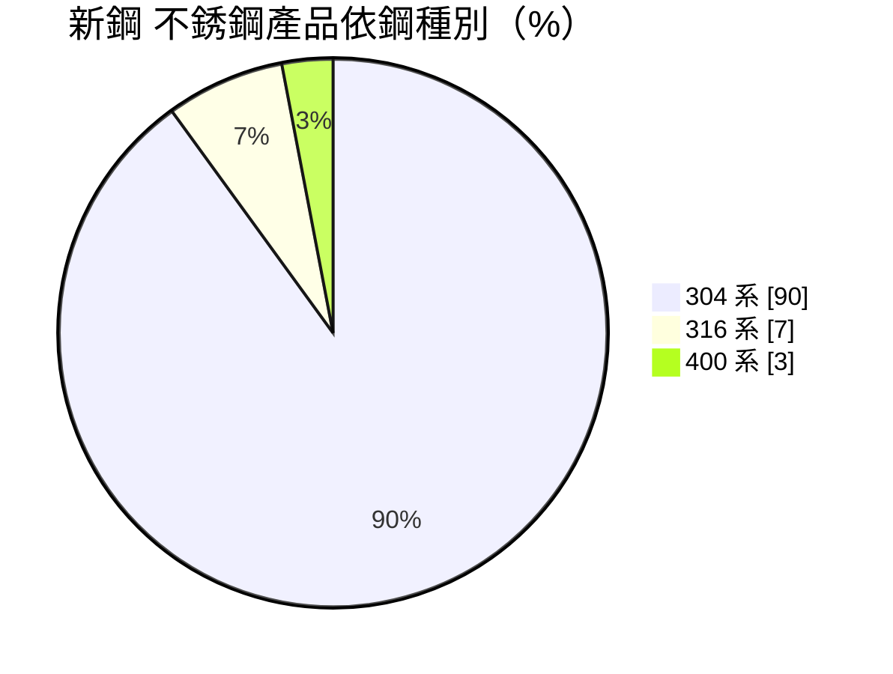
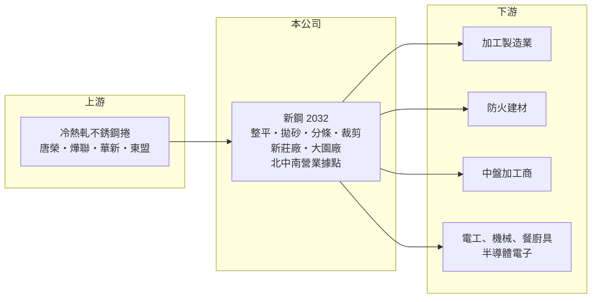

# 2032 新鋼

> 上市｜[[產業索引-鋼鐵工業|鋼鐵工業]]｜上市（櫃）日期 2000/09/11

# 第一章：企業模式與商業藍圖

> [!info] 撰寫說明
> 精簡版，由 Claude 依公開資料整理，架構比照 [[2330台積電]]，資料截至 2026-10-08。來源：MoneyDJ 理財網財務比率年表（2021 至 2025 年）；富果研究 2026 年 9 月法說會備忘錄（製程、鋼種比重、客戶應用、供應商、據點、2026 年上半年財務）；證交所開放資料快照（基本資料、2026 年上半年資產負債與損益、2025 年度股利、本益比淨值比）。營收金額由每股營業額乘以約 1.31 億股推算。#待校對

新鋼工業成立於 1971 年 7 月、2000 年 9 月上市，總部在新北新莊，董事長蔡政廷、總經理成主賜，實收資本額約 13.1 億元。新鋼是專做[[不銹鋼]]鋼捲二次加工的業者，向上游鋼廠買進冷熱軋不銹鋼捲，整平、拋砂、分條、裁剪後賣給下游加工廠，理解它要從「不銹鋼的[[鋼材加工中心]]」角度來看。

- **核心業務：** 新鋼的製程包括整平、表面處理（拋砂）、分條與裁剪，設備有飛剪式整平機、濕式鋼捲拋砂機與分條機（富果整理 2026 年 9 月法說會）。下游客戶多是中小型加工廠，它們向新鋼買已裁好尺寸、處理好表面的不銹鋼板片，省去自己備料與加工的成本。
- **營收結構：** 依法說會，鋼種以 304 系為大宗約 90%，316 系約 7%，400 系約 3%（原文未說明是營收或銷量比重）。客戶應用上，加工製造業約 32%、防火建材約 25%、中盤加工約 21%、電工器材約 7%、機械製造約 6%、餐廚具業約 6%。
- **營運據點：** 台北總公司、台中營業所、台南辦事處與高雄營業所，台中與高雄設有物流倉庫，加工廠包括新莊廠與大園廠（富果整理法說會）。新莊與大園廠屋頂出租鋪設太陽能板，電力回售台電。
- **長期方向：** 公司策略是拓展高附加價值客戶，特別是用鋼要求較高的半導體電子產業。半導體廠務與設備需要高潔淨、高耐蝕的不銹鋼材料，若能打進這類供應鏈，新鋼可以從單純的分條裁剪，往規格更嚴格、價差更穩定的市場移動。

# 第二章：護城河深度與競爭優勢

新鋼的競爭力在於北中南的服務網與小量多樣的加工能力，但產品同質，護城河以服務與庫存深度為主。

- **競爭優勢：** 不銹鋼下游客戶分散、單筆用量小，大型鋼廠不會直接服務。新鋼以多個營業據點與倉庫就近供貨，並向 [[2035唐榮]]、燁聯、[[1605華新]]、東盟等多家鋼廠採購（富果整理法說會），能提供多鋼種、多厚度與多種表面的現貨。多家供應來源也降低了對單一鋼廠的依賴。
- **主要對手：** 國內的不銹鋼加工中心與中盤商眾多，綜合型鋼材加工業者 [[2031新光鋼]] 在部分產品上重疊；上游鋼廠的直營加工體系也是競爭者。客戶應用中有 21% 是中盤加工，代表新鋼也扮演批發角色，價格競爭明顯。
- **觀察重點：** 2026 年上半年毛利率約 12%，去年同期只有約 2%（富果整理法說會）；營業利益率由虧損轉為約 8%。這種大幅擺動主要來自鎳價與不銹鋼價格的變化，長期要看半導體電子客戶比重能否提高，讓獲利不再只靠價格循環。

# 第三章：財務體質與盈利規模

資料日期：2026-10-08，表格是撰寫當時的快照；最新月營收、毛利率、累計 EPS 由自動排程寫在本筆記的屬性欄位（月營收、毛利率、累計EPS 等）。#待校對

新鋼營收在 2021 至 2025 年間介於約 29 億至 35 億元，獲利在 2021 年後長期處於低檔，2023 年小幅虧損。

| 年度 | 營收（億元） | [[毛利率]] | [[營業利益率]] | EPS（元） | [[ROE]] |
|---|---|---|---|---|---|
| 2021 | 約 34.9（推算） | 8.62% | 5.45% | 1.28 | 9.48% |
| 2022 | 約 33.6（推算） | 3.22% | 0.51% | 0.29 | 2.17% |
| 2023 | 約 28.6（推算） | 1.52% | -2.05% | -0.16 | -1.24% |
| 2024 | 約 29.7（推算） | 3.93% | 0.54% | 0.45 | 3.51% |
| 2025 | 約 30.4（推算） | 4.16% | 0.82% | 0.56 | 4.21% |

- **長期指標：** 2021 至 2025 年營收年複合成長率約 -3.4%（推算），近 5 年平均 ROE 約 3.6%（推算）。稅後淨利率多數年度高於營業利益率，代表業外收益（如太陽能屋頂租金、利息等，推估）對獲利有相當貢獻。2025 年度現金股利 0.5 元，約為 EPS 0.56 元的 89%（證交所資料）。負債比率長年在 11% 至 19%，財務保守。
- **[[ROIC]] 與 [[WACC]]：** 2025 年營業利益約 0.25 億元（營收約 30.4 億元 × 0.82%），稅後約 0.2 億元。投入資本以 2026 年第二季權益總計 18.1 億元，加上有息負債推估約 2.2 億元（以負債總計 5.6 億元的四成估算，官方快照未拆分）計算，ROIC 約 1%（推算）；2026 年上半年年化約 10%（推算），2021 年約 7.5%（推算）。WACC 約 6.7%（推算：無風險利率 1.75%、市場風險溢酬 6%、β 取鋼鐵同業常見值 0.9，股東權益成本 7.15%；稅前負債成本 2.5%、稅率 20%，以市值約 25 億元與負債 2.2 億元計算權重約 92：8）。ROIC 只有在不銹鋼價格上升期（2021 年、2026 年上半年）高於 WACC，其餘年度都低於，代表加工價差本身不足以長期創造價值。
- **財務特色：** 2026 年第二季總資產 23.6 億元、負債 5.6 億元，負債比率約 24%，每股淨值 13.84 元。2026 年上半年營收 16.7 億元、[[毛利率]] 11.5%、營業利益率 7.6%、EPS 1.02 元（證交所資料）。

# 第四章：總體風險與地緣政治

新鋼的風險集中在不銹鋼價格循環與加工通路的價格競爭。

- **產業週期：** 不銹鋼價格由鎳價主導，印尼[[鎳生鐵]]產能擴張使鎳價長期承壓。新鋼持有鋼捲庫存，價格上漲時獲利放大，價格下跌時須提列[[存貨跌價損失]]，2023 年毛利率只剩 1.52% 就是不銹鋼價格下跌期的結果。
- **營運風險：** 客戶以中小型加工廠與中盤商為主，價格敏感、忠誠度有限；新鋼規模不大，採購議價力不如大型通路。開發半導體電子客戶需要時間與認證，短期內難以改變營收結構。
- **其他風險：** 國內不銹鋼冷軋捲外銷量下滑（法說會引用 2026 年上半年產業數據外銷量年減 16.7%），代表上游鋼廠可能把更多貨轉回內銷，加劇國內價格競爭。中國低價不銹鋼與各國[[反傾銷]]措施也會改變亞洲市場的供需。

# 專有名詞解析

## 金融

- **[[存貨跌價損失]]**：存貨的市價低於帳面成本時，依會計規定須認列的損失，會直接壓低毛利率。
- **[[ROIC]]**：投入資本報酬率，稅後營業利益除以股東權益加有息負債，衡量本業運用資本的效率。
- **[[WACC]]**：加權平均資金成本，股東與債權人要求報酬率的加權平均，是 ROIC 要超越的門檻。

## 產業

- **[[不銹鋼]]**：含鉻、鎳等合金元素的耐腐蝕鋼材，鎳價是主要成本，價格隨鎳價波動。
- **[[鋼材加工中心]]**：向鋼廠買進鋼捲、鋼板，依客戶需求分條、裁切、沖壓後出貨的中間加工商，賺取加工費與進銷價差。
- **[[鎳生鐵]]**：以紅土鎳礦冶煉出的含鎳生鐵，是生產不銹鋼的低成本鎳原料，印尼為主要產地。
- **[[反傾銷]]**：進口國對低於正常價格銷售的進口商品加徵關稅的貿易救濟措施。

# 核心供應鏈

- 上游：[[2035唐榮]]、燁聯鋼鐵、[[1605華新]]、東盟（富果整理法說會）。
- 下游／客戶：加工製造業、防火建材業、中盤加工商、電工器材、機械製造與餐廚具業者，並開發半導體電子產業客戶（具名客戶未查得）。
- 同業：不銹鋼加工中心與中盤商；[[2031新光鋼]]、[[2027大成鋼]]。

## 最新新聞
<!-- news:start -->
<!-- news:end -->

## 相關連結
- [公開資訊觀測站](https://mopsov.twse.com.tw/mops/web/t05st03?step=1&firstin=1&co_id=2032)
- [Goodinfo](https://goodinfo.tw/tw/StockDetail.asp?STOCK_ID=2032)
- [Yahoo 股市](https://tw.stock.yahoo.com/quote/2032)
- [鉅亨網新聞](https://www.cnyes.com/twstock/2032/news)
