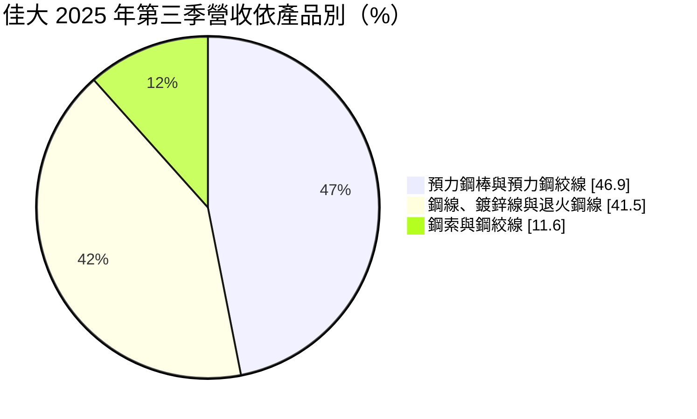
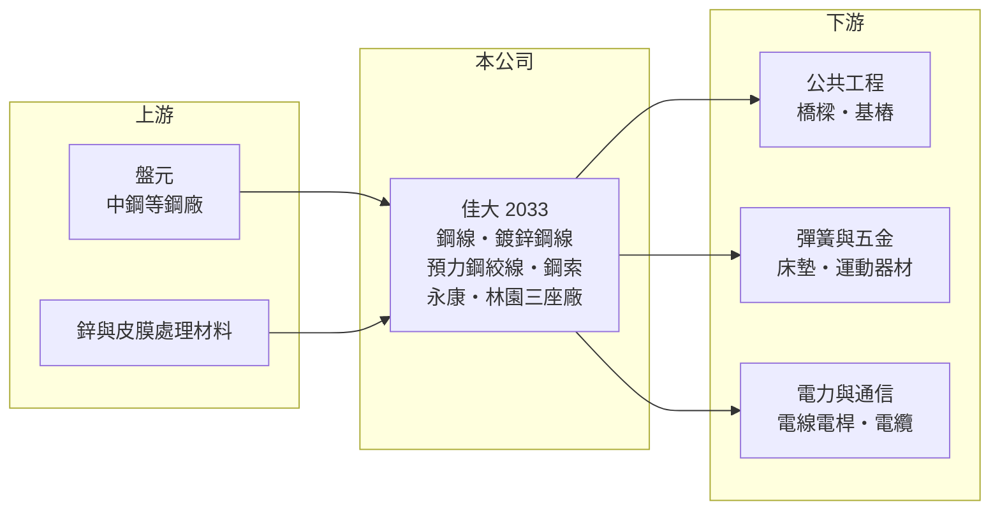

# 2033 佳大

> 上市｜[[產業索引-鋼鐵工業|鋼鐵工業]]｜上市（櫃）日期 2000/09/11

# 第一章：企業模式與商業藍圖

> [!info] 撰寫說明
> 精簡版，由 Claude 依公開資料整理，架構比照 [[2330台積電]]，資料截至 2026-10-08。來源：MoneyDJ 理財網財務比率年表（2021 至 2025 年）；富果研究 2025 年 12 月法說會備忘錄（產品分類、營收比重、廠區、2023 至 2025 年營收與 EPS）；證交所開放資料快照（基本資料、2026 年上半年資產負債與損益、2025 年度股利、本益比淨值比）。2021、2022、2025 年營收由每股營業額乘以約 0.81 億股推算。公開資料有限。#待校對

佳大世界成立於 1973 年 4 月、2000 年 9 月上市，總部在台南永康，董事長吳大和、總經理陳正平。佳大是小型的鋼線製造商，產品從一般鋼線、鍍鋅鋼線延伸到公共工程用的[[預力鋼絞線]]與電力通信用鋼索，理解它要從「線材加工的利基市場」來看。證交所基本資料的實收資本額為 12 億元，高於 2026 年第二季財報股本約 8.07 億元，代表第二季後曾辦理增資（性質與對象未查得）。

- **核心業務：** 佳大以[[盤元]]為原料，經伸線、熱處理、鍍鋅與絞合，製成七大類產品：一般鋼線、鍍鋅鋼線、預力鋼線、預力鋼絞線、預力細徑鋼棒、鍍鋅與不鍍鋅鋼絞線，以及鍍鋅鋼索（富果整理法說會）。預力鋼材用於橋樑、基樁等公共工程，一般鋼線用於彈簧與五金，鋼索與鋼絞線則用於電力與通信線路。
- **營收結構：** 依 2025 年 12 月法說會，2025 年第三季預力鋼棒與預力鋼絞線約占 46.9%，鋼線、鍍鋅線與退火鋼線約 41.5%，鋼索與鋼絞線約 11.6%。下游涵蓋彈簧床褥、五金零件、橋樑基樁、電線電桿、運動器材與電線電纜，公共工程相關約占一半。
- **營運據點：** 在台南永康與高雄林園共有三座生產基地，員工約 110 人；近年完成皮膜處理廠設備汰換並購入新伸線設備，其中永康二廠的產品組合毛利較高（富果整理法說會）。
- **長期方向：** 公司表示目前沒有新的重大投資計畫，以逐步更新設備為主，並積極開發新客戶與新市場，降低市場集中的風險。2026 年的增資若帶來新的股東或資金用途，可能改變公司的長期方向，需持續追蹤（待校對）。

# 第二章：護城河深度與競爭優勢

佳大的競爭力在於預力鋼材與鋼索的規格認證，但規模很小，護城河主要來自利基產品而非成本。

- **競爭優勢：** 預力鋼絞線與預力鋼棒用在橋樑與基樁，必須符合國家標準並通過工程材料檢驗，承包商通常只向通過認證的少數供應商採購。佳大同時具備預力鋼材、一般鋼線與鋼索產品，可以在公共工程與民生市場之間調配產能。
- **主要對手：** 國內鋼線與預力鋼材同業包括 [[2069運錩]] 等線材加工業者，以及中鋼集團的條鋼下游加工廠；進口方面面對中國與東南亞的鋼線與鋼絞線。佳大的營收只有數億元，在原料採購與價格上議價力有限。
- **觀察重點：** 毛利率由 2022 年的 6.36% 回升到 2025 年的 14.24%，營業利益率由負轉為 4.33%，顯示產品組合調整有成效。長期要看公共工程預算能否維持預力鋼材需求，以及增資資金的實際用途是否能帶來高於資金成本的報酬。

# 第三章：財務體質與盈利規模

資料日期：2026-10-08，表格是撰寫當時的快照；最新月營收、毛利率、累計 EPS 由自動排程寫在本筆記的屬性欄位（月營收、毛利率、累計EPS 等）。#待校對

佳大營收由 2021 年約 8.4 億元降到 2023、2024 年不到 6 億元，2025 年回升到約 7 億元，獲利長期在損益兩平附近。

| 年度 | 營收（億元） | [[毛利率]] | [[營業利益率]] | EPS（元） | [[ROE]] |
|---|---|---|---|---|---|
| 2021 | 約 8.4（推算） | 10.17% | 1.70% | 0.18 | 1.41% |
| 2022 | 約 8.1（推算） | 6.36% | -1.86% | -0.16 | -1.22% |
| 2023 | 5.87 | 8.89% | -1.04% | -0.04 | -0.30% |
| 2024 | 5.78 | 13.42% | 2.93% | 0.19 | 1.52% |
| 2025 | 約 7.0（推算） | 14.24% | 4.33% | 0.35 | 2.70% |

- **長期指標：** 2021 至 2025 年營收年複合成長率約 -4.5%（推算），近 5 年平均 ROE 約 0.8%（推算），長期沒有賺到資金成本。2025 年度未配發股利（證交所資料）。負債比率在 13% 至 22% 之間，財務保守；每股現金流量除 2021 年外皆為正。
- **[[ROIC]] 與 [[WACC]]：** 2025 年營業利益約 0.3 億元（營收約 7.0 億元 × 4.33%），稅後約 0.24 億元。投入資本以 2026 年第二季權益總計 10.7 億元，加上有息負債推估約 0.4 億元（以負債總計 1.9 億元的兩成估算，官方快照未拆分）計算，ROIC 約 2.2%（推算）；2026 年上半年年化也約 2%（推算）。WACC 約 7.1%（推算：無風險利率 1.75%、市場風險溢酬 6%、β 取鋼鐵同業常見值 0.9，股東權益成本 7.15%；稅前負債成本 2.5%、稅率 20%，以市值約 42.5 億元與負債 0.4 億元計算權重約 99：1）。ROIC 長期明顯低於 WACC，代表以目前的業務規模與利潤率，公司並未創造經濟價值。
- **財務特色：** 2026 年第二季總資產 12.6 億元、負債 1.9 億元，負債比率約 15%，每股淨值 13.25 元。2026 年上半年營收 3.4 億元、[[毛利率]] 15.1%、營業利益率 4.5%、EPS 0.15 元（證交所資料）。

# 第四章：總體風險與地緣政治

佳大的風險在於規模小、獲利薄，以及公共工程與鋼價的雙重循環。

- **產業週期：** 原料盤元價格跟隨國際鋼價，鋼價急跌時須提列[[存貨跌價損失]]；預力鋼材的需求取決於橋樑、基樁等公共工程的發包進度，政府預算與工程延宕都會影響訂單。民生用鋼線則受彈簧床、五金外銷景氣影響。
- **營運風險：** 營收規模只有數億元，固定成本與人事費用占比高，營收減少一成就可能轉為虧損。公司表示要降低市場集中風險，代表目前客戶或應用相對集中（具體客戶未查得）。
- **其他風險：** 增資後股本擴大，若新資金未能投入報酬率高於資金成本的用途，會稀釋每股盈餘與股東權益報酬率。中國低價鋼線與鋼絞線的進口競爭是長期壓力。

# 專有名詞解析

## 金融

- **[[存貨跌價損失]]**：存貨的市價低於帳面成本時，依會計規定須認列的損失，會直接壓低毛利率。
- **[[ROIC]]**：投入資本報酬率，稅後營業利益除以股東權益加有息負債，衡量本業運用資本的效率。
- **[[WACC]]**：加權平均資金成本，股東與債權人要求報酬率的加權平均，是 ROIC 要超越的門檻。

## 產業

- **[[預力鋼絞線]]**：多股高強度鋼線絞合而成，施加張力後埋入混凝土以提高橋樑、基樁的承載力。
- **[[盤元]]**：熱軋後捲成盤狀的圓形條鋼，是抽製鋼線、螺絲與彈簧的原料。

# 核心供應鏈

- 上游：盤元供應商，國內主要為 [[2002中鋼]]（實際採購比重未查得）；鋅錠與表面處理材料。
- 下游／客戶：公共工程承包商、彈簧床墊與五金業者、電力與通信線路業者、電線電纜廠（具名客戶未查得）。
- 同業：[[2069運錩]]、其他鋼線與預力鋼材加工廠；中國與東南亞鋼線廠。

## 最新新聞
<!-- news:start -->
<!-- news:end -->

## 相關連結
- [公開資訊觀測站](https://mopsov.twse.com.tw/mops/web/t05st03?step=1&firstin=1&co_id=2033)
- [Goodinfo](https://goodinfo.tw/tw/StockDetail.asp?STOCK_ID=2033)
- [Yahoo 股市](https://tw.stock.yahoo.com/quote/2033)
- [鉅亨網新聞](https://www.cnyes.com/twstock/2033/news)
