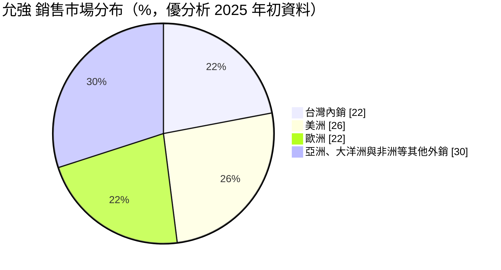
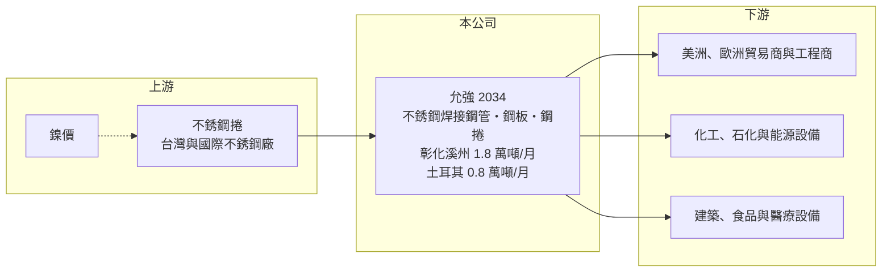

# 2034 允強

> 上市｜[[產業索引-鋼鐵工業|鋼鐵工業]]｜上市（櫃）日期 2001/09/17

# 第一章：企業模式與商業藍圖

> [!info] 撰寫說明
> 精簡版，由 Claude 依公開資料整理，架構比照 [[2330台積電]]，資料截至 2026-10-08。來源：MoneyDJ 理財網財務比率年表（2021 至 2025 年）；優分析 2025 年初個股文章（產品、產能、土耳其廠、外銷比重、2024 年營收）；證交所開放資料快照（基本資料、2026 年上半年資產負債與損益、2025 年度股利、本益比淨值比）。營收除 2024 年外由每股營業額乘以約 5.29 億股推算。#待校對

允強實業成立於 1973 年 1 月、2001 年 9 月上市，總部與工廠在彰化溪州，董事長兼總經理為張金鈺，實收資本額約 52.9 億元。允強把[[不銹鋼]]原料加工成鋼管、鋼板與鋼捲，外銷比重近八成，並在土耳其設廠，理解它要抓住「外銷型不銹鋼管廠＋海外第二基地」兩個重點。

- **核心業務：** 允強生產不銹鋼[[焊接鋼管]]，以及不銹鋼鋼板與鋼捲。焊接鋼管用於建築結構與管線、化工與石化輸送管、太陽能與風電設備、食品加工與醫療衛生級設備。依優分析整理，允強是全球前五大不銹鋼焊接管製造商之一（待校對）。
- **營收結構：** 產品別營收比重未查得。依優分析 2025 年初的文章，外銷約占 78%，其中美洲約 26%、歐洲約 22%，其餘外銷市場包括亞洲、大洋洲與非洲。2024 年全年營收約 145.2 億元，較 2023 年下滑 4.66%。
- **營運據點：** 總產能每月約 2.6 萬噸，其中台灣彰化約 1.8 萬噸、土耳其約 0.8 萬噸；土耳其廠區自 2019 年開始布局，第二期廠區已完工，文章當時的整體稼動率約 60%（優分析整理）。土耳其廠可以就近供應歐洲、中東與非洲市場，並以非亞洲產地的身分降低部分貿易壁壘的影響。
- **長期方向：** 允強的長期策略是以台灣與土耳其雙基地服務全球市場，把握能源轉型（太陽能、風電）、化工與基礎建設的不銹鋼管需求。從 2019 年起的土耳其投資可以看出，經營層願意承擔海外擴張的風險，換取市場分散與關稅上的彈性。

# 第二章：護城河深度與競爭優勢

允強的護城河來自規模、全球認證與海外產能布局，在外銷型不銹鋼管廠中具有代表性。

- **競爭優勢：** 外銷不銹鋼管需要取得各國的產品規範與工程認證，並建立長期的貿易商與工程客戶關係，這些都要多年經營。允強以每月 2.6 萬噸的產能規模，能同時接大型工程與標準品訂單；土耳其廠讓它在歐美對亞洲鋼管加徵[[反傾銷]]稅時，仍有替代的出貨來源。
- **主要對手：** 國內同業包括 [[2030彰源]]、[[2020美亞]]，以及從事不銹鋼管與通路的 [[2027大成鋼]]；國際上面對中國、印度、越南、韓國的大型不銹鋼管廠。中國與印度產能龐大且成本低，是全球報價的主要壓力來源。
- **觀察重點：** 毛利率由 2021 年的 16.27% 降到 2025 年的 8.5%，2023 至 2024 年稅後連續小幅虧損，部分原因是土耳其高通膨下的會計調整。長期要看土耳其廠稼動率能否提升、[[高度通膨會計]]的影響何時減輕，以及歐美市場的貿易政策變化。

# 第三章：財務體質與盈利規模

資料日期：2026-10-08，表格是撰寫當時的快照；最新月營收、毛利率、累計 EPS 由自動排程寫在本筆記的屬性欄位（月營收、毛利率、累計EPS 等）。#待校對

允強營收由 2021 年約 212 億元連續下滑到 2025 年約 127 億元，獲利也從 2021 年的高峰降到損益兩平附近。

| 年度 | 營收（億元） | [[毛利率]] | [[營業利益率]] | EPS（元） | [[ROE]] |
|---|---|---|---|---|---|
| 2021 | 約 212（推算） | 16.27% | 7.81% | 2.86 | 13.63% |
| 2022 | 約 200（推算） | 12.93% | 5.63% | 1.16 | 5.23% |
| 2023 | 約 180（推算） | 7.23% | 2.23% | -0.38 | -1.75% |
| 2024 | 145.2 | 11.92% | 4.38% | -0.22 | -1.06% |
| 2025 | 約 127（推算） | 8.50% | 1.55% | 0.21 | 1.07% |

- **長期指標：** 2021 至 2025 年營收年複合成長率約 -12%（推算），近 5 年平均 ROE 約 3.4%（推算）。2024 年營業利益率 4.38% 但稅後虧損，代表業外項目（包括土耳其的高度通膨會計調整，優分析整理）侵蝕了本業獲利。2025 年度配發盈餘現金股利 0.2 元，另以資本公積發放 0.8 元（證交所資料），合計 1 元遠高於 EPS 0.21 元。負債比率由 2022 年的 47% 升到 2025 年的 55.9%。
- **[[ROIC]] 與 [[WACC]]：** 2025 年營業利益約 2.0 億元（營收約 126.7 億元 × 1.55%），稅後約 1.6 億元。投入資本以 2026 年第二季權益總計 90.0 億元，加上有息負債推估約 112 億元（以負債總計 149.4 億元的七成五估算，官方快照未拆分）計算，ROIC 約 0.8%（推算）；2021 年約 6.5%（推算），2026 年上半年年化約 1.6%（推算）。WACC 約 4.7%（推算：無風險利率 1.75%、市場風險溢酬 6%、β 取鋼鐵同業常見值 0.9，股東權益成本 7.15%；稅前負債成本 2.5%、稅率 20%，以市值約 127 億元與負債 112 億元計算權重約 53：47）。2021 年 ROIC 高於 WACC，2022 年後持續低於，說明土耳其擴產後投入資本增加，但獲利尚未跟上。
- **財務特色：** 2026 年第二季總資產 239.4 億元、負債 149.4 億元，負債比率約 62%，每股淨值 17.02 元。2026 年上半年營收 62.9 億元、[[毛利率]] 9.7%、營業利益率 3.2%、業外損失約 1.3 億元，EPS 0.14 元（證交所資料）。

# 第四章：總體風險與地緣政治

允強的風險來自鎳價循環、土耳其的總體經濟，以及全球不銹鋼管的貿易壁壘。

- **產業週期：** 不銹鋼管售價隨鎳價與不銹鋼捲價格調整，鎳價下跌時須提列[[存貨跌價損失]]，客戶也會延後下單。印尼[[鎳生鐵]]大量擴產使鎳價長期承壓，加上中國產能過剩，使 2022 年後全球不銹鋼管的利差持續收斂。
- **營運風險：** 土耳其長期高通膨，財報須依國際會計準則 IAS 29 認列高度通膨調整；當地利率與匯率劇烈波動，也增加資金調度與營運成本（優分析整理，2025 年土耳其央行基準利率降至約 45%，仍屬極高水準）。負債比率逾六成，獲利偏低時財務彈性有限；以資本公積配發現金也不是可長期持續的做法。
- **其他風險：** 外銷近八成，美國的鋼鐵關稅與各國對不銹鋼管的[[反傾銷]]措施直接影響接單；歐盟碳邊境調整機制（CBAM）可能提高出口成本。新台幣與土耳其里拉的匯率變動，也會影響換算後的營收與獲利。

# 專有名詞解析

## 金融

- **[[高度通膨會計]]**：國際會計準則 IAS 29 規定，在高度通膨國家營運的子公司須以物價指數重編財報，通常產生帳面損失。
- **[[存貨跌價損失]]**：存貨的市價低於帳面成本時，依會計規定須認列的損失，會直接壓低毛利率。
- **[[ROIC]]**：投入資本報酬率，稅後營業利益除以股東權益加有息負債，衡量本業運用資本的效率。
- **[[WACC]]**：加權平均資金成本，股東與債權人要求報酬率的加權平均，是 ROIC 要超越的門檻。

## 產業

- **[[不銹鋼]]**：含鉻、鎳等合金元素的耐腐蝕鋼材，鎳價是主要成本，價格隨鎳價波動。
- **[[焊接鋼管]]**：把鋼帶捲成圓形後沿接縫焊合製成的鋼管，用於建築結構、管線輸送與機械零件。
- **[[鎳生鐵]]**：以紅土鎳礦冶煉出的含鎳生鐵，是生產不銹鋼的低成本鎳原料，印尼為主要產地。
- **[[反傾銷]]**：進口國對低於正常價格銷售的進口商品加徵關稅的貿易救濟措施。

# 核心供應鏈

- 上游：台灣與國際不銹鋼上游廠，國內如 [[2035唐榮]]、[[1605華新]]、燁聯鋼鐵（實際採購對象未查得）。
- 下游／客戶：美洲、歐洲為主的鋼管貿易商與工程商，化工、石化、太陽能與風電設備業者，建築、食品與醫療設備業者（具名客戶未查得）。
- 同業：[[2030彰源]]、[[2020美亞]]、[[2027大成鋼]]；中國、印度、越南、韓國不銹鋼管廠。

## 最新新聞
<!-- news:start（自動產生，請勿手動編輯此範圍） -->
- 2026-10-07 📰 媒體 11:50｜營收速報 - 允強(2034)9月營收14.65億元年增率高達47.39％｜[鉅亨網](https://news.cnyes.com/news/id/6623529)

完整紀錄：[[2034允強 新聞]]
<!-- news:end -->

## 相關連結
- [公開資訊觀測站](https://mopsov.twse.com.tw/mops/web/t05st03?step=1&firstin=1&co_id=2034)
- [Goodinfo](https://goodinfo.tw/tw/StockDetail.asp?STOCK_ID=2034)
- [Yahoo 股市](https://tw.stock.yahoo.com/quote/2034)
- [鉅亨網新聞](https://www.cnyes.com/twstock/2034/news)
