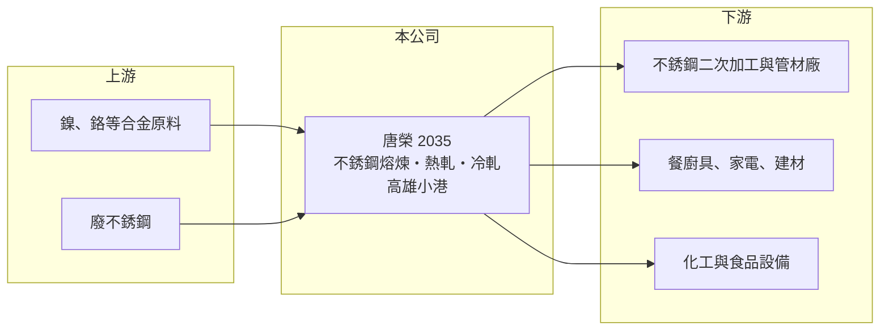

# 2035 唐榮

> 上櫃｜[[產業索引-鋼鐵工業|鋼鐵工業]]｜上市（櫃）日期 2006/07/07

# 第一章：企業模式與商業藍圖

> [!info] 撰寫說明
> 精簡版，由 Claude 依公開資料整理，架構比照 [[2330台積電]]，資料截至 2026-10-08。來源：Goodinfo 台灣股市資訊網經營績效年表（2016 至 2025 年）；nStock 公司沿革；櫃買中心開放資料快照（基本資料、2026 年上半年資產負債與損益、2026 年 8 月營收、本益比淨值比）。產品別營收比重與產能未查得，公開資料有限。#待校對

唐榮鐵工廠（以下簡稱唐榮）是台灣歷史最久的鋼鐵公司之一，1940 年由唐榮先生在高雄創立，1962 年收歸省營，1999 年精省後成為經濟部所屬國營事業，2006 年 7 月在櫃買中心掛牌。理解唐榮要同時看兩件事：一是[[不銹鋼]]這門受鎳價主導的大宗商品生意，二是國營體制下長年虧損、資本結構偏弱的財務現實。

- **核心業務：** 唐榮目前以不銹鋼產品的製造與買賣為主（nStock 整理公司登記資料），產品涵蓋不銹鋼鋼胚、熱軋與[[冷軋]]鋼捲等（產品細項為待校對）。不銹鋼是餐廚具、家電、建材、化工與食品設備的基礎材料，唐榮位在煉鋼與軋延的中游，向上採購鎳、鉻與廢不銹鋼等原料，向下供應鋼捲給二次加工廠與管材廠。
- **營收結構：** 產品別與地區別營收比重未查得。從規模看，唐榮年營收在 2021 年景氣高點約 168 億元，2025 年降到約 96 億元（Goodinfo），起伏幾乎完全跟著不銹鋼價格與出貨量走，顯示產品同質性高、價格由國際行情決定。
- **營運據點：** 總公司與不銹鋼廠位於高雄小港臨海工業區，2008 年完成「廠辦合一」，把總公司與不銹鋼廠整合在一起（nStock）。2002 年，機械廠的軌道與公路車輛事業、鋼鐵廠運輸與物流事業陸續民營化，營建部門縮編，唐榮因此由多角化的國營工業集團收斂為以不銹鋼為主的單一事業體。
- **長期方向：** 唐榮的長期課題不是擴張，而是在國營體制下改善成本結構與財務體質。過去五年有四年虧損，2025 年底每股淨值已低於面額，2026 年上半年轉為小幅獲利（櫃買資料），能否靠產品組合調整與成本控制脫離「景氣好才賺、景氣差大賠」的模式，是觀察重點。

# 第二章：護城河深度與競爭優勢

唐榮的優勢在於擁有不銹鋼一貫產線與國營背景，但面對大型民營鋼廠與中國、印尼的低價產能，護城河很窄。

- **競爭優勢：** 唐榮具備從熔煉到熱軋、冷軋的不銹鋼產線，在國內屬少數能自行煉製不銹鋼的業者，可以供應多種鋼種與規格。國營背景讓它在融資與政策配合上較有支撐，但也使人事成本、決策速度與資本配置較難像民營企業一樣靈活。
- **主要對手：** 國內最大的競爭者是燁聯鋼鐵（[[2023燁輝]] 同集團）、[[1605華新]] 的不銹鋼事業與 [[2027大成鋼]] 等通路商；國際上則是中國青山、太鋼以及在印尼以[[鎳生鐵]]建立低成本產能的業者。這些對手規模遠大於唐榮，決定了亞洲不銹鋼的報價。
- **觀察重點：** 不銹鋼是價格接受者的生意，唐榮的獲利主要取決於鎳價走勢與原料庫存的時間差。長期要看它能否提高高附加價值鋼種比重、降低單位成本，以及在每股淨值偏低的情況下，是否需要增資或由大股東支持來修補資本結構。

# 第三章：財務體質與盈利規模

資料日期：2026-10-08，表格是撰寫當時的快照；最新月營收、毛利率、累計 EPS 由自動排程寫在本筆記的屬性欄位（月營收、毛利率、累計EPS 等）。#待校對

唐榮過去十年只有少數年份獲利，2021 年不銹鋼大漲時 ROE 衝到 31.6%，其餘多數年份毛利率為負，典型的高波動、低報酬商品鋼廠。

| 年度 | 營收（億元） | [[毛利率]] | [[營業利益率]] | EPS（元） | [[ROE]] |
|---|---|---|---|---|---|
| 2021 | 168 | 11.70% | 9.58% | 4.53 | 31.6% |
| 2022 | 140 | 0.04% | -2.04% | -0.64 | -3.9% |
| 2023 | 107 | -8.07% | -10.70% | -3.22 | -21.8% |
| 2024 | 122 | -4.02% | -6.55% | -2.20 | -18.3% |
| 2025 | 96 | -13.00% | -16.20% | -4.72 | -54.2% |

- **長期指標：** 2021 至 2025 年平均 ROE 約 -13.3%（推算），營收年複合成長率約 -13%（2021 至 2025 年，推算），2016 至 2025 年十年間只有 2016、2017、2019、2021 四年 EPS 為正（Goodinfo）。近五年沒有配息紀錄（nStock）。MoneyDJ 資料顯示 2024、2025 年每股現金流量分別為 -4.85 元與 -2.80 元，自由現金流長期偏弱。
- **[[ROIC]] 與 [[WACC]]：** 2025 年營業利益約 -15.6 億元（營收 96 億元 × -16.2%），稅後約 -12.4 億元。投入資本以 2026 年第二季權益總計 24.6 億元，加上有息負債推估約 97 億元（負債總計 161.8 億元的六成，官方快照未拆分）計算，2025 年 ROIC 約 -10%（推算）。WACC 約 4.5%（推算：無風險利率 1.75%、市場風險溢酬 6%、β 取鋼鐵同業常見值 0.9，股東權益成本 7.15%；稅前負債成本 2.5%、稅率 20%，以市值約 93 億元與有息負債約 97 億元計算權重約 49：51）。負債占比高使 WACC 帳面上偏低，但實際上高槓桿公司的債權人與股東都會要求更高報酬；即使用這個偏低的門檻，唐榮多數年份的 ROIC 仍遠低於 WACC，長期在消耗股東價值。
- **財務特色：** 2026 年第二季總資產 186.4 億元、負債 161.8 億元，負債比率約 87%，每股淨值 7.04 元，低於 10 元面額。2026 年上半年營收 52.9 億元、毛利率約 4.9%、營業利益率約 2.2%、EPS 0.55 元（櫃買資料推算），是近年少見的轉盈。

# 第四章：總體風險與地緣政治

唐榮的風險集中在鎳價循環、亞洲不銹鋼產能過剩，以及高負債下的資本結構壓力。

- **產業週期：** 不銹鋼價格由鎳價主導，而印尼鎳生鐵產能大幅擴張，使全球不銹鋼長期處於供給過剩、價格易跌難漲的格局。唐榮從採購原料到出貨有時間差，鎳價下跌時要提列[[存貨跌價損失]]，這是 2023 至 2025 年毛利率為負的重要原因之一。
- **營運風險：** 負債比率接近九成、淨值低於股本，代表公司幾乎沒有承受再一次大虧的緩衝。若虧損延續，可能需要增資、減資彌補虧損或尋求政府支持，這些都會影響現有股東權益。
- **其他風險：** 中國與印尼不銹鋼低價出口，加上各國[[反傾銷]]措施改變貿易流向，使台灣市場持續承壓；匯率、電價上漲與碳費也會墊高成本。國營事業的經營層由政府任命，政策目標與股東報酬不一定一致，也是小股東需要留意的治理特性。

# 專有名詞解析

## 金融

- **[[存貨跌價損失]]**：存貨的市價低於帳面成本時，依會計規定須認列的損失，會直接壓低毛利率。
- **[[ROIC]]**：投入資本報酬率，稅後營業利益除以股東權益加有息負債，衡量本業運用資本的效率。
- **[[WACC]]**：加權平均資金成本，股東與債權人要求報酬率的加權平均，是 ROIC 要超越的門檻。

## 產業

- **[[不銹鋼]]**：含鉻、鎳等合金元素的耐腐蝕鋼材，鎳價是主要成本，價格隨鎳價波動。
- **[[冷軋]]**：在常溫下把熱軋鋼捲再壓薄的製程，可得到較薄、表面較平滑、尺寸較精確的鋼材。
- **[[鎳生鐵]]**：以紅土鎳礦冶煉出的含鎳生鐵，是生產不銹鋼的低成本鎳原料，印尼為主要產地。
- **[[反傾銷]]**：進口國對低於正常價格銷售的進口商品加徵關稅的貿易救濟措施。

# 核心供應鏈

- 上游：鎳、鉻等合金原料與廢不銹鋼（具名供應商未查得）；鎳價與印尼鎳生鐵供給決定原料成本。
- 下游／客戶：不銹鋼二次加工、管材與通路業者，例如 [[2032新鋼]]、[[2025千興]]、[[2034允強]] 等同屬不銹鋼加工鏈的公司（是否為唐榮客戶未查得），終端為餐廚具、家電、建材與工業設備。
- 同業：燁聯鋼鐵（[[2023燁輝]] 同集團）、[[1605華新]]、[[2027大成鋼]]；中國與印尼不銹鋼廠。

## 最新新聞
<!-- news:start -->
<!-- news:end -->

## 相關連結
- [公開資訊觀測站](https://mopsov.twse.com.tw/mops/web/t05st03?step=1&firstin=1&co_id=2035)
- [Goodinfo](https://goodinfo.tw/tw/StockDetail.asp?STOCK_ID=2035)
- [Yahoo 股市](https://tw.stock.yahoo.com/quote/2035)
- [鉅亨網新聞](https://www.cnyes.com/twstock/2035/news)
