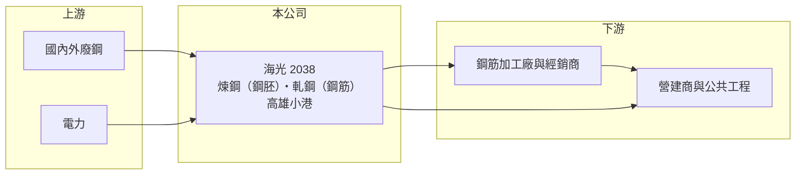

# 2038 海光

> 上市｜[[產業索引-鋼鐵工業|鋼鐵工業]]｜上市（櫃）日期 2008/12/30

# 第一章：企業模式與商業藍圖

> [!info] 撰寫說明
> 精簡版，由 Claude 依公開資料整理，架構比照 [[2330台積電]]，資料截至 2026-10-08。來源：Goodinfo 台灣股市資訊網經營績效年表（2016 至 2025 年）；nStock 公司資料；證交所開放資料快照（基本資料、2026 年上半年資產負債與損益、營益分析、2025 年度股利、本益比淨值比）。產能、製程與客戶結構未查得，公開資料有限。#待校對

海光企業成立於 1969 年 3 月，2008 年 12 月在證交所上市，總部與工廠位於高雄小港臨海工業區，董事長黃韋翰、總經理黃燦明。海光做的是建築用鋼的基礎環節：生產鋼胚，再軋成[[鋼筋]]賣給營建市場，屬於薄利、量大、跟著景氣與原料價格起伏的條鋼生意。

- **核心業務：** 海光從事鋼胚與鋼筋的製造、加工與買賣（nStock 整理公司登記資料）。鋼胚是煉鋼後凝固成形的半成品，鋼筋則是埋在混凝土裡提供抗拉強度的建材。台灣民營條鋼廠多以[[電弧爐]]熔化[[廢鋼]]煉鋼，海光是否全部採電弧爐製程未查得（待校對）。
- **營收結構：** 產品別營收比重未查得。從規模看，海光年營收在 2021 至 2022 年景氣高點約 100 至 110 億元，2025 年約 89 億元（Goodinfo），主要隨鋼筋價格與營建需求變動。
- **營運據點：** 總部與工廠位於高雄小港沿海二路（證交所基本資料），鄰近高雄港，方便進口廢鋼與原料，也接近南部營建市場。
- **長期方向：** 鋼筋屬於規格統一的標準品，海光的長期課題是在國內營建景氣與廢鋼價格的雙重循環中守住[[價差]]。2025 年虧損、2026 年上半年接近損益兩平（證交所資料），公司能否透過成本控制或產品延伸提高獲利穩定度，是長期觀察重點。

# 第二章：護城河深度與競爭優勢

海光的護城河很窄，競爭力主要來自地理位置與成本控制，而不是產品差異。

- **競爭優勢：** 鋼筋運費占售價比重不低，因此廠商在鄰近市場有一定的地緣優勢。海光位於高雄港邊，進口廢鋼與出貨給南部工地都較便利；但鋼筋規格由國家標準決定，客戶很容易在不同鋼廠間比價轉單，議價能力有限。
- **主要對手：** 國內鋼筋主要供應商包括 [[2015豐興]]、[[2006東和鋼鐵]]、[[2028威致]]（產品組合待校對）以及中鋼集團等，其中豐興規模大、財務保守，是業界的價格指標。進口鋼筋與中國過剩產能也會壓抑國內報價。
- **觀察重點：** 毛利率從 2021 年的 7.2% 一路降到 2025 年的 1.3%，2026 年上半年只剩 1.4%（Goodinfo、證交所資料），顯示價差被壓縮。長期要看營建需求能否支撐鋼筋價格，以及海光能否在電價與碳費上升的環境下維持成本競爭力。

# 第三章：財務體質與盈利規模

資料日期：2026-10-08，表格是撰寫當時的快照；最新月營收、毛利率、累計 EPS 由自動排程寫在本筆記的屬性欄位（月營收、毛利率、累計EPS 等）。#待校對

海光的獲利能力長期偏低，近十年毛利率大多在 0% 至 7% 之間，ROE 只有 2021 年接近兩位數。

| 年度 | 營收（億元） | [[毛利率]] | [[營業利益率]] | EPS（元） | [[ROE]] |
|---|---|---|---|---|---|
| 2021 | 102 | 7.17% | 5.09% | 2.54 | 11.90% |
| 2022 | 110 | 2.80% | 0.92% | 1.16 | 4.69% |
| 2023 | 93.7 | 2.69% | 0.52% | 0.28 | 0.76% |
| 2024 | 97.2 | 2.47% | 0.35% | 0.20 | 0.48% |
| 2025 | 89.2 | 1.32% | -0.87% | -0.56 | -3.12% |

- **長期指標：** 2021 至 2025 年平均 ROE 約 2.9%（推算），遠低於一般股東要求的報酬率；營收 2020 至 2025 年複合成長率約 3%（推算，2020 年 76 億元）。2025 年度因虧損未配發股利（證交所資料），配息穩定度低。
- **[[ROIC]] 與 [[WACC]]：** 2025 年營業利益約 -0.8 億元（營收 89.2 億元 × -0.87%），稅後約 -0.6 億元。投入資本以 2026 年第二季權益總計 40.0 億元，加上有息負債推估約 25 億元（負債總計 50.9 億元的一半，官方快照未拆分）計算，2025 年 ROIC 約 -1%（推算）；2021 年景氣高點時以同樣資本規模估算約 6% 上下（推算）。WACC 約 4.6%（推算：無風險利率 1.75%、市場風險溢酬 6%、β 取鋼鐵同業常見值 0.9，股東權益成本 7.15%；稅前負債成本 2.5%、稅率 20%，以市值約 25 億元與有息負債約 25 億元計算權重約 50：50）。除了景氣高峰年，ROIC 長期低於 WACC，代表本業沒有創造超額價值，這也反映在股價淨值比只有 0.63 倍。
- **財務特色：** 2026 年第二季總資產 90.8 億元、負債 50.9 億元，負債比率約 56%，每股淨值 19.63 元。2026 年上半年營收 39.8 億元、毛利率 1.38%、營業利益率 -1.03%，靠業外收益使 EPS 維持在 0.02 元（證交所資料）。

# 第四章：總體風險與地緣政治

海光的風險來自營建景氣、廢鋼與電力成本，以及標準品鋼筋的價格競爭。

- **產業週期：** 鋼筋需求高度依賴住宅與公共工程，房市降溫或公共建設放緩時，出貨量與價格會同時下滑。原料廢鋼是國際大宗商品，價格每日變動，若鋼筋售價調整跟不上廢鋼成本，價差就會被壓縮，甚至需要提列[[存貨跌價損失]]。
- **營運風險：** 毛利率只有 1% 到 3%，任何成本上升都可能讓公司轉為虧損。負債比率超過五成，在利率上升時財務費用壓力也會增加。
- **其他風險：** 電弧爐煉鋼耗電量大，台灣工業電價調漲與供電穩定度直接影響成本；碳費與歐盟[[CBAM]]等碳排規範，長期可能增加煉鋼成本。進口鋼筋與[[反傾銷]]政策的變化，也會影響國內鋼筋行情。

# 專有名詞解析

## 金融

- **[[存貨跌價損失]]**：存貨的市價低於帳面成本時，依會計規定須認列的損失，會直接壓低毛利率。
- **[[ROIC]]**：投入資本報酬率，稅後營業利益除以股東權益加有息負債，衡量本業運用資本的效率。
- **[[WACC]]**：加權平均資金成本，股東與債權人要求報酬率的加權平均，是 ROIC 要超越的門檻。

## 產業

- **[[鋼筋]]**：埋在混凝土中提供抗拉強度的條狀鋼材，規格標準化，是住宅與公共工程的主要用鋼。
- **[[電弧爐]]**：以電力產生電弧熔化廢鋼的煉鋼設備，投資較小、碳排較低，台灣多數民營鋼廠採用。
- **[[廢鋼]]**：回收的鋼鐵料，是電弧爐的主要原料，價格隨國際供需每日變動，占電爐廠成本最大比重。
- **[[價差]]**：鋼材售價與原料成本之間的差額，是鋼鐵廠獲利的主要來源。
- **[[CBAM]]**：歐盟碳邊境調整機制，對進口鋼鐵、鋁、水泥等高碳排產品依碳含量收費。
- **[[反傾銷]]**：進口國對低於正常價格銷售的進口商品加徵關稅的貿易救濟措施。

# 核心供應鏈

- 上游：國內外廢鋼（具名供應商未查得）、電力；回收料處理同業如 [[9930中聯資源]]。
- 下游／客戶：鋼筋加工廠、經銷商與營建商（具名客戶未查得），終端為住宅、廠房與公共工程。
- 同業：[[2015豐興]]、[[2006東和鋼鐵]]、[[2028威致]]、[[2002中鋼]]（中鋼集團條鋼）。

## 最新新聞
<!-- news:start -->
<!-- news:end -->

## 相關連結
- [公開資訊觀測站](https://mopsov.twse.com.tw/mops/web/t05st03?step=1&firstin=1&co_id=2038)
- [Goodinfo](https://goodinfo.tw/tw/StockDetail.asp?STOCK_ID=2038)
- [Yahoo 股市](https://tw.stock.yahoo.com/quote/2038)
- [鉅亨網新聞](https://www.cnyes.com/twstock/2038/news)
