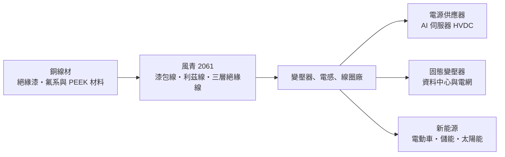
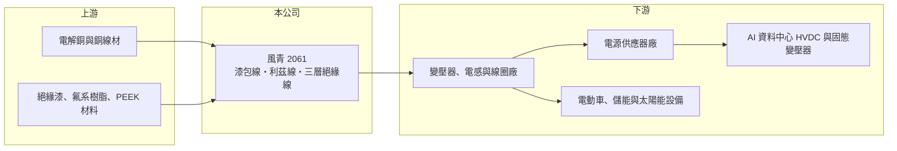

# 2061 風青

> 上櫃｜[[產業索引-電器電纜|電器電纜]]｜上市（櫃）日期 2010/12/09

# 第一章：企業模式與商業藍圖

> [!info] 撰寫說明
> 本文由 Claude 依公開資料整理，架構比照 [[2330台積電]] 的四章研究，資料截至 2026-10-08。財務數字來源：Goodinfo 年度經營績效頁與基本資料頁、櫃買中心開放資料（基本資料、資產負債、綜合損益、每月營收、本益比殖利率）；業務轉型描述參考 2026 年 6 月時報資訊報導標題。公開資料有限，產品比重與客戶名單未查得，產業描述為整理性內容，尚未逐條比對原始文件。#待校對

在評估單一個股的長期投資價值時，首要步驟是拆解企業的底層獲利邏輯。本章說明風青實業（股票代號：2061，以下簡稱風青）如何從傳統[[漆包線]]廠，轉向電源與高壓直流應用的高頻絕緣線材。

## 一、核心定位：小型特殊線材廠

風青成立於 1994 年 9 月，2010 年 12 月在櫃買中心上櫃，2026 年實收資本額約 5.74 億元，董事長為陳信宇，總部位於高雄（依公司傳真區碼推估）。公司產品包括高頻電力線材、新能源線材、5G 線材、漆包線、[[利茲線]]、膜包線、絲包線、[[三層絕緣線]]、鐵氟龍線、FIW 線、PEEK 線與無骨架線圈。

這些產品的共同點是「銅導體加上特殊絕緣層」。它們不是用來輸送電力的電纜，而是繞在變壓器、電感與馬達裡的線圈材料。電源轉換的效率與安全，很大一部分取決於線圈的絕緣耐壓與高頻損耗，因此規格越高的應用，越需要特殊線材。

* **傳統漆包線：** 在銅線外塗一層絕緣漆，是馬達與變壓器的基本材料，技術成熟、競爭激烈，價格主要由銅價加工繳決定。
* **高頻與高壓線材：** 利茲線以多股細絕緣線絞合，降低高頻電流造成的損耗；三層絕緣線以多層絕緣取代變壓器中的擋牆與膠帶，可縮小電源體積。這類產品的附加價值高於一般漆包線。

## 二、長期方向：切入 AI 電源與固態變壓器

依 2026 年 6 月時報資訊報導，風青把自己定位為高頻絕緣線供應商，董事長表示 800V [[HVDC]]（高壓直流電）絕緣線材已打進輝達 Vera Rubin 平台的供應鏈，[[固態變壓器]]（SST）領域也具備 1200V 以上的超高壓技術，產品自 2026 年開始貢獻營收。這是公司自己的說法，客戶與出貨規模尚未在財報中具體揭露。#待校對

* **策略意義：** AI 資料中心的供電架構正從傳統交流轉向 800V 高壓直流，固態變壓器也被視為下一代電網與資料中心的關鍵設備。如果風青能在這些新架構取得合格供應商地位，產品組合就能從低毛利的標準漆包線，轉向高毛利的特殊線材。
* **財報的初步反映：** 2026 年上半年毛利率 10.8%、營業利益率 5.8%，明顯高於 2023 至 2025 年的 3% 至 5% 毛利率；前 8 個月營收年增約 18.7%。是否能延續，仍需更多季度驗證。

# 第二章：護城河深度與競爭優勢

在長期價值投資中，「護城河」指企業抵禦競爭、維持超額利潤的保護機制。本章分析風青在特殊線材市場的優勢與限制。

## 一、護城河的組成

風青規模小，護城河目前仍在建立階段：

* **品項廣度與客製能力：** 同時具備漆包、膜包、絲包、三層絕緣、鐵氟龍、PEEK 等多種絕緣技術，可以依電源廠的規格快速打樣。電源與磁性元件廠在新平台開發時需要供應商配合試作，客製能力是小廠能爭取訂單的主要方式。
* **認證帶來的轉換成本：** 三層絕緣線等安全規格產品需要通過安規認證，一旦被設計進電源產品，客戶在產品生命週期內通常不會輕易更換線材。AI 伺服器電源與 HVDC 系統若完成驗證，也具有同樣的黏著度。

## 二、競爭對手格局

| 對手 | 定位 | 對風青的影響 |
|---|---|---|
| 日本古河電工、住友電工 | 高階絕緣線與三層絕緣線領導廠 | 高階規格的主要競爭者 |
| 中國精達股份等漆包線大廠 | 大量生產標準漆包線 | 壓低一般漆包線價格 |
| [[1609大亞]] | 台灣線纜與漆包線廠 | 部分產品重疊（是否直接競爭未查得） |

## 三、守得住與守不住的地方

* **守得住：** 需要客製與安規認證的高頻、高壓線材，特別是 AI 電源與新能源的新平台。
* **守不住：** 標準漆包線的價格。2019 至 2025 年風青毛利率多數年份只有 3% 至 10%，七年中有五年本業虧損，說明傳統產品幾乎沒有定價能力。
* **觀察重點：** 高頻絕緣線材占營收比重、毛利率能否穩定在 10% 以上，以及新客戶是否帶來持續性訂單而不是一次性樣品。

# 第三章：財務體質與盈利規模

資料日期：2026-10-08。數字取自 Goodinfo 年度經營績效頁與櫃買中心開放資料，表格是撰寫當時的快照；最新月營收、毛利率、累計 EPS 由自動排程寫在本筆記的屬性欄位（月營收、毛利率、累計EPS 等）。#待校對

財務報表是檢驗護城河是否真實存在的最終標準。本章用多年度三率、ROE 與資本報酬，檢視風青的獲利品質。

## 一、多年度獲利

| 年度 | 營收（新台幣） | [[毛利率]] | [[營業利益率]] | EPS（元） | [[ROE]] |
|---|---|---|---|---|---|
| 2019 | 9.00 億 | 5.14% | -1.09% | -0.18 | -1.74% |
| 2020 | 7.54 億 | 8.03% | 0.77% | 0.10 | 1.06% |
| 2021 | 9.59 億 | 9.91% | 2.59% | 2.37 | 20.6% |
| 2022 | 9.27 億 | 6.05% | -0.03% | -1.56 | -12.3% |
| 2023 | 8.87 億 | 3.24% | -3.61% | -0.54 | -4.75% |
| 2024 | 11.9 億 | 4.17% | -1.66% | -0.30 | -2.55% |
| 2025 | 12.0 億 | 5.30% | -0.37% | -0.97 | -8.71% |
| 2026 上半年 | 6.73 億 | 10.82% | 5.84% | 1.03 | 未查得 |

註：2026 年上半年毛利率與營業利益率由櫃買中心綜合損益資料計算（營業毛利 0.73 億元、營業利益 0.39 億元）。2026 年 1 至 8 月累計營收 9.18 億元，年增約 18.7%。

* **獲利高度波動：** 2021 年銅價上漲期間 EPS 2.37 元，可能含有庫存利益（推估）；2022 年銅價回落即轉為虧損。這種起伏反映傳統漆包線的利潤主要來自[[銅價轉嫁]]的時間差，而不是穩定的加工利潤。
* **營收年複合成長率：** 2020 至 2025 年約 9.7%（推算），但營收成長沒有轉成獲利，2024 至 2025 年營收增加，本業仍虧損。
* **2026 年的轉折：** 上半年營業利益 0.39 億元，加上業外收益 0.24 億元，稅後淨利 0.59 億元，是近年少見的獲利表現。

## 二、長期指標

* **平均 ROE：** 2021 至 2025 年平均約負 1.5%（推算），長期沒有替股東創造報酬。
* **股利：** 近年未配發股利，櫃買中心資料顯示最新年度每股股利為 0 元。Goodinfo 統計 2005 至 2025 年平均股利約 0.31 元。
* **資產結構：** 2026 年第二季總資產 13.1 億元，負債 6.32 億元、權益 6.79 億元，負債比約 48%，每股淨值 11.83 元。保留盈餘只有 0.61 億元，財務緩衝有限，擴產若需要大額資金，可能要透過增資或借款。

## 三、[[ROIC]] 與 [[WACC]]：價值創造利差

**ROIC 推算：** 2025 年營業利益約負 0.04 億元（12.0 億元 × -0.37%），ROIC 約為負 0.4% 至負 0.7%（以權益加負債 13.1 億元或權益 6.79 億元計算，推算）。若以 2026 年上半年營業利益 0.39 億元年化約 0.79 億元，稅後約 0.63 億元，ROIC 約 4.8%（計入全部負債）至 9.3%（只計權益）（推算）。

**WACC 推算：** 權益成本以 [[CAPM]] 估算，台灣 10 年期公債 1.75%、市場風險溢酬 6%、β 取 1.2（小型股波動較大的推估值，非來源數字），約 8.95%；負債成本假設 2.5%，稅後 2%。假設權益占資本 70%，WACC 約 6.9%（推算）。

**結論：** 過去七年風青的 ROIC 大多低於 WACC，屬於沒有創造價值的傳統線材廠。2026 年上半年的改善若能持續，ROIC 有機會接近或超過 WACC，但這需要高頻線材的營收占比明顯提高才能成立。

# 第四章：總體風險與地緣政治

任何企業都無法脫離宏觀環境獨立存在。本章分析風青必須面對的原料、需求與外部風險。

## 一、產業週期

* **銅價：** 銅占線材成本的大部分，銅價大漲時若無法及時反映到售價，毛利會被壓縮；銅價下跌時則可能出現存貨跌價。
* **電源與電子景氣：** 線材需求跟著電源供應器、家電、汽車與工業設備的出貨走，消費性電子景氣下滑時需求會同步減少。

## 二、營運風險

* **新業務的不確定性：** AI 伺服器電源與固態變壓器仍處於早期導入階段，規格與供應鏈可能變動，單一平台的訂單也可能集中在少數客戶。
* **規模與產能：** 公司規模小，若新產品需求放大，可能面臨產能與資金不足的問題。
* **經營團隊變動：** 2026 年 8 月公告總經理異動，策略延續性需要觀察。

## 三、其他風險

* **市場評價波動：** 2026 年 9 月公司因股價多次達注意交易標準而發布公告，題材性推升的評價與基本面之間可能有落差。
* **中國低價競爭：** 標準漆包線面臨中國大廠的價格壓力。
* **匯率：** 銅以美元計價，新台幣匯率變動會影響原料成本。

# 專有名詞解析

## 產業

- **[[漆包線]]**：在銅或鋁導線外塗覆絕緣漆的線材，是馬達、變壓器與電感線圈的基本材料。
- **[[利茲線]]**：由多股彼此絕緣的細線絞合而成，可降低高頻電流在導線表面集中造成的損耗，用於高頻變壓器與無線充電。
- **[[三層絕緣線]]**：導體外包覆三層絕緣材料、可單獨通過安規耐壓要求的線材，能減少變壓器內的隔離材料、縮小電源體積。
- **[[HVDC]]**：高壓直流供電，AI 資料中心以 800V 等高壓直流配電，可減少交直流轉換損耗並降低銅材用量。
- **[[固態變壓器]]**：以電力電子元件取代傳統鐵芯與線圈做電壓轉換的設備，體積小、可雙向控制，被視為下一代資料中心與電網的關鍵設備。
- **[[銅價轉嫁]]**：廠商把銅等原料價格的變動反映到產品售價的能力，轉嫁越及時，毛利越不受原料價格波動影響。

# 核心供應鏈

## 1. 上游：原料
- 電解銅與銅線材（供應商名稱未查得）
- 絕緣漆、氟系樹脂與 PEEK 等高分子材料

## 2. 本公司與同業
- 線材同業：[[1609大亞]]、[[1616億泰]]、[[1617榮星]]（產品是否直接重疊未查得）
- 國際高階絕緣線廠：古河電工、住友電工

## 3. 下游：可能的應用客戶（是否為風青客戶未查得）
- 電源供應器：[[2308台達電]]、[[2301光寶科]]、[[6412群電]]、[[2457飛宏]]
- AI 伺服器平台：[[NVDA輝達]] Vera Rubin 世代的 800V HVDC 架構

## 最新新聞
<!-- news:start -->
<!-- news:end -->

## 相關連結
- [公開資訊觀測站](https://mopsov.twse.com.tw/mops/web/t05st03?step=1&firstin=1&co_id=2061)
- [Goodinfo](https://goodinfo.tw/tw/StockDetail.asp?STOCK_ID=2061)
- [Yahoo 股市](https://tw.stock.yahoo.com/quote/2061)
- [鉅亨網新聞](https://www.cnyes.com/twstock/2061/news)
