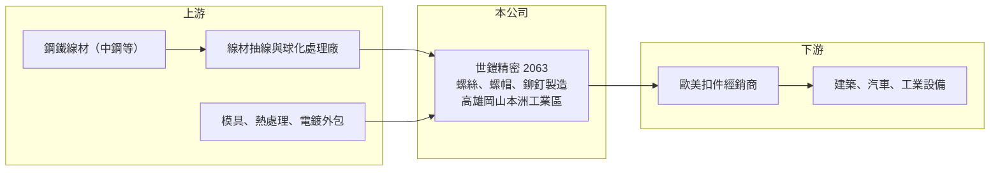

# 2063 世鎧

> 上櫃｜[[產業索引-鋼鐵工業|鋼鐵工業]]｜上市（櫃）日期 2010/09/07

# 第一章：企業模式與商業藍圖

> [!info] 撰寫說明
> 精簡版，由 Claude 依公開資料整理，架構比照 [[2330台積電]]，資料截至 2026-10-08。來源：Goodinfo 台灣股市資訊網經營績效年表（2016 至 2025 年）；nStock 公司沿革；櫃買中心開放資料快照（基本資料、2026 年上半年資產負債與損益、本益比淨值比）。產品別、地區別營收與主要客戶未查得，公開資料有限。#待校對

世鎧精密成立於 1992 年 4 月，原名世鎧工業，2003 年更名，2010 年 9 月在櫃買中心掛牌，工廠位於高雄岡山的本洲工業區，董事長杜泰源、總經理林上安。世鎧是台灣[[螺絲扣件]]聚落中的中小型專業廠，生意本質是把鋼材[[線材]]加工成螺絲，賺取加工附加價值與規格差異帶來的利潤。

- **核心業務：** 世鎧的營業項目是各種螺絲、螺帽、螺絲釘、鉚釘等金屬製品的製造（nStock 整理公司登記資料）。螺絲看似簡單，但不同材質、頭型、牙型、熱處理與表面處理的組合成千上萬，專業廠靠模具開發、製程穩定度與交期在特定規格中建立口碑。
- **營收結構：** 產品別與地區別營收比重未查得。台灣螺絲廠普遍以外銷歐美為主，世鎧是否以建築、汽車或工業用螺絲為主要產品為待校對。年營收在 2021 至 2023 年約 14 億元，2025 年降到約 9.8 億元（Goodinfo）。
- **營運據點：** 工廠位於高雄岡山本洲工業區（櫃買基本資料），岡山是全球知名的螺絲扣件生產聚落，上游線材、模具、熱處理與電鍍廠都在附近，形成完整的分工網路。
- **長期方向：** 世鎧與 [[2065世豐]] 的董事長同為杜泰源（櫃買基本資料），兩家公司在經營上的分工與合作關係未查得。長期要看世鎧能否從一般規格螺絲，持續提高特殊規格、高強度或高精度產品的比重，以抵抗低價競爭。

# 第二章：護城河深度與競爭優勢

世鎧的護城河來自螺絲聚落的群聚效益與特定規格的製程經驗，屬於窄護城河。

- **競爭優勢：** 2017 至 2023 年世鎧的毛利率多在 23% 至 32%（Goodinfo），明顯高於一般鋼鐵加工業，代表產品具有一定的規格門檻或客戶黏著度。岡山聚落讓小型廠也能快速取得模具、熱處理與表面處理等外包資源，降低單一工廠的投資負擔。
- **主要對手：** 國內螺絲廠數量眾多，上市櫃同業包括 [[2065世豐]]、[[5007三星]]、[[2012春雨]] 等；國際上則面對中國、越南、印度的低價螺絲。歐美市場對中國螺絲課徵的[[反傾銷]]稅，長期反而給了台灣廠商轉單空間。
- **觀察重點：** 2024 年起毛利率由 31.8% 降到 2025 年的 17.0%，2026 年上半年回到約 20.5%（櫃買資料推算），顯示價格競爭與需求下滑的壓力不小。長期要看世鎧能否恢復到過去 25% 以上的毛利率水準。

# 第三章：財務體質與盈利規模

資料日期：2026-10-08，表格是撰寫當時的快照；最新月營收、毛利率、累計 EPS 由自動排程寫在本筆記的屬性欄位（月營收、毛利率、累計EPS 等）。#待校對

世鎧在 2022 至 2023 年交出 ROE 24% 以上的成績，2024 年後隨歐美需求放緩明顯回落，呈現扣件業典型的庫存循環。

| 年度 | 營收（億元） | [[毛利率]] | [[營業利益率]] | EPS（元） | [[ROE]] |
|---|---|---|---|---|---|
| 2021 | 14.4 | 23.1% | 14.1% | 3.31 | 19.5% |
| 2022 | 14.5 | 27.5% | 18.4% | 4.91 | 26.8% |
| 2023 | 14.3 | 31.8% | 21.5% | 4.95 | 24.0% |
| 2024 | 11.2 | 22.0% | 10.6% | 1.93 | 8.77% |
| 2025 | 9.75 | 17.0% | 3.73% | 1.72 | 8.13% |

- **長期指標：** 2021 至 2025 年平均 ROE 約 17.4%（推算），2016 至 2025 年十年間 EPS 全部為正（Goodinfo），獲利穩定度在鋼鐵類股中屬較佳者。營收 2021 至 2025 年複合成長率約 -9%（推算）。2025 年度配發現金股利 0.5 元與股票股利 1 元（nStock）。2025 年稅後淨利率 8.47% 高於營業利益率 3.73%，代表業外收益占比提高。
- **[[ROIC]] 與 [[WACC]]：** 2025 年營業利益約 0.36 億元（營收 9.75 億元 × 3.73%），稅後約 0.29 億元。投入資本以 2026 年第二季權益總計 9.6 億元，加上有息負債推估約 5.5 億元（負債總計 10.9 億元的一半，官方快照未拆分）計算，2025 年 ROIC 約 2%（推算）；2023 年營業利益約 3.1 億元，以相近資本估算 ROIC 約 16%（推算）。WACC 約 5.5%（推算：無風險利率 1.75%、市場風險溢酬 6%、β 取鋼鐵同業常見值 0.9，股東權益成本 7.15%；稅前負債成本 2.5%、稅率 20%，以市值約 11 億元與有息負債約 5.5 億元計算權重約 68：32）。過去景氣正常年份 ROIC 明顯高於 WACC，具備創造價值的能力，但 2025 年已跌破門檻，回升速度是關鍵。
- **財務特色：** 2026 年第二季總資產 20.5 億元、負債 10.9 億元，負債比率約 53%，每股淨值 19.99 元。2026 年上半年營收 4.6 億元、營業利益率約 6.0%、EPS 0.85 元（櫃買資料推算）。

# 第四章：總體風險與地緣政治

世鎧的風險來自歐美終端需求、鋼材價格與匯率，以及亞洲低價螺絲的競爭。

- **產業週期：** 螺絲需求跟著歐美的建築、汽車與工業景氣走，經銷商一旦去化庫存，訂單會在短時間內大幅下滑，這種[[長鞭效應]]讓扣件業營收常出現兩到三年的循環。2024 至 2025 年的營收下滑就是典型例子。
- **營運風險：** 原料線材價格上漲時，若無法即時轉嫁給客戶，毛利率會被壓縮；反之鋼價下跌時，手上的高價庫存可能需要提列[[存貨跌價損失]]。公司規模小，單一大客戶或單一市場的變動對營收影響較大。
- **其他風險：** 外銷為主的螺絲廠受新台幣匯率影響明顯；美國關稅政策、歐盟對中國螺絲的反傾銷措施變化，都會改變國際訂單流向。碳排規範逐步納入扣件產品，未來可能增加申報與減碳成本。

# 專有名詞解析

## 金融

- **[[長鞭效應]]**：終端需求的小幅變動，沿供應鏈往上游傳遞時被逐級放大，造成上游庫存與訂單劇烈波動。
- **[[存貨跌價損失]]**：存貨的市價低於帳面成本時，依會計規定須認列的損失，會直接壓低毛利率。
- **[[ROIC]]**：投入資本報酬率，稅後營業利益除以股東權益加有息負債，衡量本業運用資本的效率。
- **[[WACC]]**：加權平均資金成本，股東與債權人要求報酬率的加權平均，是 ROIC 要超越的門檻。

## 產業

- **[[螺絲扣件]]**：用來鎖固與連接零件的螺絲、螺栓、螺帽等產品，台灣高雄岡山是全球重要的生產聚落。
- **[[線材]]**：鋼胚熱軋成捲狀的細長條鋼，是拉線、螺絲、彈簧與焊材的原料。
- **[[反傾銷]]**：進口國對低於正常價格銷售的進口商品加徵關稅的貿易救濟措施。

# 核心供應鏈

- 上游：線材主要由 [[2002中鋼]] 等鋼廠供應，再經 [[2064晉椿]]、[[2073雄順]] 等線材加工廠抽線與熱處理（世鎧的實際供應商未查得）。
- 下游／客戶：歐美扣件經銷商與製造業客戶（具名客戶未查得）。
- 同業：[[2065世豐]]、[[5007三星]]、[[2012春雨]]；中國、越南與印度螺絲廠。

## 最新新聞
<!-- news:start（自動產生，請勿手動編輯此範圍） -->
- 2026-10-08 🏛️ 重訊 16:11｜公告本公司董事會決議除權息基準日及調整配息率相關事宜｜[觀測站](https://mops.twse.com.tw/mops/#/web/t05st01)

完整紀錄：[[2063世鎧 新聞]]
<!-- news:end -->

## 相關連結
- [公開資訊觀測站](https://mopsov.twse.com.tw/mops/web/t05st03?step=1&firstin=1&co_id=2063)
- [Goodinfo](https://goodinfo.tw/tw/StockDetail.asp?STOCK_ID=2063)
- [Yahoo 股市](https://tw.stock.yahoo.com/quote/2063)
- [鉅亨網新聞](https://www.cnyes.com/twstock/2063/news)
