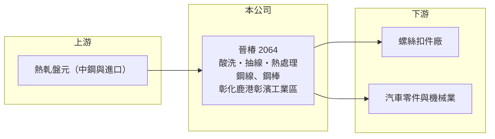

# 2064 晉椿

> 上櫃｜[[產業索引-鋼鐵工業|鋼鐵工業]]｜上市（櫃）日期 2014/12/26

# 第一章：企業模式與商業藍圖

> [!info] 撰寫說明
> 精簡版，由 Claude 依公開資料整理，架構比照 [[2330台積電]]，資料截至 2026-10-08。來源：Goodinfo 台灣股市資訊網經營績效年表（2016 至 2025 年）；nStock 公司資料；櫃買中心開放資料快照（基本資料、2026 年上半年資產負債與損益、2026 年 8 月營收、本益比淨值比）。產品別營收、產能與客戶未查得，公開資料有限。#待校對

晉椿工業成立於 1971 年 5 月，2014 年 12 月在櫃買中心掛牌，工廠位於彰化鹿港的彰濱工業區，董事長陳譽、總經理蕭良賢。晉椿位在鋼鐵與扣件之間的加工環節，把熱軋[[盤元]]加工成精密的鋼線與鋼棒，供應螺絲、汽車零件與機械業使用。

- **核心業務：** 晉椿與子公司的主要營業項目是各類鋼線、鋼棒的製造加工與買賣（nStock 整理公司財報附註）。加工程序通常包括酸洗、抽線、[[球化退火]]與矯直切斷，目的是讓鋼材的尺寸精度與硬度符合下游冷鍛或切削的需求（製程細節為一般產業描述，待校對）。
- **營收結構：** 產品別與地區別營收比重未查得。年營收在 2021 年景氣高點約 27 億元，2023 年降到約 14 億元，2025 年約 15.8 億元（Goodinfo），起伏與鋼價和扣件景氣高度連動。
- **營運據點：** 總部與工廠位於彰化縣鹿港鎮彰濱工業區（櫃買基本資料），中部是台灣汽車零件、手工具與扣件的重要聚落，晉椿可以就近服務這些客戶。
- **長期方向：** 鋼線、鋼棒屬於中間材料，晉椿的價值在於加工品質與交期穩定。2026 年 1 至 8 月營收年增約 16%（櫃買資料），但上半年仍小幅虧損，代表營收回升還沒有轉成穩定獲利，產品往高強度、汽車用等高附加價值規格移動，是長期改善的方向（推估）。

# 第二章：護城河深度與競爭優勢

晉椿的護城河很窄，主要靠在地服務與加工經驗，難以對抗原料價格的波動。

- **競爭優勢：** 下游螺絲與零件廠對線材的尺寸公差、表面品質與金相組織要求嚴格，換供應商需要重新試模與驗證，因此長期合作的加工廠有一定黏著度。晉椿在中部有地利之便，可以小量多樣、快速交貨。
- **主要對手：** 國內同業包括南部的 [[2073雄順]]、扣件大廠 [[2012春雨]] 自有的線材加工部門，以及眾多未上市的抽線廠；上游的 [[2002中鋼]] 也供應部分直接可用的線材產品。進口線材與中國低價鋼材也會壓縮加工費。
- **觀察重點：** 毛利率由 2021 年的 10.6% 降到 2023 年的 1.1%，2025 年為 3.3%，2026 年上半年約 7.6%（Goodinfo、櫃買資料推算）。長期要看毛利率能否穩定站回 8% 至 10% 的水準，才足以支撐營業費用並轉為獲利。

# 第三章：財務體質與盈利規模

資料日期：2026-10-08，表格是撰寫當時的快照；最新月營收、毛利率、累計 EPS 由自動排程寫在本筆記的屬性欄位（月營收、毛利率、累計EPS 等）。#待校對

晉椿近十年的獲利呈現明顯的景氣循環，2019、2020、2023 至 2025 年都是虧損，只有鋼價上漲年份才有不錯的利潤。

| 年度 | 營收（億元） | [[毛利率]] | [[營業利益率]] | EPS（元） | [[ROE]] |
|---|---|---|---|---|---|
| 2021 | 27.0 | 10.6% | 5.48% | 1.81 | 11.0% |
| 2022 | 21.6 | 8.40% | 2.45% | 1.14 | 6.64% |
| 2023 | 14.3 | 1.05% | -7.09% | -1.36 | -8.45% |
| 2024 | 16.4 | 4.89% | -2.21% | -0.18 | -1.24% |
| 2025 | 15.8 | 3.25% | -4.13% | -1.30 | -9.16% |

- **長期指標：** 2021 至 2025 年平均 ROE 約 -0.2%（推算），營收 2021 至 2025 年複合成長率約 -12.5%（推算）。nStock 資料顯示近五年平均現金股利約 0.4 元，但 2025 年度未配發股利，配息穩定度不高。
- **[[ROIC]] 與 [[WACC]]：** 2025 年營業利益約 -0.65 億元（營收 15.8 億元 × -4.13%），稅後約 -0.52 億元。投入資本以 2026 年第二季權益總計 9.3 億元，加上有息負債推估約 8.9 億元（負債總計 14.9 億元的六成，官方快照未拆分）計算，2025 年 ROIC 約 -3%（推算）；2021 年營業利益約 1.5 億元，以相近資本估算 ROIC 約 6%（推算）。WACC 約 4.5%（推算：無風險利率 1.75%、市場風險溢酬 6%、β 取鋼鐵同業常見值 0.9，股東權益成本 7.15%；稅前負債成本 2.5%、稅率 20%，以市值約 8.4 億元與有息負債約 8.9 億元計算權重約 48：52）。只有鋼價大漲的年份 ROIC 才略高於 WACC，五年平均明顯低於門檻，長期並未創造價值。
- **財務特色：** 2026 年第二季總資產 24.2 億元、負債 14.9 億元，負債比率約 62%，其中流動負債 13.9 億元，短期資金需求高。每股淨值 13.39 元，股價淨值比約 0.9 倍。2026 年上半年營收 8.9 億元、營業利益率約 0.4%、EPS -0.04 元（櫃買資料推算）。

# 第四章：總體風險與地緣政治

晉椿的風險來自鋼價循環、下游扣件景氣，以及偏重短期借款的財務結構。

- **產業週期：** 鋼線、鋼棒的售價跟著盤元價格走，加工費相對固定，鋼價下跌時存貨價值縮水，必須提列[[存貨跌價損失]]，這是 2023 年毛利率跌到 1% 的主要原因之一（推估）。下游扣件業的庫存調整也會透過[[長鞭效應]]放大到線材加工廠。
- **營運風險：** 負債比率超過六成且以流動負債為主，若銀行收緊額度或利率上升，資金調度壓力會增加。公司規模小，費用攤提不易，營收一下滑就容易轉虧。
- **其他風險：** 原料盤元價格受國際鋼價、[[反傾銷]]措施與中國出口影響；下游客戶多以外銷為主，間接承受匯率與美國關稅風險。酸洗與熱處理製程涉及環保法規，未來排放與碳費標準提高時可能增加成本。

# 專有名詞解析

## 金融

- **[[存貨跌價損失]]**：存貨的市價低於帳面成本時，依會計規定須認列的損失，會直接壓低毛利率。
- **[[長鞭效應]]**：終端需求的小幅變動，沿供應鏈往上游傳遞時被逐級放大，造成上游庫存與訂單劇烈波動。
- **[[ROIC]]**：投入資本報酬率，稅後營業利益除以股東權益加有息負債，衡量本業運用資本的效率。
- **[[WACC]]**：加權平均資金成本，股東與債權人要求報酬率的加權平均，是 ROIC 要超越的門檻。

## 產業

- **[[盤元]]**：熱軋後捲成盤狀的圓形條鋼，是抽製鋼線、螺絲與彈簧的原料。
- **[[球化退火]]**：把鋼材長時間加熱再緩慢冷卻，使內部碳化物變成球狀，讓鋼材變軟、便於冷鍛成形的熱處理。
- **[[反傾銷]]**：進口國對低於正常價格銷售的進口商品加徵關稅的貿易救濟措施。

# 核心供應鏈

- 上游：熱軋盤元，國內主要供應商為 [[2002中鋼]]，另有進口料（晉椿實際採購比重未查得）。
- 下游／客戶：螺絲扣件、汽車零件與機械加工業者（具名客戶未查得），例如 [[2063世鎧]]、[[2065世豐]]、[[5007三星]] 等螺絲廠屬於同一產業鏈。
- 同業：[[2073雄順]]、[[2012春雨]]（自有線材加工）；國內未上市抽線廠。

## 最新新聞
<!-- news:start -->
<!-- news:end -->

## 相關連結
- [公開資訊觀測站](https://mopsov.twse.com.tw/mops/web/t05st03?step=1&firstin=1&co_id=2064)
- [Goodinfo](https://goodinfo.tw/tw/StockDetail.asp?STOCK_ID=2064)
- [Yahoo 股市](https://tw.stock.yahoo.com/quote/2064)
- [鉅亨網新聞](https://www.cnyes.com/twstock/2064/news)
