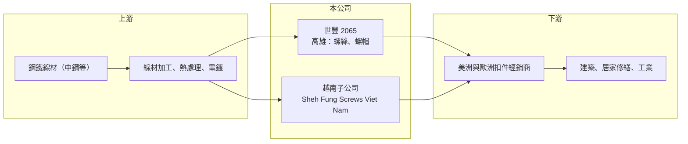

# 2065 世豐

> 上櫃｜[[產業索引-鋼鐵工業|鋼鐵工業]]｜上市（櫃）日期 2017/04/21

# 第一章：企業模式與商業藍圖

> [!info] 撰寫說明
> 精簡版，由 Claude 依公開資料整理，架構比照 [[2330台積電]]，資料截至 2026-10-08。來源：Goodinfo 台灣股市資訊網經營績效年表（2016 至 2025 年）；nStock 公司沿革與重大訊息（越南子公司資金貸與）；櫃買中心開放資料快照（基本資料、2026 年上半年資產負債與損益、2026 年 8 月營收、本益比淨值比）。產品別營收比重與主要客戶未查得，公開資料有限。#待校對

世豐螺絲成立於 1973 年 8 月，1982 年改組為股份有限公司，2015 年更名為世豐螺絲，2017 年 4 月在櫃買中心掛牌，總部位於高雄，董事長杜泰源、總經理陳駿彥。世豐是以外銷為主的[[螺絲扣件]]廠，近年在越南設立生產基地，屬於台灣扣件業「台灣加越南」雙基地布局的代表之一。

- **核心業務：** 世豐的主要營業項目是各種螺絲及螺帽的製造、加工與買賣（nStock 整理公司登記資料）。螺絲廠向上採購鋼鐵[[線材]]，經打頭、輾牙、熱處理與表面處理製成成品，再透過經銷商或品牌商銷往終端市場。
- **營收結構：** 產品別與地區別營收比重未查得。2023 年 10 月的新聞提到美洲客戶庫存去化與歐洲轉單（nStock 新聞標題），顯示美洲與歐洲都是主要市場。年營收在 2021 年約 28.6 億元，2025 年約 20.7 億元（Goodinfo）。
- **營運據點：** 總部位於高雄（櫃買基本資料），並設有越南子公司 Sheh Fung Screws Viet Nam；2023 年 10 月董事會通過對越南子公司分次資金貸與合計 500 萬美元（nStock 重大訊息），顯示越南廠是集團擴產與分散產地的重點。
- **長期方向：** 美國對中國螺絲課徵高額關稅與反傾銷稅後，越南與台灣成為替代產地。世豐透過越南廠爭取對產地有要求的訂單，並與董事長同為杜泰源的 [[2063世鎧]] 形成相近的經營團隊（兩家公司的分工未查得），長期要看越南廠的產能利用率與獲利貢獻。

# 第二章：護城河深度與競爭優勢

世豐的護城河屬於窄護城河，主要來自多產地供貨能力與長期累積的外銷客戶關係。

- **競爭優勢：** 扣件買家重視交期穩定、品質一致與產地合規，世豐同時擁有台灣與越南產能，可以依關稅與原產地規則調配訂單，這是單一產地小廠難以提供的彈性。2019 至 2023 年毛利率維持在 16% 至 23%（Goodinfo），在扣件同業中屬中上水準。
- **主要對手：** 國內上市櫃同業包括 [[2063世鎧]]、[[5007三星]]、[[2012春雨]]等眾多扣件廠，以及在越南、印度設廠的台灣與中國業者。中國螺絲廠產能龐大，在不受關稅影響的市場仍具價格優勢。
- **觀察重點：** 毛利率由 2022 年高點 22.8% 降到 2025 年 14.6%，2026 年上半年回升到約 17.8%（櫃買資料推算）。長期要看越南廠擴產後能否攤薄固定成本，以及關稅政策是否持續有利於非中國產地。

# 第三章：財務體質與盈利規模

資料日期：2026-10-08，表格是撰寫當時的快照；最新月營收、毛利率、累計 EPS 由自動排程寫在本筆記的屬性欄位（月營收、毛利率、累計EPS 等）。#待校對

世豐近十年全部獲利，2022 年 ROE 達 22.6%，之後隨歐美庫存調整逐年下滑，2025 年 ROE 只剩 3.8%。

| 年度 | 營收（億元） | [[毛利率]] | [[營業利益率]] | EPS（元） | [[ROE]] |
|---|---|---|---|---|---|
| 2021 | 28.6 | 19.9% | 12.2% | 5.42 | 18.7% |
| 2022 | 25.9 | 22.8% | 15.2% | 6.95 | 22.6% |
| 2023 | 23.2 | 21.3% | 13.6% | 5.12 | 16.3% |
| 2024 | 23.2 | 18.8% | 9.86% | 3.56 | 11.4% |
| 2025 | 20.7 | 14.6% | 4.79% | 1.12 | 3.84% |

- **長期指標：** 2021 至 2025 年平均 ROE 約 14.6%（推算），2016 至 2025 年 EPS 全部為正（Goodinfo）。營收 2016 年 11.2 億元成長到 2021 年 28.6 億元，之後回落，2021 至 2025 年複合成長率約 -8%（推算）。櫃買資料顯示最近一年度每股股利 1.5 元，高於 2025 年 EPS 1.12 元，代表公司願意動用保留盈餘維持配息。
- **[[ROIC]] 與 [[WACC]]：** 2025 年營業利益約 0.99 億元（營收 20.7 億元 × 4.79%），稅後約 0.79 億元。投入資本以 2026 年第二季權益總計 18.1 億元，加上有息負債推估約 8.7 億元（負債總計 17.3 億元的一半，官方快照未拆分）計算，2025 年 ROIC 約 3%（推算）；2022 年營業利益約 3.9 億元，以相近資本估算 ROIC 約 12%（推算）。WACC 約 5.7%（推算：無風險利率 1.75%、市場風險溢酬 6%、β 取鋼鐵同業常見值 0.9，股東權益成本 7.15%；稅前負債成本 2.5%、稅率 20%，以市值約 22.6 億元與有息負債約 8.7 億元計算權重約 72：28）。景氣正常年份 ROIC 明顯高於 WACC，2025 年跌破，2026 年上半年營業利益率回到約 7.7%，年化 ROIC 約 5% 上下（推算），正在接近門檻。
- **財務特色：** 2026 年第二季總資產 35.4 億元、負債 17.3 億元，負債比率約 49%，每股淨值 28.48 元。2026 年上半年營收 10.9 億元、EPS 2.27 元（櫃買資料），稅後淨利 1.44 億元高於營業利益 0.84 億元，業外收益貢獻不小，來源未查得。

# 第四章：總體風險與地緣政治

世豐的風險集中在歐美需求循環、海外廠的執行，以及貿易政策的變化。

- **產業週期：** 扣件需求跟著歐美建築、居家修繕與工業景氣變動，經銷商的補庫與去化會透過[[長鞭效應]]放大訂單波動。2023 至 2025 年營收與毛利率連續下滑，是典型的去庫存期。
- **營運風險：** 越南廠擴產需要資金與管理資源，產能利用率不足時，折舊與人事成本會拖累毛利率。母公司對子公司的資金貸與也意味著海外營運的財務風險會回到台灣母公司。鋼材價格下跌時，高價庫存可能需要提列[[存貨跌價損失]]。
- **其他風險：** 外銷比重高，新台幣升值會壓縮獲利；美國關稅、原產地規則與歐盟[[反傾銷]]措施變動，可能讓越南產地的優勢改變。越南的勞動成本、法規與供電穩定度，也是長期需要留意的變數。

# 專有名詞解析

## 金融

- **[[長鞭效應]]**：終端需求的小幅變動，沿供應鏈往上游傳遞時被逐級放大，造成上游庫存與訂單劇烈波動。
- **[[存貨跌價損失]]**：存貨的市價低於帳面成本時，依會計規定須認列的損失，會直接壓低毛利率。
- **[[ROIC]]**：投入資本報酬率，稅後營業利益除以股東權益加有息負債，衡量本業運用資本的效率。
- **[[WACC]]**：加權平均資金成本，股東與債權人要求報酬率的加權平均，是 ROIC 要超越的門檻。

## 產業

- **[[螺絲扣件]]**：用來鎖固與連接零件的螺絲、螺栓、螺帽等產品，台灣高雄岡山是全球重要的生產聚落。
- **[[線材]]**：鋼胚熱軋成捲狀的細長條鋼，是拉線、螺絲、彈簧與焊材的原料。
- **[[反傾銷]]**：進口國對低於正常價格銷售的進口商品加徵關稅的貿易救濟措施。

# 核心供應鏈

- 上游：線材主要來自 [[2002中鋼]] 等鋼廠，再經 [[2064晉椿]]、[[2073雄順]] 等加工廠處理（世豐實際供應商未查得）。
- 下游／客戶：美洲與歐洲的扣件經銷商與通路（具名客戶未查得）。
- 同業：[[2063世鎧]]、[[5007三星]]、[[2012春雨]]；中國、越南與印度螺絲廠。

## 最新新聞
<!-- news:start -->
<!-- news:end -->

## 相關連結
- [公開資訊觀測站](https://mopsov.twse.com.tw/mops/web/t05st03?step=1&firstin=1&co_id=2065)
- [Goodinfo](https://goodinfo.tw/tw/StockDetail.asp?STOCK_ID=2065)
- [Yahoo 股市](https://tw.stock.yahoo.com/quote/2065)
- [鉅亨網新聞](https://www.cnyes.com/twstock/2065/news)
