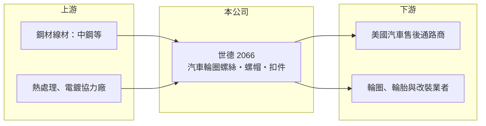

# 2066 世德

> 上櫃｜[[產業索引-電機機械|電機機械]]｜上市（櫃）日期 2013/09/24

# 第一章：企業模式與商業藍圖

> [!info] 撰寫說明
> 精簡版，由 Claude 依公開資料整理，架構比照 [[2330台積電]]，資料截至 2026-10-08。來源：櫃買中心開放資料快照（基本資料、2026 年第二季資產負債與損益、本益比殖利率）、Goodinfo 經營績效頁、nStock 公司簡介。產品與市場描述有部分憑記憶整理，已標「待校對」。公開資料有限。#待校對

世德工業（以下簡稱世德）是高雄大發工業區的汽車扣件廠，理解它的關鍵在於：它賣的是車輛上數量多、規格雜、但安全要求高的小零件，獲利取決於售後市場的品牌通路與少量多樣的生產效率。

- **核心業務：** 世德成立於 1988 年，2013 年在櫃買中心掛牌，登記的營業項目為汽車零件、五金零件、機械零件與螺絲加工。主力產品是固定輪圈用的[[輪圈螺絲]]、螺帽與防盜鎖等汽車[[扣件]]（待校對）。這類零件單價不高，但直接關係行車安全，客戶對強度、尺寸與表面處理有嚴格規範，因此不是一般螺絲廠都能做。
- **營收結構：** 世德以外銷為主，主要市場在美國的汽車[[售後市場]]（待校對）。產品別與地區別的營收比重在這次查到的公開資料中未查得。售後市場的需求來自既有車輛的維修、換胎與改裝，和新車銷售的景氣連動較低，這讓世德的營收比一般原廠零件供應商穩定。
- **營運據點：** 總部與主要生產基地位於高雄市大寮區（大發工業區），鄰近南台灣的鋼材與扣件產業聚落。扣件業高度集中在高雄、台南一帶，原料線材、熱處理、電鍍等協力廠都在附近，形成成本與交期上的群聚優勢。
- **長期方向：** 2018 年營收由 13.4 億元跳升到 19.7 億元，但營業利益率同時由 17.0% 降到約 5%，推估當年起合併了毛利較低的事業或通路（推估，原因未查得）。之後毛利率回到三成上下，代表公司正把較低利潤的業務逐步整合。長期來看，世德的成長要靠擴大品項、深化美國通路，以及因應美國關稅的在地化布局。

# 第二章：護城河深度與競爭優勢

世德的護城河屬於「窄護城河」，來自安全件的認證門檻、少量多樣的生產能力與長期通路關係，而不是技術獨占。

- **競爭優勢：** 輪圈螺絲與螺帽對應的車款、輪圈規格非常多，售後通路需要一個能一次供應數千種料號、穩定交貨的供應商。世德長年累積的模具、料號資料與熱處理製程，讓它能接少量多樣的訂單，這是新進者短期難以複製的。毛利率長年維持在 25% 至 33% 之間，也反映它不是單純比價的大宗螺絲廠。
- **主要對手：** 台灣扣件業者眾多，與汽車扣件相關的上市櫃公司包括 [[8349恒耀]]、[[2228劍麟]] 等，另有中國與印度的低價扣件廠。美國售後市場也有本地品牌與通路商自有的供應鏈。由於扣件技術門檻有限，世德必須靠品項齊全與服務維持定價。
- **觀察重點：** 長期最該追蹤的是營業利益率能否回到 10% 以上。2023 年營業利益率 14.3%，2025 年降到 2.73%，同期毛利率只由 33.5% 降到 29.9%，代表費用（推估包含運費、關稅與匯率影響）吃掉了大部分毛利。2026 年上半年營業利益率回升到約 7.8%，若能延續，代表 2025 年屬於短期衝擊而非結構性惡化。

# 第三章：財務體質與盈利規模

資料日期：2026-10-08，表格是撰寫當時的快照；最新月營收、毛利率、累計 EPS 由自動排程寫在本筆記的屬性欄位（月營收、毛利率、累計EPS 等）。#待校對

世德的財務呈現「高毛利、費用率偏高」的售後零件商樣貌：營收規模在 20 多億元，毛利率三成上下，獲利對匯率、運費與關稅相當敏感。

| 年度 | 營收（億元） | [[毛利率]] | [[營業利益率]] | EPS（元） | [[ROE]] |
|---|---|---|---|---|---|
| 2021 | 22.8 | 27.7% | 8.43% | 4.00 | 11.2% |
| 2022 | 28.5 | 30.4% | 11.1% | 8.05 | 19.0% |
| 2023 | 27.8 | 33.5% | 14.3% | 8.08 | 17.8% |
| 2024 | 27.6 | 33.0% | 9.71% | 6.16 | 12.8% |
| 2025 | 24.9 | 29.9% | 2.73% | 1.34 | 2.73% |

（來源：Goodinfo 經營績效頁。2026 年上半年依櫃買中心資料，營收 14.6 億元、毛利率約 34.9%、EPS 2.94 元。）

- **營收規模：** 2020 年營收 19.9 億元，2025 年 24.9 億元，年複合成長率約 4.6%（推算）。2022 年營收創 28.5 億元高點，與疫後美國汽車售後需求暢旺有關（推估）。整體而言，世德是穩定、緩慢成長的公司，而不是高成長股。
- **獲利：** 2021 至 2025 年平均 ROE 約 12.7%（推算），2022、2023 年接近兩成，2025 年跌到 2.7%。2015 至 2016 年營業利益率曾在 20% 以上，之後明顯下移，顯示營收擴大的同時，獲利率被稀釋。
- **財務特色：** 依 2026 年第二季資料，總資產約 37.6 億元、負債約 16.0 億元、股東權益約 21.6 億元，每股淨值 48.82 元，負債比約 43%。Goodinfo 統計 2013 年以來平均現金股利約 3.11 元，2023 年曾配息 4.42 元，近期每股股利 2.15 元，配息率長期偏高。公司曾發行無擔保轉換公司債。自由現金流是否長期為正未查得。
- **[[ROIC]] 與 [[WACC]]：** 以 2025 年營業利益約 0.68 億元（24.9 億元 × 2.73%）、稅率 20% 計算，稅後營業利益約 0.54 億元；有息負債未查得，投入資本以股東權益 21.6 億元到總資產 37.6 億元為區間，ROIC 約 1.4% 至 2.5%（推算）。2024 年同法約 5.7% 至 9.9%，2023 年更高（推算）。WACC 以 CAPM 推估：無風險利率 1.75%、市場風險溢酬 6%、β 假設 0.8（傳產零件股常見值），權益成本約 6.6%；稅後負債成本 2%、負債占三成，WACC 約 5.2%（推算）。景氣正常年度 ROIC 高於 WACC，代表本業長期能創造價值；2025 年則低於資金成本，需要看費用結構能否恢復。

# 第四章：總體風險與地緣政治

世德的風險集中在單一市場、匯率與原料，屬於典型外銷型傳產零件股。

- **產業週期：** 汽車售後市場需求比新車穩定，但仍受美國消費力、換胎週期與通路庫存影響。通路商在景氣轉弱時會先去化庫存，零件廠的訂單往往比終端需求波動更大，這是 2025 年營收下滑的可能原因之一（推估）。
- **營運風險：** 營收高度依賴美國市場與少數大型通路客戶（待校對），客戶調整採購或轉向低價供應商，影響會直接反映在營收。扣件同質性較高，價格競爭壓力長期存在。
- **其他風險：** 美國對進口汽車零件課徵關稅，會壓縮售價或迫使公司分擔成本；新台幣升值會同時打擊營收與毛利。主要原料為鋼材線材，價格隨國際鋼價波動。電鍍與熱處理製程也面臨愈來愈嚴格的環保法規。

# 專有名詞解析

## 應用

- **[[輪圈螺絲]]**：把車輪固定在輪轂上的螺絲或螺帽，屬安全件，須符合強度與尺寸規範。
- **[[售後市場]]**：新車出廠之後的維修、保養與改裝零件市場，英文為 Aftermarket，需求較不受新車銷售影響。

## 產業

- **[[扣件]]**：螺絲、螺帽、螺栓等用來固定零件的五金，台灣南部是全球重要的扣件生產聚落。

# 核心供應鏈

- 上游：扣件用鋼材線材供應商，例如 [[2002中鋼]]，以及南台灣的熱處理、電鍍與包裝協力廠。
- 下游／客戶：美國為主的汽車售後零件通路商、輪胎與輪圈業者（具體客戶名單公開資料未點名，#待校對）。
- 同業：汽車與工業扣件廠，例如 [[8349恒耀]]、[[2228劍麟]]、[[2012春雨]]（線材與扣件）。

## 最新新聞
<!-- news:start -->
<!-- news:end -->

## 相關連結
- [公開資訊觀測站](https://mopsov.twse.com.tw/mops/web/t05st03?step=1&firstin=1&co_id=2066)
- [Goodinfo](https://goodinfo.tw/tw/StockDetail.asp?STOCK_ID=2066)
- [Yahoo 股市](https://tw.stock.yahoo.com/quote/2066)
- [鉅亨網新聞](https://www.cnyes.com/twstock/2066/news)
