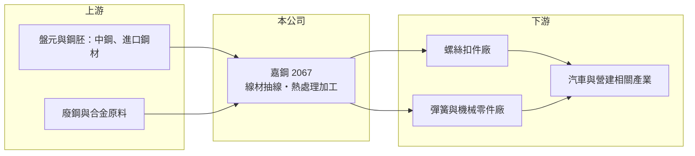

# 2067 嘉鋼

> 上櫃｜[[產業索引-電機機械|電機機械]]｜上市（櫃）日期 2014/05/26

# 第一章：企業模式與商業藍圖

> [!info] 撰寫說明
> 精簡版，由 Claude 依公開資料整理，架構比照 [[2330台積電]]，資料截至 2026-10-08。來源：櫃買中心開放資料快照（基本資料、2026 年第二季資產負債與綜合損益）、Goodinfo 經營績效頁、nStock 公司簡介、觀測站重大訊息標題；產品與客戶細節依記憶整理。公開資料有限。#待校對

嘉鋼精密是嘉義的老牌鋼鐵加工廠，產業分類在電機機械，但本質是把鋼鐵原料加工成線材與鋼線的中游廠。理解嘉鋼，要先看懂中游加工廠「夾在上游鋼價與下游客戶之間」的薄利處境。

- **核心業務：** 嘉鋼 1974 年在嘉義民雄成立，原名嘉義鋼鐵，2018 年 6 月更名為嘉鋼精密工業，2014 年 5 月起在櫃買中心掛牌。依公開簡介，營業項目是鋼品的鑄造、加工與買賣；產品以碳鋼與合金鋼[[線材]]的抽線與熱處理加工為主，用於[[扣件]]、彈簧與機械零件（產品細項依記憶整理，待校對）。這類產品規格標準化程度高，客戶比的是品質穩定、交期與價格。
- **營收結構：** 2025 年營收約 10.2 億元，產品別與內外銷比重本次未查得。財報有非控制權益，代表旗下有非百分之百持股的子公司，子公司的業務與地點本次未查得。
- **營運據點：** 工廠位於嘉義縣民雄工業區，鄰近南部的扣件與五金產業聚落。南台灣是全球主要的螺絲扣件生產地之一，線材加工廠靠近客戶，可以降低運輸成本並配合小批量、多規格的訂單。
- **長期方向：** 嘉鋼連續多年虧損，2026 年辦理減資，實收資本額由約 4.51 億元降為約 3.39 億元（依櫃買中心基本資料，推估為[[減資彌補虧損]]，待校對）。同年並公告[[資金貸與]]超限的改善計畫執行情形，代表公司曾有資金借給他人超過法定限額的情況。這兩件事顯示公司目前的重點在財務整頓，而不是擴張。

# 第二章：護城河深度與競爭優勢

中游鋼鐵加工業的護城河普遍很淺。本章說明嘉鋼的競爭位置，以及它為何難以把成本轉嫁給客戶。

- **競爭優勢：** 嘉鋼在嘉義經營超過 50 年，與南部扣件與五金客戶有長期往來，熟悉多規格、小批量的訂單模式，這是地方型加工廠能存活的主要原因。但線材加工的設備與技術門檻不高，同業產品替代性強，客戶多以價格與交期比價，嘉鋼的毛利率長期只有 4% 至 16%，說明它缺乏定價權。
- **主要對手：** 台灣線材加工與鋼線同業包括 [[5016松和]] 等球化與抽線加工廠，以及多家未上市的地方加工廠；上游一貫作業鋼廠 [[2002中鋼]] 本身也供應[[盤元]]與線材，具備規模與成本優勢。進口線材，特別是中國與東南亞產品，也會在景氣差時壓低國內報價。
- **觀察重點：** 長期要觀察三點：減資與財務整頓後能否止血、毛利率能否回到 10% 以上的正常水準，以及資金貸與等公司治理問題是否改善。若無法提升產品附加價值，例如轉向高強度或汽車用的精密鋼線，嘉鋼很難擺脫跟著鋼價起伏的處境。

# 第三章：財務體質與盈利規模

資料日期：2026-10-08，表格是撰寫當時的快照；最新月營收、毛利率、累計 EPS 由自動排程寫在本筆記的屬性欄位（月營收、毛利率、累計EPS 等）。#待校對

嘉鋼的財務特色是長期本業虧損、權益持續被侵蝕、負債比偏高。本章用多年度數字說明虧損的結構性。

| 年度 | 營收（億元） | [[毛利率]] | [[營業利益率]] | EPS（元） | [[ROE]] |
|---|---|---|---|---|---|
| 2019 | 8.84 | 15.1% | -4.43% | -1.25 | -10.7% |
| 2020 | 7.21 | 13.8% | -7.17% | -0.88 | -8.03% |
| 2021 | 9.85 | 16.1% | -2.62% | -0.24 | -2.82% |
| 2022 | 12.4 | 11.6% | -5.89% | -0.62 | -9.34% |
| 2023 | 11.6 | 11.4% | -4.07% | -0.76 | -12.4% |
| 2024 | 10.1 | 4.59% | -12.9% | -2.74 | -42.0% |
| 2025 | 10.2 | 3.88% | -12.6% | -2.80 | -49.8% |

（來源：Goodinfo 經營績效頁）

- **營收規模：** 2019 至 2025 年營收在 7.2 億至 12.4 億元之間起伏，年複合成長率約 2.4%（推算），2022 年隨鋼價上漲達到高點後回落。營收高低主要反映鋼價與景氣，而不是市占率的變化。2026 年上半年營收約 4.6 億元。
- **獲利：** 2019 年以來每年[[營業利益率]]都是負數，代表即使在 2021 至 2022 年鋼市熱絡時，本業也沒有賺錢。2024 年起毛利率跌到 5% 以下，營業虧損擴大到營收的一成以上；2026 年上半年毛利率約 2.8%、營業利益率約 -14.2%、EPS -1.55 元（依櫃買中心資料推算）。毛利不足以支付營業費用，是虧損的直接原因。
- **財務特色：** 2026 年第二季資產總計 19.3 億元、負債 17.1 億元，負債比約 88%；流動負債 14.0 億元高於流動資產 8.5 億元，短期償債壓力大。累積虧損約 4.1 億元，母公司業主權益只剩約 1.9 億元，每股淨值 4.26 元。近 5 年沒有發放股利。
- **長期指標：** 2021 至 2025 年 ROE 每年為負，平均約 -23%（推算）；由於權益基數持續縮小，近兩年 ROE 的負值被放大到 -40% 以上。自由現金流是否為正本次未查得，但長期虧損與高負債代表公司主要靠借款與資產維持營運。

**[[ROIC]] 與 [[WACC]]：** 以 2025 年營收 10.2 億元、營業利益率 -12.6% 計算，營業虧損約 1.29 億元，虧損無所得稅，稅後營業利益約 -1.29 億元。投入資本以 2026 年第二季權益總計 2.24 億元加上有息負債（未查得，負債總計 17.1 億元，推估有息負債約 8 億至 12 億元）計算，約 10 億至 14 億元，ROIC 約 -9% 至 -13%（推算）。WACC 以 CAPM 推估：無風險利率 1.75%、市場風險溢酬 6%、β 取鋼鐵同業常見值 1.0（推算），股權成本約 7.75%；負債成本假設 3%、稅後約 2.4%；資本結構以市值約 2.2 億元、負債約 10 億元計，負債占八成以上，帳面 WACC 約 3.4%（推算）。不過高負債公司的實際資金成本遠高於此帳面數字，因為債權人與股東都要求更高的風險補償。ROIC 為負、遠低於 WACC，代表嘉鋼長期在消耗價值，必須先讓本業轉為獲利，資本報酬的討論才有意義。

# 第四章：總體風險與地緣政治

嘉鋼的風險以財務體質與公司治理為最優先，其次才是鋼鐵景氣。

- **產業週期：** 線材加工的營收與毛利跟著鋼價與扣件、汽車、營建等下游景氣起伏。鋼價下跌時，庫存跌價損失會先壓縮毛利；鋼價上漲時，若無法及時轉嫁給客戶，毛利同樣被壓縮。中國鋼鐵產能過剩時，低價進口線材會壓低全球報價。
- **營運與財務風險：** 負債比近九成、流動負債高於流動資產，代表公司對銀行續借的依賴很高，一旦銀行緊縮額度，營運資金可能出現缺口。連續虧損使權益持續減少，2026 年的減資雖然能整理帳面虧損，但若本業沒有改善，權益仍可能再度被侵蝕。
- **公司治理風險：** 2026 年公告資金貸與超限的改善計畫，代表公司曾把資金借給他人且超過內部或法定限額。資金貸與若對象為關係人或回收不易，會進一步影響公司的流動性與股東權益，需持續追蹤改善進度。
- **其他風險：** 原料盤元多來自國內鋼廠或進口，受鐵礦砂、廢鋼價格與匯率影響；美國與歐盟對鋼鐵與扣件的關稅、反傾銷措施，也會透過下游扣件客戶的出口影響嘉鋼的訂單。

# 專有名詞解析

## 金融

- **[[減資彌補虧損]]**：公司減少股本、用以沖銷帳上累積虧損，股數變少但股東權益總額不變。
- **[[資金貸與]]**：公司把資金借給其他公司或個人，依法規有額度上限，超限須公告並提出改善計畫。

## 產業

- **[[線材]]**：將鋼胚熱軋成細長圓形斷面的鋼材，常捲成盤狀，再經抽線加工製成螺絲、彈簧與鋼線。
- **[[盤元]]**：捲成盤狀的熱軋線材，是製造螺絲扣件、鋼線的主要原料。
- **[[扣件]]**：螺絲、螺帽、鉚釘等用於連接與固定的零件，台灣南部是全球主要生產聚落之一。

# 核心供應鏈

- 上游：一貫作業鋼廠 [[2002中鋼]] 供應盤元與線材，另有中國、東南亞的進口鋼材；廢鋼與合金原料影響煉鋼與鑄造成本。
- 下游／客戶：南部螺絲扣件廠（例如 [[2012春雨]]、[[8349恒耀]] 這類扣件業者為代表性客群，實際客戶名稱未查得）、彈簧與機械零件廠，終端為汽車、營建與五金產業。
- 同業：線材與鋼線加工 [[5016松和]]；上游兼營線材的 [[2002中鋼]]。

## 最新新聞
<!-- news:start（自動產生，請勿手動編輯此範圍） -->
- 2026-10-08 🏛️ 重訊 14:16｜公告本公司未來三個月預計之現金收支狀況，及上一月份 之銀行融資額度使用情形｜[觀測站](https://mops.twse.com.tw/mops/#/web/t05st01)

完整紀錄：[[2067嘉鋼 新聞]]
<!-- news:end -->

## 相關連結
- [公開資訊觀測站](https://mopsov.twse.com.tw/mops/web/t05st03?step=1&firstin=1&co_id=2067)
- [Goodinfo](https://goodinfo.tw/tw/StockDetail.asp?STOCK_ID=2067)
- [Yahoo 股市](https://tw.stock.yahoo.com/quote/2067)
- [鉅亨網新聞](https://www.cnyes.com/twstock/2067/news)
