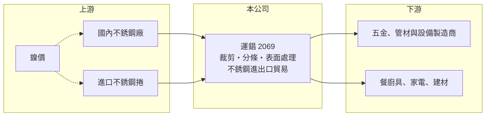

# 2069 運錩

> 上市｜[[產業索引-鋼鐵工業|鋼鐵工業]]｜上市（櫃）日期 2016/03/22

# 第一章：企業模式與商業藍圖

> [!info] 撰寫說明
> 精簡版，由 Claude 依公開資料整理，架構比照 [[2330台積電]]，資料截至 2026-10-08。來源：Goodinfo 台灣股市資訊網經營績效年表（2016 至 2025 年）；nStock 公司資料；證交所開放資料快照（基本資料、2026 年上半年資產負債與損益、營益分析、2025 年度股利、本益比淨值比）。產品別營收比重、工廠產能與客戶未查得，公開資料有限。#待校對

運錩鋼鐵成立於 1987 年 7 月，2016 年 3 月在證交所上市，總部位於高雄前金區，董事長兼總經理顏德和。運錩是[[不銹鋼]]產業鏈中的加工與貿易商，向鋼廠或國外採購不銹鋼材，經裁剪、分條與表面處理後賣給下游製造業，也經營不銹鋼的進出口貿易。

- **核心業務：** 運錩與子公司主要從事不銹鋼的裁剪、分條、表面處理及加工品買賣，並經營不銹鋼產品的進出口（nStock 整理公司財報附註）。這類業者在產業中扮演[[鋼材加工中心]]的角色：鋼廠只賣大捲標準品，加工中心把鋼捲切成客戶需要的寬度、長度與表面，並提供小量、即時的交貨服務。
- **營收結構：** 產品別與內外銷比重未查得。年營收在 2016 至 2020 年約 74 至 87 億元，2021 年跳升到 143 億元，2025 年約 101 億元（Goodinfo）。2021 年營收倍增的原因（價格上漲、轉投資併入或貿易量擴大）未查得。
- **營運據點：** 總部位於高雄市前金區（證交所基本資料），加工廠位置與產能未查得。南台灣是國內不銹鋼產業的主要聚落，上游有大型不銹鋼廠，下游有大量五金、管材與設備業者。
- **長期方向：** 加工貿易商的利潤來自加工費與買賣價差，規模與庫存管理能力決定長期競爭力。2026 年上半年營業利益率回升到 7.6%、EPS 1.66 元（證交所資料），是近年較好的水準，能否把加工比重拉高、降低對純貿易價差的依賴，是長期觀察重點。

# 第二章：護城河深度與競爭優勢

運錩的護城河很窄，主要靠庫存規模、加工服務與通路關係，而不是技術門檻。

- **競爭優勢：** 下游中小型製造業需要多樣規格、小量快速交貨的不銹鋼材，直接向大鋼廠採購並不方便。運錩以庫存與加工能力提供這種服務，客戶關係與交貨速度構成一定的轉換成本。
- **主要對手：** 國內不銹鋼加工與通路同業包括 [[2027大成鋼]]、[[2032新鋼]]、[[2025千興]] 等，以及眾多未上市的鋼材行；上游鋼廠如燁聯、[[2035唐榮]] 也會直接供貨給大客戶。中國與印尼的低價不銹鋼捲則壓抑整體報價。
- **觀察重點：** 毛利率在 2021 年鎳價上漲時達 13.6%，2023 年跌到 3.5%，2024 至 2025 年回到 9% 以上（Goodinfo）。不銹鋼通路商的獲利與鎳價方向高度相關，長期要看公司在鎳價下跌期能否控制庫存，避免大幅虧損。

# 第三章：財務體質與盈利規模

資料日期：2026-10-08，表格是撰寫當時的快照；最新月營收、毛利率、累計 EPS 由自動排程寫在本筆記的屬性欄位（月營收、毛利率、累計EPS 等）。#待校對

運錩是典型的薄利多銷通路商，營業利益率多在 0% 至 7% 之間，ROE 在景氣好時可達兩位數，景氣差時接近零。

| 年度 | 營收（億元） | [[毛利率]] | [[營業利益率]] | EPS（元） | [[ROE]] |
|---|---|---|---|---|---|
| 2021 | 143 | 13.6% | 6.72% | 4.73 | 19.7% |
| 2022 | 140 | 8.34% | 2.66% | 1.16 | 4.57% |
| 2023 | 118 | 3.48% | -0.46% | -0.90 | -3.77% |
| 2024 | 107 | 9.66% | 3.46% | 1.35 | 5.79% |
| 2025 | 101 | 9.36% | 3.63% | 1.62 | 6.61% |

- **長期指標：** 2021 至 2025 年平均 ROE 約 6.6%（推算），營收 2020 至 2025 年複合成長率約 6%（推算，2020 年 74.3 億元）。2018 年 EPS 5.9 元主要來自約 9.4 億元的業外收益（Goodinfo），不代表本業水準。2025 年度配發現金股利 1 元，配發率約 62%（證交所資料推算）。
- **[[ROIC]] 與 [[WACC]]：** 2025 年營業利益約 3.7 億元（營收 101 億元 × 3.63%），稅後約 2.9 億元。投入資本以 2026 年第二季權益總計 44.0 億元，加上有息負債推估約 36.5 億元（負債總計 60.9 億元的六成，貿易商多以短期借款支應庫存，官方快照未拆分）計算，2025 年 ROIC 約 3.6%（推算）；2026 年上半年營業利益 3.8 億元，年化 ROIC 約 7.6%（推算）。WACC 約 4.7%（推算：無風險利率 1.75%、市場風險溢酬 6%、β 取鋼鐵同業常見值 0.9，股東權益成本 7.15%；稅前負債成本 2.5%、稅率 20%，以市值約 41 億元與有息負債約 36.5 億元計算權重約 53：47）。過去五年 ROIC 大多在 WACC 上下徘徊，只有鎳價上漲年份明顯高於門檻，長期創造價值的能力有限但不至於持續消耗資本。
- **財務特色：** 2026 年第二季總資產 104.8 億元、負債 60.9 億元，負債比率約 58%，流動負債 45.2 億元，反映以短期資金支應存貨與應收帳款的通路商特性。每股淨值 26.43 元。2026 年上半年營收 50.0 億元、毛利率 14.66%、營業利益率 7.61%（證交所資料）。

# 第四章：總體風險與地緣政治

運錩的風險集中在鎳價循環、庫存管理與高槓桿的營運資金結構。

- **產業週期：** 不銹鋼價格由鎳價主導，印尼[[鎳生鐵]]產能擴張使價格長期承壓。通路商手上隨時有大量庫存，鎳價上漲時賺庫存利益，下跌時要提列[[存貨跌價損失]]，2023 年虧損就是鎳價回落期的例子。
- **營運風險：** 貿易與加工的利潤率薄，營業利益率只要下滑幾個百分點就可能轉虧。負債比率接近六成且以流動負債為主，景氣反轉時若存貨變現速度放慢，資金壓力會同時上升。
- **其他風險：** 進出口業務受匯率與海運影響；中國與印尼不銹鋼低價出口，以及各國[[反傾銷]]措施改變貿易流向，可能壓縮台灣通路商的價差。下游客戶多為中小型製造業，景氣下行時也有應收帳款回收風險。

# 專有名詞解析

## 金融

- **[[存貨跌價損失]]**：存貨的市價低於帳面成本時，依會計規定須認列的損失，會直接壓低毛利率。
- **[[ROIC]]**：投入資本報酬率，稅後營業利益除以股東權益加有息負債，衡量本業運用資本的效率。
- **[[WACC]]**：加權平均資金成本，股東與債權人要求報酬率的加權平均，是 ROIC 要超越的門檻。

## 產業

- **[[不銹鋼]]**：含鉻、鎳等合金元素的耐腐蝕鋼材，鎳價是主要成本，價格隨鎳價波動。
- **[[鋼材加工中心]]**：向鋼廠採購大捲鋼材，再依客戶需求裁剪、分條、表面處理後供貨的中間商，賺取加工費與價差。
- **[[鎳生鐵]]**：以紅土鎳礦冶煉出的含鎳生鐵，是生產不銹鋼的低成本鎳原料，印尼為主要產地。
- **[[反傾銷]]**：進口國對低於正常價格銷售的進口商品加徵關稅的貿易救濟措施。

# 核心供應鏈

- 上游：國內不銹鋼廠如燁聯、[[2035唐榮]]，以及進口不銹鋼捲（運錩實際採購對象未查得）。
- 下游／客戶：五金、管材、設備、餐廚具與建材業者（具名客戶未查得）。
- 同業：[[2027大成鋼]]、[[2032新鋼]]、[[2025千興]]；國內不銹鋼鋼材行。

## 最新新聞
<!-- news:start -->
<!-- news:end -->

## 相關連結
- [公開資訊觀測站](https://mopsov.twse.com.tw/mops/web/t05st03?step=1&firstin=1&co_id=2069)
- [Goodinfo](https://goodinfo.tw/tw/StockDetail.asp?STOCK_ID=2069)
- [Yahoo 股市](https://tw.stock.yahoo.com/quote/2069)
- [鉅亨網新聞](https://www.cnyes.com/twstock/2069/news)
