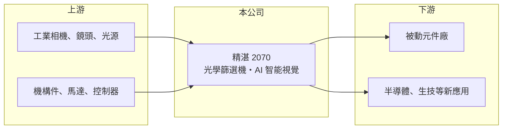

# 2070 精湛

> 上櫃｜[[產業索引-電機機械|電機機械]]｜上市（櫃）日期 2018/12/17

# 第一章：企業模式與商業藍圖

> [!info] 撰寫說明
> 精簡版，由 Claude 依公開資料整理，架構比照 [[2330台積電]]，資料截至 2026-10-08。來源：櫃買中心開放資料快照（基本資料、2026 年第二季資產負債與損益）、Goodinfo 經營績效頁、優分析轉載鉅亨網 2026 年 8 月報導。公開資料有限。#待校對

精湛光學科技（以下簡稱精湛）是高雄的設備廠，專做電子零件的光學外觀篩選機。理解它的關鍵在於：它賣的不是產能，而是「幫客戶把瑕疵品挑出來」的良率保證，因此毛利率能長期維持在五成上下。

- **核心業務：** 精湛成立於 1994 年，2018 年在櫃買中心掛牌，總部位於高雄湖內。主力產品是[[光學篩選機]]，依 2026 年 8 月報導約占營收八成，用高速相機與影像演算法逐顆檢查被動元件等小型電子零件的外觀瑕疵。被動元件一批動輒數百萬顆，人工無法全檢，所以這類設備是元件廠出貨前的必要關卡。
- **營收結構：** 營收以光學篩選機為主，其餘為零組件、維修與其他設備，詳細比重未查得。終端客戶以[[被動元件]]廠為主，報導指出被動元件產業的需求最明顯，並有出貨給歐洲客戶的高階機種。由於客戶集中在被動元件業，精湛的接單週期大致跟著被動元件的擴產週期走。
- **營運據點：** 總部與生產位於高雄湖內，子公司先聯科技在高雄、桃園擴充產能與團隊。設備業的關鍵資源是光學、機構與軟體工程師，而不是大型廠房，因此資本支出相對輕。
- **長期方向：** 公司宣示由傳統光學篩選轉型為結合 AI 與 [[AOI]] 的智能視覺，以[[深度學習]]改善表面瑕疵的判讀，降低傳統演算法判定過嚴造成的「過殺」，也就是把良品誤判為不良品。應用也正延伸到半導體晶片與生技等領域。這個方向如果成功，可以降低對被動元件單一產業的依賴。

# 第二章：護城河深度與競爭優勢

精湛的護城河來自檢測演算法的累積、客戶製程的熟悉度與專利，在小眾利基市場中屬於窄而深的類型。

- **競爭優勢：** 依報導，公司擁有近 50 項專利，並把深度學習導入檢測演算法。篩選機的價值在於誤判率與檢測速度，這需要長期累積各種元件的瑕疵影像資料，客戶產線一旦用慣某家設備，換供應商要重新驗證良率，轉換成本不低。毛利率長期在 45% 至 52% 之間（2020 年除外），反映它賣的是技術而非硬體組裝。
- **主要對手：** 台灣的檢測設備廠如 [[6187萬潤]]、[[3455由田]] 在部分被動元件與電子零件檢測領域有重疊，日本也有被動元件外觀檢測設備的專業廠商。具體在光學篩選機市場的對手名單與市占率未查得。
- **觀察重點：** 長期要看兩件事：一是 AI 視覺能否帶來新客群，讓營收脫離 6 億至 7 億元的區間；二是被動元件大廠在 AI 伺服器帶動下的擴產，能否延續到更多設備訂單。2026 年上半年毛利率 50.2%、EPS 1.29 元，比前一年同期明顯改善。

# 第三章：財務體質與盈利規模

資料日期：2026-10-08，表格是撰寫當時的快照；最新月營收、毛利率、累計 EPS 由自動排程寫在本筆記的屬性欄位（月營收、毛利率、累計EPS 等）。#待校對

精湛是營收規模小、毛利率高、低負債的設備公司，獲利主要受客戶擴產週期與匯率影響。

| 年度 | 營收（億元） | [[毛利率]] | [[營業利益率]] | EPS（元） | [[ROE]] |
|---|---|---|---|---|---|
| 2021 | 5.97 | 50.2% | 19.7% | 2.66 | 11.6% |
| 2022 | 6.04 | 45.1% | 10.6% | 2.32 | 9.59% |
| 2023 | 6.22 | 51.5% | 15.0% | 2.25 | 8.98% |
| 2024 | 7.15 | 52.2% | 18.3% | 2.97 | 11.5% |
| 2025 | 6.94 | 46.4% | 13.5% | 2.30 | 8.73% |

（來源：Goodinfo 經營績效頁。2020 年營收 4.68 億元、EPS −1.45 元，為近十年唯一虧損年。）

- **營收規模：** 2020 至 2025 年營收由 4.68 億元增至 6.94 億元，年複合成長率約 8.2%（推算），但若從 2015 年的 7.21 億元算起，十年間營收幾乎沒有成長。這代表精湛長期處在被動元件設備的利基市場裡，天花板明顯，需要新應用才能突破。
- **獲利：** 2021 至 2025 年平均 ROE 約 10.1%（推算），比 2015 年的 21.5% 低。ROE 偏低的原因不是本業賺不到錢，而是公司保留了較多現金與資產，股東權益基數大。
- **財務特色：** 依 2026 年第二季資料，總資產約 17.3 億元、負債約 5.5 億元、股東權益約 11.8 億元，負債比約 32%，流動資產占六成。Goodinfo 統計的歷年平均現金股利約 1.55 元，近期每股股利 1.50 元，配息相對穩定。自由現金流是否長期為正未查得，但設備業資本支出輕，推估多數年度為正。
- **[[ROIC]] 與 [[WACC]]：** 以 2025 年營業利益約 0.94 億元（6.94 億元 × 13.5%）、稅率 20% 計算，稅後營業利益約 0.75 億元；投入資本以股東權益 11.8 億元到總資產 17.3 億元為區間，ROIC 約 4.3% 至 6.3%（推算），2024 年同法約 6.0% 至 8.9%（推算）。若扣除帳上現金，實際營運資本報酬會更高。WACC 以 CAPM 推估：無風險利率 1.75%、市場風險溢酬 6%、β 假設 1.0（中小型設備股常見值），權益成本約 7.8%；公司有息負債少，WACC 約 7%（推算）。整體 ROIC 與 WACC 大致相當，代表本業有超額報酬，但被閒置資金稀釋。

# 第四章：總體風險與地緣政治

精湛的風險主要在客戶產業集中與規模小，對單一景氣循環的抵抗力有限。

- **產業週期：** 被動元件是典型的週期產業，元件廠只有在擴產時才大量採購設備。2019 至 2020 年被動元件景氣反轉時，精湛營收由 8.82 億元降到 4.68 億元並出現虧損，說明設備商的波動比元件廠本身更大。
- **營運風險：** 客戶集中在少數被動元件大廠，大客戶延後擴產就會直接影響全年營收。公司規模小，研發人才流失或核心技術被對手追上，都會削弱定價能力。
- **其他風險：** 外銷比重不低，新台幣升值會壓縮營收與毛利；中國本土檢測設備廠以低價搶市，可能壓縮中國客戶的訂單。AI 視覺轉型需要持續投入研發，短期內可能先增加費用。

# 專有名詞解析

## 應用

- **[[深度學習]]**：以多層神經網路從大量資料中學習特徵的 AI 技術，可用於影像瑕疵判讀。

## 產業

- **[[光學篩選機]]**：用高速相機與影像演算法逐顆檢查電子零件外觀並自動剔除瑕疵品的設備。
- **[[AOI]]**：自動光學檢測，以光學影像取代人眼檢查產品瑕疵，廣泛用於 PCB、面板與半導體。
- **[[被動元件]]**：電容、電阻、電感等不需外部電源即可運作的基礎電子零件，用量極大。

# 核心供應鏈

- 上游：工業相機、光學鏡頭、光源模組，以及機構件、馬達與控制系統供應商。
- 下游／客戶：被動元件廠為主，例如 [[2327國巨]]、[[2492華新科]]、[[3026禾伸堂]] 這類元件業者屬於潛在與典型客群（具體客戶公開資料未點名，#待校對），另有歐洲客戶與半導體、生技應用。
- 同業：電子零件與 PCB 檢測設備廠，例如 [[6187萬潤]]、[[3455由田]]。

## 最新新聞
<!-- news:start（自動產生，請勿手動編輯此範圍） -->
- 2026-10-05 📰 媒體 20:53｜精湛光學9月營收7134萬元年增17.7% 本季營運動能看佳｜[鉅亨網](https://news.cnyes.com/news/id/6622030)

完整紀錄：[[2070精湛 新聞]]
<!-- news:end -->

## 相關連結
- [公開資訊觀測站](https://mopsov.twse.com.tw/mops/web/t05st03?step=1&firstin=1&co_id=2070)
- [Goodinfo](https://goodinfo.tw/tw/StockDetail.asp?STOCK_ID=2070)
- [Yahoo 股市](https://tw.stock.yahoo.com/quote/2070)
- [鉅亨網新聞](https://www.cnyes.com/twstock/2070/news)
