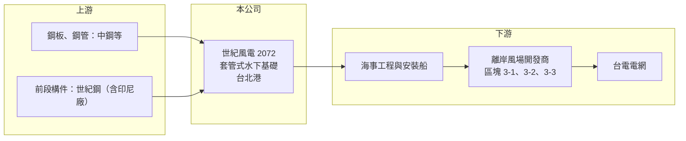

# 2072 世紀風電

> 上市｜[[產業索引-綠能環保|綠能環保]]｜上市（櫃）日期 2026/03/26

# 第一章：企業模式與商業藍圖

> [!info] 撰寫說明
> 精簡版，由 Claude 依公開資料整理，架構比照 [[2330台積電]]，資料截至 2026-10-08。來源：Goodinfo 經營績效年表（2017 至 2025 年）；優分析 2026 年 3 月上市前報導（營收結構、風場、世紀鋼分工）；證交所開放資料快照（基本資料、2026 年第二季資產負債與上半年損益、股利）。各風場開發商與合約金額未查得。#待校對

世紀風電（以下簡稱世紀風電）成立於 2017 年 5 月，原名「世紀離岸風電設備」，後更名為世紀能源設備，2026 年 3 月 26 日在證交所上市，總部與工廠在新北市八里的台北港，董事長為賴文祥，總經理為余俊緯。它是 [[9958世紀鋼]] 集團旗下專做離岸風電[[水下基礎]]的公司，也是台灣離岸風電「國產化」政策下成長最快的本土供應商之一。

- **核心業務：** 世紀風電在台北港基地製造離岸風機的水下基礎，主力是[[套管式基礎]]（Jacket），負責中段與大型結構件的製作與組裝。水下基礎是把風機固定在海床上的鋼結構，每座重達上千噸，焊接品質直接影響風機二十年以上的安全，因此需要大型廠房、碼頭與嚴格的國際認證。
- **營收結構：** 依上市前資料，2024 年營收中套管式水下基礎占 98%，水下基樁 1%，其他 1%，幾乎是單一產品公司。營收認列跟著風場施工進度，從 2020 年 17.9 億元成長到 2025 年 103 億元。
- **營運據點與集團分工：** 主要產能在台北港；母公司世紀鋼負責較前段的構件，並規劃以印尼巴淡島工廠供應台灣，未來可能延伸到澳洲、紐西蘭等亞太市場。集團內的分工讓世紀風電專注在高附加價值的大型結構與總組。
- **長期方向：** 台灣[[區塊開發]]第三階段的 3-1（2.64 GW）與 3-2（2.7 GW）預計在 2026 至 2029 年進入施工高峰，3-3 區塊約 3.6 GW、需要 300 座以上基礎，預計 2030 至 2031 年併網。公司另有切入[[浮動式風電]]平台與電力相關商機的規劃（待校對）。在台灣離岸風電至 2035 年以前持續建置的前提下，世紀風電有多年的訂單能見度。

# 第二章：護城河深度與競爭優勢

世紀風電的護城河來自國產化政策、台北港的碼頭與廠房，以及已完成多個風場交貨的實績；但客戶與市場高度集中在台灣離岸風電。

- **競爭優勢：** 水下基礎體積大、運輸困難，最好在靠近風場的港口生產，台北港基地讓世紀風電具備地利。國際開發商對焊接品質與交期要求嚴格，完成過渢妙等多個風場交貨的實績，是新進者很難短時間複製的資格。2025 年毛利率 28.4%、營業利益率 22.6%，在重工業中屬於很高的水準，顯示產能稀缺時的議價能力。
- **主要對手：** 台灣本土的水下基礎供應商包括 [[2208台船]]（及其轉投資）、[[2013中鋼構]] 等；國際上則有荷蘭 Sif、比利時 Smulders、韓國與中國的鋼構廠。國產化要求降低了外國廠的威脅，但若政策放寬，價格競爭會加劇。
- **觀察重點：** 3-2 與 3-3 區塊的得標與排程、印尼廠的成本優勢能否讓集團搶到台灣以外的訂單，以及浮動式風電等新產品能否接續固定式基礎的需求。

# 第三章：財務體質與盈利規模

資料日期：2026-10-08，表格是撰寫當時的快照；最新月營收、毛利率、累計 EPS 由自動排程寫在本筆記的屬性欄位（月營收、毛利率、累計EPS 等）。#待校對

世紀風電的財務反映典型的「專案型」產業：建廠期虧損、2022 年曾因專案問題大虧，2023 年起隨風場施工放量而轉為高獲利。

| 年度 | 營收（億元） | [[毛利率]] | [[營業利益率]] | EPS（元） | [[ROE]] |
|---|---|---|---|---|---|
| 2020 | 17.9 | 32.4% | 27.3% | 4.32 | 12.8% |
| 2021 | 48.1 | 24.0% | 20.1% | 8.04 | 20.5% |
| 2022 | 28.9 | -17.0% | -23.6% | -5.41 | -12.4% |
| 2023 | 82.1 | 17.3% | 14.1% | 6.67 | 11.9% |
| 2024 | 96.6 | 21.8% | 19.3% | 10.62 | 11.0% |
| 2025 | 103 | 28.4% | 22.6% | 11.94 | 10.6% |
| 2026 上半年 | 88.46 | 25.23% | 23.06% | 9.30 | 未查得 |

註：2020 至 2025 年取自 Goodinfo，2026 年上半年取自證交所開放資料。2019 年以前為建廠期，營收極少且虧損。

- **長期指標：** 2021 至 2025 年營收年複合成長率約 21%（推算），同期平均 ROE 約 8.3%（推算），受 2022 年虧損拉低。2025 年度擬配現金股利 8 元，配息率約 67%（推算）；2026 年上半年再擬配 6 元，改為半年配息。
- **[[ROIC]] 與 [[WACC]]：** 2025 年營業利益約 23.3 億元（103 億 × 22.6%），稅後約 18.6 億元。2026 年第二季權益 241.5 億元（其中資本公積 188 億元，反映股份轉換與上市募資），總負債 101 億元中有息負債未查得，假設約 40 億元，投入資本約 282 億元，ROIC 約 6.6%（推算）；以 2026 年上半年營業利益 20.4 億元年化計算約 11.6%（推算）。WACC 以無風險利率 1.75%、市場風險溢酬 6%、β 1.1（重工與綠能設備常見值）、稅前負債成本 2.5%、稅率 20%、權益比重約 86% 計算約 7.5%（推算）。以 2025 年資本計算 ROIC 低於 WACC，主要是權益大幅增加後尚未完全轉為營收；以 2026 年施工高峰的獲利計算則高於 WACC，代表在訂單滿載期能創造價值。
- **財務特色：** 2026 年第二季資產 342.6 億元、負債比率約 30%，每股淨值 125.77 元。專案型產業的營收與現金流跟著施工里程碑波動，預收款與合約資產變化大，單看單季數字容易誤判。

# 第四章：總體風險與地緣政治

世紀風電的風險集中在台灣離岸風電政策、專案執行與單一產品依賴。

- **產業週期：** 離岸風電屬於政策驅動的長週期產業，一個區塊從遴選、融資到施工要好幾年，政策延宕或開發商財務問題都會讓訂單延後。2022 年營收從 48 億元掉到 29 億元並大幅虧損，說明專案時程與成本控管出問題時，衝擊非常大。
- **營運風險：** 營收九成以上來自套管式水下基礎，客戶是少數國際開發商，任何一個風場延期都會影響整年營收。大型焊接專案的工安、品質與鋼材價格風險，也可能吞噬固定價合約的利潤。
- **其他風險：** 國產化政策若放寬，國際與中國鋼構廠的低價競爭會加劇；開發商的融資成本受利率影響；鋼材價格波動；印尼廠的海外營運與匯率風險。

# 專有名詞解析

## 金融

- **[[ROIC]]**：投入資本報酬率，稅後營業利益除以股東權益加有息負債，衡量本業運用資本的效率。
- **[[WACC]]**：加權平均資金成本，股東與債權人要求報酬率的加權平均，是 ROIC 要超越的門檻。

## 產業

- **[[水下基礎]]**：把離岸風機固定在海床上的鋼結構，常見形式有單樁與套管式，是離岸風場最重的單一構件之一。
- **[[套管式基礎]]**：由鋼管焊成格狀塔架、以樁腳固定在海床的水下基礎，英文為 Jacket，適合台灣海峽較深與地質複雜的海域。
- **[[區塊開發]]**：台灣離岸風電第三階段的遴選制度，政府分批釋出容量並要求國產化，3-1、3-2、3-3 為不同批次。
- **[[浮動式風電]]**：把風機裝在浮動平台上並以纜繩錨定海床，可用於水深超過 50 至 60 公尺、無法打樁的海域。

# 核心供應鏈

- 上游：鋼板供應商如 [[2002中鋼]]（實際供貨比重未查得）；集團母公司 [[9958世紀鋼]] 供應前段構件。
- 下游／客戶：國際離岸風場開發商，風場包括渢妙、海盛、海廣、蔚藍海、又德等（各風場開發商名稱未查得）。
- 同業：[[2208台船]]、[[2013中鋼構]]、[[9958世紀鋼]]。

## 最新新聞
<!-- news:start（自動產生，請勿手動編輯此範圍） -->
- 2026-10-06 🏛️ 重訊 07:00｜公告本公司名稱由「世紀離岸風電設備股份有限公司」更名 為「世紀能源設備股份有限公司」，公告期間：115年8月26日至 115年11月25日。｜[觀測站](https://mops.twse.com.tw/mops/#/web/t05st01)

完整紀錄：[[2072世紀風電 新聞]]
<!-- news:end -->

## 相關連結
- [公開資訊觀測站](https://mopsov.twse.com.tw/mops/web/t05st03?step=1&firstin=1&co_id=2072)
- [Goodinfo](https://goodinfo.tw/tw/StockDetail.asp?STOCK_ID=2072)
- [Yahoo 股市](https://tw.stock.yahoo.com/quote/2072)
- [鉅亨網新聞](https://www.cnyes.com/twstock/2072/news)
