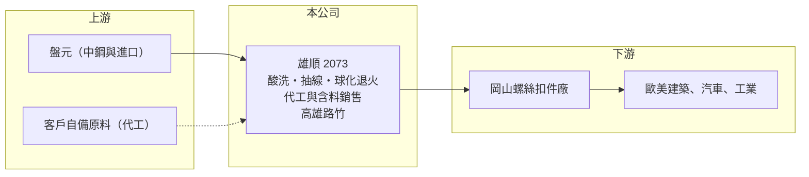

# 2073 雄順

> 上櫃｜[[產業索引-鋼鐵工業|鋼鐵工業]]｜上市（櫃）日期 2023/06/21

# 第一章：企業模式與商業藍圖

> [!info] 撰寫說明
> 精簡版，由 Claude 依公開資料整理，架構比照 [[2330台積電]]，資料截至 2026-10-08。來源：Goodinfo 台灣股市資訊網經營績效年表（2018 至 2025 年）；nStock 公司資料；櫃買中心開放資料快照（基本資料、2026 年上半年資產負債與損益、2026 年 8 月營收與營收變動說明、本益比淨值比）。產品別營收、產能與客戶未查得，公開資料有限。#待校對

雄順金屬成立於 2010 年 4 月，2023 年 6 月由興櫃轉上櫃，工廠位於高雄路竹，董事長陳恆毅、總經理郭穎謙。雄順位在螺絲扣件產業鏈的上游加工環節，把鋼鐵[[線材]]加工成適合冷鍛的材料，2026 年起正從「代工收加工費」轉向「自行購料、含料銷售」，營運模式正在改變。

- **核心業務：** 雄順的主要營業項目是金屬線材的加工、製造與買賣（nStock 整理公司登記資料）。線材加工通常包含酸洗、抽線與[[球化退火]]，讓[[盤元]]變成尺寸精準、硬度適中的線材，供螺絲廠打頭成形（製程細節為一般產業描述，待校對）。
- **營收結構：** 產品別營收比重未查得。過去雄順以接受客戶供料、只收加工費的代工模式為主，因此營收規模小，2018 至 2025 年年營收約 4.3 至 6.5 億元（Goodinfo）。櫃買中心 2026 年 8 月營收說明指出，公司自 2026 年第二季起增加購料含料自製生產銷售，1 至 8 月營收年增約 80%。
- **營運據點：** 工廠位於高雄路竹（櫃買基本資料），鄰近岡山螺絲扣件聚落，可以就近服務螺絲廠。
- **長期方向：** 從[[代工模式]]轉為含料銷售，營收會隨原料金額大幅放大，但毛利率會因分母變大而下降，公司也開始承擔原料價格波動與庫存風險。這個轉變能否帶來更高的獲利金額與 ROE，是未來幾年最重要的觀察點。

# 第二章：護城河深度與競爭優勢

雄順的護城河很窄，競爭力主要來自地緣、加工品質與服務彈性。

- **競爭優勢：** 線材加工品質直接影響螺絲成形的良率與模具壽命，螺絲廠換加工廠需要重新試打，因此穩定的加工廠有一定的客戶黏著度。雄順位於岡山聚落旁，運輸距離短、交期彈性高。
- **主要對手：** 同業包括中部的 [[2064晉椿]]、扣件大廠 [[2012春雨]] 自有的線材加工部門，以及岡山、路竹一帶眾多未上市的抽線與熱處理廠；上游 [[2002中鋼]] 也提供部分可直接使用的線材產品。
- **觀察重點：** 毛利率由 2021 年的 30.4% 一路降到 2025 年的 9.8%，2026 年上半年約 6.3%（Goodinfo、櫃買資料推算）。後者有一部分是含料銷售使營收放大造成的稀釋效果，因此未來比較時應該看毛利金額與營業利益，而不是只看毛利率。

# 第三章：財務體質與盈利規模

資料日期：2026-10-08，表格是撰寫當時的快照；最新月營收、毛利率、累計 EPS 由自動排程寫在本筆記的屬性欄位（月營收、毛利率、累計EPS 等）。#待校對

雄順在 2020 至 2022 年扣件景氣熱絡時 ROE 超過一成，2023 年起隨扣件去庫存明顯下滑，2025 年轉為小幅虧損。

| 年度 | 營收（億元） | [[毛利率]] | [[營業利益率]] | EPS（元） | [[ROE]] |
|---|---|---|---|---|---|
| 2021 | 6.42 | 30.4% | 18.1% | 3.67 | 22.7% |
| 2022 | 6.03 | 23.0% | 11.0% | 1.96 | 11.6% |
| 2023 | 5.17 | 16.2% | 3.52% | 0.49 | 3.02% |
| 2024 | 5.92 | 16.3% | 4.38% | 0.63 | 3.87% |
| 2025 | 5.58 | 9.79% | -2.10% | -0.39 | -2.49% |

- **長期指標：** 2021 至 2025 年平均 ROE 約 7.7%（推算），營收 2020 至 2025 年複合成長率約 4%（推算，2020 年 4.51 億元）。2025 年雖虧損，仍配發每股 0.3 元現金股利（nStock、櫃買資料），應是動用保留盈餘。
- **[[ROIC]] 與 [[WACC]]：** 2025 年營業利益約 -0.12 億元（營收 5.58 億元 × -2.10%），稅後約 -0.09 億元。投入資本以 2026 年第二季權益總計 3.9 億元，加上有息負債推估約 2.1 億元（負債總計 4.2 億元的一半，官方快照未拆分）計算，2025 年 ROIC 約 -1.5%（推算）；2021 年營業利益約 1.2 億元，以相近資本估算 ROIC 約 15%（推算）。WACC 約 6.0%（推算：無風險利率 1.75%、市場風險溢酬 6%、β 取鋼鐵同業常見值 0.9，股東權益成本 7.15%；稅前負債成本 2.5%、稅率 20%，以市值約 7 億元與有息負債約 2.1 億元計算權重約 77：23）。代工模式在景氣好時資本需求小、ROIC 高；轉為含料銷售後，存貨與應收帳款會占用更多資本，未來 ROIC 能否維持在 WACC 之上需要重新檢驗。
- **財務特色：** 2026 年第二季總資產 8.2 億元、負債 4.2 億元，負債比率約 52%，每股淨值 14.32 元，實收資本額 2.75 億元。2026 年上半年營收 3.8 億元、營業利益率約 -2.3%、EPS -0.37 元（櫃買資料推算）。

# 第四章：總體風險與地緣政治

雄順的風險在於營運模式轉換、扣件景氣循環，以及含料銷售帶來的原料價格曝險。

- **產業週期：** 線材加工需求跟著下游螺絲廠的訂單走，而螺絲需求又受歐美建築與汽車景氣影響，經銷商去庫存時會透過[[長鞭效應]]放大到上游加工廠。2023 年後的營收與毛利率下滑正是這個循環的結果。
- **營運風險：** 轉為購料含料銷售後，公司要自行承擔鋼材價格變動，鋼價下跌時可能需要提列[[存貨跌價損失]]；同時營運資金需求增加，可能提高借款。小公司的規模與議價力有限，原料採購成本不一定比大型同業低。
- **其他風險：** 下游客戶多以外銷為主，間接受匯率、美國關稅與歐盟[[反傾銷]]措施影響；酸洗、熱處理涉及環保與能源成本，電價與碳費上升會增加加工成本。

# 專有名詞解析

## 金融

- **[[長鞭效應]]**：終端需求的小幅變動，沿供應鏈往上游傳遞時被逐級放大，造成上游庫存與訂單劇烈波動。
- **[[存貨跌價損失]]**：存貨的市價低於帳面成本時，依會計規定須認列的損失，會直接壓低毛利率。
- **[[ROIC]]**：投入資本報酬率，稅後營業利益除以股東權益加有息負債，衡量本業運用資本的效率。
- **[[WACC]]**：加權平均資金成本，股東與債權人要求報酬率的加權平均，是 ROIC 要超越的門檻。

## 產業

- **[[線材]]**：鋼胚熱軋成捲狀的細長條鋼，是拉線、螺絲、彈簧與焊材的原料。
- **[[盤元]]**：熱軋後捲成盤狀的圓形條鋼，是抽製鋼線、螺絲與彈簧的原料。
- **[[球化退火]]**：把鋼材長時間加熱再緩慢冷卻，使內部碳化物變成球狀，讓鋼材變軟、便於冷鍛成形的熱處理。
- **[[代工模式]]**：由客戶提供原料、加工廠只收取加工費的經營方式，營收規模小但不承擔原料價格風險。

# 核心供應鏈

- 上游：盤元主要由 [[2002中鋼]] 等鋼廠供應，代工模式下由客戶自備原料（雄順實際採購來源未查得）。
- 下游／客戶：岡山、路竹一帶的螺絲扣件廠（具名客戶未查得），同產業鏈的上市櫃螺絲廠如 [[2063世鎧]]、[[2065世豐]]、[[5007三星]]。
- 同業：[[2064晉椿]]、[[2012春雨]]（自有線材加工）；岡山、路竹未上市抽線與熱處理廠。

## 最新新聞
<!-- news:start -->
<!-- news:end -->

## 相關連結
- [公開資訊觀測站](https://mopsov.twse.com.tw/mops/web/t05st03?step=1&firstin=1&co_id=2073)
- [Goodinfo](https://goodinfo.tw/tw/StockDetail.asp?STOCK_ID=2073)
- [Yahoo 股市](https://tw.stock.yahoo.com/quote/2073)
- [鉅亨網新聞](https://www.cnyes.com/twstock/2073/news)
