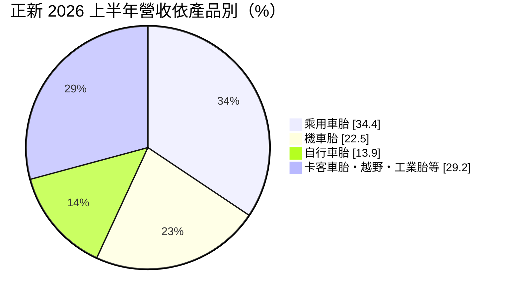
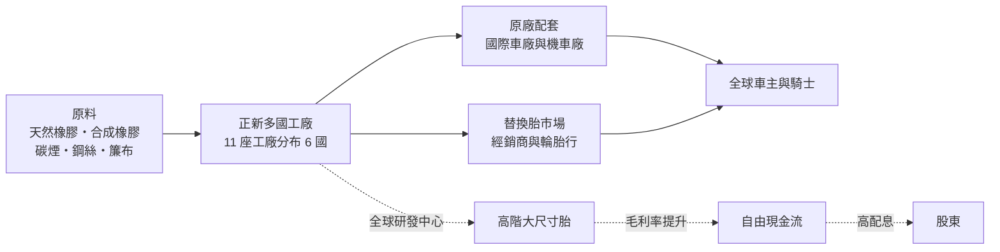
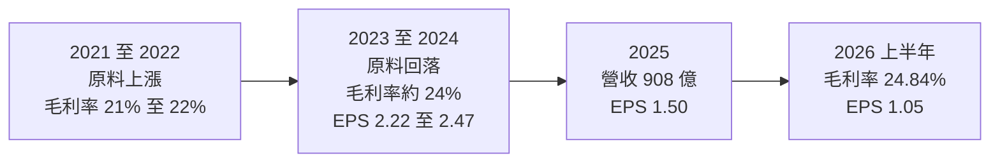
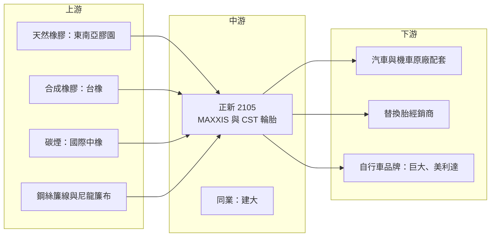

# 2105 正新

> 上市｜[[產業索引-橡膠工業|橡膠工業]]｜上市（櫃）日期 1987/12/07

# 第一章：企業模式與商業藍圖

> [!info] 撰寫說明
> 本文由 Claude 依公開資料整理，架構比照 [[2330台積電]] 的四章研究，資料截至 2026-10-08。財務數字來源：Goodinfo 經營績效、現金流量、股利政策頁（年度合併報表）、證交所開放資料（基本資料、2026 年第二季綜合損益與資產負債、股利）、富果研究與 Poorstock 的正新法說會摘要、nStock 公司簡介；產業描述為整理性內容，尚未逐條比對原始文件。#待校對

在評估單一個股的長期投資價值時，首要步驟是拆解企業的底層獲利邏輯。本章針對正新橡膠工業（股票代號：2105，以下簡稱正新）的商業模式進行定性分析，說明台灣最大的輪胎廠如何以自有品牌 MAXXIS（瑪吉斯）在全球市場競爭，以及它為什麼在中國品牌低價擴張的環境下，選擇把重心從「量」轉向「質」。

## 一、核心定位：自有品牌的全品項輪胎製造商

正新 1969 年在彰化成立，1987 年上市，是台灣規模最大的輪胎公司。產品涵蓋乘用車胎、機車胎、自行車胎、卡客車胎、越野車與工業用胎，以自有品牌 MAXXIS 與 CST 在全球銷售。和代工廠不同，正新同時經營品牌、通路與製造，既賣給車廠做[[原廠配套]]，也透過經銷商賣到[[替換胎市場]]，因此它的競爭力同時來自工廠效率與品牌力。

正新的定位有兩個長期特色。第一，它是兩輪胎的全球領導者之一。機車胎與自行車胎是正新起家的業務，在登山車、公路車與機車原廠配套中有很高的能見度，這個市場規格分散、需要大量模具與配方經驗，國際四輪大廠投入相對少。第二，它的中國市場比重很高。正新在 1990 年代就到中國設廠，依法說會資料，2026 年上半年中國大陸營收占比約 48%，中國是最大的市場，也是最大的風險來源。

## 二、終端應用與產品板塊：乘用車胎為主、兩輪胎穩定

依法說會資料，2026 年上半年營收依產品別如下（其餘為卡客車胎、越野與工業用胎等，公司未逐項揭露）：

- **乘用車胎（[[PCR]]）：** 營收最大的品項，但比重逐年下降。正新刻意避開中國品牌主導的一般尺寸價格戰，把資源集中在 17 吋以上的大尺寸胎與高性能胎，法說會資料顯示大尺寸胎占 PCR 銷售比重已超過四成。這個策略犧牲了部分銷量，換取較高的單價與毛利率。
- **機車胎：** 成長主要來自印度與印尼，這兩國是全球最大的機車市場之一。印度廠以原廠配套為主，供應當地日系機車品牌體系，原廠配套比重高，訂單穩定。
- **自行車胎：** 自行車產業在疫情期間需求暴增，2023 至 2024 年經歷大規模庫存調整，之後逐步回溫。正新在高階登山車與公路車胎的品牌地位，讓它在自行車景氣回升時受惠。
- **其他：** 卡客車胎（[[TBR]]）、越野車胎、卡丁車胎與工業用胎。卡客車胎過去曾拖累獲利，近年營運逐步穩定。

## 三、資本轉化邏輯：品牌、通路與多國工廠

- **全球據點：** 依公司資料，正新在 6 個國家擁有 11 座工廠與 5 個研發中心，涵蓋台灣、中國、越南、泰國、印尼與印度等地（國家明細依公開報導整理，待校對）。多國生產讓正新能就近供應當地車廠，並在美國反傾銷稅或關稅變動時，調整出口來源。
- **原廠配套帶動品牌：** 打進車廠原廠配套，除了訂單本身，也能提升品牌在替換胎市場的可信度。依公司資料，正新多年獲 GM 年度最佳供應商，也取得北美 Honda 品質獎項，近年打入歐洲豪華車廠配套，這些認證是品牌往高階移動的基礎。
- **原料成本傳導：** 依法說會資料，天然橡膠與合成橡膠合計占原料成本超過五成。原料下跌時毛利率擴張，上漲時則需要漲價轉嫁；替換胎市場通常有數月的落後期，所以正新的毛利率常常與橡膠價格呈反向變動。

## 四、企業長期藍圖：高階化與新興市場

- **產品高階化：** 持續提高大尺寸胎、高性能胎與電動車專用胎的比重。旗下 MAXXIS 高性能夏季胎取得歐洲 TÜV SÜD 認證，有助於在歐洲高階替換胎市場建立品牌形象。高階化是正新對抗中國低價品牌最主要的策略。
- **加碼印度與印尼：** 兩國機車市場規模大、汽車普及率仍在上升，正新以當地工廠搶原廠配套與替換需求，是未來十年機車胎與乘用車胎成長的主要動能。
- **品牌行銷：** 透過賽車、卡丁車與自行車賽事贊助經營 MAXXIS 品牌，建立在專業騎士與車迷心中的形象，這是代工廠無法取得的長期資產。

# 第二章：護城河深度與競爭優勢

在長期價值投資中，「護城河」指企業抵禦競爭、維持超額利潤的保護機制。本章分析正新的護城河構成、全球主要輪胎競爭對手，以及在中國品牌大量擴產的環境下，這些優勢能守住多少。

## 一、護城河的核心組成要素

輪胎是資本密集、但技術相對成熟的產業。正新的護城河屬於「窄護城河」，由三個要素組成：

- **兩輪胎的品牌與規格經驗：** 機車胎與自行車胎款式多、規格分散，每一種尺寸與花紋都需要模具與配方開發。正新在這兩個領域經營數十年，累積了大量規格與原廠配套關係，新進者即使有資本，也很難在短時間內建立同樣廣度的產品線。
- **車廠原廠配套認證：** 車廠對輪胎的認證流程長，涵蓋耐久、噪音、濕地抓地與滾動阻力等測試，一旦成為配套供應商，通常會跟著車型週期供貨數年。這種關係讓正新的部分訂單具有穩定性，也為替換胎市場提供品牌背書。
- **全球產能與財務體質：** 多國工廠分散了關稅與地緣政治風險，加上公司長年維持大量現金與偏低負債，依證交所資料，2026 年第二季總資產約 1,485 億元、負債約 608 億元，負債占總資產約 41%。這讓正新有能力在景氣低迷時持續投資、維持配息，等待競爭對手退出。

## 二、全球主要競爭對手格局

| 對手 | 定位 | 對正新的威脅 |
|---|---|---|
| 普利司通、米其林、固特異 | 全球前三大輪胎集團，高階品牌 | 掌握高階原廠配套與品牌溢價 |
| 韓泰、錦湖、住友、橫濱 | 日韓中高階輪胎 | 在中階乘用車胎直接競爭 |
| 玲瓏、賽輪等中國品牌 | 大量擴產、低價搶市，並到東南亞設廠 | 壓低中低階乘用車胎價格 |
| [[2106建大]] | 台灣自行車與機車胎同業 | 在兩輪胎與越野胎直接競爭 |

## 三、優勢轉化：哪些守得住、哪些守不住

- **守得住：** 機車胎、自行車胎與高階大尺寸乘用車胎。這些市場看重規格齊全、品牌與配套關係，正新的經驗能有效轉成定價力。
- **守不住：** 中低階乘用車胎。2020 至 2025 年營收由 962 億元降到 908 億元，乘用車胎比重也持續下降，反映中國品牌在一般尺寸乘用車胎的價格壓力。正新的選擇是放棄部分銷量，換取毛利率，這是理性的防守，但也意味著營收規模難以成長。
- **觀察重點：** 毛利率能否長期維持在 24% 至 25% 的水準；印度、印尼機車胎與乘用車胎能否成為新的成長來源；中國市場的價格競爭是否進一步惡化；以及電動車專用胎能否打進更多原廠配套。

# 第三章：財務體質與盈利規模

資料日期：2026-10-08。年度數字取自 Goodinfo 經營績效、現金流量與股利政策頁，2026 年上半年數字依證交所開放資料計算；表格是撰寫當時的快照，最新月營收、毛利率、累計 EPS 由自動排程寫在本筆記的屬性欄位（月營收、毛利率、累計EPS 等）。#待校對

財務報表是檢驗護城河是否真實存在的最終標準。本章用多年度的三率、ROE、現金流與資本報酬，檢視正新在產品高階化策略下的獲利品質。

## 一、獲利能力的基石：三率

| 年度 | 營收（億元） | [[毛利率]] | [[營業利益率]] | EPS（元） | [[ROE]] |
|---|---|---|---|---|---|
| 2020 | 962 | 24.9% | 8.94% | 1.85 | 7.55% |
| 2021 | 1,015 | 22.0% | 7.54% | 1.63 | 6.52% |
| 2022 | 986 | 21.3% | 7.48% | 1.53 | 6.02% |
| 2023 | 962 | 24.3% | 10.8% | 2.22 | 8.45% |
| 2024 | 962 | 24.2% | 10.4% | 2.47 | 9.10% |
| 2025 | 908 | 22.7% | 7.88% | 1.50 | 5.44% |
| 2026 上半年 | 486.2 | 24.84% | 9.96% | 1.05 | 未查得 |

- **毛利率跟著橡膠價格擺動：** 2021 至 2022 年原料與運費上漲，毛利率降到 21% 至 22%；2023 至 2024 年原料回落，毛利率回到 24% 以上。這說明正新的毛利率高度受原料成本影響，高階化策略的效果需要在原料價格相近的年份比較才看得出來。
- **營收長期停滯：** 2020 至 2025 年營收年複合成長率約 -1.2%（推算），正新已經不是一家營收成長型公司，長期價值主要取決於每一元營收能賺多少，而不是營收規模。
- **營業利益率是關鍵指標：** 營業利益率在 7.5% 至 10.8% 之間擺動，2026 年上半年回到約 10%。若能長期維持在 10% 上下，代表高階化與成本控制有效；若跌回 7% 至 8%，則表示中國品牌的價格壓力仍在侵蝕獲利。

## 二、[[ROE]]：資本效率

2021 至 2025 年正新的五年平均 ROE 約 7.1%（推算），在輪胎業中屬於中等偏低。ROE 不高的原因有二：一是輪胎業本身資本密集，需要大量工廠與設備；二是公司保留大量現金，帳上權益規模大（2026 年第二季權益總計約 877 億元、每股淨值約 26.9 元），現金的報酬率拉低了整體 ROE。換句話說，正新是一家穩健但資本效率不高的公司。

## 三、資本支出與自由現金流

- **[[自由現金流]]長期為正：** 依 Goodinfo（以營業現金流加投資現金流計算），2020 至 2025 年自由現金流分別為 120、89、77.4、107、84 與 27.7 億元，六年都是正值。另依富果研究整理的法說會資料，以營業現金流減資本支出計算，2025 年自由現金流約 106 億元，兩者差異來自投資活動中非資本支出的項目（如金融資產）。
- **[[CapEx]]：** 正新在 2010 年代大舉擴產，近年資本支出收斂，主要投入產線升級、自動化與印度、印尼等新興市場。折舊大於資本支出，使營業現金流長期高於帳上獲利。
- **股利：** 依 Goodinfo 股利政策頁，2019 至 2025 年度現金股利分別為 1.0、1.2、1.2、1.4、2.0、2.4 與 1.8 元。以 EPS 計算，2023 年度[[配息率]]約 90%、2024 年度約 97%、2025 年度約 120%（推算），近年配息率接近或超過 100%，是以累積現金支應。高配息反映公司缺乏高報酬的投資機會，選擇把現金還給股東。

## 四、[[ROIC]] 與 [[WACC]]：價值創造利差

- **ROIC：** 以 2025 年營收 908 億元、營業利益率 7.88% 計算，營業利益約 71.6 億元，扣除 20% 稅率後約 57.2 億元。投入資本以 2026 年第二季權益總計約 877 億元加上有息負債估算；有息負債未查得，假設約 350 億元（總負債約 608 億元），投入資本約 1,227 億元，ROIC 約 4.7%（推算）。若以 2026 年上半年營業利益約 48.4 億元年化計算，ROIC 約 6.3%（推算）。若扣除帳上超額現金，實際營運資本的報酬率會更高。
- **WACC：** 以 [[CAPM]] 推估，無風險利率 1.75%、市場風險溢酬 6%、β 假設 0.7（傳產汽車零組件股常見值，未查得來源數字），權益成本約 5.95%。稅前負債成本假設 2%、稅後約 1.6%，資本結構假設權益七成、負債三成，WACC 約 4.7%（推算）。
- **解讀：** 正新的 ROIC 約 4.7% 至 6.3%，與約 4.7% 的 WACC 相當或略高，代表公司大致賺回資金成本，但創造的超額價值有限。輪胎業在中國產能擴張下，全球報酬率普遍偏低，正新要擴大利差，關鍵在於維持 10% 上下的營業利益率，以及善用龐大現金，例如提高配息或投資報酬更高的新興市場產能。

# 第四章：總體風險與地緣政治

任何企業都無法脫離宏觀環境獨立存在。本章分析正新未來必須面對的地緣政治、產業週期與營運風險。

## 一、地緣政治

- **中國市場集中：** 中國大陸營收占比接近一半，中國汽車市場的價格戰、本土輪胎品牌崛起與兩岸關係，都會直接影響正新的獲利。這是正新最主要、也最難分散的長期風險。
- **美國關稅與反傾銷：** 美國多次對中國、越南、泰國等地出口的輪胎課徵反傾銷與反補貼稅，亞洲輸美輪胎經常是調查對象。正新的多國產能讓它能調整出口來源，但稅率變動仍會影響輸美產品的競爭力。
- **新興市場政策：** 印度與印尼是成長重心，當地的進口限制、匯率與產業政策變化，會影響投資報酬與資金匯回。

## 二、產業週期與市場結構

- **原料價格：** 天然橡膠受東南亞氣候、病蟲害與產量影響，合成橡膠與碳煙受原油價格影響。原料價格大漲時，毛利率會被壓縮數個百分點。
- **中國產能過剩：** 中國輪胎廠大量擴產並到東南亞設廠，全球中低階輪胎供過於求，價格競爭可能長期存在。
- **兩輪車需求週期：** 自行車在疫情期間爆量後經歷長達兩年的庫存調整，顯示兩輪胎也有明顯的[[長鞭效應]]，需求波動會沿著品牌、組車廠一路放大到輪胎廠。

## 三、營運環境的隱性風險

- **匯率：** 營收以人民幣、美元與多國貨幣計價，匯率變動會影響營業利益與業外損益。
- **工廠營運效率：** 多國工廠的產能利用率不一，部分工廠若長期低稼動，會拖累整體毛利率。
- **經營權與策略延續：** 正新是家族企業，經營團隊的交接與策略延續性，是長期投資人需要觀察的治理議題。

## 四、科技或法規演進

- **電動車輪胎：** 電動車重量較大、扭力強，需要低滾阻、低噪音、耐磨的專用輪胎，單價也較高。能否打進電動車原廠配套，關係到正新在高階市場的地位。
- **歐盟法規：** 歐盟輪胎標籤制度、[[EUDR]]（零毀林法規）要求天然橡膠可追溯來源，以及未來可能的輪胎磨耗微粒規範，都會提高合規成本。這些法規對規模較小、管理較弱的中國中小廠衝擊更大，對管理成熟的正新反而可能是相對優勢。

# 專有名詞解析

## 應用

- **[[EV]]**：電動車，以電池與馬達取代內燃機，車重與扭力較大，需要專用的低滾阻、耐磨輪胎。

## 金融

- **[[毛利率]]**：毛利除以營收，反映產品售價扣除直接生產成本後的獲利空間。
- **[[營業利益率]]**：營業利益除以營收，反映扣除管銷研發費用後的本業獲利能力。
- **[[自由現金流]]**：營業活動現金流減去資本支出，代表企業可自由用於配息、還債或併購的現金。
- **[[配息率]]**：現金股利除以每股盈餘，代表公司把多少比例的獲利發給股東。
- **[[ROIC]]**：投入資本報酬率，稅後營業利益除以股東權益加有息負債，衡量本業運用全部資本的效率。
- **[[WACC]]**：加權平均資金成本，股東與債權人要求報酬率的加權平均，ROIC 高於它才算創造價值。
- **[[長鞭效應]]**：終端需求的小幅變動沿供應鏈往上游傳遞時被逐級放大，造成上游庫存與訂單劇烈波動。

## 產業

- **[[原廠配套]]**：輪胎廠直接供應車廠新車裝配使用的輪胎，認證流程長，常稱 OE 市場。
- **[[替換胎市場]]**：車主更換輪胎的售後市場，品牌與通路是主要競爭因素，價格對原料成本的反應有落後期。
- **[[PCR]]**：乘用車輻射層輪胎，即一般轎車與休旅車使用的輪胎。
- **[[TBR]]**：卡客車輻射層輪胎，用於卡車與巴士，單價高但競爭激烈。
- **[[天然橡膠]]**：從橡膠樹採集的乳膠加工而成，主要產自泰國、印尼、馬來西亞，是輪胎最主要的原料之一。
- **[[合成橡膠]]**：以石化原料聚合而成的橡膠，價格受原油影響，與天然橡膠搭配使用以調整輪胎性能。
- **[[反傾銷]]**：進口國認定外國產品以低於正常價格銷售時，額外課徵關稅的貿易救濟措施。
- **[[EUDR]]**：歐盟零毀林法規，要求天然橡膠等商品證明產地未涉及毀林，進口商須提供可追溯資料。

# 核心供應鏈

## 1. 上游：橡膠與原料
- 合成橡膠：[[2103台橡]]
- 碳煙：[[2104國際中橡]]
- 天然橡膠：泰國、印尼、馬來西亞等東南亞產地
- 鋼絲簾線、尼龍簾布等補強材料

## 2. 中游：正新本身與同業
- 正新：多國工廠與研發中心，自有品牌 MAXXIS、CST
- 台灣同業：[[2106建大]]
- 國際同業：普利司通、米其林、固特異、韓泰、玲瓏、賽輪

## 3. 下游：車廠與通路
- 汽車與機車原廠配套：國際車廠與日系機車品牌（具體名單以公司揭露為準）
- 自行車品牌：[[9921巨大]]、[[9914美利達]]
- 替換胎經銷商與輪胎行

## 最新新聞
<!-- news:start -->
<!-- news:end -->

## 相關連結
- [公開資訊觀測站](https://mopsov.twse.com.tw/mops/web/t05st03?step=1&firstin=1&co_id=2105)
- [Goodinfo](https://goodinfo.tw/tw/StockDetail.asp?STOCK_ID=2105)
- [Yahoo 股市](https://tw.stock.yahoo.com/quote/2105)
- [鉅亨網新聞](https://www.cnyes.com/twstock/2105/news)
